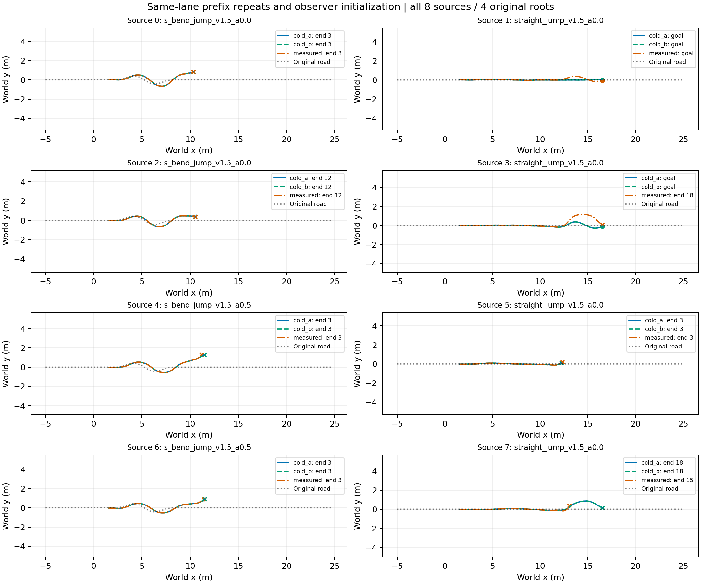

# Same-lane landing initialization comparison

|Run|Handoffs|Complete task|Wall time (s)|
|---|---:|---:|---:|
|cold_a|6/8|2/8|66.73|
|cold_b|6/8|2/8|72.19|
|measured|6/8|1/8|68.34|

|Source|Cold A/B/measured complete|A/B recorded prefix equal|A/measured recorded prefix equal|
|---|---|---|---|
|0|0/0/0|no paired handoff|no paired handoff|
|1|1/1/1|True|True|
|2|0/0/0|no paired handoff|no paired handoff|
|3|1/1/0|True|True|
|4|0/0/0|True|False|
|5|0/0/0|True|True|
|6|0/0/0|True|False|
|7|0/0/0|True|True|

Fresh-process same-lane replay diagnostic. Exact recorded prefix comparisons do not serialize hidden solver state. Historical handoff-conditioned DEV cohort;4 original roots.

All runs use identical lane layout, initial conditions, seed, frozen policies, candidate and timing protocol. Only measured initializes the observer at actual handoff. Cold A/B is the no-treatment repeat control. No new training; current handoff and goal criteria are unchanged. No outcome-selected exclusions or inferred capture labels.

A missing handoff is retained and is not counted as a matched interface experiment. Equal logged prefixes cover observed state, action, controller history, road history and handoff root/time, not all PhysX contact/solver internals. Initialization effects cannot be isolated when the prefixes differ.

Raw run: `/media/qy/6A7E3DB07E3D75C3/STTW_runs/chapter3_handoff_same_lane`. Full pairing and numeric differences: [results.json](results.json).

- Source 0: [XY, per-step reward and speed](pair_00.png)
- Source 1: [XY, per-step reward and speed](pair_01.png)
- Source 2: [XY, per-step reward and speed](pair_02.png)
- Source 3: [XY, per-step reward and speed](pair_03.png)
- Source 4: [XY, per-step reward and speed](pair_04.png)
- Source 5: [XY, per-step reward and speed](pair_05.png)
- Source 6: [XY, per-step reward and speed](pair_06.png)
- Source 7: [XY, per-step reward and speed](pair_07.png)

[Interpretation and adoption decision](ANALYSIS.md).
