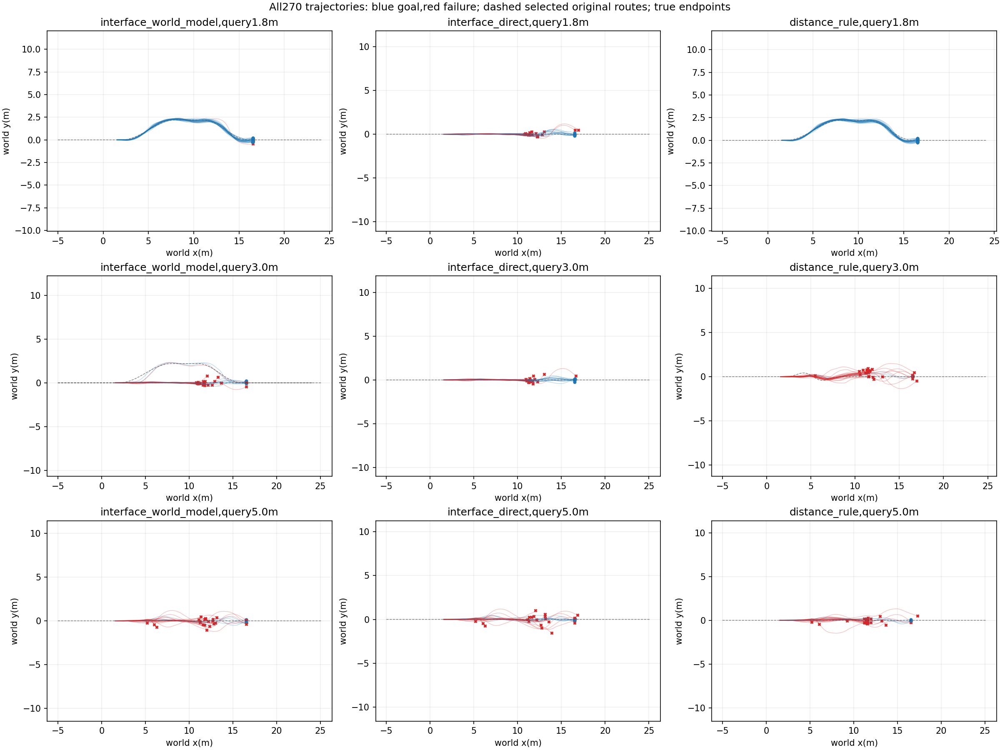
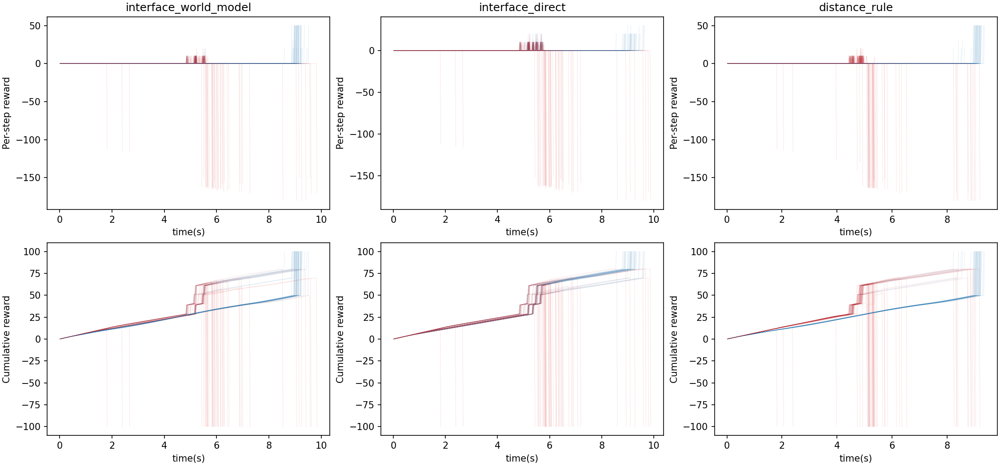

DEVELOPMENT RETEST: previously inspected roots; identical nominal time screening applied to every method.

# Two-interface online execution

Data role: FROZEN_NEW_ROOTS. 30 independent roots,10 per query position; each method evaluated3times with crossed environment slots.90episodes per method are not90independent initial conditions. Model weights,conditions and distance rule frozen before this physical batch.

|Query(m)|Method|Goal/N|Road violation|Handoffs|Mean query(ms)|
|---|---|---:|---:|---:|---:|
|None|interface_world_model|43/90|13|54|9.571|
|1.8|interface_world_model|29/30|1|0|9.707|
|3.0|interface_world_model|9/30|4|27|9.804|
|5.0|interface_world_model|5/30|8|27|9.201|
|None|interface_direct|35/90|15|87|6.505|
|1.8|interface_direct|13/30|2|30|6.441|
|3.0|interface_direct|14/30|2|30|6.724|
|5.0|interface_direct|8/30|11|27|6.349|
|None|distance_rule|36/90|23|54|5.696|
|1.8|distance_rule|30/30|0|0|5.741|
|3.0|distance_rule|2/30|18|27|5.888|
|5.0|distance_rule|4/30|5|27|5.458|

|Comparator|Mean condition difference|Root-bootstrap95% interval|Matched-slot gains/losses|Exactly equal query roots|
|---|---:|---|---:|---:|
|interface_direct|0.0889|[-0.02222222222222221, 0.1888888888888889]|21/13|90/90|
|distance_rule|0.0778|[-0.011111111111111112, 0.16666666666666663]|13/6|90/90|

Actual1056960 physical lane steps; summed simulator wall time271.18s; no policy training.

Same known map and fixed cold handoff context. This evaluates one moving query and publication recheck,not repeated feedback replanning or changed downstream widths/curvatures. Missing publications and upstream failures stay in the main denominator. Each method uses each environment slot once per condition; query-state equality is audited but does not serialize hidden solver state. If query states differ, paired outcome gains are descriptive rather than a pure causal estimator. Bootstrap units are roots,not samples or repeats.

Raw trajectories/configs and selected forecasts remain under repeat0/1/2. All per-case outcomes,pairs and route choices are in results.json. No outcomes from this batch were used to retune its frozen model; prior inspection and development status are specified above.
