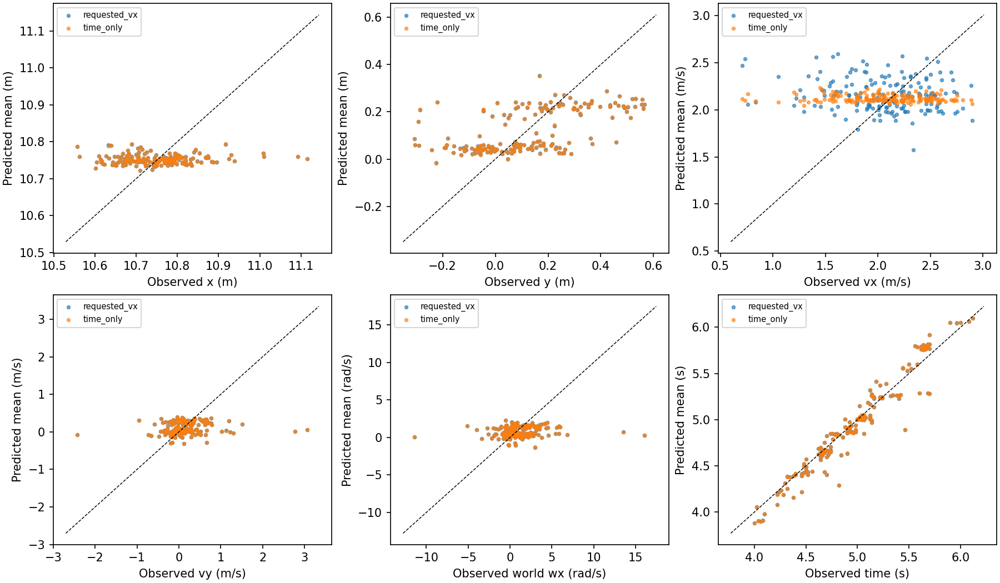
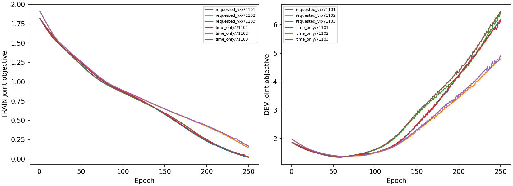

# 交接预测误差诊断与两项受控拟合

没有新增仿真或PPO；未修改论文。沿用原分组TRAIN/DEV，开发集已被多次查看。

|检查|实际结果|决定|
|---|---|---|
|请求进场速度能否作落地速度基线|TRAIN/DEV相关系数−.026/−.152；DEV请求速度RMSE .594，训练均值.445|请求值不是这批冻结跳跃技能的合适落地速度中心|
|只去掉请求vx基线，保留时间基线、PCA、动作跳连|DEV vx .511→.449m/s；时间.1279→.1283s；y .17235→.17230m；46.10s拟合|接回闭环验证，尚未采用为最终模型；vx预测标准差.0366，对照真实.4377，状态分辨仍不足|
|下游仅保留物理root/时间与Frenet，去掉25维观测帧|DEV Brier .10650→.11318；2.57s拟合|不采用，保留原完整状态模型|
|三条道路是否具有完全相同的交接输入|TRAIN78组只有1组、DEV44组只有3组39维描述完全相等|按原根/候选分组的择优计数仅为观察诊断，不能当同状态反事实收益|

修订的上游闭环合同：`STTW_runs/chapter3_time_residual_online`；保持30旧根、三方法和三槽位，三批各300秒封顶，不更改成功标准或追加调参。最终结果另行分析。第一次拟合命令误传3路线资产，在优化前报错；随后复用原checkpoint保存的60路线数组，未改变几何。错误记录保留在原输出目录。
