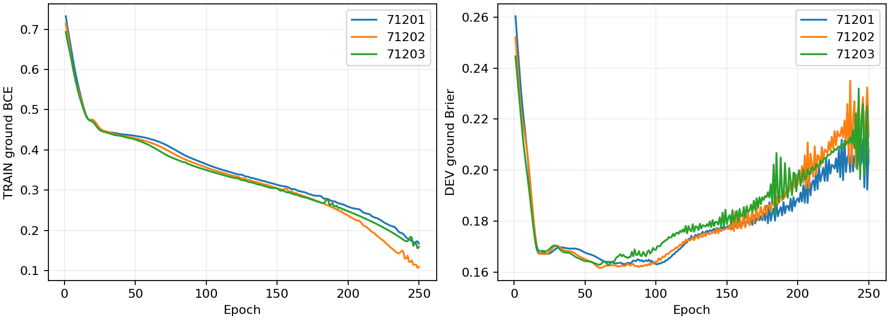

# Independent ground-head fitting

No new physical trajectories in this fitting stage. The corresponding previous physical XY source is [the full interface online panel](../chapter3_interface_online/RESULTS.md).

Only ground-only candidates train a separate582-128-64-1SiLU outcome ensemble. Upstream/downstream/direct weights remain frozen. Three seeds,250epochs,originalTRAIN/DEV groups; DEV Brier selects each member. No prior online labels enter fitting. This is a single bounded architecture/selection correction, not a sweep.

|Role|N|Goals|Shared Brier|Independent Brier|
|---|---:|---:|---:|---:|
|TRAIN|300|77|0.16437|0.13273|
|DEV|120|29|0.16439|0.15916|
|historical_source240|60|18|0.20611|0.20728|

CPU fitting/preparation/prediction 2.687s; no PPO.

DEV improves modestly but historical transfer worsens. TRAIN detour1.5/alpha0 still has0/20 goals and mean predicted0.34432 versus old0.23785. Detour1.8/alpha0 has16/20 goals and mean0.43403 versus old0.28734. Independent fitting does not resolve low-speed miscalibration. Actual selection must be checked; do not declare the shared objective the sole cause.

Raw checkpoint/curves: `/media/qy/6A7E3DB07E3D75C3/STTW_runs/chapter3_interface_ground_independent`. Existing30 online roots, if rerun, are DEVELOPMENT_RETEST rather than fresh confirmation.
