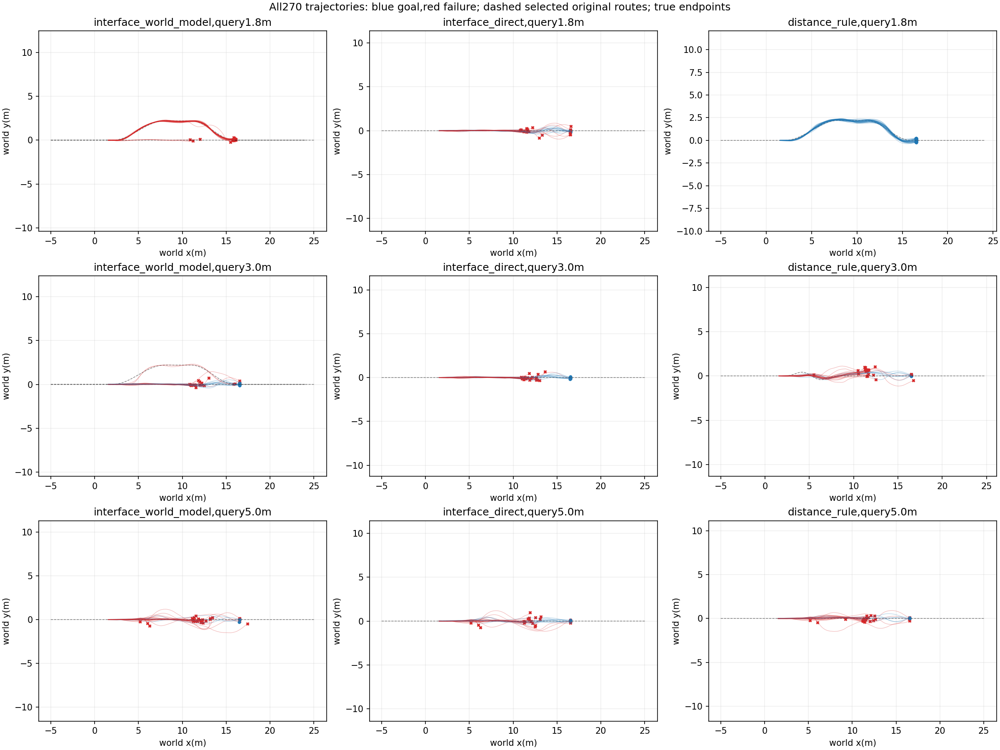
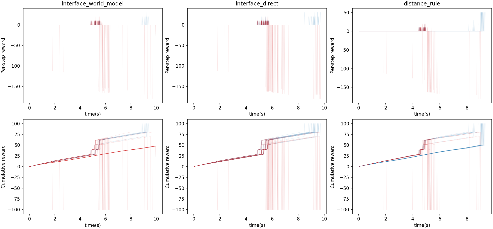

# Two-interface online execution

Data role: DEVELOPMENT_RETEST: original30 online roots already inspected. 30 independent roots,10 per query position; each method evaluated3times with crossed environment slots.90episodes per method are not90independent initial conditions. Model weights,conditions and distance rule frozen before this physical batch.

|Query(m)|Method|Goal/N|Road violation|Handoffs|Mean query(ms)|
|---|---|---:|---:|---:|---:|
|None|interface_world_model|14/90|11|58|6.735|
|1.8|interface_world_model|0/30|0|3|6.664|
|3.0|interface_world_model|10/30|3|28|6.650|
|5.0|interface_world_model|4/30|8|27|6.892|
|None|interface_direct|30/90|15|87|3.476|
|1.8|interface_direct|11/30|7|30|3.505|
|3.0|interface_direct|10/30|2|30|3.486|
|5.0|interface_direct|9/30|6|27|3.436|
|None|distance_rule|42/90|19|54|2.643|
|1.8|distance_rule|30/30|0|0|2.639|
|3.0|distance_rule|7/30|14|27|2.645|
|5.0|distance_rule|5/30|5|27|2.646|

|Comparator|Mean condition difference|Root-bootstrap95% interval|Matched-slot gains/losses|Exactly equal query roots|
|---|---:|---|---:|---:|
|interface_direct|-0.1778|[-0.27777777777777773, -0.08888888888888888]|4/20|90/90|
|distance_rule|-0.3111|[-0.4111111111111111, -0.21111111111111117]|10/38|90/90|

Actual1080000 physical lane steps; summed simulator wall time265.48s; no policy training.

Same known map and fixed cold handoff context. This evaluates one moving query and publication recheck,not repeated feedback replanning or changed downstream widths/curvatures. Missing publications and upstream failures stay in the main denominator. Each method uses each environment slot once per condition; query-state equality is audited but does not serialize hidden solver state. If query states differ, paired outcome gains are descriptive rather than a pure causal estimator. Bootstrap units are roots,not samples or repeats.

Raw trajectories/configs and selected forecasts remain under repeat0/1/2. All per-case outcomes,pairs and route choices are in results.json. No outcomes from this batch were used to retune its frozen model; prior inspection and development status are specified above.

## Bounded correction outcome

Independent ground fitting completes14/90 (early/middle/late0/10/4) versus direct30/90 and rule42/90. All29 selected detours remain1.5m/s/alpha0 and time out. Compared with the original shared-head panel, the corrected method changes4/90 decisions, gains5 and loses6 completions; all90 query roots match. Unchanged comparators also vary across batches (direct33→30,rule41→42), so15→14 alone is not an isolated causal effect of the fit. The correction does not resolve the dominant observed detour failure. No further fitting is authorized by this bounded ablation; retain the original main-panel results and treat this panel as development.

Raw model: `/media/qy/6A7E3DB07E3D75C3/STTW_runs/chapter3_interface_ground_independent`. Training evidence: [independent ground head](../chapter3_interface_ground_head/RESULTS.md). Physical/controllers/task limits are unchanged; no PPO.
