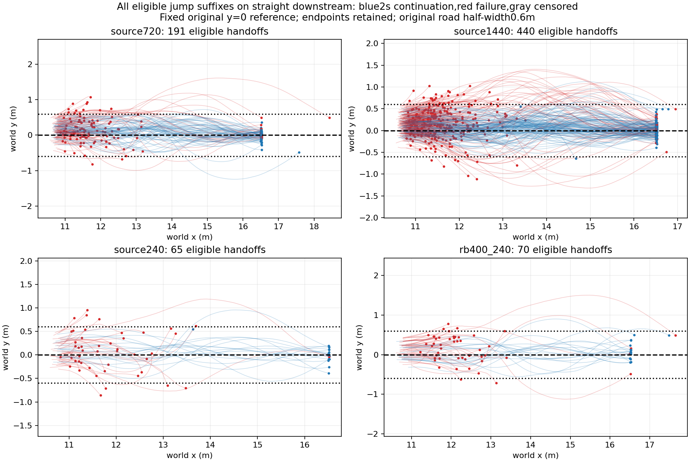

# Frozen-envelope retrospective handoff labels

No new physics or training. Declared jump-route subset only; not a replacement for full-task denominators. Nominal-envelope entry is not yet validated capture.

|Dataset|Eligible|Original goal|Envelope held|Continue2s|Fail2s|Censored|Held then fail2s|
|---|---:|---:|---:|---:|---:|---:|---:|
|source720|191|64|12|67|124|0|0|
|source1440|440|114|27|125|315|0|0|
|source240|65|16|3|18|47|0|0|
|rb400_240|70|17|2|20|50|0|0|

Full exclusions and per-source labels: labels.json. Criteria were fixed in declaration.json before label evaluation. Nominal calibration was separate from these jump outcomes, but this is retrospective analysis of previously inspected data, not independent TEST. Early goals without2s observation are censored for2s continuation while retaining original_success=true.

The nominal envelope achieved11/12 coverage on its own holdout; absence of envelope entry must not be called physically unrecoverable. Perturbation margins and rescuability need matched physical branching. Root-only snapshots are not used.
