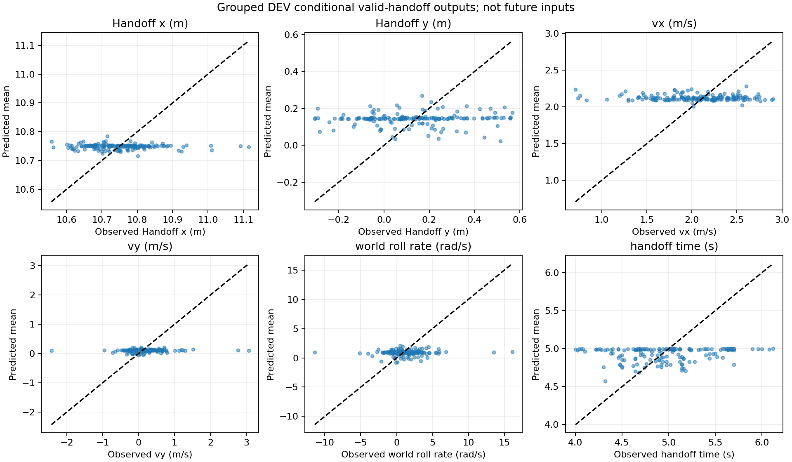
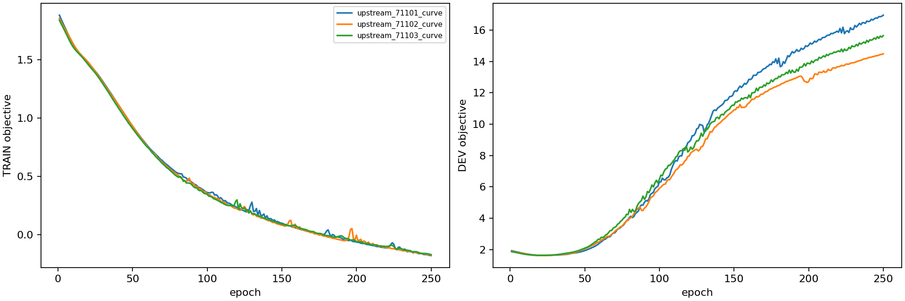

# Two-interface world-model fit

Actual/reference trajectory source: [all-route handoff labels](../chapter3_interface_labels/RESULTS.md).

|Data role|N|Goals|Interface Brier|Direct Brier|Route-prior Brier|Constant Brier|Handoff position RMSE(m)|Handoff time MAE(s)|
|---|---:|---:|---:|---:|---:|---:|---:|---:|
|pooled_TRAIN|1379|205|0.11310|0.10996|0.11772|0.12656|0.1198|0.3573|
|pooled_DEV|540|79|0.11520|0.12336|0.11673|0.12490|0.1317|0.3711|
|source1440 (mixed TRAIN/DEV;not transfer)|1199|162|0.10323|0.09921|0.11183|0.11704|0.1204|0.3305|
|source240|240|34|0.11139|0.11839|0.10998|0.12165|0.1299|0.4588|

CPU total 19.49s including data preparation,fit and prediction. Fixed source jump/H75/cold reset/map. No PPO,new physics or RB-upstream training.

Inputs582: query root13,observation80,ground controller history352,time1,candidate8,known local map128. Upstream three-member128/64SiLU MLP outputs39D Gaussian mean/log-variance,valid-handoff probability and a ground-route goal probability. Invalid or missing handoffs remain Bernoulli negatives; conditional state loss uses valid handoffs. Original720+published1199 retain all candidate failures; unpublished241 are not attributed to requested candidates.

The39D handoff output contains root13,latest measured25D frame and physical time1. The frozen downstream three-member64/32SiLU MLP predicts full-goal continuation under the declared cold reset. Jump score averages P(valid handoff) times the conditional goal prediction over32 sampled handoff states per upstream member. Ground bypass has no jump interface and uses a separate direct-goal branch. Intermediate event propagation/PCA prediction is not used. The2s continuation pilot remains separate auxiliary evidence.

Three seeds and250epochs for upstream and direct comparator; TRAIN-only normalization; grouped DEV selects upstream likelihood objective and direct Brier checkpoints. Source720 has8TRAIN/4DEV roots; source1440 has6TRAIN/2DEV roots. Across the20 declared initial roots, no exact initial-condition duplicate crosses TRAIN/DEV. All earlier data have been inspected; source240 is historical transfer,not a new independent TEST.

DEV Brier measures model selection performance. Route-prior comparison remains strong; no universal superiority is claimed. Diagonal Gaussian samples and ensemble disagreement are not certified feasible states or calibrated physical margins. Known-map/cold-reset context is frozen rather than learned over changing terrain or initialization. The compact downstream input does not serialize the PhysX solver or all controller memory.

The early-query-only predecessor is retained in the sibling upstream directory: its transfer handoff position RMSE2.32m/time MAE3.01s motivated using the already partitioned distance-training data. This is declared development,not hidden TEST tuning. No new frozen online roots were consulted before this model was frozen.
