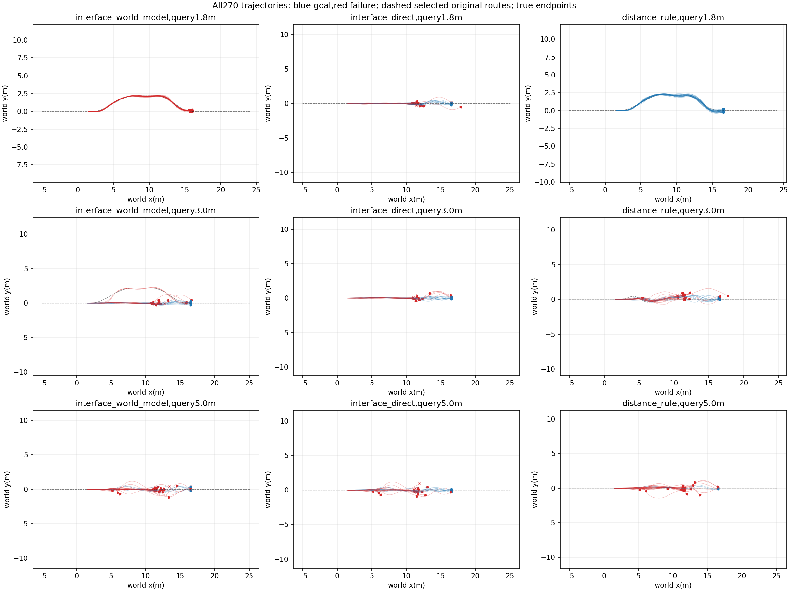
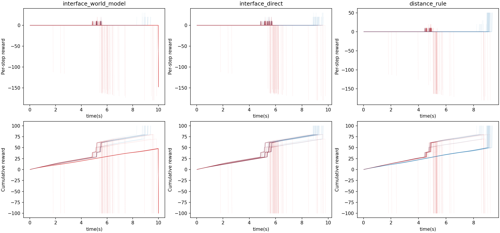

# Frozen two-interface online execution

30 newly sampled independent roots,10 per query position; each method evaluated3times with crossed environment slots.90episodes per method are not90independent initial conditions. Model weights,conditions and distance rule frozen before physics.

|Query(m)|Method|Goal/N|Road violation|Handoffs|Mean query(ms)|
|---|---|---:|---:|---:|---:|
|None|interface_world_model|15/90|9|54|6.402|
|1.8|interface_world_model|0/30|0|0|6.352|
|3.0|interface_world_model|10/30|3|27|6.433|
|5.0|interface_world_model|5/30|6|27|6.422|
|None|interface_direct|33/90|13|87|3.506|
|1.8|interface_direct|11/30|2|30|3.567|
|3.0|interface_direct|13/30|5|30|3.500|
|5.0|interface_direct|9/30|6|27|3.450|
|None|distance_rule|41/90|22|54|2.653|
|1.8|distance_rule|30/30|0|0|2.647|
|3.0|distance_rule|9/30|13|27|2.650|
|5.0|distance_rule|2/30|9|27|2.663|

|Comparator|Mean condition difference|Root-bootstrap95% interval|Matched-slot gains/losses|Exactly equal query roots|
|---|---:|---|---:|---:|
|interface_direct|-0.2000|[-0.34444444444444444, -0.06666666666666665]|5/23|90/90|
|distance_rule|-0.2889|[-0.4, -0.17777777777777778]|13/39|90/90|

Actual1080000 physical lane steps; summed simulator wall time268.06s; no policy training.

Same known map and fixed cold handoff context. This evaluates one moving query and publication recheck,not repeated feedback replanning or changed downstream widths/curvatures. Missing publications and upstream failures stay in the main denominator. Each method uses each environment slot once per condition; query-state equality is audited but does not serialize hidden solver state. If query states differ, paired outcome gains are descriptive rather than a pure causal estimator. Bootstrap units are roots,not samples or repeats.

Raw trajectories/configs and selected forecasts remain under repeat0/1/2. All per-case outcomes,pairs and route choices are in results.json. No outcomes were used to retune the frozen model.

## Interpretation and next bounded correction

The composed method completes15/90 versus33/90 for the direct classifier and41/90 for the distance rule. Its three runs complete5/30,3/30,7/30; the rule completes13/30,14/30,14/30. All90 matched-slot query roots are identical in each comparison. This does not prove hidden solver equality, but the deficit cannot be dismissed as differing recorded query states.

By query position,interface completion is0/30,10/30,5/30 versus rule30/30,9/30,2/30. All33 selected ground detours time out. The interface chooses only detour1.5/alpha0 and straight-jump1.5/alpha0 or1. Its13 paired gains against the rule coexist with39 losses and do not establish overall benefit.

TRAIN-only audit already shows zero goals in20 ground-detour1.5/alpha0 samples, while the ground branch predicts mean0.238;1.8/alpha0 has16/20 goals and mean0.287. Thus the ground branch has poor action discrimination even on training outcomes. The shared Gaussian objective and goal-head fitting are a hypothesis for this failure,not a demonstrated cause. Do not relax task deadlines or remove these samples. A bounded next correction may separate ground-head fitting/selection from the handoff likelihood while retaining frozen upstream/downstream models; these30 roots then remain development evidence,not a fresh confirmation set after repair.

The physical loop is implemented and has real complete-task examples; the present model is not adopted as superior to either comparator. Changed downstream layouts,empirical recovery margins and repeated replanning remain untested.
