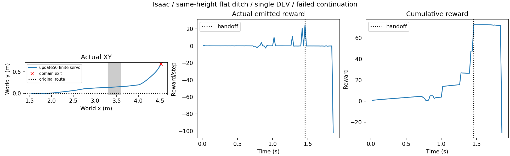

# Isaac同高平面与有限电机回交：接口执行，续行失败

单条DEV，0训练；仍为现有update50、原随机化和stage3交接，非附件heading125/entry4的跨后端配对。新增finite_motor回交保持原髋膝限位，使用已有有限力矩位置伺服，目标夹在原控制范围内。旧joint_brake默认与旧记录不变。

同高平面30cm沟（3.3～3.6m），1.46s达到stage3并回交，根状态不重置；1.86s地面适用域退出，非数值故障。最终x4.524m/y0.681m，回报−30，未完成1秒稳定续行。交接时vy0.868m/s、偏航角速度1.834rad/s；仅电机定姿及平地改动没有解决现有候选的接管问题。

初次初始化被旧地形校验拒绝0高度，未物理执行；原位允许非负高度后完整回放。网格验证全部z=0且没有三角面跨接沟口；运行预算1lane×8s上限，实际1.86s。Python编译/diff检查通过。没有改成功判据或原始失败记录。

源附件使用heading125、真实entry4历史、稳定保持后交接；本次仍为update50及更早stage3交接，不能称已等价复现附件。下一步需把源模型与初态/观测/交接合同明确对接Isaac，再判断必要技能适配。正式训练优先Isaac，MuJoCo保留参考；不恢复高岸。

原始数据：`/media/qy/6A7E3DB07E3D75C3/STTW_runs/chapter3_isaac_flat_handoff/checked/`。本目录保存配置、预算、原始摘要和停止原因；[绘图脚本](plot.py)从真实轨迹出图。
