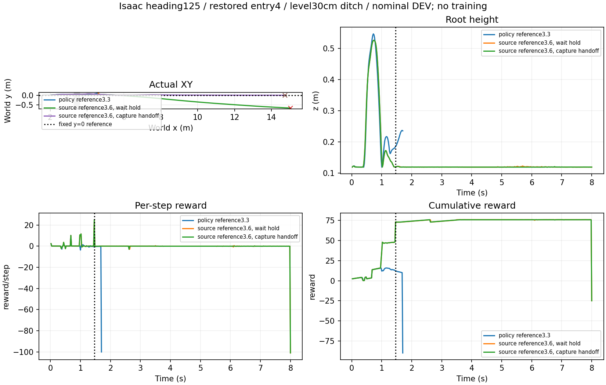

# Isaac源技能接续走通：落地捕获后H75继续行驶

**按用户最新任务定义，不要求先连续稳定支撑1秒；要求跨沟后回交并继续行驶。** 同高平面、30cm沟口3.3～3.6m、原heading125、entry4及76D历史、有限力矩髋膝伺服，Isaac已执行落地捕获→H75续行到8秒。此次0训练，GPU单车名义评测，非独立测试成功率或已指定终点的整图验收。

|回放|变化|结果|
|---|---|---|
|初次源模型|旧Isaac按3.3m生成策略障碍距离|1.70s侧倾超限，stage1，无交接|
|保留源参考|仅策略距离恢复附件3.6m，实际沟仍3.3～3.6m；等待1秒支撑|8s无物理失败、stage3，未达旧交接门槛，y=−0.680m|
|捕获后回交|同前者，仅采用已有stage3交接|1.46s交回、续行6.54s至8s，终点x14.744/y0.01346m；无地面域退出或数值故障|

后两条切换前73步root逐值一致，交接瞬间root不变。恢复的原入口位置/世界速度与76D观测逐值一致；源权重加载哈希校验通过。保持原物理失败标准，不更改接触记录或把旧失败抹掉。

发现旧观测接口将实际沟口3.3m直接用于源策略，而附件移动沟口后仍保留3.6m策略参考。新增显式policy_obstacle_reference_x_m，默认旧逻辑不变；此修复不是重新训练。当前80维源网络、完整历史恢复与源bundle评价已接入现有Isaac评测入口。未来正式训练保留Go2随机化，本次名义评价不能冒充随机化能力验证。

## 接触评分与任务评价分开

原接触评分仍是stage3、−25超时，完整1秒保持false；保留该原始标签。附件评分器对最终Isaac轨迹离线复算：严格双轮支撑最长0.010s，20ms过滤最长0.150s，同样未满足1秒。1.5～3s内前/后轮受力支撑占比约21.4%/59.1%，姿态最大绝对侧倾0.022rad、俯仰0.019rad。不能由此声称持续双轮支撑，也不能仅因该诊断未通过否定已执行的地面续行。

用户本轮明确取消把1秒支撑作为任务交接前置条件；本次8秒接续实例是按新任务方向解释的既有物理结果，不伪称原协议任务合格。后续配置continue_to_horizon=true从捕获后持续运行至任务窗口，保留物理失败、地面控制域及数值故障退出；接触评分不再提前结束续行。新增开关已编译检查，尚未另跑新配置；本次捕获回放原本就持续满8秒。

## 证据与下一步

- 原始数据根：`/media/qy/6A7E3DB07E3D75C3/STTW_runs/chapter3_isaac_source_entry4/`，三子目录evaluation/source_reference/capture_handoff。
- 本目录保留三摘要、两份原附件接触复算、评测配置与预算；[绘图入口](plot.py)读取原始轨迹。
- [下一次续行配置](continuation_config.json)仍是单车名义诊断，不是训练配置；entry4是合法既有入口，不是从共同起点完整接近。
- 下一步从真实STTW直道/弯道来车产生入口，对比接近指令，再加入绕行与决策线。此次尚未完成该上游链路，不启动无差别大训练。
