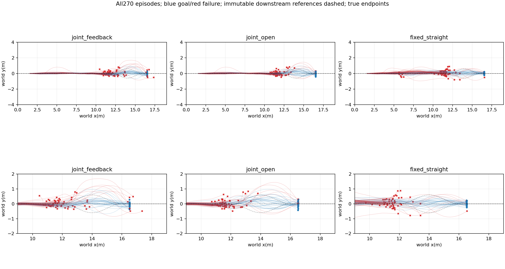
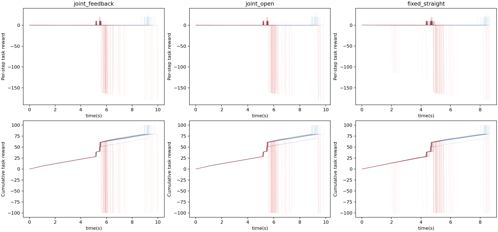
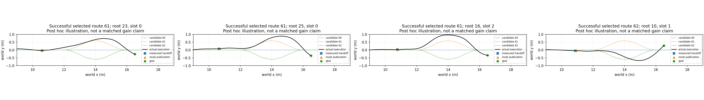

# Joint approach and downstream feedback

30 new independent roots; three methods and three crossed-slot repetitions, 90 episodes/method. All upstream failures remain in the denominator. Models and conditions frozen before execution.

|Method|Goal/N|Handoffs|Valid handoffs|Published|Road violations|Mean query ms|
|---|---:|---:|---:|---:|---:|---:|
|joint_feedback|30/90|89|88|89|10|0.434|
|joint_open|28/90|89|88|89|9|0.255|
|fixed_straight|28/90|81|77|81|14|0.261|

|Comparator|Mean root difference|Root bootstrap95%|Gains/losses|Equal query descriptors/both queried|
|---|---:|---|---:|---:|
|joint_open|0.0222|[-0.11111111111111112, 0.15555555555555553]|16/14|1/89|
|fixed_straight|0.0222|[-0.08888888888888888, 0.13333333333333333]|16/14|0/80|

Task-conditioned selected-route outcomes: [{'route': 60, 'selected': 52, 'goals': 26}, {'route': 61, 'selected': 35, 'goals': 3}, {'route': 62, 'selected': 2, 'goals': 1}]. These conditional counts are selection-biased, not route rankings. All 259 publications match the logged route and declared delay.

Actual 1066320 physical lane steps; summed simulation wall275.77s; 0 training.

Full query/publication records,model scores,actual contexts and endpoints remain in repeat0/1/2 and results.json. All failures and unpublished decisions are retained.

|Method|Approach choices|Planned downstream|Handoff revisions|Successful revised|Mean upstream query ms|
|---|---|---|---:|---:|---:|
|joint_feedback|{0: 90}|{60: 72, 61: 18}|44|11|7.899|
|joint_open|{0: 90}|{60: 72, 61: 18}|0|0|7.775|
|fixed_straight|{7: 90}|{60: 90}|0|0|0.670|

Joint panel: at x=3 m, frozen upstream predictions score 15 approach speed/preference pairs and three downstream routes. Joint-open retains its planned downstream route; joint-feedback queries again at measured handoff. Fixed uses 2 m/s, alpha .5 and straight continuation. The planned road runs during handoff inference delay. Route publication does not reset physical/controller state. This extension excludes upstream S/90-degree/bypass candidates; earlier broader panels remain separate.

No certified margin, independent-map generalization, superiority or equivalence claim. Query descriptors differ and hidden solver state is not serialized. All failures remain in the primary denominator.

Reproduction: `PYTHONPATH=learning/src python learning/cli/analyze_task_handoff_online.py --run /media/qy/6A7E3DB07E3D75C3/STTW_runs/chapter3_joint_handoff_online`. Recorded-input replay reproduces all 180 joint upstream score vectors exactly and all planned downstream choices; see `score_replay.json`. This checks numerical execution, not prediction accuracy. Raw trajectories and per-batch frozen configurations remain in the run directory.
