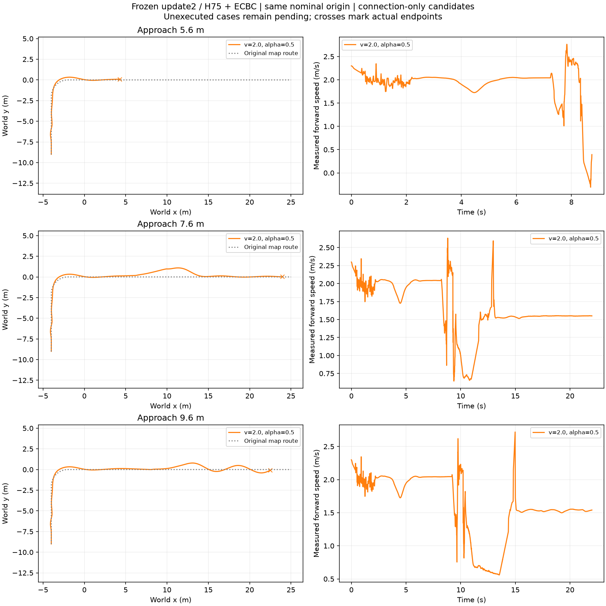

# 新任务书：跳台接近先导（18/18已完成）

**全部18条已完成：5.6m为0/6、7.6m为3/6、9.6m为4/6。** 同一名义上游根，冻结原RB/H75＋ECBC（零底层残差）/update2；全程400Hz物理、200Hz底层、50Hz策略，无RL更新。

## 协议

三距离为出弯到台沿5.6/7.6/9.6m，仅平移平台及相应交权线/目标；上游起点、2cm双起伏、R2右弯保持。上游2.0m/s、alpha=.5，x≥−2m弯出口才采用候选，至距台沿1.6m交权。落地过渡固定1.5m/s、0.8m/s²，速度≥1.2后交回；续行固定alpha=.5。

保留原七项判据，增加平台后沿+3m最终检查点（1m半径）。Y仍要求完整22s和原路半宽1m，T为严格落台后首次同时满足最终点、续行≥2s且≥2m的时刻，失败时T为空。新protocol_id为ch3_jump_connection_hold_v1，不与旧未定义最终点的结果混作同一标签。

|接近距离|2.0m/s、alpha=.5完整Y|全程最大原路误差|结果|
|---|---|---:|---|
|5.6m|失败|0.330m|8.745s终止，未形成严格落台|
|7.6m|失败|1.094m|完整落台及续行；略超预定1m走廊，不改门槛|
|9.6m|通过|0.790m|22s完整通过，T=16.360s|

三条共同前缀到5.26s的264个采样点，记录的位置、速度、侧倾及侧倾角速度差均为0。对比的是不中断实跑前缀，不是两次恢复快照；未宣称序列化隐藏PhysX缓存。三条交权处速度均约2.04m/s，但航向/姿态状态不同；不能只按横向位置是否接近零判断跳跃准备。

## 第二速度档准备

两条独立平地4s检查：1.8/2.0m/s请求对应后2s实测1.8488/2.0459m/s，实际分离0.1971m/s，均完整。原转向/轮速目标触及限幅比例为0；该统计不是实测力矩饱和率。见speed_readiness.json。

## 完整候选结果

|距离(m)|速度(m/s)|α|完整任务|T(s)|最大路径误差(m)|
|---|---|---|---|---|---|
|5.6|1.8|0.0|失败|—|0.428|
|5.6|1.8|0.5|失败|—|0.330|
|5.6|1.8|1.0|失败|—|0.330|
|5.6|2.0|0.0|失败|—|0.331|
|5.6|2.0|0.5|失败|—|0.330|
|5.6|2.0|1.0|失败|—|1.512|
|7.6|1.8|0.0|通过|14.880|0.376|
|7.6|1.8|0.5|通过|14.260|0.537|
|7.6|1.8|1.0|失败|—|0.372|
|7.6|2.0|0.0|通过|14.000|0.679|
|7.6|2.0|0.5|失败|—|1.094|
|7.6|2.0|1.0|失败|—|1.688|
|9.6|1.8|0.0|通过|15.440|0.712|
|9.6|1.8|0.5|通过|15.280|0.403|
|9.6|1.8|1.0|失败|—|1.506|
|9.6|2.0|0.0|失败|—|1.778|
|9.6|2.0|0.5|通过|16.360|0.790|
|9.6|2.0|1.0|通过|14.880|0.834|

同一根下，1.8m/s、α=.5已经覆盖两个可行距离；因此当前证据不支持能力评价器相对最佳固定方案提高成功率。若事后按距离选最快成功候选，7.6m选择2.0/α0（14.000s），9.6m选择2.0/α1（14.880s）；固定1.8/α.5对应14.260/15.280s，平均节省0.330s。此为同一开发根的事后oracle上界，尚非在线选择收益。5.6m保持不可行/未知候选区域，不删失败或放宽走廊。

下一阶段六个新来车根、108条D0配对已启动；初始横向±.04m×航向±2°四根，加横向±.08m/航向0两根。实际运行上游形成出口状态，冻结控制器，0优化更新；数据全部DEV且按origin分组。未训练能力评价器。

## 代码、配置与原始证据

configs保存完整18条配置，manifest记录执行顺序及本地依赖路径；summary保留全部18项、五阶段、实际出口和交接状态、共同前缀对比。18个已完成目录保存压缩原始轨迹/接触/参考及实际执行输入：ground文件为plant输入前轮角速度/后轮速度，jump文件为过渡覆盖后的转向位置/后轮速度/摆臂位置目标，二者均不是实测力矩。跳跃原actor输出仍在trajectory中。

运行入口run_jump_approach_pilot.py；评估analyze_isaac_pendulum_landing.py、analyze_rb_continuous_task.py；同图summarize_jump_approach_pilot.py。模型参数与URDF见此前chapter3_motion_chain_20261106/CONFIGURATION.md；权重不入本精简包。原始运行位于数据盘STTW_runs/chapter3_jump_approach_pilot。

records/保留决策时刻输入与完整任务标签。早期协议缺少live joint_names的行保留髋膝速度null，不猜测顺序或填零；后续完整输入行明确标识。全部18条只有一个上游origin，不拆成18个独立根。

## 原高斯核评价器接口检查

已用原八维特征及冻结尺度接入跳台数据，任务按距离区分，整条上游根跨所有距离/候选留出。18条只有一个根，留出后没有其他证据，因此三组均unknown、没有可报告Brier或选择成功率。这一结果验证分组边界，不是评价器性能退化。使用decision_id标识不中断运行的决策点，不冒称已保存完整PhysX快照。完整23维记录另保留；核基线不依赖早期缺失的髋膝速度。耗时代价用决策后到任务完成的时间，不能与整任务时间混为一列。
