# 跳跃与落地偏航修复：开发记录

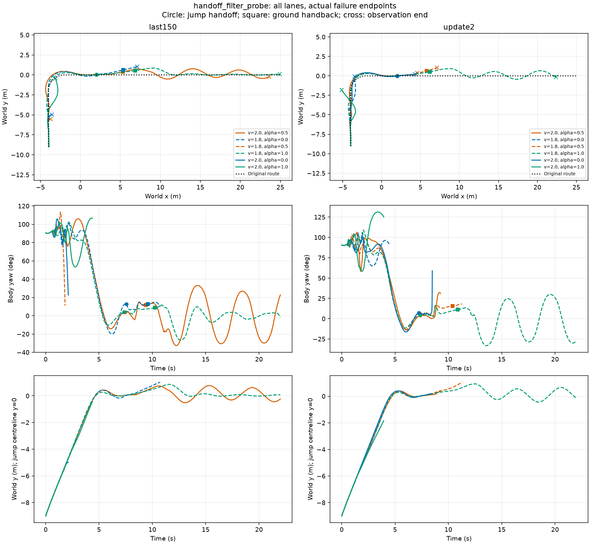

当前不能称偏航已解决。原 update150 入口贴近中心线，但跳跃期间航向增加；交回 H75 后仍可能出现左右摆动。图中圆点为接跳跃，方点为交回地面，叉号为真实观察终点。所有候选和失败保留；转弯前世界 y 不等于横向路径误差。

## 已完成的两个有界尝试

1. **提前地面接管**：support_s 从1秒改为.15秒，其余模型/速度/20ms接触处理不变，原离线1秒落地判据不变。root000两个模型各六连接，12条22秒。latest150原contact20整链2/6，本次0/6；部分横向轨迹改善，但出现新增失败，未采用。见 [完整轨迹](early_handback_xy_heading.png)。同配置GPU重放存在上游差异，不把到达率差异归因于跳跃权重。
2. **接地转向修正**：同latest150、同21实际入口，gain=0/.15/.3三组63条8秒；双轮当前接触>1N时按-yaw_gain*yaw修正策略转角，增量限±.06rad，50Hz采样，不改变摆臂/轮速。严格落地分别1/21、1/21、0/21；20ms附加落地20/21、20/21、18/21；8秒未终止19/21、20/21、16/21。1秒共同窗口平均绝对航向6.12/5.49/5.75°；后续偏移未改善，较强修正损害平衡。**未采用**。见 [全部21入口XY](feedback_gain_xy.png)。不是RL能力提升，没有H75交回，不代表完整任务。

原108条严格交回协议已完成：update2/latest150/采样best各36条，原全链0/0/6。另72条20ms接触协议：latest150/update2各36，原strict全链0/1；独立contact20全链11/5。两个协议不得混合报成功率，11/36仍未解决用户指出的偏航。

## 本轮针对性适配配置

原Actor的76维观测包含角速度但无绝对航向、横向位置或横向速度，不能仅靠加大惩罚为策略提供缺失反馈。`heading150`从实际update150权重初始化、fresh Adam，Actor增加4维定位信息：[y, sin(yaw), cos(yaw)-1, vy]；原256×3 SiLU隐藏层、4动作、106维Critic均不变。新增第一层权重为零，32输入对照动作maxdiff=0，Critic逐值一致。输入均基于直线平台参考y=0/yaw=0，不能直接当任意世界路径接口。

新项：`-(y/.3)^2 -.5*(vy/.3)^2 -(yaw/10deg)^2 -.1*yaw_rate^2`。原跳跃/速度/落地奖励及物理判据保留。新4特征均匀噪声幅度[.01,.005,.005,.02]，当前帧附加；没有声称这些额外特征已纳入原3帧传感延迟。其余Go2随机化原样保留。原奖励测试6项通过。

4096环境×24步×150更新；物理400Hz、传感/底层200Hz、策略50Hz；固定学习率1e-4，每25更新存候选。配置：`learning/configs/isaac_rb_jump_heading150.json`、`isaac_phase_u_task_heading.json`。不启用上述外部转向修正或提前交回。完成后先比较父150/训练奖励best/第100轮/最新四个模型×21同入口；不以奖励或存活替代航向、轨迹与落地。**150轮已完成，结果及局限见下节。**

数据根目录：`/media/qy/6A7E3DB07E3D75C3/STTW_runs/`；旧两试验在`chapter3_jump_platform150/{early_ground_return_probe,heading_feedback_probe}`；新训练在`chapter3_jump_heading150`，原始轨迹/配置/失败记录保留。来源为已参与开发的TRAIN入口，非独立TEST。

## Update50中途实测

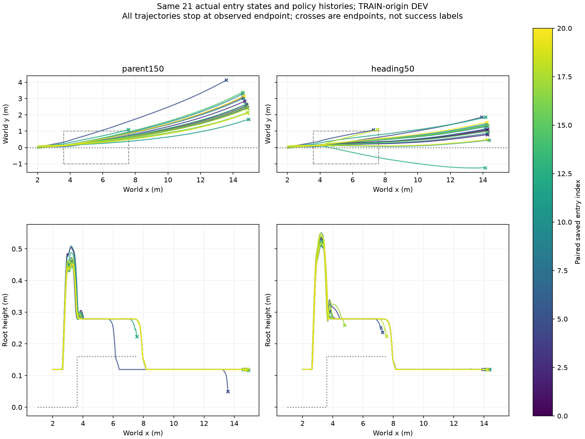

父150/heading50：strict落地2/2，contact20落地21/18，8秒未终止19/18（各21）。前三秒实际观察窗横向RMSE中位.297/.227m、航向RMSE6.51/5.26°；通过平台最大横向偏移中位.645/.458m。前三秒完整观察21/20，早失败不补齐，误差必须与失败数共同解释。明显减少后段漂移，但仍有约1m以上偏移和反例；不采用、不宣布修复，继续原150轮预算。原始逐入口指标见[摘要](update50_heading_summary.json)。

实际Go2运行超参数见[runtime_recipe.json](runtime_recipe.json)：5 learning epochs、4 minibatches、clip .2、entropy .01、gamma .99、lambda .95、max_grad_norm1、fixed lr1e-4；任务书JSON中的历史PPO字段不代表本次runner实际取值。当前采样best仍update1，最终固定入口84条比较不按该文件名直接采用。

## 150轮完成与候选125

训练150轮实际1564.76秒，14,745,600策略步、117,964,800物理lane步。后25轮/前25轮采样reward .108/.158、episode reward198.46/248.20、physical_failure .404/.425、apex .663/.619，不能称已稳定收敛；[训练曲线](training_curves.png)。第150轮虽然方向修正明显，但落地侧翻增加，不采用最后一轮。

旧84条评测还暴露纵向地面边界：latest150有5条在7.93–7.995秒、x约15.28、y接近0时掉出原x=15地面；另6条是真实早期侧翻，分别保留。新协议仅将前方平地延到25m，平台/侧界±4/质量/摩擦/时序/8秒窗口不变，四候选同条件重测84条，不覆盖旧结果，不改变失败或1秒落地定义。训练入口新增可选`ground_end_x_m`，缺省15，旧配置不变；本轮训练仍使用旧地面。

| 新直行余量协议，各21入口 | 8秒未终止 | strict落地 | contact20落地 | 通过平台最大横向偏移中位数(m) |
|---|---:|---:|---:|---:|
| 父150 |18|1|19|0.696|
| heading100 |19|0|17|0.467|
| heading125 |18|1|15|0.260|
| heading150 |14|1|10|0.306|

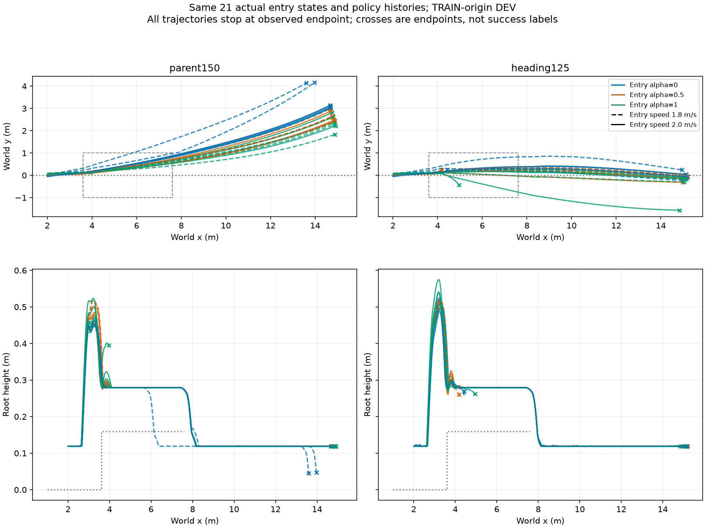

[四候选全图](runout_all_candidates_xy.png)、[全部84条数据](runout_heading_summary.json)。当前选择125作为**完整链验证候选**，不是宣称所有任务已成功。125三条早期roll失败entry3/9/15，父模型失败5/11/12，新增/恢复各3条；不把相同总数说成逐例不退化。另125三条未满1秒hold但8秒不摔、最大roll1.27–4.72°，hold .91/.94/.98秒，仍按未通过记录。

两者共同完成8秒的15条配对入口，末端绝对y中位数2.612→.092m；每条全程最大绝对y的中位数2.612→.287m，新模型这15条全程最大值.421m；末端绝对yaw中位数23.37→3.53°。[配对来源与指标](paired_full8.json)。这是完整观察子集的描述性比较，不替代全部21条失败及落地报告。第125轮有明显纠偏，但3次早期侧翻尚未解决。

## 完整路线与落地回交

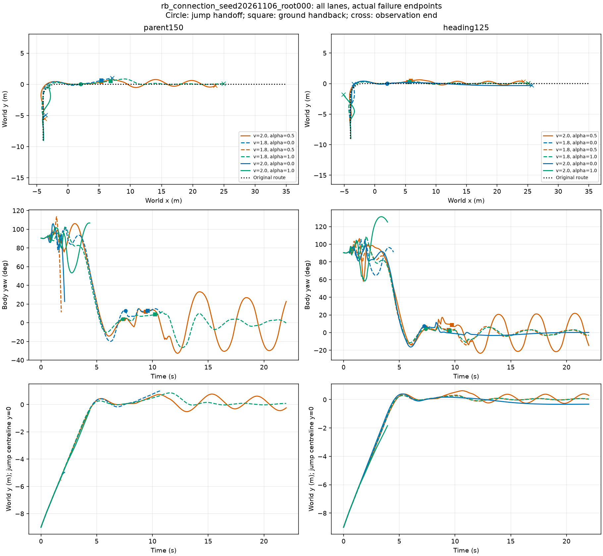

[root003完整XY和航向](chain_runout_root003.png)、[逐条回交状态](chain_runout_heading.json)。前方平地及参考终点从25延到35m，原任务目标10.6m、路廊、22秒观察和1秒支持均不变，避免新策略仅因更快驶出评测场地产生失效；旧结果不覆盖。两组root各两模型×六候选，共24条。contact20全链父150为2/6+3/6，新125为3/6+4/6，即5/12→7/12；仅为开发结果。同配置GPU重放前段也有差异，不能将全部新增到达归因于跳跃权重。

125七条完整任务中，六条最终|y|≤.074m、|yaw|≤3.94°；root000 lane6最终y=.299m、yaw=-14.62°，最大|y|=.626m，落地回交后持续振荡。**通过原1m走廊不等于偏航问题解决。** 当前不将125冻结为最终版本。

原单独跳跃21入口中，125 entry11虽未早停，但末端y=-1.565m，是明确反例；不能用共同完整15条的.421m最大值覆盖它。新增21保存状态×父/125的跳跃→H75回交评测，见[全部42条轨迹](entry_return_xy.png)。启动时因基础平面与负高度地形接线冲突失败，实际未产出结果；修正后重跑，失败启动目录保留。该测试是入口子任务，不是完整粗糙地形到达率；新125仍存在未交回、早期失败与横漂反例。

正在检查落地回交α=0能否改善路径振荡，保持速度1.5m/s、支持1秒和原物理模型，不启用外部转向修正。

42条入口回交实测：parent/125的contact20子任务完成17/21、13/21，strict均0；交回19/21、14/21。首帧76维历史观测与源bank最大差0，物理接触求解器内部状态不属于恢复内容。**125多数轨迹更直，但该入口测试完成率退化，因此不作为已解决或全局最佳采用。** 详见[全条件摘要](entry_return_summary.json)。

## 回交参数与初始化修复

落地回交α=0试验（六条22秒）：原root000持续振荡候选本次最大|y|=.207m，终点y=-.049m、yaw=.59°；但其他候选仍有一条越廊、另一条末端偏移-.459m，不能作为全局解决方案。[全部六条轨迹](return_alpha0_xy.png)。物理批次从12变6且上游有重放差异，只报告本次行为，不把差值当严格单因素因果估计。

发现并原位修复回交初始化进度：原resume_ground_lanes先以progress0生成nominal/rates/history，再只覆盖projection/follower；现按实际位姿在固定原路径求最近进度，再完整初始化H75。默认起点reset不变。CPU实际H75模块验证了首帧参考/历史一致及不影响其他lane；原振荡例首个限速后的nominal与修复前相同，所以不宣称该错误就是振荡的唯一原因。相同α=.5的六条完整链已完成：contact20 3/6、strict 1/6；三条完成轨迹末端|y|=.077/.052/.022m、|yaw|=.25/2.83/2.67°，全程仍有横摆和失败，不能宣称全条件偏航清零。见[修复后完整轨迹](return_progress_xy.png)、[六条逐项结果](return_progress_summary.json)。初始化修复作为接线修复保留；α=0不改为默认，125仍为待进一步稳定化的候选。

## 平台失败后的地面恢复试验

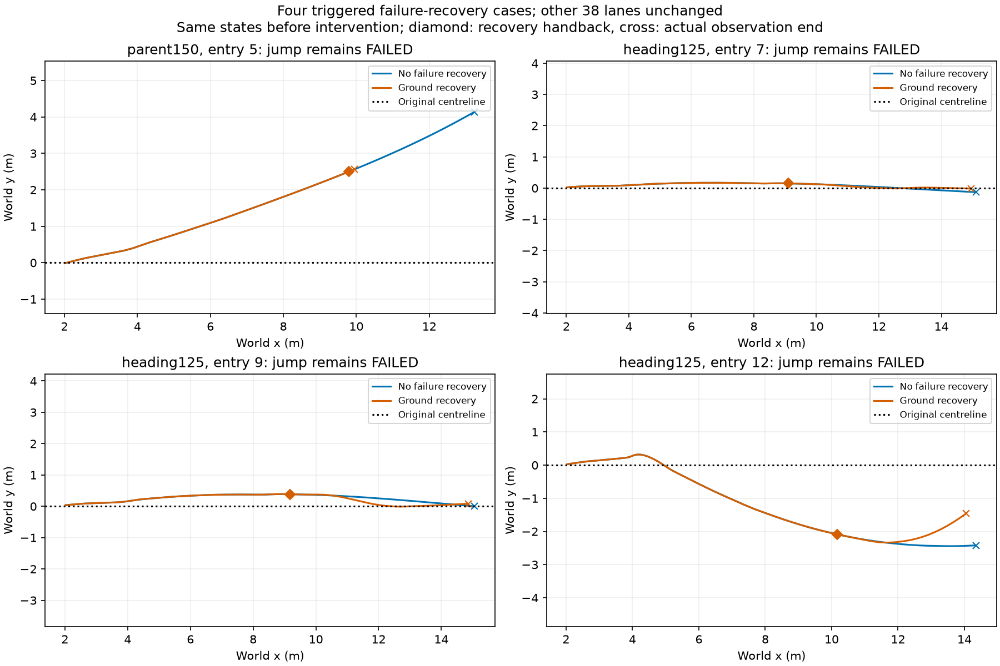

同代码、同42入口配对，所有42条干预前轨迹在1e-6容差内一致，38条未触发者全程不变。新增可选ground_recovery：驶过平台尾+.1m、双轮平地高度及当前接触成立、roll/pitch<.15rad、垂速<.2m/s持续.1秒且前速>=1.2，锁摆并接H75；平台原1秒支持标准不变。事件名与landing_handoff分开，未回交成功不因此改标签。完整[配置](ground_recovery_config.json)、[42条配对状态](paired_recovery.json)、[原任务判读](paired_task_results.json)。

触发4条：125 entry7末端y -.129→-.014m；entry9 .003→.083m，不能称所有误差均改善；entry12 -2.419→-1.458m，但仍大偏移且末端航向约35°；父模型entry5提前在5.02秒退出，不能用其较小末端y冒充改善。父entry5最大roll仅2.44°，末端根据原Pure Pursuit重建preview_body.x=.02834m，小于接口要求.05m，invalid=true、numerical_fault=false。此前口头“目标在车后方”不精确，实际是前向距离不足，属于地面控制接口退出，不是侧翻。

**不默认采用失败恢复**：直接接回H75可处理部分小偏移，约2m大偏移需要能力合适的连接参考，不能以放宽成功标准解决。下一步复用项目现有PythonRobotics前向路径实现，先检查连接几何及终点约束，再决定接线；不新增规划器、不将失败恢复计作跳跃能力提高。

同版本两组84条判读：strict均0/42、contact20均30/42，失败恢复未改变原任务成功计数。复用已固定版本PythonRobotics，对两条大偏移到原目标(10.6,0)、终点航向0、半径1.8m的接回几何得到长度13.415/13.107m，含约3.6m负向x行程；违反当前前向不绕圈意图，未上线执行。见[几何来源](recovery_rejoin_geometry.json)。不为回收这两例移动任务目标或放宽原路廊。下一步仍须提高起跳/落地的方向稳定性。

## 有界方向奖励稳定化（150轮及入口评测完成）

从heading125继续150更新，fresh Adam、fixed5e-5；4096×24步，原80/106输入、256×3隐藏、Go2 DR及50%实际入口/42%名义/8%RSI保持。方向惩罚由e²改1-exp(-e²)，最大方向总罚2.6/步；原侧翻400、落地、跳跃和速度奖励不变。地面前界15→25m与评测覆盖一致，平台/侧界不变，属于奖励与场地前向余量的联合修正，不称单因素消融。配置`isaac_rb_jump_heading_bounded150.json`和`isaac_phase_u_task_heading_bounded.json`。

已有42轨迹反事实重算，4条旧方向折扣累计>400，最大1925.57，而有界后最大198.50；[逐条数据](reward_direction_audit.json)。这是解释风险的诊断，不是智能体“故意摔倒”的因果证明，也不是新回报或成功结论。

选模脚本补识别model_update_N定期checkpoint，显式更新N归属N，不再跳过中途权重；最新末轮仍列为候选。最多3奖励候选+末轮+父150/125（模型0重复跳过），同21入口、同H75进度修复、无失败恢复比较真实轨迹和原任务指标。评测进程以pidfd等待训练结束，不轮询。七项奖励测试、四项选择测试通过，新增方向罚上限及原400失败罚保留已验。当前尚无该轮训练后结论。

150轮实际用时2108.18秒（35.14分钟）；绘图解释器缺少tensorboard导致自动后处理停止，改用已有Isaac环境后从绘图续接，未重训。126入口评测全部完成。

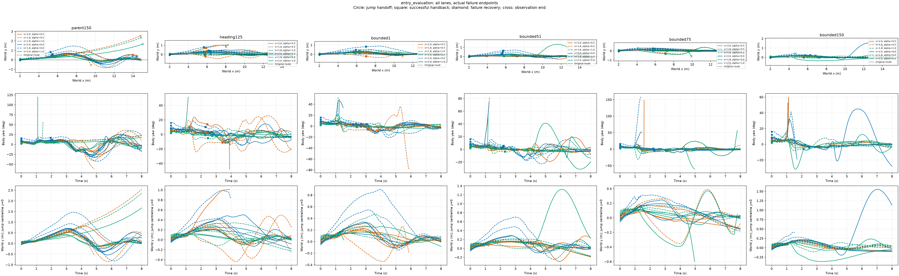

|模型|严格完成/21|20ms接触协议完成/21|完整8秒/21|全程最大绝对y中位数(m)|最坏最大绝对y(m)|
|---|---:|---:|---:|---:|---:|
|parent150|0|14|18|0.660|2.543|
|heading125|1|13|18|0.277|1.013|
|bounded1|1|14|16|0.222|0.899|
|bounded51|0|11|18|0.187|1.322|
|bounded75|0|8|15|0.170|0.599|
|bounded150|0|8|15|0.191|1.552|

方向误差减小但后期完成率下降；不采用末轮，不把早失败较短的观察窗口冒充低偏移优势。第1轮仅进入完整链验证，完整8秒16/21仍低于父模型18/21。当前126lane与旧42lane重放不完全一致，历史17/21与当前14/21不能混作同一父基线。严格判据和20ms判据分别保留，不称偏航已解决。[全部逐例方向](bounded_entry_heading.json)、[选模身份](bounded_selection.json)、[摘要](bounded_entry_summary.json)。完成通知Bark失败(URLError)，未声称已送达。

## 有界奖励候选的完整链复核

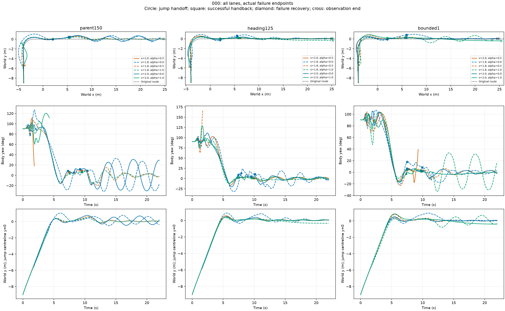

[root003全部轨迹](bounded_chain_root003.png)。同当前H75初始化修复、原地形/目标/22秒/支持1秒，3模型×6连接×2根=36条，0优化；复用批量GPU。root000实际仿真89.16秒。启动首条命令遗漏PYTHONPATH，导入失败后补环境变量执行，未消耗该次物理预算；原失败日志保留。

|模型|严格完成/12|20ms接触协议完成/12|完整22秒/12|
|---|---:|---:|---:|
|parent150|0|5|7|
|heading125|1|7|8|
|bounded1|1|5|7|

新bounded1不采用；heading125保留为继续改进基线，不代表任务已经合格。125已进入跳跃的9条，跳跃以后最大绝对y中位数.298m；其中7条20ms完成，最终绝对y≤.077m、绝对yaw≤4.0°，但root000 lane7过程中横偏峰值.823m；另root003 lane11偏移峰值1.074m、末航向128°，是未解决的严重反例。不能用成功子集掩盖失败。不同lane的前段到达也有重放差异，不把完整链计数差全归因于跳跃策略。[全部判据](bounded_chain_results.json)、[逐条方向](bounded_chain_heading.json)。

本轮不支持“奖励收敛即完成”：后25更新平均步奖励.932对前25的.922，episode回报1685对1626；但平台hold日志比例.00564对.00794下降，固定入口后期模型也退化。这些是不同口径诊断指标，不能互当成功率。当前不继续同奖励无差别加轮数；方向、落地和到达要联合判断，下一阶段先处理失败的起跳/落地过程，而非仅进一步提高偏航罚。

## 当前heading125的真实在线技能接续（四条完成）

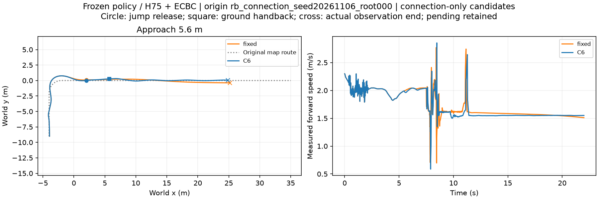

[root003配对轨迹](online_root003_xy.png)。圆点为跳跃交权，方点为地面回交，叉号为观察终点。固定与在线各两个根，每条完整22秒；同一冻结heading125/H75，地形、初态、路廊和两套评分保持。

|根/方法|实际接近速度/α|严格完整任务|20ms完整任务|跳跃释放(s)|地面回交(s)|回交后时间/距离|
|---|---|---|---|---:|---:|---|
|000_fixed|2.0/0.5|False|False|7.50|无|0.00s/0.00m|
|000_C6|2.0/0.0|False|True|7.54|9.72|12.28s/19.13m|
|003_fixed|2.0/0.5|False|True|7.42|9.72|12.28s/19.17m|
|003_C6|2.0/0.5|False|True|7.42|9.72|12.28s/19.17m|

在线按20ms接触协议2/2，固定1/2；原严格协议四条都不通过。不是独立TEST或校准概率，不把两根样本的差值外推为普遍收益。以用户最新要求，这证明当前技能与选档接口已实际贯通，不要求所有工况100%完成。source/RB历史对比及原严格判据均不由本结果替代。

root000选择前275个trace记录逐值相同；5.48秒根据本次实际状态选择2/α0，约9.07ms查询，电机命令此刻开始分离；前段最大指令差转向.13790rad/s、后轮.57117rad/s。在线9.72秒回交、继续12.28秒/19.13m；固定最长20ms支撑.925s，未回交。root003在线保留2/.5，其全程trace与固定逐值一致，两者均完成20ms任务。预测并非必须改变参考。

两根真实出口速度1.992/2.000m/s、侧倾-8.99/-8.26°、横向误差.760/.495m、偏航角速度-.765/-.728rad/s。相同地图距离下，选档依赖当前状态；目前不能分离位置、姿态及其他特征各自的增量价值，不能把本先导当特征消融。

仅使用对方根的3/5条可用Q_hold证据，整根排除，不看本组结局；当前概率1意味着稀疏近邻的经验结果，不是成功保证。较早离线批量状态建议root000用1.8/.5，而实际到达状态选2/0，保留两份查询证明状态依赖，不将旧建议冒充实际执行。

[逐阶段结果](delivery_config/online_stage_summary.json)、[完整四条判据](delivery_config/online_summary.json)、[配对执行审计](delivery_config/online_first_pair_execution_audit.json)。首对与第二对均已完成，Bark回执HTTP200、status sent。当前接触保持训练仍作为补充候选，不再作为接续规划前置。

## 接触保持补充训练收尾（不替换主线技能）

150更新完成，1691.26秒（28.19分钟），117964800物理lane步；从125权重fresh Adam、lr5e-5，仅启用已有上一策略帧接触并集，其他权重/随机化/物理保持。训练检测50Hz，不冒称与执行200Hz接触age逐帧相同。

[全部126入口XY/方向](contact_entry_xy.png)、[训练曲线](contact_training_curves.png)、[选模身份](delivery_config/contact_selection.json)。

|模型|原严格/21|20ms完整任务/21|完整8秒/21|全程peak绝对y中位数(m)|
|---|---:|---:|---:|---:|
|parent150|0|13|17|0.660|
|heading125|1|12|18|0.277|
|contact1|1|14|15|0.222|
|contact51|1|13|18|0.234|
|contact101|0|9|16|0.180|
|contact150|0|13|17|0.160|

contact1任务数略高但早失败更多；最新contact150也无明显整体优势，不替换已实测在线技能链的heading125，不追加RL训练。本批父/125数字与旧批次不同，保留真实GPU重放差异，不跨批混算净收益。方向较小但观察长度不同，不把早停当低误差改善。此为补充候选评测，不阻塞能力接续主线。

## 当前冻结技能的六根能力表（零新增训练）

[根000全部六档XY](capability_root000_xy.png)、[002](capability_root002_xy.png)、[003](capability_root003_xy.png)、[004](capability_root004_xy.png)、[005](capability_root005_xy.png)、[008](capability_root008_xy.png)。颜色表示α、实线/虚线表示速度；同根保留未到出口和出廊失败。

冻结heading125，复用原000/003的12条，补既定train根002/004/005/008各六条，追加211200物理lane步、0优化。四批实际仿真82.64/86.38/76.65/81.30秒；分析/出图另计。36分支来自6个根，全部为DEV。严格与20ms分别导出；不混其他跳跃权重。

|根|到达决策点/6|原严格/6|20ms完整/6|1.8m/s α0/.5/1|2m/s α0/.5/1|
|---|---:|---:|---:|---|---|
|000|5|1|4|1/0/0|1/1/1|
|002|5|0|4|1/1/1|0/1/0|
|003|4|0|3|0/1/0|1/1/0|
|004|3|0|1|0/0/1|0/0/0|
|005|5|0|3|1/0/1|1/0/0|
|008|5|0|4|0/1/0|1/1/1|

总计原严格1/36、20ms 19/36。六个来源各有至少一条20ms可用分支，但不同分支的出口状态可能不同，不能把事后六根各挑一条冒充真实选档6/6，也不称完全相同出口快照配对。已执行的真实在线证据仍是前节两个根、四条，不被此离线表替换。

复用JumpConnectionSelector和ConnectionCapability、固定23维尺度与门槛、不拟合或调阈值。每条实际有效决策状态查询时排除整根；27条到达决策，20条同时满足完整输入与此前未越廊，17条对实际候选有足够支持（3条未知）。条件Brier=.08709只覆盖这17条，不代表全体36或独立TEST概率校准，也不推断未执行选择的效果。上游失败保留全分母。两套原始[20ms记录](delivery_config/six_root_contact20_records.jsonl)、[严格记录](delivery_config/six_root_strict_records.jsonl)及[核支持逐项摘要](delivery_config/six_root_capability_summary.json)可复查。

复算：`PYTHONPATH=learning/src python learning/cli/summarize_connection_support.py --records docs/evidence/chapter3_jump_heading/delivery_config/six_root_contact20_records.jsonl --config learning/configs/jump_connection_capability_dev.json --output runs/ch3_support_replay.json`。无需新物理或训练。当前保留核工具，不因六根数据启动MLP或继续PPO；下一步为冻结该表后检验新的实际来车状态与任务组织。

## 冻结36条训练证据后的新验证状态与批量在线入口

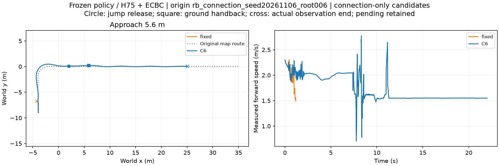

[新验证根021](validation_root021_xy.png)。两根按原120根划分中的validation_tuning顺序前两根006/021选取，在仿真前冻结heading125/H75、36条train证据、23维尺度和门槛；无调参/训练，不把验证记录回填训练。四条真实执行、35200物理lane步，原严格及20ms口径都保留。它们是新验证状态，不是独立TEST。

|根/方法|到达出口后的实际选择|原严格完整|20ms完整|回交(s)|回交后时间/距离|
|---|---|---|---|---:|---|
|006/fixed|未到选档点|False|False|无|0.00s/0.00m|
|006/C6|2.0/1.0|False|True|9.68|12.32s/19.22m|
|021/fixed|2.0/0.5|False|False|无|0.00s/0.00m|
|021/C6|2.0/1.0|False|True|9.88|12.12s/18.92m|

两条C6都选2m/s、α1，查询约1.99/2.04ms、接受20条原train有效证据，并完成跳跃回交续行。固定结果0/2、在线2/2只是原始记录：006固定在1.18s、选档前已退出，021固定在9.15s退出；两组在选档前的观测位置差分别.357/.933m，速度差.651/.301m/s。因此不能将成绩差归因为选档，也不汇总成与前节单车一致前缀配对的“4/4性能提升”。这里只证明在声明的批量布局和实际到达状态下，冻结工具/技能能被真实调用并完成接续。

批量代码复用现有run_connection_batch，新增出口query调用和每lane启用标志；同权重、出口一次选择、无选择旧批量和单车入口保留。每组两条一起实际仿真77.70/74.42秒，加载/分析另计；此前单车测试同时存在4096训练，不能把耗时比当纯代码加速倍数。实际选择写入事件、speed/alpha tensor及导出lane配置。候选不同不改变原观察/失败标签。

[冻结运行单](delivery_config/validation_manifest.json)、[所有事件与前缀差](delivery_config/validation_execution_summary.json)、[006配置](delivery_config/validation_root006.json)、[021配置](delivery_config/validation_root021.json)。固定证据与前节six_root_contact20_records相同；查询排除整根，两个新根不在建表数据里。此阶段无模型拟合、无新增RL。

### 一次同原点诊断，失败与限制保留

[诊断XY](origin_zero_diagnostic_xy.png)、[诊断记录](delivery_config/origin_zero_summary.json)。确认ground_settings.randomization=null后，仅将root006两lane的env_spacing20改0，保持独立碰撞组、模型/控制/几何/频率。两条trace逐值相同，均在2.20s上游退出、没有选档或跳跃；最大侧倾18.79°，不能仅凭results中的physical_termination字段称45°跌倒。原点布局改变了结果，但不能证明浮点精度是唯一根因。

该诊断只实际运行1776物理lane步（上限17600）、0更新，作为看过结果后的工程诊断，独立于四条新验证统计。不追加spacing扫描、奖励修改或训练，不自动更改全局默认。批量入口可做实际状态条件的数据采集；当前不将此异质批量当无混杂的“同出口反事实性能比较”。此前单车两根/四条中，第一对选档前trace相同、第二对同选择全程相同的证据仍独立保留。

## 任务程序的真实执行绑定与物理完成回写

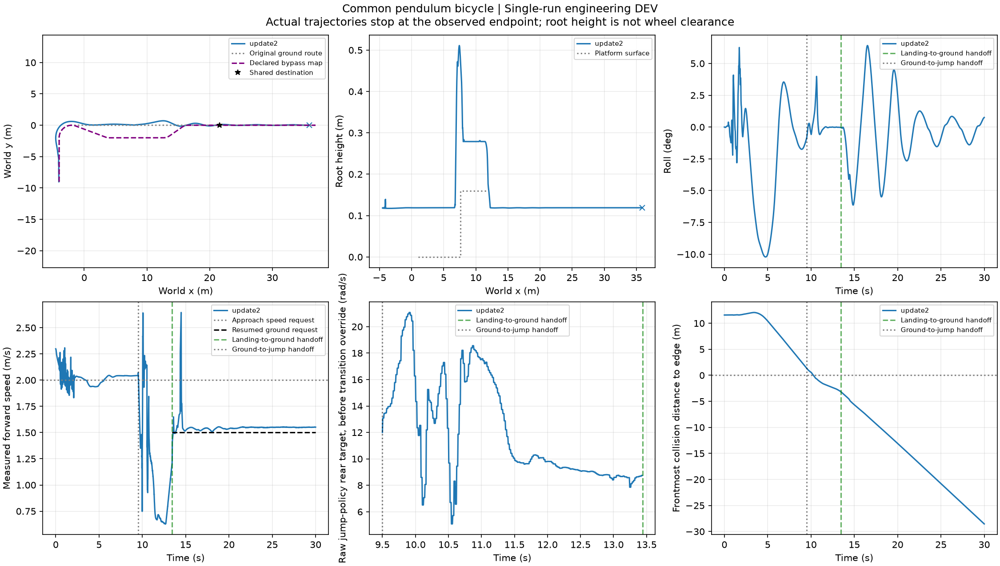

本轮处理任务管理接线，未调整模型/控制器/奖励、未新增RL。为验证接口，重放原已记录root002 D0、9.6m接近、30s的旧update2场景；它不是当前heading125的新泛化测试，也不替换当前技能基线。

### 建议、实际执行与物理完成

ContinuousTask新增`record_execution`及`active_reference`：启用执行绑定后，未应用的建议不能当实际参考；未知/超时仍保留执行器当前有效参考；完成目标不会凭空抹掉仍在执行的控制参考，也不能重复给目标计完成。未启用绑定的旧用法保持。真实执行器在初始参考及分流实际应用后记录引用，任务完成由既有物理分析后独立确认。

- `task_execution.json`：程序、建议与实际执行事件；物理完成待确认。
- `task_revision_request.json`：当时的修订请求，保留未完成目标和实际参考；这是历史事件。
- `task_outcome.json`：依据冻结物理评分确认目标/剩余任务；它是最终结果入口，不把旧请求当仍待处理。

这里的实际引用是任务级路线与接近候选，不是逐时刻电机目标。跳跃和回交继续使用冻结技能参数，回交目标速度为1.5m/s；它不会因任务记录中的接近速度2m/s而被覆盖，实际电机与跳跃目标仍在原执行日志中单独保存。

运行配置通过`forward_branch.track_task_progress=true`启用，并声明`initial_reference`与`outcome_goal_id`；示例见[本次配置](delivery_config/task_live_config.json)。原单车/批量旧配置缺省不启用。既有`run_jump_approach_pilot`在物理分析后调用finalize；执行记录先写，再发布results完成标记，方便既有resume复用。

本次5.56s能力工具报告no_feasible，执行器保留original_jump、2/.5参考；随后9.50s交跳跃、严格台面支撑1.215s、13.44s交回地面、19.46s进入E5共同目标区，完整30s窗口通过。原始跳台终点条件首次满足20.10s，与E5共同目标2m半径的首次到达分开记录。物理运行85.882秒、12000物理lane步、0更新；因此不能把经验工具的no_feasible当不可达证明，也不能把该次已知配置重放说成算法增益。

物理分析后，原程序及“必跳”语义都确认destination，remaining为空；`request_disposition=resolved_by_observed_completion`。历史修订请求文件保留，最终状态已说明无需再为已完成目标修订。此为**评分后的任务进度确认**，不是实时多目标重规划或LLM已经接入。

### 已保存18条路线的零物理回放

复用原E5能力方法18条完整记录，未到分流点的上游失败也保留。回放中的初始执行引用由已运行配置的速度/α重建，分流引用读取当时实际执行的路线事件；这些不是当年已在线写出的任务进度日志。原任务语义3条完成、15条待修订；同18条在必跳语义下也是3/15，均与原冻结标签零差异。不是36次新试验，不混入当前heading125的验证统计。18条来自原6个上游根的三个条件，3个完成都来自root002，不算3个独立成功根。绕行只到目的地而没有平台技能时，必跳任务仍需修订；对应语义测试通过。

[回放摘要](delivery_config/task_replay_summary.json)、[实际执行记录](delivery_config/task_live_execution.json)、[物理评分](delivery_config/task_live_chain_summary.json)、[最终任务状态](delivery_config/task_live_outcome.json)、[必跳语义](delivery_config/task_live_outcome_mandatory.json)。已导出[18条可移植执行快照与物理摘要](task_execution_replay/)，可在不加载Isaac或权重的情况下重算进度。它复用物理评分，不能替代原始接触/轨迹重新验证。

例：`PYTHONPATH=learning/src python learning/cli/finalize_task_execution.py --run docs/evidence/chapter3_jump_heading/task_execution_replay/rb_connection_seed20261106_root002_forced_original_jump_extended_reference_capability --output runs/task_replay.json --require-platform`。

新增执行绑定、旧建议不能确认下一目标、重复到达不重复记分、必跳不能被绕行替代、观测完成解除旧修订请求等共17项相关测试通过；实际完整链流水线已生成独立执行/结果文件。首次回放遇到缺失分流文件，已按真实“未到分流点”处理，没有丢掉该失败或新增物理。当前仍未部署LLM、未声称所有路由/来车状态可行，整体任务书未宣布完成。

## 承诺起跳前的有限次在线重选

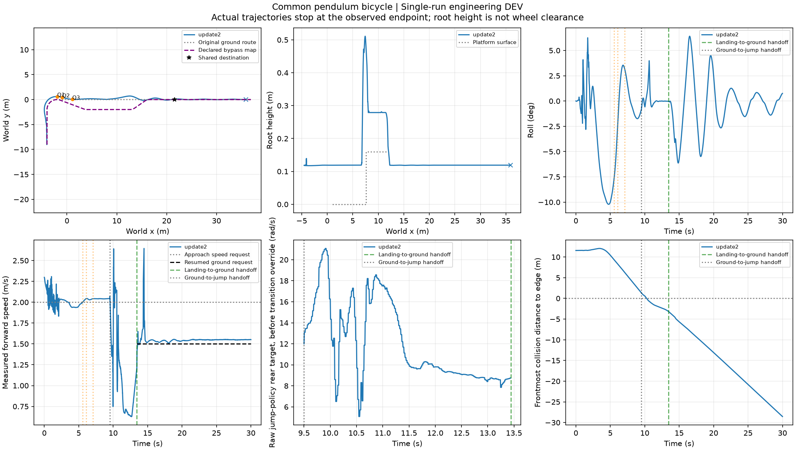

本轮优先推进任务接口，不加严验收、不新增训练。复用同一已知旧update2/root002长接近场景，增加三个预定查询位置。保持原模型、控制、400/200/50Hz、30s窗口和原严格成功判据；不是当前heading125的新验证，也不替换它。

|触发位置 x（m）|实际应用时刻（s）|评价结果|实际执行|
|---|---:|---|---|
|-2|5.56|no_feasible|保持原路2m/s、α=.5|
|-1|6.06|unknown|保持原路2m/s、α=.5|
|1|7.08|unknown；支路入口已过|保持原路，支路被排除|

三次查询含异步应用的墙钟延迟分别82/67/69ms，控制继续执行。每个位置使用新的实际观测，应用前重新检查原地图的单调进度与分流期限；切入绕行后不再跳回固定原路，超时停止本次有限查询序列。未新增线程机制，复用原单工作线程。缺省仍为原单点查询。

9.50s交给跳跃，严格台面连续支撑1.215s，13.44s交回地面，19.46s进入共同目标区域，30s完整窗口完成。物理rollout100.47s、12000物理lane步、0优化。保存的全程trace与上一轮单查询运行逐值相同；这说明本例保留原参考时多次查询没有改变运动，不是重选提高完成率的证据。评价器没有找到新可用方案，不宣称已验证可靠绕行或实时多目标任务修订。

配置新增`forward_branch.decision_positions_x_m`，只允许起跳交权前有序位置；旧`forward_branch_decision.json`保留首事件，新增`forward_branch_decisions.json`保存全序列。评分/绘图读取最后实际路线，避免把首建议误当最终执行。实际执行引用和剩余目标沿用ContinuousTask；本例最终完成，历史修订请求由物理完成解除。17项相关测试通过，完整仿真流水线通过。

[冻结配置](delivery_config/reselection_config.json)、[完整事件序列](delivery_config/reselection_decisions.json)、[结果摘要](delivery_config/reselection_summary.json)、[任务状态](delivery_config/reselection_outcome.json)、[XY原始坐标与参考](task_reselection_xy.npz)。完整高频证据位于数据盘`chapter3_task_reselection/live_root002`。
