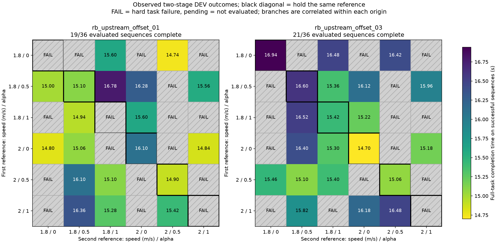
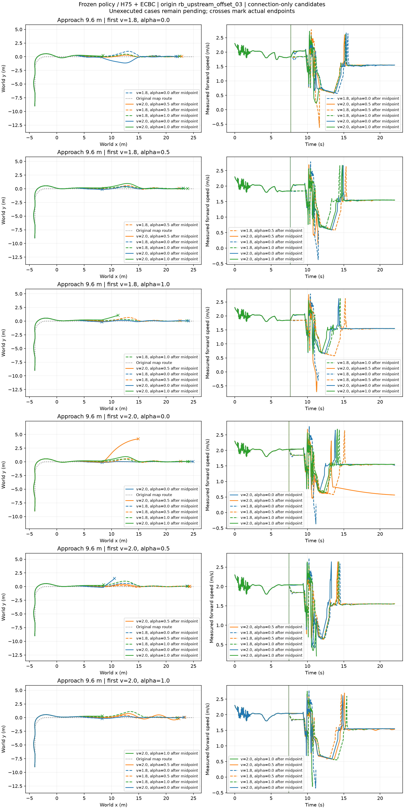
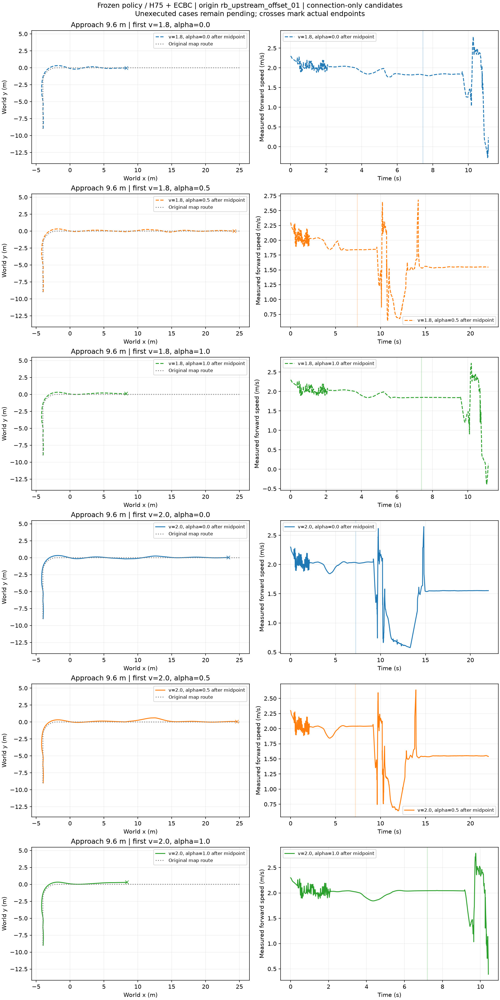

## 两阶段候选成败与时间矩阵

每行是第一段速度/α，每列是中点后的速度/α；黑框对角线表示不换档。数字为完整任务成功时间，阴影FAIL表示硬条件失败，颜色只编码成功时间。两个根共72条实际后缀（首根19/36、第二根21/36）；不能把同根分支当独立试验。原始XY见下方与首根章节。本图不包含尚未完成的144条，未新增仿真或改变标签。

## 两根的中点选档：仍未超过最佳固定后段

实际轨迹见下方第二根总览及首根历史总览。复用72条已完成分支，形成2个上游根×6种前段参考＝12个真实中点状态；不是12个独立来车根。按整根留一，查询时只用另一根全部后段数据，未训练、未校准、未改核参数。

|中点方法|完成/12中点状态|
|---|---:|
|保持前段参数|8/12|
|现行在线选择函数＋无建议保持当前|10/12|
|固定后段1.8/.5（本DEV最佳固定）|10/12|
|逐状态事后枚举最优|12/12|

按原实际在线 `JumpConnectionSelector` 的并列处理和当前指令回退评分：第一根4/6，第二根6/6。两次no_feasible保留当前参考，实际均完成；不是证明回退一般安全。10次主动选档中有2次失败，误放行2/10。无回退的通用核诊断为8个被选中成功、2次不放行，不能把不放行直接记作实际任务失败。

这只是在已观察分支上评估中点动作，不是完整C6/R6在线比较，不是独立TEST。动态选档与DEV最佳固定后段相同，不能以优于“什么都不改”声称状态特征有增益。两根均已有固定保持可行，后段补救没有新增可完成的上游根。其余四根继续原队列。

[实际在线规则重评分](two_root_selection/midpoint_runtime_selection.json) · [完整中点记录](two_root_selection/midpoint_hold_records.jsonl) · [无回退核诊断](two_root_selection/midpoint_kernel_evaluation.json)。对应命令 `evaluate_midpoint_hold_selection.py`，使用原 `JumpConnectionSelector`，未另造选档器；现有12项能力工具测试通过。

## 第二代表来车根：完整36序列

`rb_upstream_offset_03`、9.6m平整接近、冻结update2/H75/ECBC，400/200/50Hz，22s窗口。36个序列完整评价，21成功、15失败；失败分为11起跳/落地、4续行/走廊。图中 `2.0/0 → 2.0/.5` 落地后明显偏出原路径，不能因满窗口存活算完成。完整轨迹与原地图、命令、接触数据见second_root逐案例目录。

保持同一参考的6条对角序列5成功；对原C6的成败标签全部一致，匹配轨迹最大位置差0。同一第一阶段的6条分支到中点的已记录状态差0。此为实际记录一致，不是隐藏PhysX缓存证明。

|第一阶段速度/α|六个第二阶段成功数|不换档是否完成|
|---|---:|---|
|1.8/0|3/6|是|
|1.8/.5|4/6|是|
|1.8/1|3/6|是|
|2.0/0|4/6|是|
|2.0/.5|4/6|是|
|2.0/1|3/6|否|

最快固定保持与最快36枚举均为2.0/0保持，14.70s，时间上界增益0。先选2.0/1后中点换档存在3种补救成功，但整根原本已可完成，不能算新增成功来车根，也不能把21/36与5/6当方法成功率直接比较。

结合首根：目前两代表根均已有可行固定档，第一根仅事后最快时间提升.16s、第二根无时间提升。在线R6此前在第二根保持原选档，C6/R6同为16.60s，尚未实现枚举上界收益。其余4根144序列待原队列执行，不记失败，不据两个根结束整个E3。

[逐组比较与对角检查](second_root/comparison.json) · [36条完整标签](second_root/summary.json)。0优化；以下首根结果保持历史身份。

## 首根36组合完整结果

36条按相同首段档位配对，中点前完整已存状态最大差0，样本数与触发时刻完全一致（summary的midpoint_prefix_comparison）。

全部36条完成评估，19条完整任务成功、17条失败。原六条保持档为3成功/3失败；六对角与原C6全轨迹、时刻及判据完全一致。三个保持档失败的首段档位各有至少一个换档后成功方案，但来源层面原本就有固定档可行，因此未新增可行来源。

最快保持档2.0/0.5为14.90 s；最快序列1.8/0→2.0/0.5为14.74 s，节省0.16 s。这是单根DEV事后枚举上界，不是在线R6、独立TEST或普遍收益。36个实际中点Q_hold标签已导出，同一上游根仍只算一个来源。

进一步按六个真实中点状态比较：固定后段档位的成功数依次为2、5、4、3、3、2（各分母6，对应下表列顺序）；每一列都存在成功与失败。固定后段最好的1.8/.5为5/6个中点状态可行，逐状态事后选择为6/6。这说明后段结果依赖此前形成的状态/控制历史，值得验证状态选档；六状态仍来自一个上游根，不能当六个独立来车样本，也不能把事后6/6称在线R6成功率。详见[midpoint_state_dependence.json](midpoint_state_dependence.json)。

下表行为首段、列为中点后档位，1表示整任务完成，0为失败：

|首段\后段|1.8/0|1.8/.5|1.8/1|2/0|2/.5|2/1|
|---|---|---|---|---|---|---|
|1.8/0.0|0|0|1|0|1|0|
|1.8/0.5|1|1|1|1|0|1|
|1.8/1.0|0|1|0|1|0|0|
|2.0/0.0|1|1|0|1|0|1|
|2.0/0.5|0|1|1|0|1|0|
|2.0/1.0|0|1|1|0|1|0|

后续采用代表性六根安排见chapter3_midpoint_representative，原不可达根的E2失败保留；本页summary冻结首根结果，其他旧清单条目pending不作失败。以下为历史阶段记录。

# 两阶段接续：首根六个同参数对角结果

已执行 6/216 条计划序列，全部来自同一 DEV 根；3 条完整成功、3 条失败，失败保留。六条完整轨迹与原 C6 对应结果逐点相同（位置和速度最大差为 0，样本数、观察时长、八项判据和完成时间相同）。这说明加入中点事件且不改变参数时保持原行为，不代表 36 候选或在线 R6 已验证。

|速度 m/s|α|完整成功|完成时间 s|观察时长 s|
|---|---|---|---|---|
|2.0|0.5|True|14.899999618530273|22.0|
|1.8|0.0|False|None|11.125|
|1.8|0.5|True|15.100000381469727|22.0|
|1.8|1.0|False|None|11.15999984741211|
|2.0|0.0|True|16.100000381469727|22.0|
|2.0|1.0|False|None|10.420000076293945|

模型与时序：原 RB 带摆双轮车，H75＋ECBC/ESO，地面零残差；跳跃 update2。物理 400 Hz、地面底层 200 Hz、H75/跳跃 50 Hz。冻结策略，无优化更新。地面锁摆，跳跃解锁，落地重新锁摆。详细资产与控制配置在各配置及 results/*/protocol.json。

出口决策 x=-2 m，中点 x=2 m，释放线 x=6 m，平台前缘 x=7.6 m；实际中点状态在 records/midpoint_hold_records.jsonl（6 条）。前后阶段序列标签与中点后保持方案标签分别保存，不能混作同一个评价器目标。

下一步：执行预先声明的非对角候选，随后判断是否存在实际选择收益；当前不新增训练。

## 在线中点查询接口（已接线，尚未实跑 R6）

`evaluate_isaac_pendulum_jump.py` 的可选 `connection_selector` 接收 `config`、`records`（JSONL 路径列表）和 `stages`（默认 `["midpoint"]`）。配合原有 `connection_midpoint_candidate` 指定真实触发坐标。配置入口为 `learning/configs/jump_connection_capability_dev.json`，继续使用既有高斯经验评价器，不新增RL。

在线/离线共同使用 `sttw_control.jump_connection.decision_features` 的23个可观测特征；六条已保存中点特征逐项相同。按实际模型/冻结策略/物理周期/零残差配置匹配证据，排除整个当前根；只消费Q_hold与决策前走廊完整的记录。中点标签现在检查第一段连接在内的历史，六条原完整任务标签和完成时间不变。

支持不足或无可行候选保留实际当前速度与alpha请求，不重置滤波、ESO、历史或物理状态。每次事件保存所有候选估计、选档/未知、实际执行参数、查询耗时，初始化记录证据哈希与排除根。保留当前参考不等于保证安全或完成任务。

带在线选择的出口标签标为adaptive_remaining_task，不能误用为保持原档的Q_hold；实际中点选择后的保持标签单独输出。当前只有接口测试和保存数据回归，尚无在线R6物理运行或收益结论。
