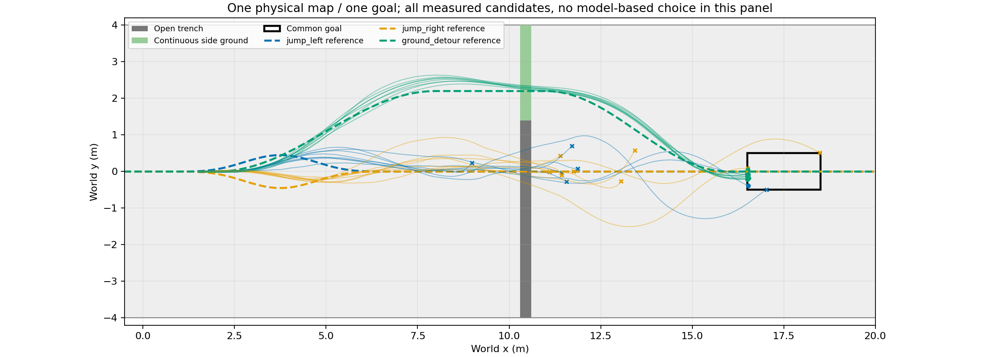

# 同地图、同目标的跳跃与地面绕行

新地图在x10.3～10.6m的沟侧增加y1.4～4m连续地面；中央开口沟保留，既有岸面顶点/三角形不变。中央接近/续行0.5～1mm微凸面、跳跃区平面；侧方绕行主要为平面。这是明确的新地图身份，不改写旧地图结果。

三候选为左/右接近后heading125跳跃并首次触地回交H75，以及H75全程轮行侧方绕行。共同目标x16.5～18.5m、|y|≤.5m、vx≥.5m；各自声明道路半宽.6m，原物理限制不变。轮行没有伪造跳跃交接，handoff_s保持null。起跳/绕行仍由数值候选选择，无LLM场景ID。

## 已执行结果

首轮4初态×3候选×2重复：左跳2/8、右跳0/8、绕行8/8完成；图包含全部24条。绕行完成8.02～8.16s，两个跳跃完成8.66/8.72s。绕行的H75请求保持2m/s，跳跃后H75请求1.5m/s，沿用明确的技能执行配置；不能忽略这一差异来宣称跳跃节省时间。

随后64个新初态×3候选=192条，在执行前按完整初态冻结40 TRAIN/8 DEV/16 TEST；109.0秒、768000物理环境步，0次控制策略训练。

|路线/技能|TRAIN 40|DEV 8|TEST 16|
|---|---:|---:|---:|
|左接近＋跳跃＋STTW|4|2|3|
|右接近＋跳跃＋STTW|6|1|2|
|连续地面绕行|37|8|15|

当前候选的事后覆盖上界与固定绕行完全相同：37/40、8/8、15/16。该分布未提供“绕行失败但跳跃成功”的互补样本；不继续靠更复杂模型拟合出规划优势。

## 多技能事件模型与在线接线

共享状态/实际局部高程编码，接近、越障、续行三分支；候选新增显式技能位（跳跃/全程轮行）。轮行只预测至共同目标的事件，跳过不存在的腾空与交接事件。只用TRAIN拟合，600CPU梯度步、DEV每100步选模，选择update400，耗时2.65秒。事件时间/状态在实际发生条件下监督，失败仍训练事件概率；候选共享未来采样噪声减少排序噪声。预测不是物理可行证明。

离线DEV8/8、TEST15/16，均等于固定绕行。冻结模型后，在另外16个新初态对固定TRAIN最佳跳跃、固定绕行、事件模型分别执行：2/16、13/16、15/16完成；48环境查询.173秒、物理评测75.7秒。模型全部选择绕行，与固定绕行组的2条差异来自同方案执行差异，不能归为模型收益。当前只在运动前查询，不声称已完成运动中的反馈重规划/计算延迟补偿。

**已走通的是地图—路线/技能—事件预测—实际任务执行。尚未证明世界模型优于固定绕行，也未得到依状态交替选路的价值。** 后续应先建立合法的路线机会截止条件或确有互补能力的任务分布，保留强固定基线，不能事后放松物理标准或给绕行随意加罚。

[192条全部XY与奖励](/media/qy/6A7E3DB07E3D75C3/STTW_runs/chapter3_jump_or_detour/collection/plots/README.md) · [在线16组三方法图](/media/qy/6A7E3DB07E3D75C3/STTW_runs/chapter3_jump_or_detour/online_selection/plots/README.md) · [逐条在线结果](online_results.json) · [模型误差](model_results.json)。生成器：`learning/cli/prepare_ditch_route_map.py`；[地图/技能合同](map_contract.json)。完整输入、轨迹与权重保留在数据盘，非新机器自包含运行包。
