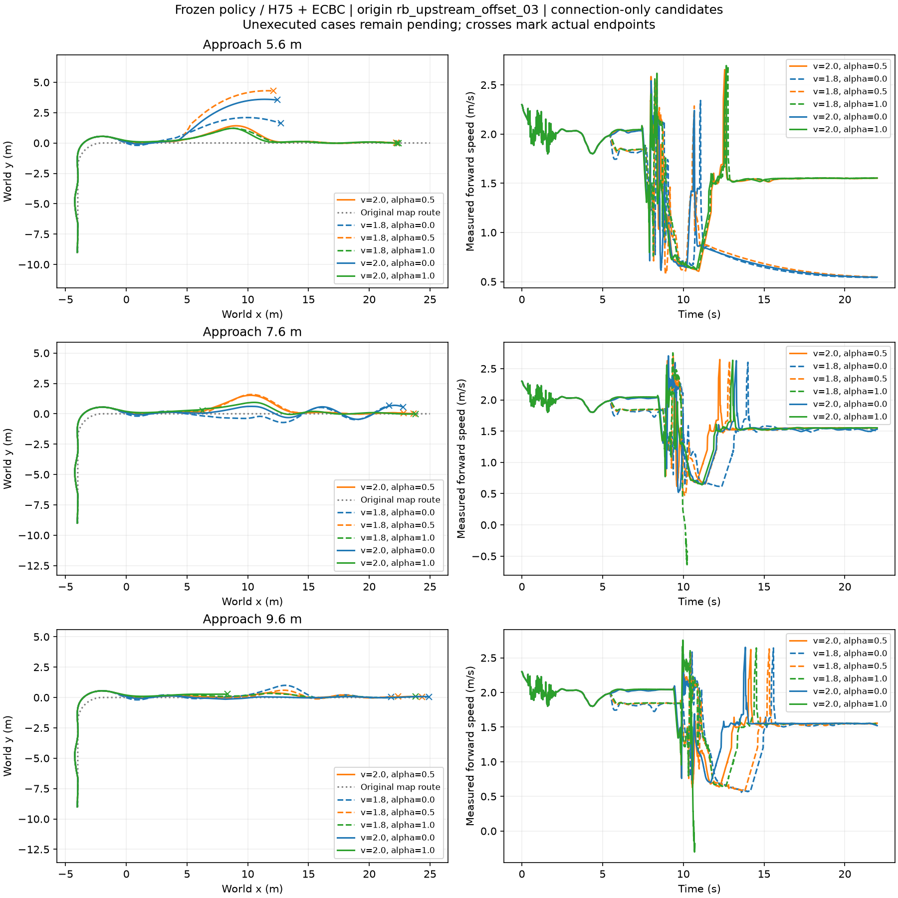
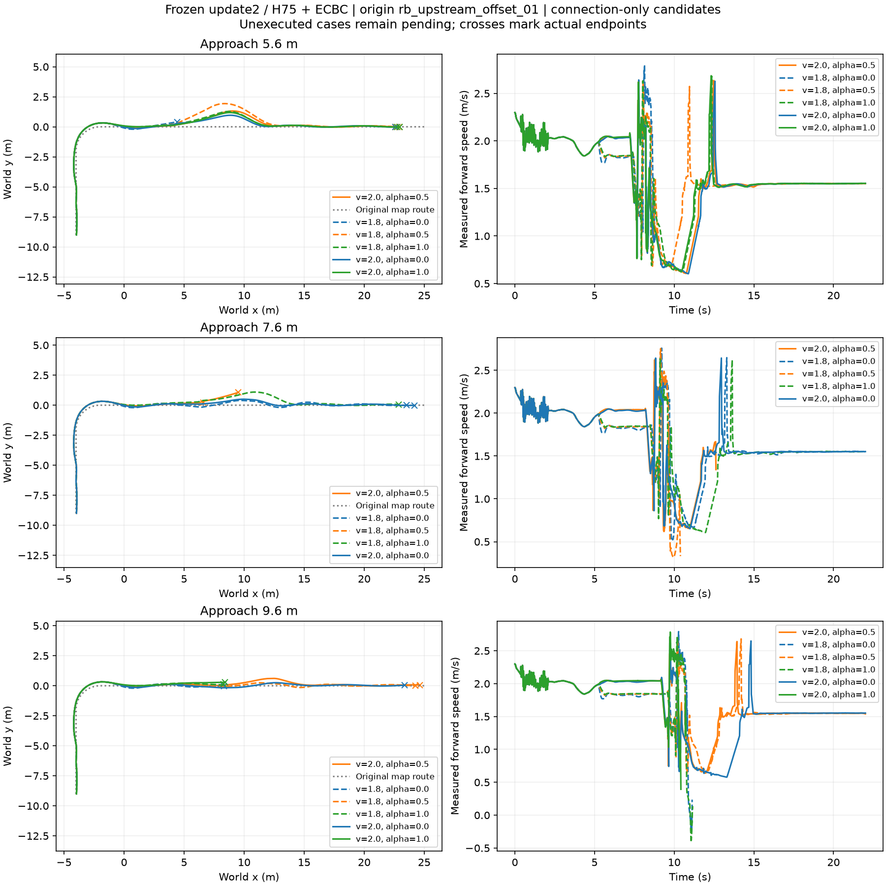
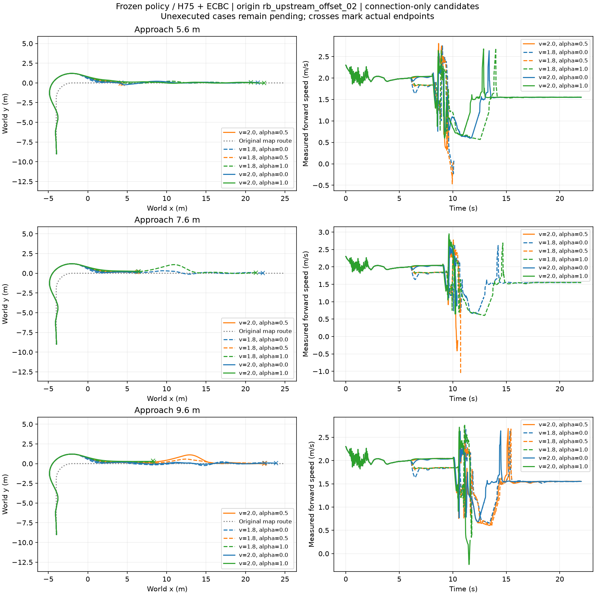

# 六新根：97/108封存

前五根各18条，第六根7条。完整15个根×距离组，固定2.0/0与事后联合最优均完成5/15；不完整的第六根不进入该比较。按根已完成候选数/成功数：01为18/6、02为18/0、03为18/8、04为18/0、05为18/0、06为7/3。不是97个独立来车样本。

根02决策前越界；根04/05分别在1.68/1.66秒、接续前终止。根05峰值侧倾43.63°，越过地面层.7rad终止线；根04保存样本峰值20.55°，最后转向速度约3rad/s，旧运行未保存控制域终止标志，不能只据physical_termination字段称倒地或确定根因。50Hz保存接触也不能排除帧间短接触。两者不作后续连接失败标签，仍保留原任务分母。

有效出口核现6完整组、2根，整根留出全部unknown；没有在线完成或概率校准证据，不因此放宽支持阈值/追加训练。剩余11条继续原批次。summary与记录导出/候选比较绑定相同封存范围，避免后台新增案例导致分母错位。以下旧阶段文字仅作历史。

# 六新来车根跳台配对：52/108阶段结果

17:54 UTC 封存 52 条：根01/02各18条，根03共16条；其余56条待回收。8个完整六候选组中，固定2.0 m/s、α=0与事后联合最优均完成4/8；当前尚无选择成功率增量，不将不完整组加入比较。

根03长9.6 m为5/6通过（仅2.0/1失败），短5.6 m六档均失败；中7.6 m已封存四档，1.8/0成功，2.0/.5、1.8/.5、1.8/1失败。短段中有候选完成落地后继续行驶但超出原走廊，仍计完整任务失败；不能只看终点。完整检查、终点、时序及原始实际命令均保存。

根02的决策前走廊违规仍在全任务分母，未修改标签。剔除已不可逆的上游失败后，Q_hold目前5个完整有效组、2个有效上游根；整根留出核评价全部返回unknown，覆盖率0，不能称在线选择已可用。没有拟合新网络或新增RL。

比较入口现可用 --summary 将本次比较固定到已封存行，避免运行中的新增文件让表、图和分母错位。本包summary、records和comparison使用这52条范围；以下为历史文字快照，公共图展示本次最新封存范围。

# 六新来车根跳台配对：38/108阶段结果

本次回收38条：前两根各18已完成，第三根2条；其余70待运行/回收。前两根×三距离构成6个完整六候选组，固定2.0 m/s、α=0和逐组事后最优都覆盖3/6，目前没有选择成功率收益证据。第三根未满六候选，不能混入此分母。

**第二根的18次完整任务失败有共同的上游原因。** 首次越过1 m半宽在4.06 s，连接参数选择在6.08 s；决策前最大偏差1.218305 m。多条后续能够落台/继续，但完整任务已经因上游越界失败。原Y、T、终止及全部检查不改，不事后放宽走廊。将其单列为决策前走廊失败，不能把这18条解释为连接候选均无效。

为了避免把已经不可逆失败的完整任务当作有效出口的连接标签，这一根不进入有效出口Q_hold核评价；它仍在全部任务记录与完整任务成功分母中。此筛选明确针对已观察的前缀约束，不按后续成败筛选。核评价目前只有首根的3个完整有效出口组，整根留出后全部unknown，尚不能证明在线选择可用。

第三根已完成的9.6m、2/.5通过；5.6m、2/.5未通过。它们仅是阶段记录。所有结果为DEV，不代表独立TEST或学会了泛化。summary完整保留108声明及pending；records保存38条原标签、决策时状态和决策前走廊历史。无新增训练。

# 历史快照：17/108

2026-11-06 16:36 UTC回收：只有首根17条已评价，首根最后一档及另外五根仍待回收。不是108条完成报告。所有结果是DEV，未训练策略/评价器。

首根为上游横向−.04m、航向−2°。5.6m六档中2.0m/s、α=0通过完整22s，T=13.700s，最大原路偏差.961m；其余五档失败。9.6m六档3通过：1.8/.5、2/0、2/.5。7.6m当时只完成5档，2档通过，不给完整六档成功率。

原名义根的5.6m六档都失败，但这个新来车根已有完整成功。因此不能仅凭距离把5.6m固定判为不可行。成功轨迹靠近1m走廊边界（余量约.039m），不将单次成功宣称为稳健能力或泛化。控制器、模型、物理400Hz/底层200Hz/策略50Hz、地图高度与完整判据未改。

首根与名义根的出口速度约1.9865/1.9874m/s，偏航角速度−.7842/−.7569rad/s，侧倾−.1515/−.1489rad；来车残余状态不同，不能把结果差异单独归因于某一个量。同首根不同候选共同前缀的位置差为0。

summary保留全部108声明及pending，comparison只对完整候选组比较，records保留17条真实标签与决策输入。这里的分支不是17个独立根。完整108冻结配置见此前jump_approach_pilot证据包next_six_roots；大数据运行目录为数据盘chapter3_jump_six_roots。
