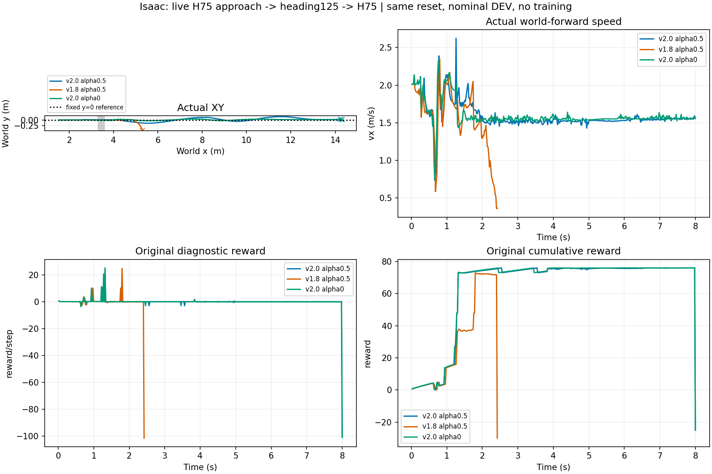

# Isaac真实STTW接近—跨沟—回交：直道链与接近配对

三条均从环境共同起点x=1.5m、vx=2m/s开始，用H75实际驶至x≥2m，再由原heading125跨越3.3～3.6m的同高平面沟；落地捕获后有限电机定姿并交回H75，续行速度请求1.5m/s、α=.5。没有读取entry4，不重置跳跃入口或落地状态，跳跃观测历史由真实地面行驶生成。名义配置单车、0训练，每条最多8秒。

|接近请求|实际切入跳跃时间/速度|回交时间|实际结果|
|---|---|---|---|
|2m/s，α=.5|0.26s / 2.040m/s|1.32s|续行至8s，终点x14.247/y0.0351m|
|1.8m/s，α=.5|0.26s / 1.870m/s|1.80s|2.42s地面跟随器适用域退出，x5.297/y−0.4608m|
|2m/s，α=0|0.26s / 2.115m/s|1.32s|续行至8s，终点x14.314/y0.0158m|

后两条只改变接近段对应请求，跳跃策略/回交/地形/名义物理配置一致。入口位置略不同，因为x≥2m按策略边界触发，不人为将不同实际状态平移对齐；实际入口、历史与时间保存在approach_entry.npz。三条为同一初态的三个候选，不是三个独立成功样本，也不宣称速度或α的普适优劣。

**当前结论：** 完整地面接近—跳跃—续行工程链已在Isaac执行；接近安排确实改变实际起跳状态及后续结果，值得继续开展多来车/准备距离配对。尚未证明世界模型收益，未验证弯道、绕行、决策线或随机化鲁棒性。不需要为走通该直道链重新训练。

按用户最新要求，连续双轮稳定支撑不作任务前置。三条原接触评分仍stage3：原诊断回报−25/−30/−25，不能用该旧分数替代续行结果。保留真实失败，未修改物理限制或后移失败终点。终点是8秒窗口末状态，未预先声明共同目标到达标准，因此这里称接续实例，不报正式整图成功率。

## 实现与证据

- DitchGroundHandoff新增可选approach段，复用已有H75与同一物理实例；保留原无接近回放默认行为。地面段jump action历史沿已有connection batch约定为零，状态/速度/加速度和控制器历史来自真实执行。
- continue_to_horizon现已实际运行；旧接触评分与任务续行终止分开，真实物理/地面域/数值故障仍终止。
- [逐候选摘要](summary.json)、[画图入口](analyze.py)、[精简图源数据](plot_data.npz)。原始根目录：`/media/qy/6A7E3DB07E3D75C3/STTW_runs/chapter3_isaac_live_approach/`，evaluation/speed18/alpha0含完整控制步、物理步、入口与交接记录。
- [冻结预算](protocol.json)及三份配置保留；代码编译和diff检查通过。因记录字段在本轮完善，最后alpha0额外保存初态及地面指令时间/阶段标签；之前两条没有这些新增字段，不冒称已补采。
- 后续：增加真实弯道来车及准备距离，先验证几种接近方案的可执行差异，再进入预测模型和两路线选路；不扩回高岸或厘米碎石。
