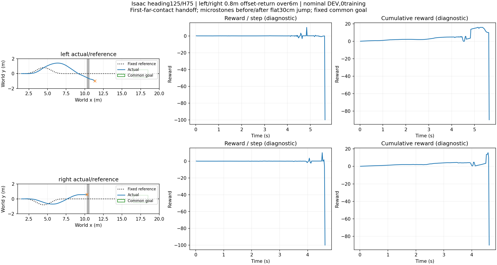

# 长弯道接近与共同目标区

运行前合同固定左右参考峰值±0.8m、偏移返回段x1.5～7.5m长6m；触发线x9，平面开口沟10.3～10.6m；0.5～1mm微凸面位于x2～7和12～22。两条共同起点，heading125/H75，接近2m/s α.5，首次远岸触地交接，续行1.5m/s α.5，名义DEV、0训练。

共同目标：x∈[16.5,18.5]m、|y|≤0.5m、vx≥0.5m/s且已交回STTW。到达前不得物理失败，车体中心距原参考折线≤0.6m；以2.5ms物理记录检查。此为中心线道路合同，不冒称完整车体扫掠碰撞保证。无需支撑保持，继续到10秒仅作后续诊断，不用后续表现重写到达时判定。

|候选|实际接近最大绝对y(m)|回交时间(s)|首次进目标(s)|满足完整目标合同|终止码/时间|
|---|---:|---:|---:|---|---|
|left|1.412|None|None|False|3 / 5.64s|
|right|0.697|None|None|False|12 / 4.62s|

全部实际轨迹保留至真实终点。进入目标区与满足道路/物理条件分别存于summary，不把存活或参考弯道存在当作任务成功。原接触奖励仅作诊断，无滤波，累计自首转移求和。两条不是独立训练种子，不构成泛化或规划增益结果；未使用世界模型在线选档。

原始记录：`/media/qy/6A7E3DB07E3D75C3/STTW_runs/chapter3_long_bend_goal`。协议与目标在运行前冻结，图和逐点距离由本目录analyze.py从原物理记录计算。

结论：这次形成实际左右弯道运动（峰值横向位移1.412/0.697m），但两条均未交回STTW、未到共同目标。左侧5.64s侧倾超限，右侧4.62s通用物理失败code12；不把code12未经分解写成某种确定碰撞原因。左侧还超出预定义道路走廊，右侧全程中心距≤0.572m。

- left：跳跃入口航向-33.22°，世界横向速度-1.097m/s；首次道路越界时刻2.05。
- right：跳跃入口航向13.02°，世界横向速度0.401m/s；首次道路越界时刻None。

当前证据支持先改进出弯后的接近准备，而非直接套用直道跳跃入口；不放宽道路或物理判据，也不增加底层训练。下一步同地图保留失败基线，比较地面准备指令对实际入口和清沟/续行的影响。两条单初态DEV不足以分离航向、侧倾、速度的独立作用。
