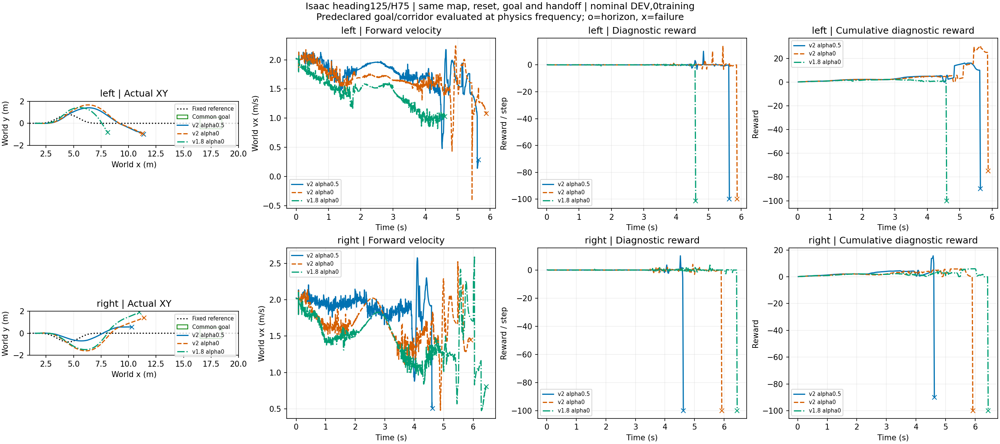

# 同地图接近指令候选：未改善

> **远岸标签更正：** 远岸接触识别终点误固定为min(8m,map_end)，而本地图远岸始于10.6m，因此目标接触标签恒false、回交无法触发。地面来车/道路越界与实际物理记录保留；触地/交接/整程能力比较须使用修正后的重跑，不将原未回交归因于技能。

复用两条原基线，仅新增左右各2m/s α0和1.8m/s α0；共四次Isaac评测、零训练。地图、道路0.6m、目标区x16.5～18.5/|y|≤0.5、触发x9、heading125/H75和首次触地回交均不变。全部初始root、关节、观测与物理随机化记录和各自原基线逐值/逐项一致。

|来路|请求速度/α|入口航向(°)|入口世界vy(m/s)|道路首次越界(s)|终止|共同目标|
|---|---|---:|---:|---:|---|---|
|left|2.0/0.5|-33.223|-1.097|2.050|code3 @ 5.64s|False|
|right|2.0/0.5|13.018|0.401|—|code12 @ 4.62s|False|
|left|2.0/0.0|-39.374|-1.195|1.992|code3 @ 5.88s|False|
|left|1.8/0.0|—|—|2.158|code15 @ 4.60s|False|
|right|2.0/0.0|30.053|0.844|2.038|code3 @ 5.92s|False|
|right|1.8/0.0|40.588|1.070|2.260|code3 @ 6.44s|False|

新增四条均未回交；2m/s α0入口航向比α.5更偏，1.8m/s左侧还未抵达跳跃线就退出地面跟随器适用域（code15），右侧入口航向40.6°后侧倾失败（code3）。原右侧α.5虽然未越道路，但仍跳跃失败code12。不能将α“路径优先”理解为保证更好跟踪。原与新增六条均未完成共同目标，不采用新增候选，不追加α扫描。

下一步检查/生成原道路走廊内更可跟踪的接近曲线，固定原道路及目标进行评价；不能把修改后的控制参考用作新的验收道路，不能放宽跳跃或物理判据。当前只有名义DEV，不是泛化结论或规划收益。所有失败保留，无新训练。

分析入口：`learning/cli/analyze_ditch_goal.py --runs <chapter3_long_bend_goal> <chapter3_long_bend_preparation> --output <report>`。目标和道路按2.5ms真实物理状态验收，原奖励仅作诊断；图无平滑、累计从首转移求和，实际终点截断。原始记录位于数据盘同名目录。两种同速度条件的回报可描述比较，但回报不替代到达/越界；没有独立ECBC对照。
