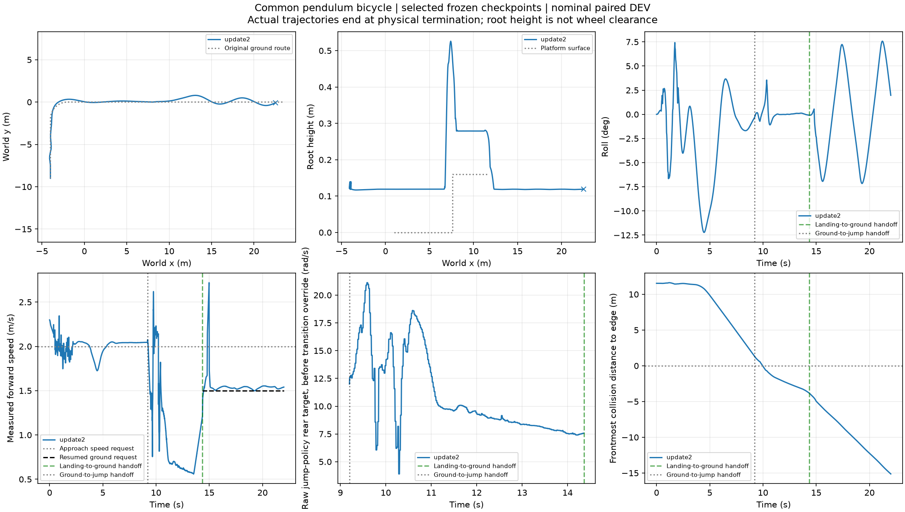

# 第三章：起伏—转弯—跳跃—续行工程链



**当前结果：单个名义仿真场景完整通过，不代表第三章或鲁棒性验证完成。** 2026-11-06，Isaac Lab，同一原RB带摆双轮模型，全程未重置物理状态。没有新增RL训练或奖励修改，大模型暂停。

## 做了什么

车辆从(-4,-9)朝北出发，通过两处2cm起伏（总长3.2m），完成半径2m右弯，沿9.6m平整路段接近0.16m高平台，跳上平台并交回地面控制续行。跳跃区不叠加起伏。平台前沿x=7.6m、后沿11.6m。

地面使用冻结H75＋ECBC/ESO，底层残差为零；跳跃使用已选update2策略。地面锁摆，跳跃释放；落地接触稳定后由跳跃姿态控制平缓恢复速度，实测达到1.2m/s再锁摆交回地面控制。不是简单按时间直接切换。

## 实测结果

|项目|结果|
|---|---:|
|完整窗口|22s，无物理/控制终止|
|原固定路径最大距离 / RMSE|0.790 / 0.223m|
|双轮台上连续严格稳定支撑|1.260s|
|交回后继续行驶|7.64s / 11.295m|
|全程最大绝对侧倾|12.223°|
|末端横向位置|−0.0786m|
|实际物理步数 / rollout墙钟|8800 / 60.05s（不含应用初始化）|

完整窗口、顺序检查点、原路径1m走廊、严格落台、地面交回、续行时间及距离均通过。[逐项判定](chain_summary.json)。落台要求双轮位置/接触力、非轮体无明显接触、侧倾与俯仰≤15°、连续≥1s；见[接触判定](landing.json)。XY保留全程摆动，不只展示末端。

## 配置与代码

- 同一原RB整车，5.091kg，轮半径0.07m/全宽0.05m，21圆柱组合圆角轮；摩擦0.8。沿用原执行器力限。
- **全程统一物理0.0025s，底层0.005s，中层/跳跃策略0.02s**。此前0.005s起伏失稳；0.001s及短接近段0.0025s通过前段但跳跃失败。新时间离散与平台后移均明确记录，不冒称单因素控制改进。
- 解析平面承载＋非零高度地形网格。源平台地下几何裁到地面以下不可见区域的z0，地上起伏及平台尺寸保留。
- [冻结运行配置](config.json)、[实际协议与模型身份](protocol.json)、[模型参数](model_config.json)。跳跃Actor哈希 `80529e5c6ffdc4036da9ee08a4218193d706ae55e23ce02e9cc7cd840c01be39`。
- 场景：`learning/cli/prepare_rb_offroad_chain.py`；执行：`learning/cli/evaluate_isaac_pendulum_jump.py`；接触/任务分析：`analyze_isaac_pendulum_landing.py`、`analyze_rb_continuous_task.py`；绘图：`plot_isaac_pendulum_jump.py`。
- 复用：`IsaacPathRollout`、`TorchController`、`TorchPendulumSkill`，未另写训练框架。原网络大小不变。

## 保留的失败与限制

[全部本阶段尝试摘要](attempts.json)保留初态不一致、短/长起伏、角速度滤波、物理步长、平整接近长度等失败。短接近时横向位置接近零仍带残余动态，跳跃未通过；直接落地交零转向也曾大幅漂移。不能把各次成功片段拼成全链成功；本报告指标均来自同一次最终运行。

这是一次DEV工程贯通，未证明跨种子、扰动或更高地形鲁棒性。原STTW正反出口6候选各12/12；前瞻评价选中方案通过，但仍无优于固定2.3m/s、alpha=.5的证据。36候选、受扰剩余任务修订、技能对照及语言任务组织仍待完成。

## 精简数据与离线重画

保留压缩原始 `trajectory.npz`、`body_contact.npz`、`ground_tracking.npz`、固定参考 `ground_route.npz`、模型碰撞几何与JSON协议；不包含训练权重、缓存或大型仿真资产。约1.3MB。原始仿真完整目录仍在数据盘 `STTW_runs/rb_offroad_platform_shift/evaluation`。

在仓库根目录、已有NumPy/SciPy/Matplotlib环境中：

```bash
RUN=docs/evidence/chapter3_motion_chain_20261106
python learning/cli/analyze_isaac_pendulum_landing.py --run "$RUN" --geometry "$RUN/geometry.json" --model-config "$RUN/model_config.json"
python learning/cli/analyze_rb_continuous_task.py --run "$RUN"
python learning/cli/plot_isaac_pendulum_jump.py --run "$RUN"
```

这些命令从保存的数据重算/出图，不重新仿真。重新运行仿真仍需配置所指本地Isaac Lab环境、原模型和冻结策略；本精简包不是自包含仿真发行包。后轮曲线是原jump网络输出，尚未叠加接管过渡覆盖，不能当作全程实际执行器命令。

第三章实时台账为项目 `research-hub/CHAPTER3_PROJECT_STATE.md`；本目录只作为可分享证据快照，不替代台账。第一章及其他线程内容没有在此改写。

详细运行、ECBC、地面策略配置及两策略身份集中在 [configuration](configuration/)。[第三章台账快照](LEDGER_SNAPSHOT.md)保留已做尝试、失败及下一步；后续以本地实时台账为准。

[模型、400Hz仿真、200Hz底层、50Hz策略及交接详细说明](CONFIGURATION.md)。
