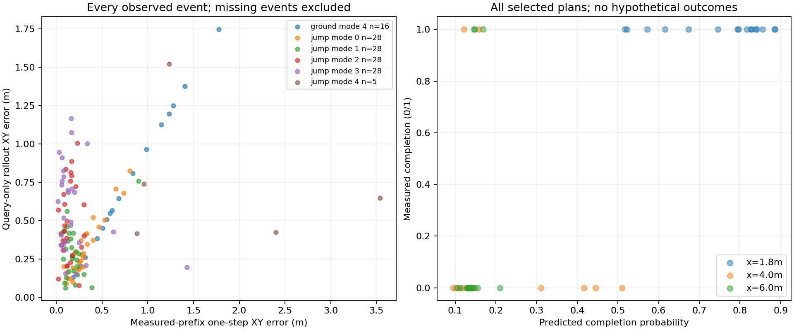

# 途中规划方法实际执行结果

|查询x/m|方法|完成|越廊|绕行/跳跃|平均查询ms|
|---|---|---:|---:|---:|---:|
|1.8|direct_success|13/16|3/16|16/0|0.393|
|1.8|event_model|16/16|0/16|16/0|3.834|
|1.8|geometry_rule|15/16|1/16|16/0|0.126|
|1.8|state_rule|16/16|0/16|16/0|0.124|
|4.0|direct_success|0/16|15/16|15/1|0.405|
|4.0|event_model|2/16|9/16|4/12|3.759|
|4.0|geometry_rule|0/16|16/16|16/0|0.125|
|4.0|state_rule|1/16|1/16|0/16|0.122|
|6.0|direct_success|4/16|3/16|0/16|0.422|
|6.0|event_model|3/16|5/16|0/16|4.022|
|6.0|geometry_rule|4/16|6/16|0/16|0.120|
|6.0|state_rule|4/16|6/16|0/16|0.127|

仿真墙钟91.53秒，768000物理环境步；0策略训练。每个初态重复多个查询位置，不能视作独立初态样本。方法共享原道路和物理失败判据；克隆环境同方案结果差异仍存在。

[逐初态XY、每步与累计奖励、速度](/media/qy/6A7E3DB07E3D75C3/STTW_runs/chapter3_jump_or_detour/moving_baselines/plots/README.md)；[完整分组与逐条结果](results.json)。

## 比较合同与结论

16个新初态、3个查询位置、4种方法，共192条；环境空间排列按seed20261118预先打乱。地形、H75/heading125、原物理与0.6m道路、同一终点均冻结。低层0次训练，无中途状态重置。模型未使用这批初态调参，仍属单地图开发性验证，不是独立布局泛化。

准备距离规则：x<2.5m时优先合法绕行，之后优先直行跳跃；2.5m来自既有TRAIN早1.8m绕行成功、晚4m失败的区间内保守取值，未搜索本批结果，也不是认证的最晚绕行点。纯几何规则只判断当前是否仍处在候选道路内。

直接成败MLP使用与事件模型相同的197个实际发布片段、完整根分组、状态历史编码、局部地图和候选参数；同样600次CPU更新、每100次按DEV选一次，使用自身BCE目标。加入同类0.5秒前缀样本；两模型的监督目标和损失不同，不能宣称训练算力完全等价。直接模型原始片段TRAIN/DEV/TEST Brier分别0.0564/0.0793/0.1695；TEST已用于前期检查，不是新确认集。加载后197条预测与保存值最大差5.96e-8；仅接口核对，不是性能证明。

总完成：事件模型21/48，准备距离规则21/48，纯几何19/48，直接成败17/48。中段事件模型12/16选择跳跃，直接模型只有1/16；事件模型2/16完成，但准备距离规则也可避开全部16次晚绕行。事件模型没有超过简单准备规则，不能把优于本次小型直接分类器写成世界模型固有优势或充分调优基线的结论。

事件模型对准备规则逐根逐位置为5赢5失，其中9个异结果条件其实选择相同路线，仍受克隆物理差异影响。早段全选绕行、晚段全选跳跃时的分数差异不能归因于选路。保留全部192条，不挑最好视频。停止针对该批次调参；下一阶段需独立道路布局、技能能力变化，以及更充分的预测校准对照。

事件推理均值约3.8–4.0ms，直接模型约0.4ms，规则约0.12ms；都向上取整为20ms后发布，并在等待期间执行旧控制真实前进。此处是单车查询计时，不是192环境并行实时部署吞吐。首次接地交回STTW，不恢复稳定支撑前置。

原始配置、逐步轨迹、查询/发布记录在数据盘`chapter3_jump_or_detour/moving_baselines`；模型在`switch_event_model`与`switch_success_model`。本阶段仅证明接通并揭示局限，不采用事件模型为更优规划器。

## 冻结模型的事件预测诊断

只核对本批48条事件模型实际选择的方案，不把未执行候选当真值。真实上一事件状态输入的单步预测，与只从选路时刻输入一次的整链预测分开；误差只对实际发生的目标事件计算，缺失事件保留在概率评分分母。原模型不重训，0新增仿真。

28条选择跳跃的轨迹全部达到远岸接触和STTW交接，但仅5条完成共同目标。首次远岸接触的单步时间MAE为0.053秒、单步XY误差0.138m；从选路时刻滚动预测的接触XY误差增至0.489m，交接XY误差0.584m。数据中没有这28条的“未接触”反例，因此低接触Brier不能证明接触失败识别能力。

落地后续行至目标是更大问题：5条真实成功跳跃的终点高度误差，真实交接状态输入的单步预测平均3.84m，整链预测5.13m；原基线把落地向下速度线性积分数秒，再由学习残差抵消，存在明显不适合接地阶段的建模先验。这里只描述预测错误，仿真本体、成功判据和实际轨迹未改。48条所选方案整程Brier为0.1253，较低分类误差不能代替可信物理状态预测。

已据此提出仅在地面事件mode0/4保持当前高度、学习变化残差的最小修订；旧模型和本批结果冻结，新模型必须另用新初态验证，不以本诊断数据反复选优。完整逐事件字段位于数据盘`moving_baselines/prediction_audit/results.json`，精简指标见[prediction_audit.json](prediction_audit.json)。
