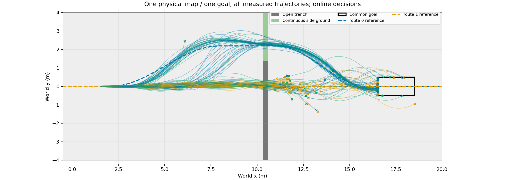
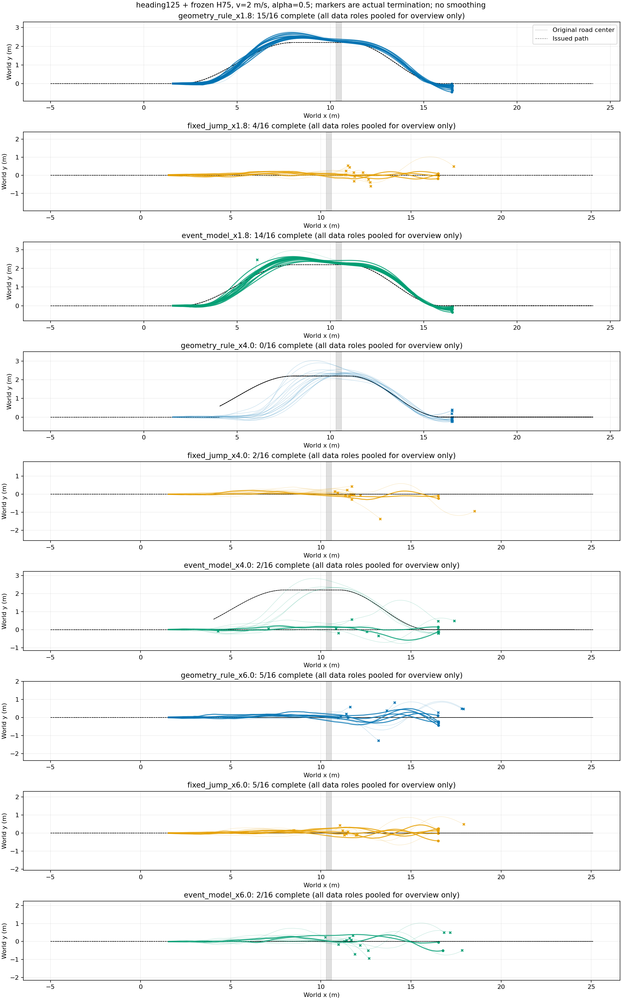

# 持续前进中的跳跃／绕行决策

共同目标、同高30cm开口沟，侧面连续地面可绕行；地面H75 + ECBC/ESO，zero_lower=true，跳跃heading125。首次远岸触地后交回STTW，不等待稳定支撑。0策略训练，原物理失败与0.6m道路约束不变。

## 实际闭环与数据

公共直路真实行驶→在x=1.8/4/6m查询当前状态及历史→旧控制继续执行计算延迟→复核道路连接→发布路线／技能→跨沟或绕行→共同目标。切换不恢复快照，不重置ESO、观测历史或物理状态；仅改变所选路径并重新投影。每条最多一次途中决策，尚不是连续滚动优化。

先前24条探针中，x1.8绕行两组各4/4；x4两组均0/4，暴露“当前尚在走廊内”不能保证能转入绕行；x6同选原右跳，0/4与2/4不能归因于模型。之后新增直行跳跃候选，取40个新根初态×5次真实发布，共200条（93.76秒）；24/8/8个完整根分TRAIN/DEV/TEST。各候选总完成为：早绕37/40、早直跳7/40、中绕0/40、中直跳1/40、晚直跳9/40。同一路线的不同发布时间结果不同，不直接解释为延迟因果效应，克隆环境物理差异仍在。

197条实际成功发布后的片段用于事件模型，3条未发布保留原始失败／回退结果，不冒充已执行候选。抽取片段没有重置仿真；每条保留原根数据角色。模型600次CPU更新，按DEV损失选400；不把这称作PPO跳跃技能训练。额外加入0.5秒间隔的因果前缀状态；失败事件仍参与分类损失。

## 冻结模型后的新16初态验证

每初态3个查询位置×3方法，144条物理轨迹；空间环境排列预先打乱。耗时89.56秒，576000物理环境步。下面均为整程到目标且未越原路廊；不是模型预测分数。

|查询x/m|方法|完成|越廊|选绕行／跳跃|平均查询ms|
|---|---|---:|---:|---:|---:|
|1.8|geometry_rule|15/16|1/16|16/0|0.110|
|1.8|fixed_jump|4/16|2/16|0/16|0.123|
|1.8|event_model|14/16|2/16|16/0|3.862|
|4.0|geometry_rule|0/16|16/16|16/0|0.120|
|4.0|fixed_jump|2/16|2/16|0/16|0.120|
|4.0|event_model|2/16|8/16|5/11|3.839|
|6.0|geometry_rule|5/16|5/16|0/16|0.126|
|6.0|fixed_jump|5/16|3/16|0/16|0.114|
|6.0|event_model|2/16|6/16|0/16|3.863|

模型在中段11/16改选直行跳跃，其他5次仍误选绕行；几何规则16次全选绕行且全部失败。但早段模型与规则都选绕行，晚段三者都选跳跃，相同方案的完成数仍不一致。汇总模型18/48、几何20/48、固定直跳11/48；位置是同根的重复条件，不能当48个独立随机初态，也不能据此宣称模型更优。

推理均被向上取整为一个20ms控制步，车辆真实前进约4cm后才发布，没有暂停物理。该延迟按单车单次查询计入；144环境批量评测的墙钟速度不等于真实实时部署。发布复核没有改变本批次初选，不能称已经证明反馈修订收益。

x6的绕行连接被硬道路检查拒绝，即使模型给出较高绕行分数也不会执行；学习分数不是可行性保证。中段的错选说明实际切换数据已让模型部分识别准备不足，但校准仍不充分。

## 结论与下一步

已走通同地图、同目标、真实前进状态下的路线／技能决策、实际延迟传播与落地STTW接续。当前不采用为优于几何／状态规则的规划器；需要同数据直接成败预测对照和独立布局验证，不能用起点候选选择代替这些实验。没有针对本批新初态继续调参。

全部逐初态XY、每步及累计奖励、速度：[完整索引](/media/qy/6A7E3DB07E3D75C3/STTW_runs/chapter3_jump_or_detour/moving_selection_validation/plots/README.md)。逐条结果、选择与延迟见[results.json](results.json)。

原始轨迹：`/media/qy/6A7E3DB07E3D75C3/STTW_runs/chapter3_jump_or_detour/moving_selection_validation/evaluation/trajectories.npz`；协议：`/media/qy/6A7E3DB07E3D75C3/STTW_runs/chapter3_jump_or_detour/moving_selection_validation/protocol.json`。训练切换轨迹：`/media/qy/6A7E3DB07E3D75C3/STTW_runs/chapter3_jump_or_detour/switch_collection`；派生片段与冻结模型：`decision_segments`、`switch_event_model`；早期24条：`moving_decision`。
