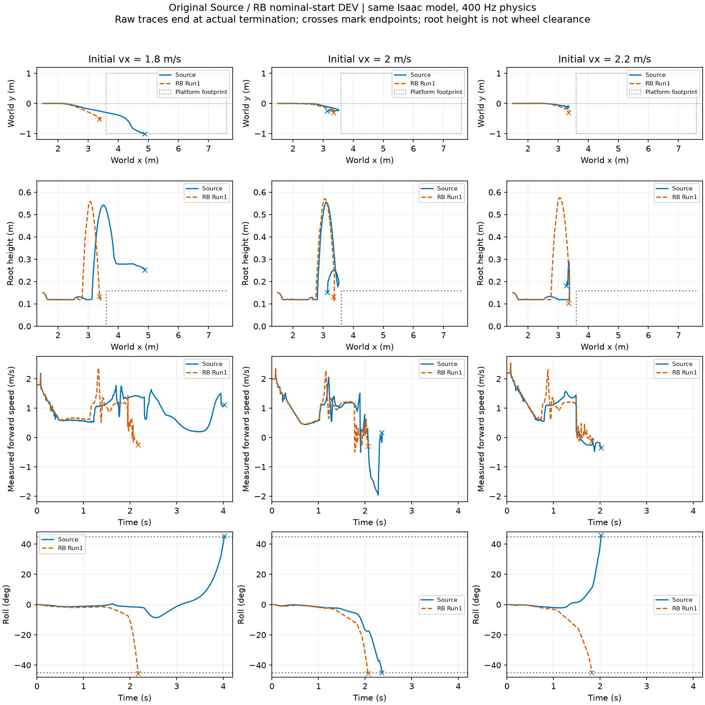

# 原source/RB名义起点：迁移基线未通过

同一Isaac模型与初始化，物理400Hz、策略50Hz；每策略vx=1.8/2/2.2m/s。所有曲线在真实失败时终止，无平滑。不同速度仅是固定初始速度条件，不是独立随机根。

|策略|初速m/s|终止s|严格支撑最长s|连续1s支撑|满8s|
|---|---:|---:|---:|---|---|
|source|1.8|4.025|0.345|否|否|
|source|2.0|2.365|0.000|否|否|
|source|2.2|2.025|0.000|否|否|
|rb_run1_candidate|1.8|2.175|0.000|否|否|
|rb_run1_candidate|2.0|2.065|0.000|否|否|
|rb_run1_candidate|2.2|1.825|0.000|否|否|

六条均以侧倾超过45°终止；source初速1.8曾在台面严格支撑约.345s，尚不足1s；其他五条没有严格支撑窗口。该结论是当前Isaac迁移结果，不能据此否定原MuJoCo策略能力或RB方法。

原airborne_after_handoff把初始0–.04s轮子离地也记入，原字段保留。新增只读诊断先要求观测到轮接触，再检查>=.02s双轮离地，六条仍有后续实际腾空，但均未达到严格落台。没有修改物理、终止或落台判据。

实际物理步5792，仿真循环墙钟合计139.785s（不含六次加载/出图）；不是19200预算步全跑完，较短耗时主要因为提前失败，不能称训练提速。0优化更新。

**决策：** 两原策略在名义起点与之前可达接近矩阵均失败，支持任务书的同待遇有界迁移适配。此名义基线没有通过项，所以“没有丢失通过项”是空条件，不能宣称保留了原有能力；后续先要求展示真正的名义与完整链改善。update2保留为当前工程技能，不替换成未通过的原策略。适配预算各25更新已准备，尚未启动。

本组属于已冻结9工况面板的update0名义部分；后续匹配策略数组/执行身份/配置后复用，不额外跑6条。原始证据路径：`/media/qy/6A7E3DB07E3D75C3/STTW_runs/chapter3_nominal_skill_retention`。
