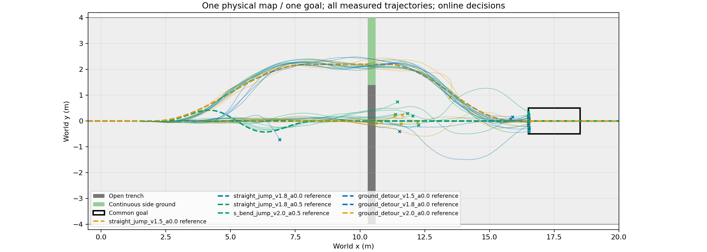
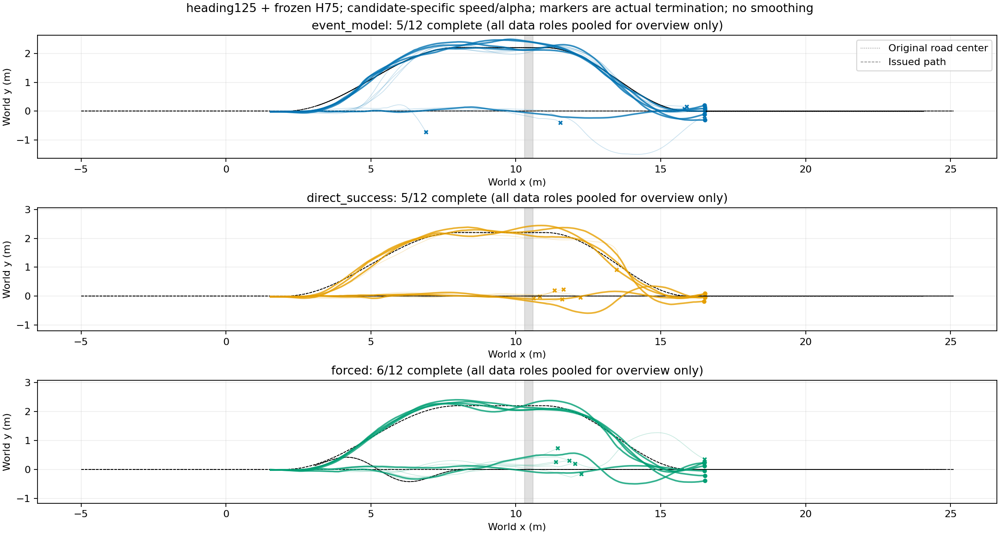

# 途中规划方法实际执行结果

|查询x/m|方法|完成|越廊|绕行/跳跃|平均查询ms|
|---|---|---:|---:|---:|---:|
|1.8|direct_success|3/4|0/4|4/0|3.531|
|1.8|event_model|4/4|0/4|4/0|53.673|
|1.8|forced|4/4|0/4|4/0|2.646|
|3.0|direct_success|0/4|0/4|0/4|3.234|
|3.0|event_model|0/4|4/4|4/0|49.441|
|3.0|forced|1/4|2/4|0/4|2.599|
|5.0|direct_success|2/4|0/4|0/4|3.196|
|5.0|event_model|1/4|2/4|0/4|50.405|
|5.0|forced|1/4|0/4|0/4|2.679|

仿真墙钟80.81秒，144000物理环境步；0策略训练。每个初态重复多个查询位置，不能视作独立初态样本。方法共享原道路和物理失败判据；克隆环境同方案结果差异仍存在。

[逐初态XY、每步与累计奖励、速度](plots/README.md)；[完整分组与逐条结果](results.json)。

## 自主执行闭环与采用决定

冻结事件模型、直接成败模型与TRAIN距离规则分别完成 **5/12、5/12、6/12**。这是4个独立新来车初态在3个查询位置的重复配对，不能视为12个独立初态。事件与直接模型相对规则均新增1例、丢失2例。本轮采用为**已知地图有限候选自主执行闭环证据**，不采用优于基线或统计等效结论。

系统实际评价60个路线/速度/α候选；x=1.8、3m时准入60个，x=5m时准入30个。晚位置绕行排除来自显式几何准入，并非模型自行发现物理不可行。事件模型在早位置选择绕行，在晚位置选择直线跳跃；不是按文字挑预设完整场景。每回合只有一次途中决策以及发布前复核，不称连续重规划。距离规则本身也属于自动决策方法，学习方法的区别是使用状态及事件预测评价候选，不能仅凭“自主”宣布优越。

同一个root=3的三个独立回合：

|查询位置/m|实际选择|准入数|完成|进入跳跃/s|回交STTW/s|
|---|---|---:|---|---:|---:|
|1.8|ground_detour_v1.8_a0.0|60|True|None|None|
|3.0|ground_detour_v1.8_a0.0|60|False|None|None|
|5.0|straight_jump_v1.8_a0.0|30|True|3.8999998569488525|4.920000076293945|

早位置绕行和晚位置跨沟续行都实际到达共同目标；中位置失败一并保留。这些是代表性解释案例，不用于替代上面的全部条件统计。[全部12条自主决策证据](autonomy_trace.json)保留状态、合法候选数、前三分数、实际选档、延迟推进和交接时间。

规则按TRAIN数据分别固定x=1.8/3/5m的候选48/22/4，不是全图单一固定档。两学习方法本轮都使用预测完整完成概率排序。查询耗时真实推进到20ms控制边界，不能将推理当作冻结物理的零成本查询。仿真耗时80.81s，144000物理环境步，0PPO。原始轨迹与权重在run路径保留。
