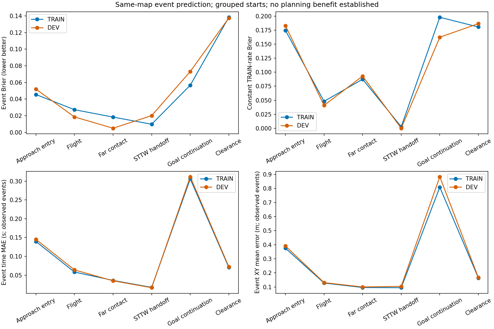

# 越野事件模型首轮预测结果

[全部物理实际／参考XY与任务结果](RESULTS.md)

按完整来车初态划分TRAIN/DEV，600次CPU更新，DEV选择更新600；耗时21.34秒。测试集未参与拟合或选择。六种预定义阶段的事件发生、状态及时间预测，尚非任意接触模式发现；不等同已验证的在线规划收益。

|阶段|DEV片段/发生|模型Brier|TRAIN发生率基线Brier|时间MAE/s|XY误差/m|
|---|---:|---:|---:|---:|---:|
|Approach entry|1200/911|0.0520|0.1831|0.1451|0.3912|
|Flight|141/135|0.0185|0.0408|0.0640|0.1311|
|Far contact|135/121|0.0050|0.0930|0.0349|0.1002|
|STTW handoff|121/121|0.0201|0.0000|0.0166|0.1045|
|Goal continuation|928/180|0.0731|0.1625|0.3115|0.8825|
|Clearance|141/106|0.1375|0.1867|0.0723|0.1668|

时间和状态误差仅对确实发生的事件计算；Brier包括未发生事件。前缀片段相关，不能把片段数当独立初态数。常数基线只使用TRAIN各阶段发生率。352维控制历史与观测压缩成16维，不能据此保证Markov性；没有物理接触求解缓存。

数据：`/media/qy/6A7E3DB07E3D75C3/STTW_runs/chapter3_offroad_distance_training/segments`；模型：`/media/qy/6A7E3DB07E3D75C3/STTW_runs/chapter3_offroad_distance_training/model`。完整指标见[prediction_metrics.json](prediction_metrics.json)。后续仍需同输入直接成败/普通转移模型对照及独立整程规划验证。

1199条实际发布片段用于建模；同初态三位置不跨分组。远岸接触DEV Brier0.0050对常数0.0930、时间MAE0.0349s、XY0.1002m；STTW回交121/121发生，常数基线接近零误差、模型0.0201更差。续行终点XY误差0.8825m，尚无在线规划收益。较晚片段只具有原10s回合的剩余时间，未重新给满10s；当前输入没有显式剩余回合时间，这是后续部署/任务时域需明确的限制，不把该模型称为充分状态预测器。
