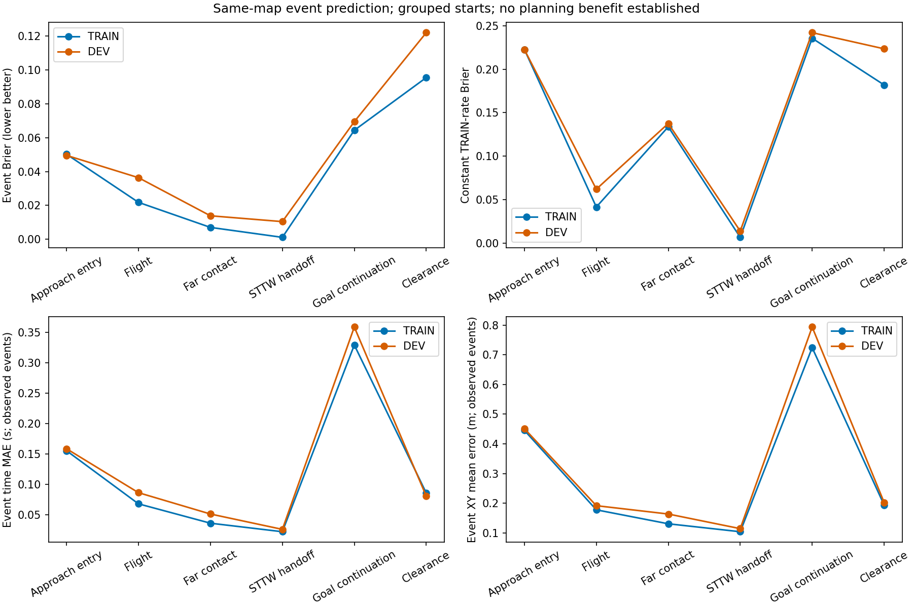

# 越野事件模型首轮预测结果

[全部物理实际／参考XY与任务结果](RESULTS.md)

按完整来车初态划分TRAIN/DEV，600次CPU更新，DEV选择更新600；耗时4.96秒。测试集未参与拟合或选择。六种预定义阶段的事件发生、状态及时间预测，尚非任意接触模式发现；不等同已验证的在线规划收益。

|阶段|DEV片段/发生|模型Brier|TRAIN发生率基线Brier|时间MAE/s|XY误差/m|
|---|---:|---:|---:|---:|---:|
|Approach entry|1127/750|0.0495|0.2226|0.1586|0.4513|
|Flight|91/85|0.0364|0.0621|0.0862|0.1916|
|Far contact|85/71|0.0139|0.1376|0.0511|0.1634|
|STTW handoff|71/70|0.0105|0.0139|0.0258|0.1142|
|Goal continuation|917/373|0.0694|0.2420|0.3591|0.7937|
|Clearance|91/62|0.1219|0.2235|0.0806|0.2027|

时间和状态误差仅对确实发生的事件计算；Brier包括未发生事件。前缀片段相关，不能把片段数当独立初态数。常数基线只使用TRAIN各阶段发生率。352维控制历史与观测压缩成16维，不能据此保证Markov性；没有物理接触求解缓存。

数据：`/media/qy/6A7E3DB07E3D75C3/STTW_runs/chapter3_offroad_event_training/segments`；模型：`/media/qy/6A7E3DB07E3D75C3/STTW_runs/chapter3_offroad_event_training/model`。完整指标见[prediction_metrics.json](prediction_metrics.json)。后续仍需同输入直接成败/普通转移模型对照及独立整程规划验证。

本轮实体任务完成122/720：直线44/180、S弯20/180、直角弯0/180、绕行58/180。模型各DEV阶段Brier低于常数基线，但目标续行状态XY平均误差仍0.794m；当前只支持“存在可学习的事件信息”，不能由此推出滚动预测可靠或规划优于直接成败模型。模型保持600轮冻结，不在已见TEST上调参。
