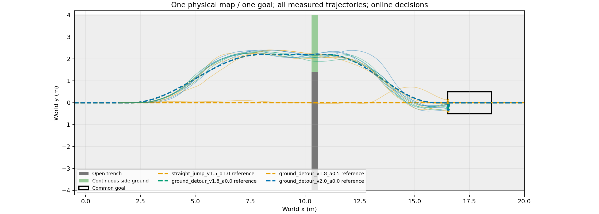
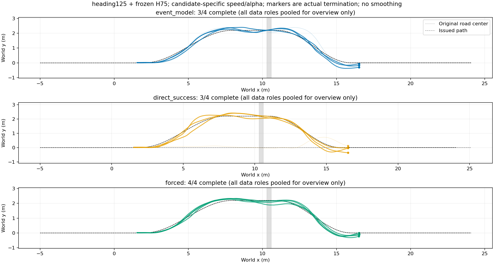

# 途中规划方法实际执行结果

|查询x/m|方法|完成|越廊|绕行/跳跃|平均查询ms|
|---|---|---:|---:|---:|---:|
|1.8|direct_success|3/4|1/4|3/1|3.494|
|1.8|event_model|3/4|1/4|4/0|50.299|
|1.8|forced|4/4|0/4|4/0|2.560|

仿真墙钟64.57秒，44352物理环境步；0策略训练。本批4个新初态、单个查询位置，每初态比较三方法；仅4个独立初态。方法共享原道路和物理失败判据；克隆环境同方案结果差异仍存在。

[逐初态XY、每步与累计奖励、速度](plots/README.md)；[完整分组与逐条结果](results.json)。

事件模型与直接模型各3/4，TRAIN固定最佳绕行48为4/4；两模型均0新增、1丢失。候选48=绕行1.8m/s、α0；51=绕行2m/s、α0；49=绕行1.8m/s、α0.5；2=直跳1.5m/s、α1。事件模型选择绕行4/4，直接选择绕行3/4、直跳1/4；不声称世界模型创造了新通过方式。两模型统一最大化完整任务概率，实际推理延迟参与物理前进；事件平均50.30ms、直接3.49ms、固定2.56ms。

冻结首轮结果：事件模型概率校准略优于直接成败，但在线未超过固定档且成本更高，未采用优越性结论。当前数据仅覆盖x1.8m早决策；下一阶段先拓展训练中准备距离和合法路线截止条件，不能把当前模型在未训练晚决策下的结果当已校准能力，也不调这4根TEST。90°路线仍无已测完整通行，不删除失败。
