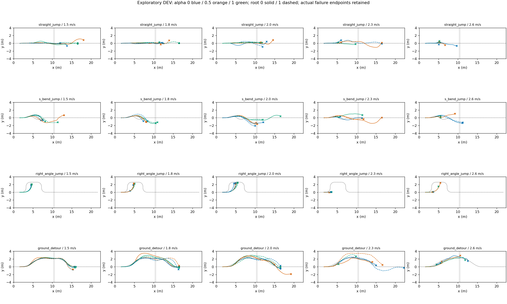
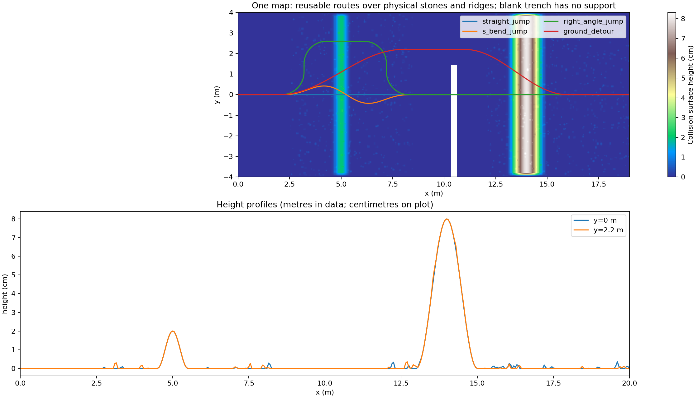

# 越野任务地图与首次全候选执行

四条路线共享同地图、同目标：直线跨沟、S弯接近跨沟、圆角90度弯接近跨沟、连续地面绕行。五速度1.5/1.8/2.0/2.3/2.6m/s来自STTW既有配置；α0/.5/1。共60候选×2初态=120条探索性DEV，不是独立泛化统计。候选在x1.8m实际发布，旧世界模型仅加载共用入口，不为新地图评分。原道路半宽0.6m、目标和失败判据保留；跳跃模型身份见下文冻结配置，首次远岸接触后交回STTW。

地形：真实30cm开口沟；沟外1–4mm圆顶石子（碰撞高度网格而非视觉装饰），2cm及8cm脊坡；x8.5–12m平整跳跃区。同高两岸，无整体高岸。碰撞网格水平分辨率约2.5cm，高程图5cm、单位米，沟缺口保留NaN及support=false；图显示厘米。圆角90度路径半径见本运行map_contract.json，不要求车辆瞬间转向。

|路线|速度m/s|α0 /2|α0.5 /2|α1 /2|
|---|---:|---:|---:|---:|
|straight_jump|1.5|0|0|2|
|straight_jump|1.8|0|0|1|
|straight_jump|2.0|0|0|0|
|straight_jump|2.3|0|0|0|
|straight_jump|2.6|0|0|0|
|s_bend_jump|1.5|0|0|0|
|s_bend_jump|1.8|0|0|0|
|s_bend_jump|2.0|0|0|0|
|s_bend_jump|2.3|0|0|0|
|s_bend_jump|2.6|0|0|0|
|right_angle_jump|1.5|0|0|0|
|right_angle_jump|1.8|0|0|0|
|right_angle_jump|2.0|0|0|0|
|right_angle_jump|2.3|0|0|0|
|right_angle_jump|2.6|0|0|0|
|ground_detour|1.5|0|0|0|
|ground_detour|1.8|1|0|1|
|ground_detour|2.0|1|0|0|
|ground_detour|2.3|0|0|0|
|ground_detour|2.6|0|0|0|

完整任务完成 6/120。耗时 94.89s，物理环境步 480000。未参与训练，不按失败删除路线或放松道路。此轮同时扩展路线与地形，用于任务覆盖与能力采集，不归因某单因素。

[每步奖励](reward.png) · [累计奖励](cumulative_reward.png) · [真实速度](speed.png) · [全部原始终止码与逐条件结果](cases.json)。

原始高程、支持掩码、碰撞网格、路线与逐步数据：`/media/qy/6A7E3DB07E3D75C3/STTW_runs/chapter3_offroad_rb_candidates/rb500`。后续世界模型需要使用本地图数据重训/校准，当前不能宣称已学会在新地图自主决策。

实际跳跃权重：`/media/qy/6A7E3DB07E3D75C3/STTW_runs/chapter3_rb_jump_scheduled/pipeline/train/training/model_update_00500.pt`。
