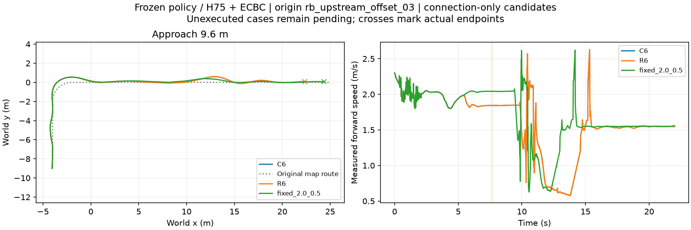

# 在线 C6/R6：同来源配对 DEV

根 rb_upstream_offset_03，接近距离9.6m，22秒完整链。C6在出口查询一次；R6在出口及中点查询。证据在执行前冻结，选择器排除整个查询来源，正在采集的该根36分支不进入查询。不是独立TEST。

|方法|完整任务|首次满足全部条件时间|实际选择|
|---|---|---|---|
|C6|通过8项检查|16.60s|出口1.8m/s，α=.5|
|R6|通过8项检查|16.60s|出口1.8m/s，α=.5；中点维持|
|复用固定参考|通过8项检查|15.06s|2.0m/s，α=.5|

C6/R6的1818条已记录12维轨迹逐元素一致，不能据此宣称隐含仿真状态一致。两者比固定参考慢1.54s。本例在线接线可用，但没有中途重选或效率收益，尚不证明能力规划优于固定参数。图中C6被R6完全覆盖。固定参考复用原chapter3_jump_six_roots同来源工况，不重新运行。其原始证据见comparison manifest配置路径和相邻chapter3_jump_six_roots_20261106证据包。

出口查询发生于5.44s，中点7.64s。C6首次查询墙钟0.23469s，R6出口0.00866s、中点0.00232s；首次查询开销不可省略。这是同步仿真测量，不代表异步实时执行时延保证。查询输出为经验估计，不是校准完成概率。

原RB整车、摩擦0.8，H75 actor0077＋ECBC/ESO，zero_lower=true；地面锁摆，起跳释放；跳跃update2。物理400Hz、底层200Hz、策略50Hz，22s×2×400=17600步上限，0优化更新。完整实际模型、关节、权重身份、控制映射和时钟见各protocol.json，冻结选择器与输入在input目录。原始运行与日志保留数据盘chapter3_online_connection_root03；此包不含权重、USD缓存。

manifest中的speed/alpha是启动模板值；真实在线选择必须读取connection_decision/midpoint_decision，不能将模板2.0误写为在线执行速度。
