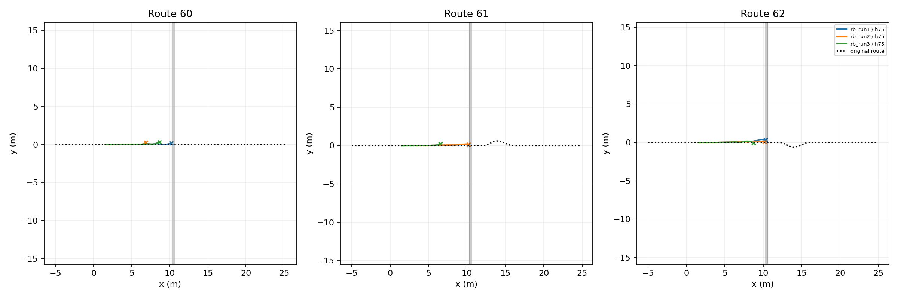

# Native Playground RB–STTW handoff trial

Role: bounded integration DEV; one common nominal ground start per route, not an independent success-rate estimate.

| Skill | Route | Continuation | Airborne | Far contact | Handoff s | End | Final XY m |
|---|---:|---|---|---|---:|---|---|
|rb_run1|60|h75|True|False|None|physical_failure|[10.18624210357666, 0.1658812016248703]|
|rb_run1|61|h75|True|False|None|physical_failure|[10.218049049377441, 0.084597148001194]|
|rb_run1|62|h75|True|False|None|physical_failure|[10.299291610717773, 0.34437066316604614]|
|rb_run2|60|h75|False|False|None|physical_failure|[6.849264144897461, 0.26257243752479553]|
|rb_run2|61|h75|True|False|None|physical_failure|[10.202569961547852, 0.18868325650691986]|
|rb_run2|62|h75|True|False|None|physical_failure|[10.151383399963379, 0.11896726489067078]|
|rb_run3|60|h75|False|False|None|physical_failure|[8.64310359954834, 0.33835557103157043]|
|rb_run3|61|h75|False|False|None|physical_failure|[6.560021877288818, 0.20657509565353394]|
|rb_run3|62|h75|False|False|None|physical_failure|[8.752605438232422, -0.030415181070566177]|

Completed 9/9 episodes. The declared approach controller (see declaration.json) precedes native RB jumping; after measured far-bank wheel contact RB continues for 0.5 s before H75 or its zero-middle comparator is engaged. Native vehicle, servos and finite-torque leg hold remain physical; no pose reset or artificial stable-support requirement.

The heightfield retains the original seeded rough-bank surface through 25mm resampling. Native vehicle/collision behavior and 5ms physics differ from Isaac, so this is a transfer feasibility trial, not a simulator-only causal comparison. H75 starts with measured ESO state and empty policy history.

## Stage diagnosis

4/9 failed during STTW approach; 5/9 entered RB but failed before far-bank contact. No touchdown or handoff was observed, so the 0.5 s handoff delay has not yet been exercised by this batch. Terrain interior checks confirm both flat buffers. Runtime: 70.09 s. This does not establish a benefit or failure of delayed handoff.
