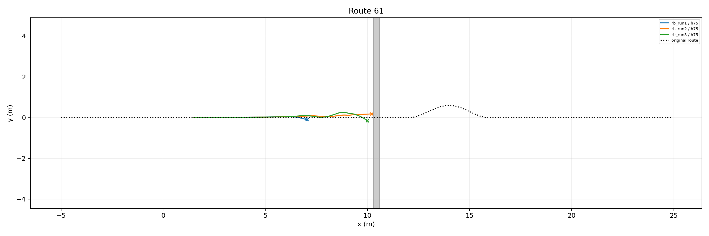

# Native Playground RB–STTW handoff trial

Role: bounded integration DEV; one common nominal ground start per route, not an independent success-rate estimate.

| Skill | Route | Continuation | Airborne | Far contact | Handoff s | End | Final XY m |
|---|---:|---|---|---|---:|---|---|
|rb_run1|61|h75|False|False|None|physical_failure|[7.034348487854004, -0.09429935365915298]|
|rb_run2|61|h75|True|False|None|physical_failure|[10.20305347442627, 0.18713043630123138]|
|rb_run3|61|h75|True|False|None|physical_failure|[9.984598159790039, -0.1473110169172287]|

Completed 3/3 episodes. The declared approach controller (see declaration.json) precedes native RB jumping; after measured far-bank wheel contact H75 or its zero-middle comparator is engaged. Native vehicle, servos and finite-torque leg hold remain physical; no pose reset or artificial stable-support requirement.

The heightfield retains the original seeded rough-bank surface through 25mm resampling. Native vehicle/collision behavior and 5ms physics differ from Isaac, so this is a transfer feasibility trial, not a simulator-only causal comparison. H75 starts with measured ESO state and empty policy history.
