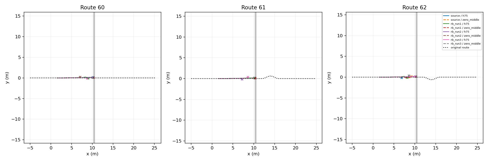

# Native Playground RB–STTW handoff trial

Role: bounded integration DEV; one common nominal ground start per route, not an independent success-rate estimate.

| Skill | Route | Continuation | Airborne | Far contact | Handoff s | End | Final XY m |
|---|---:|---|---|---|---:|---|---|
|source|60|h75|True|False|None|physical_failure|[10.130419731140137, 0.20692910254001617]|
|source|60|zero_middle|True|False|None|physical_failure|[10.16348648071289, 0.13416743278503418]|
|source|61|h75|True|False|None|physical_failure|[10.207796096801758, 0.1687595248222351]|
|source|61|zero_middle|True|False|None|physical_failure|[10.15210247039795, 0.16912369430065155]|
|source|62|h75|False|False|None|physical_failure|[6.843478679656982, -0.13694415986537933]|
|source|62|zero_middle|True|False|None|physical_failure|[9.107385635375977, 0.1731540411710739]|
|rb_run1|60|h75|True|False|None|corridor_or_domain_exit|[8.992027282714844, -0.06561915576457977]|
|rb_run1|60|zero_middle|True|False|None|physical_failure|[10.265250205993652, 0.08169066160917282]|
|rb_run1|61|h75|True|False|None|physical_failure|[10.214762687683105, 0.1306537687778473]|
|rb_run1|61|zero_middle|True|False|None|physical_failure|[10.35107421875, 0.10154376924037933]|
|rb_run1|62|h75|False|False|None|physical_failure|[8.16904354095459, -0.10519613325595856]|
|rb_run1|62|zero_middle|False|False|None|physical_failure|[8.565007209777832, 0.024691618978977203]|
|rb_run2|60|h75|True|False|None|physical_failure|[10.140816688537598, 0.14798806607723236]|
|rb_run2|60|zero_middle|False|False|None|physical_failure|[7.06632137298584, 0.2363586276769638]|
|rb_run2|61|h75|False|False|None|physical_failure|[7.191970348358154, -0.14112159609794617]|
|rb_run2|61|zero_middle|True|False|None|physical_failure|[10.16843032836914, 0.1509135216474533]|
|rb_run2|62|h75|True|False|None|physical_failure|[10.230273246765137, 0.1646096259355545]|
|rb_run2|62|zero_middle|True|False|None|physical_failure|[10.23291301727295, 0.12405199557542801]|
|rb_run3|60|h75|False|False|None|physical_failure|[8.758995056152344, -0.08416961878538132]|
|rb_run3|60|zero_middle|True|False|None|physical_failure|[10.170479774475098, 0.0668233260512352]|
|rb_run3|61|h75|False|False|None|physical_failure|[8.603520393371582, 0.3957468271255493]|
|rb_run3|61|zero_middle|True|False|None|physical_failure|[10.139860153198242, 0.21067962050437927]|
|rb_run3|62|h75|True|False|None|physical_failure|[10.086677551269531, 0.12756332755088806]|
|rb_run3|62|zero_middle|False|False|None|corridor_or_domain_exit|[8.56714153289795, 0.3807607591152191]|

Completed 24/24 episodes. The declared approach controller (see declaration.json) precedes native RB jumping; after measured far-bank wheel contact H75 or its zero-middle comparator is engaged. Native vehicle, servos and finite-torque leg hold remain physical; no pose reset or artificial stable-support requirement.

The heightfield retains the original seeded rough-bank surface through 25mm resampling. Native vehicle/collision behavior and 5ms physics differ from Isaac, so this is a transfer feasibility trial, not a simulator-only causal comparison. H75 starts with measured ESO state and empty policy history.

## Integration diagnosis

All 24 declared trials completed. Nine exited before native RB entry; 15 entered RB, but none recorded far-bank wheel contact or STTW handback. Entry counts: Source 5/6, RB Run1 3/6, Run2 4/6, Run3 3/6. Thus this batch does not measure downstream capture capability and cannot rank the RB candidates.

The requested approach speed was 2.0 m/s, but 14/15 recorded RB entries had actual world-vx 3.55–3.85 m/s (one 2.50 m/s). This is a transfer/interface discrepancy to investigate, not proof of an RB failure mechanism. Identical source/route60 prefixes differed by up to 0.0341 m in XY during the first second, before the downstream controller choice could act. These are nominally paired attempts, not exact matched-state branches; backend repeatability/reset behavior remains unresolved. The recorded airborne flag only means no wheel contact near the ditch, not a verified successful active jump.

Next: verify native-model speed and steering command/measurement semantics and repeatable common-start reset, then rerun the same three RB candidates. First recover a valid cross-gap handoff before interpreting H75 continuation. No new training or paper claims from this batch.
