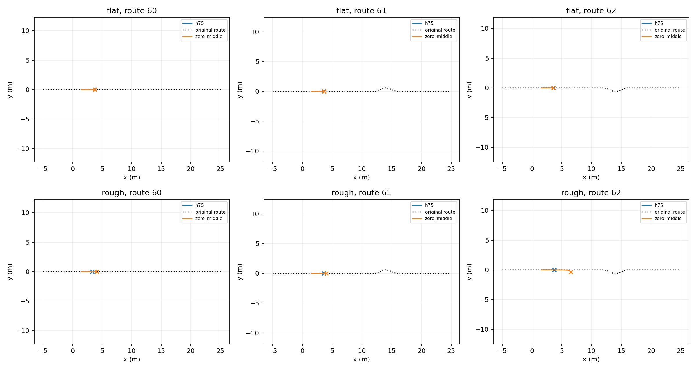
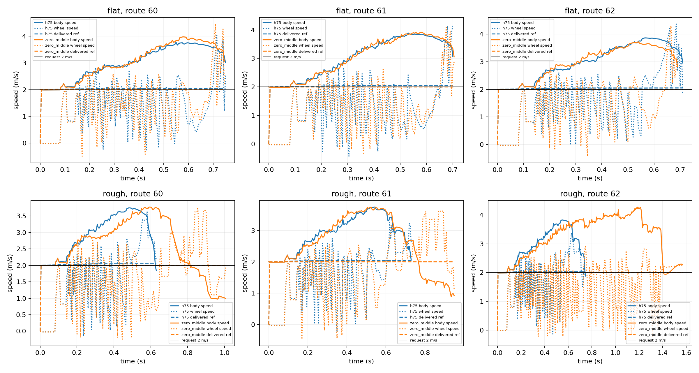

# RB native chassis: STTW ground-only verification

Nominal DEV integration diagnostic, 12 episodes: two terrains × three routes × H75/zero-middle. Requested speed 2 m/s, H75 alpha 0.5. Same nominal initialization; no guarantee of bitwise identical GPU dynamics. No jumping or training. Zero-middle retains ECBC+ESO and the reference filters; neither method includes Local300. Different actual observation lengths end at each real failure; averages are descriptive, not matched-window rankings.

|Terrain|Route|Method|End|Duration s|Mean speed m/s|Speed RMSE m/s|Max path error m|Peak roll rad|Peak pitch rad|Failure axis|
|---|---:|---|---|---:|---:|---:|---:|---:|---:|---|
|flat|60|h75|physical_failure|0.750|2.997|1.167|0.019|0.145|1.324|pitch|
|flat|60|zero_middle|physical_failure|0.745|3.039|1.239|0.018|0.091|1.330|pitch|
|flat|61|h75|physical_failure|0.700|3.031|1.236|0.018|0.110|1.331|pitch|
|flat|61|zero_middle|physical_failure|0.705|3.036|1.247|0.017|0.084|1.329|pitch|
|flat|62|h75|physical_failure|0.710|3.000|1.182|0.019|0.185|1.327|pitch|
|flat|62|zero_middle|physical_failure|0.690|2.960|1.126|0.017|0.087|1.328|pitch|
|rough|60|h75|physical_failure|0.630|2.925|1.120|0.016|0.064|1.312|pitch|
|rough|60|zero_middle|physical_failure|1.005|2.589|1.005|0.020|0.707|1.287|roll|
|rough|61|h75|physical_failure|0.730|2.904|1.069|0.019|0.137|1.313|pitch|
|rough|61|zero_middle|physical_failure|0.950|2.606|1.032|0.018|0.439|1.310|pitch|
|rough|62|h75|physical_failure|0.745|2.929|1.108|0.019|0.161|1.310|pitch|
|rough|62|zero_middle|physical_failure|1.570|3.220|1.425|0.307|0.735|0.708|roll|

The old floor/step explicit contact pairs were removed. The trench is at x=40 m, outside this test. Flat has no stones/ridges; rough preserves the declared millimeter stones and ridges. All actions and physical trajectories are in the terrain subdirectories. No reward comparison: this inference-only runner does not implement a task reward.

## Interpretation

All 12 trials failed before goal. On flat ground both methods reached the pitch threshold in 0.690–0.750 s. This isolates a ground-control integration failure before any jump or handoff, but does not identify H75 as the sole cause: the ECBC+ESO zero-middle comparator also fails. No claim about original H75 performance or RB jump skill follows. Next inspect native actuator, pendulum hold and pitch behavior before additional chained-skill evaluations.
