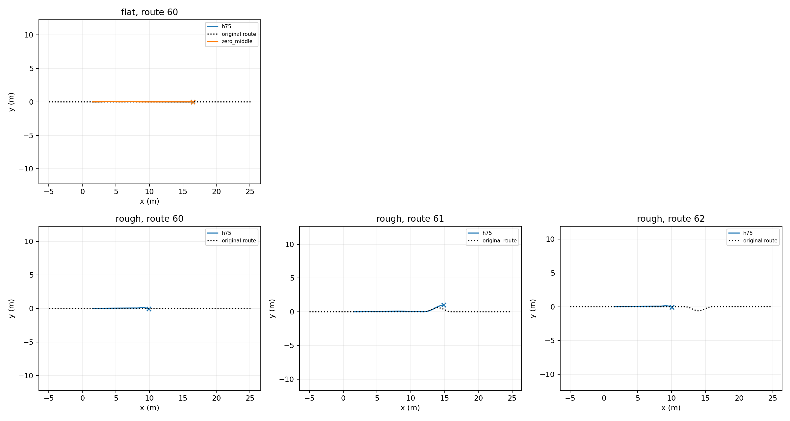
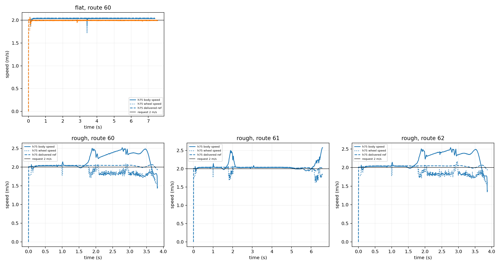

# RB native chassis: STTW ground-only verification

Nominal DEV integration diagnostic, 5 episodes; actual coverage is listed below. Requested speed 2 m/s, H75 alpha 0.5. Same nominal initialization; no guarantee of bitwise identical GPU dynamics. No jumping or training. Zero-middle retains ECBC+ESO and the reference filters; neither method includes Local300. Different actual observation lengths end at each real failure; averages are descriptive, not matched-window rankings.

|Terrain|Route|Method|End|Duration s|Mean speed m/s|Speed RMSE m/s|Max path error m|Peak roll rad|Peak pitch rad|Failure axis|
|---|---:|---|---|---:|---:|---:|---:|---:|---:|---|
|flat|60|h75|goal|7.385|2.032|0.033|0.056|0.008|0.006|other|
|flat|60|zero_middle|goal|7.545|1.989|0.013|0.028|0.016|0.006|other|
|rough|60|h75|physical_failure|3.830|2.185|0.271|0.138|0.709|0.058|roll|
|rough|61|h75|corridor_or_domain_exit|6.585|2.057|0.117|0.609|0.126|0.129|other|
|rough|62|h75|physical_failure|3.875|2.193|0.283|0.140|0.714|0.058|roll|

The old floor/step explicit contact pairs were removed. The trench is at x=40 m, outside this test. Flat has no stones/ridges; rough preserves the declared millimeter stones and ridges. All actions and physical trajectories are in the terrain subdirectories. No reward comparison: this inference-only runner does not implement a task reward.

## Repair and available candidates

The frozen H75 actor was not retrained or edited. Changing RK4 physics integration from 5 ms to 1 ms (five substeps per unchanged 5 ms lower tick, 20 ms middle tick) restored flat-ground passage: H75 7.385 s, zero-middle 7.545 s. H75 body-frame speed mean 2.032 m/s and RMSE 0.0332 m/s; peak pitch 0.00559 rad. The old 5 ms runs of both methods failed near 0.7 s. This identifies a numerical integration dependence in the previous ground-control failures; it does not establish which solver term causes it. Native actuator strengths, pendulum servos, H75 weights, requested speed, and termination thresholds were unchanged.

Rough H75 routes 60/61/62 remain incomplete: roll failure at 3.830 s, corridor/domain exit at 6.585 s (path distance 0.609 m), and roll failure at 3.875 s. Thus flat operation is available, but native rough-terrain STTW is not yet qualified. The 1 ms setting is only verified for ground control; RB jumping and delayed handoff must be evaluated separately before adopting it for the chain.

A historical alternative exists under `runs/rb_h75_ecbc_ground/{left90_R2,right90_R2}`: the same frozen H75 reached the goal at five alpha values in each Isaac turn task; zero-middle failed in both. These are one nominal condition per alpha, not independent seeds. The pendulum was fixed, the vehicle used the Isaac asset/servo stack, and final hold was not achieved. This is a candidate to reuse under its original conditions, not proof of native MuJoCo transfer.

Reproduce current ground trial with `evaluate_playground_handoff.py --ground-only --physics-substeps 5`, the frozen flat/rough configs in `chapter3_playground_ground_only`, and both STTW `learning/src` and the read-only JIT runtime on PYTHONPATH. Cached MJB dt must match the requested substeps. No training was performed.
