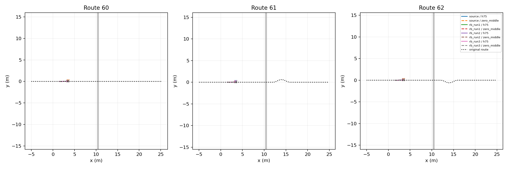

# Native Playground RB–STTW handoff trial

Role: bounded integration DEV; one common nominal ground start per route, not an independent success-rate estimate.

| Skill | Route | Continuation | Airborne | Far contact | Handoff s | End | Final XY m |
|---|---:|---|---|---|---:|---|---|
|source|60|h75|False|False|None|physical_failure|[3.494049310684204, 0.1853492259979248]|
|source|60|zero_middle|False|False|None|physical_failure|[3.506281614303589, 0.22923745214939117]|
|source|61|h75|False|False|None|physical_failure|[3.488199472427368, 0.24439425766468048]|
|source|61|zero_middle|False|False|None|physical_failure|[3.4719529151916504, 0.1839984506368637]|
|source|62|h75|False|False|None|physical_failure|[3.510719060897827, 0.2110774666070938]|
|source|62|zero_middle|False|False|None|physical_failure|[3.509490728378296, 0.24737656116485596]|
|rb_run1|60|h75|False|False|None|physical_failure|[3.4157614707946777, 0.1338900923728943]|
|rb_run1|60|zero_middle|False|False|None|physical_failure|[3.421815872192383, 0.1360880732536316]|
|rb_run1|61|h75|False|False|None|physical_failure|[3.419994354248047, 0.13818234205245972]|
|rb_run1|61|zero_middle|False|False|None|physical_failure|[3.4217681884765625, 0.13811828196048737]|
|rb_run1|62|h75|False|False|None|physical_failure|[3.421504497528076, 0.13891462981700897]|
|rb_run1|62|zero_middle|False|False|None|physical_failure|[3.4213979244232178, 0.13784250617027283]|
|rb_run2|60|h75|False|False|None|physical_failure|[3.381328582763672, 0.1126624271273613]|
|rb_run2|60|zero_middle|False|False|None|physical_failure|[3.3828201293945312, 0.11212354153394699]|
|rb_run2|61|h75|False|False|None|physical_failure|[3.383699893951416, 0.11446930468082428]|
|rb_run2|61|zero_middle|False|False|None|physical_failure|[3.3848159313201904, 0.11121270060539246]|
|rb_run2|62|h75|False|False|None|physical_failure|[3.382777690887451, 0.11188765615224838]|
|rb_run2|62|zero_middle|False|False|None|physical_failure|[3.384523868560791, 0.11137505620718002]|
|rb_run3|60|h75|False|False|None|physical_failure|[3.4663801193237305, 0.08649908751249313]|
|rb_run3|60|zero_middle|False|False|None|physical_failure|[3.478888511657715, 0.07434821873903275]|
|rb_run3|61|h75|False|False|None|physical_failure|[3.4258904457092285, 0.19214259088039398]|
|rb_run3|61|zero_middle|False|False|None|physical_failure|[3.4663968086242676, 0.0847194492816925]|
|rb_run3|62|h75|False|False|None|physical_failure|[3.4601755142211914, 0.122523732483387]|
|rb_run3|62|zero_middle|False|False|None|physical_failure|[3.46960711479187, 0.09007149189710617]|

Completed 24/24 episodes. Native RB governs approach/jump; only after measured far-bank wheel contact is H75 or its zero-middle comparator engaged. Native vehicle, servos and finite-torque leg hold remain physical; no pose reset or artificial stable-support requirement.

The heightfield retains the original seeded rough-bank surface through 25mm resampling. Native vehicle/collision behavior and 5ms physics differ from Isaac, so this is a transfer feasibility trial, not a simulator-only causal comparison. H75 starts with measured ESO state and empty policy history.

Raw evidence: `/media/qy/6A7E3DB07E3D75C3/STTW_runs/chapter3_playground_handoff_capacity`. All 24 trials stopped before the ditch; this batch cannot evaluate landing handoff. The follow-up uses H75 for the rough approach, then RB, then STTW.
