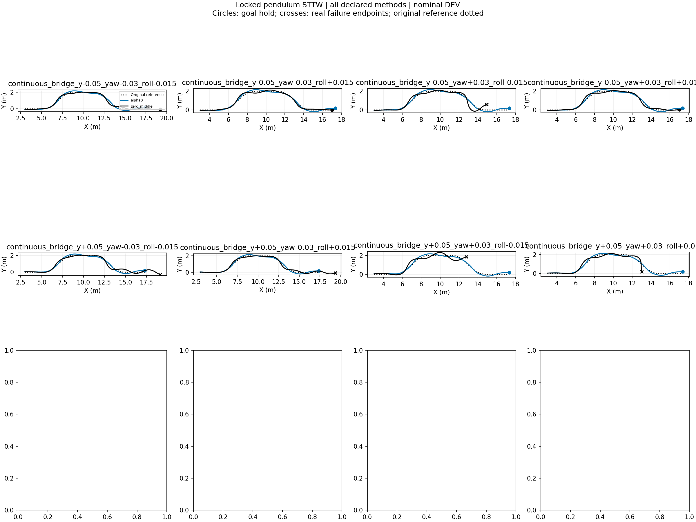

# Playground带摆STTW越野修复与验收



**采用配置：最高脊坡4cm、请求速度1.8m/s、冻结H75 alpha0、髋膝锁定、原生位置转向、implicitfast 1ms、轮/地摩擦0.8。** 依照用户允许降低难度的最新要求，原第三章地图布局不变，仅原8cm脊坡降至4cm；2cm脊坡、1–4mm碎石、沟与地桥均保留。没有续训，没有增加质量、惯量或电机力矩权限。

|验收|Playground H75|Playground零中层ECBC/ESO|同条件Isaac H75|
|---|---:|---:|---:|
|12类场景×8组横偏/航向/侧倾初差|96/96|64/96|57/96|
|连续越野：两处脊坡、碎石、左右连续弯、原跨沟地桥；8组初差|8/8|3/8|未测试此长路线|

12类为碎石、2cm脊坡、4cm脊坡，各含直行、左90°、右90°、S弯。初差全组合：横偏±0.05m、航向±0.03rad、侧倾±0.015rad。共同终止条件保留；成功要求路径误差≤0.3m、航向误差≤0.2rad、速度误差≤0.4m/s，在出弯后保持0.2秒；连续路线加强到0.5秒。连续路线x3→17m，8次均在9.025–9.075秒完成，跨沟走原有地桥，未跳跃。

96条件实际最大路径误差0.268m、侧倾0.205rad；髋/膝最大数值漂移6.88e-5/1.67e-6rad。已从保存的逐步轨迹独立重算最终保持、进度、有效窗口及失败标志，不仅依赖status成功标签。[数值核验](turning_suite/acceptance/validation.json) · [物理与地图审计](turning_suite/acceptance/physics_audit.json)。

## 发现与修复

- 地形转换：移除旧floor/step显式接触对；使用原Isaac矩形网格和相同三角对角线，避免重采样改变接触面。原图221502顶点/440326三角保持；射线抽检最大高度差4.49e-8m。降高版本XY及三角索引仍逐数组一致，只有x13–15m的原最高脊坡降低最多0.04m。
- STTW摆机构：此前有限电机保持不等于关节锁定；现在STTW启用髋膝等式制动，轮和转向仍自由。RB释放/回交重锁代码保留，但本轮交付验收对象是STTW地面能力。
- 积分与执行接口：高增益速度伺服配RK4曾出现明显数值问题；速度接口候选也未通过地面测试。采用原生位置伺服执行ECBC积分转角，改implicitfast；转向/后轮/髋/膝力矩上限仍5/6/30/30Nm。
- 接触参数：轮几何priority曾让轮摩擦1.0覆盖地面0.8，现按声明统一为0.8。保留原生椭球轮，未采用失败的单圆柱替代。
- 批量评测容量：首轮CCD溢出作废并保留；naccdmax提高到512后全部本报告有效运行无溢出。
- 跟踪设置：保留Isaac声明的转角参考slew0.6rad/s；前视0.7→0.5秒对照明显退化，已拒绝，保留0.7秒。固定alpha0由开发测试选择，未把所有alpha均称合格。

上述是已修复问题与联合采用配置；未将联合变化伪称每项都独立提升通过率。

## 全部证据与可用范围

[96条件Playground全部XY/逐条指标](turning_suite/acceptance/evaluation/RESULTS.md) · [同条件Isaac](turning_suite/acceptance/evaluation_isaac/RESULTS.md) · [连续路线全部XY/逐条指标](turning_suite/continuous_route/evaluation/RESULTS.md)。

Isaac对照采用同一三角网格、全局路径、初始车速/零轮速、锁摆、同一控制/策略和判据循环；保留其原生速度转向和2.5ms物理步长，Playground为位置转向和1ms。是任务行为对照，不是相同求解器或历史预热/落地接续表现的复现。全部数据为有界仿真DEV，无独立训练种子泛化、实车或全速度保证；未计算任务奖励，不宣称奖励提升。

原8cm地图在1.8m/s下alpha0 33/36，三次8cm脊坡S弯失败；4cm地图在2.2m/s仍有9/36失败。因此本次采用1.8m/s、最高4cm，未宣称原难度全恢复或任意高速通过。[原图失败保留](turning_suite/original_map_v18/evaluation/RESULTS.md) · [速度扩展与全部旧对照](turning_suite/README.md)。

## 运行入口

工作目录为本worktree，解释器`/home/qy/mujoco_playground/.venv/bin/python`，`PYTHONPATH=learning/src:/home/qy/DVGC/JIT/src`。已有冻结H75 bundle及原生RB模型/资产依赖保持原身份，不改外部JIT源码。

```bash
PYTHONPATH=learning/src:/home/qy/DVGC/JIT/src XLA_PYTHON_CLIENT_PREALLOCATE=false flock /home/qy/STTW_CONTROL/research-hub/.gpu-job.lock /home/qy/mujoco_playground/.venv/bin/python learning/cli/evaluate_playground_handoff.py --config learning/configs/playground_sttw_offroad.json --output runs/playground_sttw_offroad_evaluation --skills source --ground-only --physics-substeps 5
```

连续路线使用`learning/configs/playground_sttw_continuous.json`和独立输出目录。结果包含完整qpos/测量/控制/有效窗口，可用`analyze_playground_ground_suite.py`分析、`render_playground_ground_suite.py`按保存姿态播放，不重跑物理。

原始配置、逐步轨迹、日志、模型和视频目录：`/media/qy/6A7E3DB07E3D75C3/STTW_runs/chapter3_playground_isaac_recovery/turning_suite/`。[12类视频](turning_suite/acceptance/videos/README.md)，[连续路线视频](turning_suite/continuous_route/videos/README.md)；真实速度播放，末帧另标保持1秒。

<details><summary>早期锁摆分段诊断（历史，不是当前验收结论）</summary>

# Playground带摆车锁定修复

[近岸XY与全部条件](near_locked_comparison/RESULTS.md) · [远岸XY与全部条件](far_locked_comparison/RESULTS.md)

STTW已用hip/knee关节约束锁定摆机构；RB期间解除，回交按实测姿态重新锁定。保留原生有限位置伺服，未修改力矩上限、质量与惯量。

原Isaac第三章保存网格221502顶点、440326三角形与本轮源网格逐数组一致；512点编译MuJoCo表面射线最大高度差4.49e-8m。原沟位置、粗糙区及2cm/8cm脊坡均保留。

位置伺服+implicitfast+摩擦0.8+锁摆：近岸3/3到达，远岸2/3到达、路线61越廊。两个独立地面分段，不是完整跨沟或独立TEST。对应速度伺服候选6/6物理失败，未采用。未训练；越野恢复尚未完成，不将5/6写成整个第三章恢复成功。

近岸最大锁定数值漂移：hip0.0001974rad、knee4.05e-6rad。CPU制动释放测试通过；完整RB切换未验证。

原始状态、配置和全部逐步轨迹：`/media/qy/6A7E3DB07E3D75C3/STTW_runs/chapter3_playground_isaac_recovery/`。入口`learning/cli/evaluate_playground_handoff.py`，复核`audit_playground_terrain.py`和`analyze_playground_ground.py --compare-runs`。

</details>
