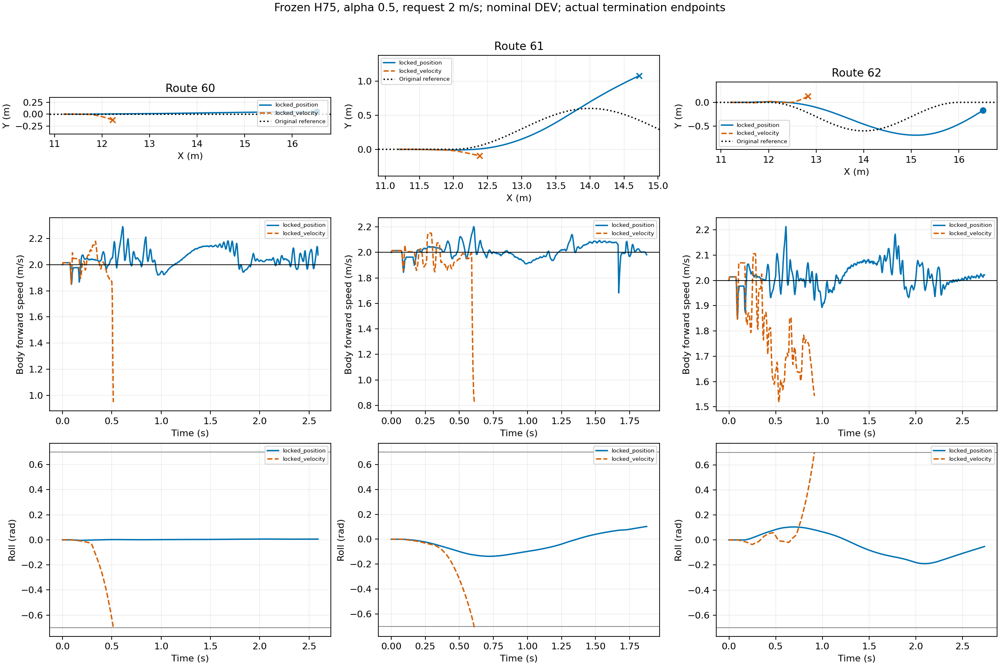

# Playground ground recovery diagnosis

All declared runs and failures retained. Each route uses a common actual observation window for paired RMSE; goal and physical failure are separate. No training, no task-reward implementation, no independent TEST claim.

|Run|Route|End|Duration s|Common window s|Speed RMSE m/s|Path RMSE m|
|---|---:|---|---:|---:|---:|---:|
|locked_position|60|goal|2.590|0.515|0.0490|0.0074|
|locked_velocity|60|physical_failure|0.515|0.515|0.1479|0.0457|
|locked_position|61|corridor_or_domain_exit|1.875|0.610|0.0604|0.0189|
|locked_velocity|61|physical_failure|0.610|0.610|0.1897|0.0495|
|locked_position|62|goal|2.735|0.915|0.0514|0.0757|
|locked_velocity|62|physical_failure|0.915|0.915|0.2550|0.1026|

Sources:
- locked_position: /media/qy/6A7E3DB07E3D75C3/STTW_runs/chapter3_playground_isaac_recovery/chapter3_far_position_locked
- locked_velocity: /media/qy/6A7E3DB07E3D75C3/STTW_runs/chapter3_playground_isaac_recovery/chapter3_far_velocity_locked
