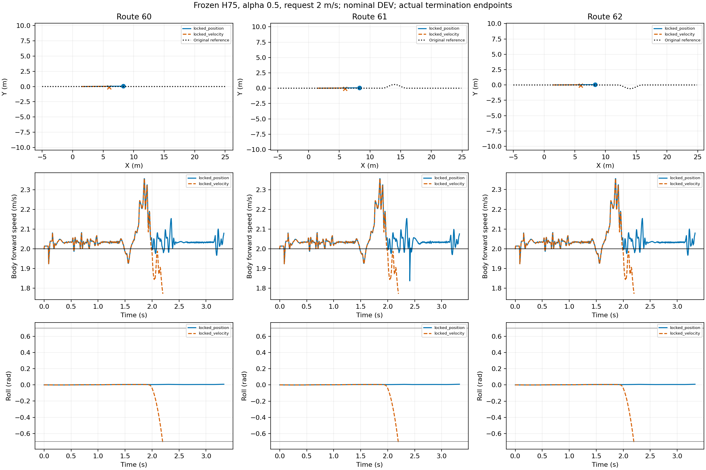

# Playground ground recovery diagnosis

All declared runs and failures retained. Each route uses a common actual observation window for paired RMSE; goal and physical failure are separate. No training, no task-reward implementation, no independent TEST claim.

|Run|Route|End|Duration s|Common window s|Speed RMSE m/s|Path RMSE m|
|---|---:|---|---:|---:|---:|---:|
|locked_position|60|goal|3.330|2.200|0.0823|0.0263|
|locked_velocity|60|physical_failure|2.200|2.200|0.0895|0.0264|
|locked_position|61|goal|3.330|2.200|0.0823|0.0263|
|locked_velocity|61|physical_failure|2.200|2.200|0.0895|0.0264|
|locked_position|62|goal|3.330|2.200|0.0823|0.0263|
|locked_velocity|62|physical_failure|2.200|2.200|0.0895|0.0264|

Sources:
- locked_position: /media/qy/6A7E3DB07E3D75C3/STTW_runs/chapter3_playground_isaac_recovery/chapter3_near_position_locked
- locked_velocity: /media/qy/6A7E3DB07E3D75C3/STTW_runs/chapter3_playground_isaac_recovery/chapter3_near_velocity_locked
