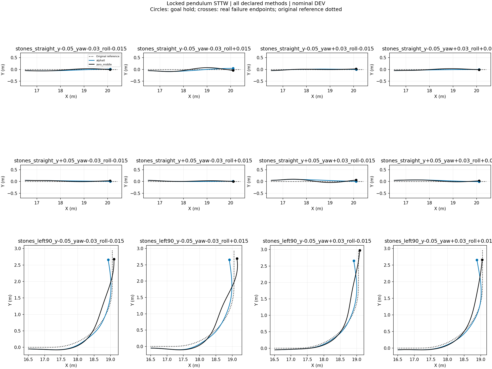
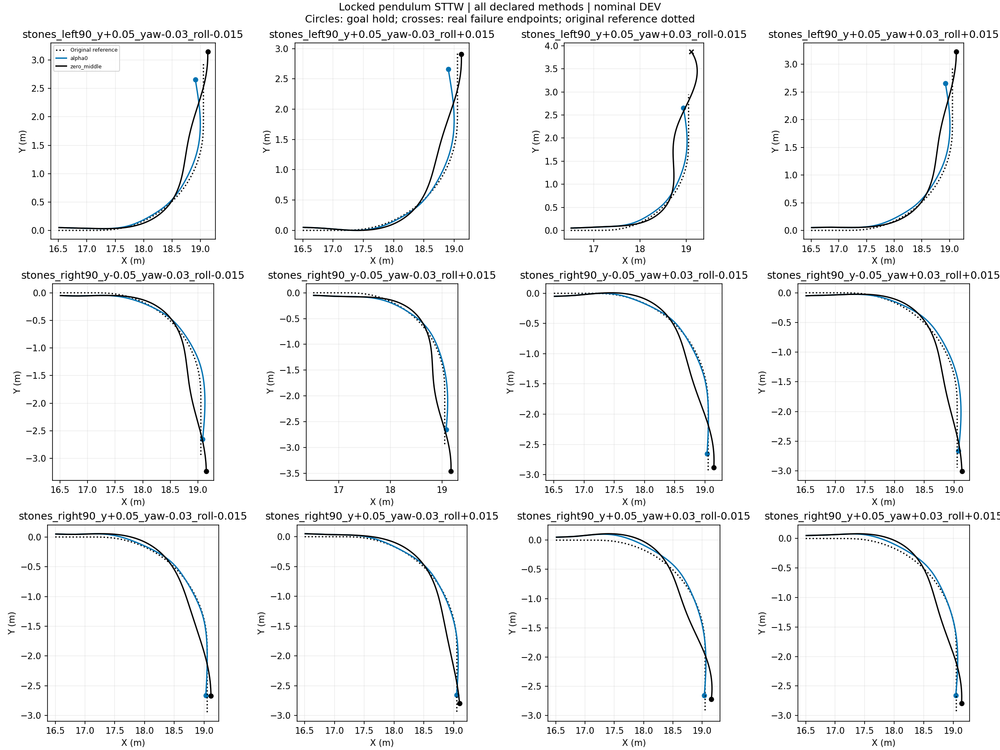
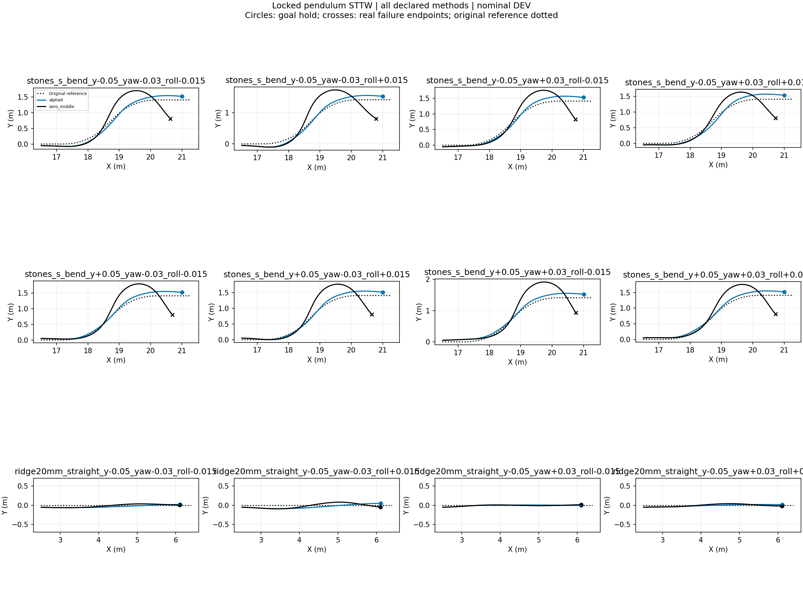
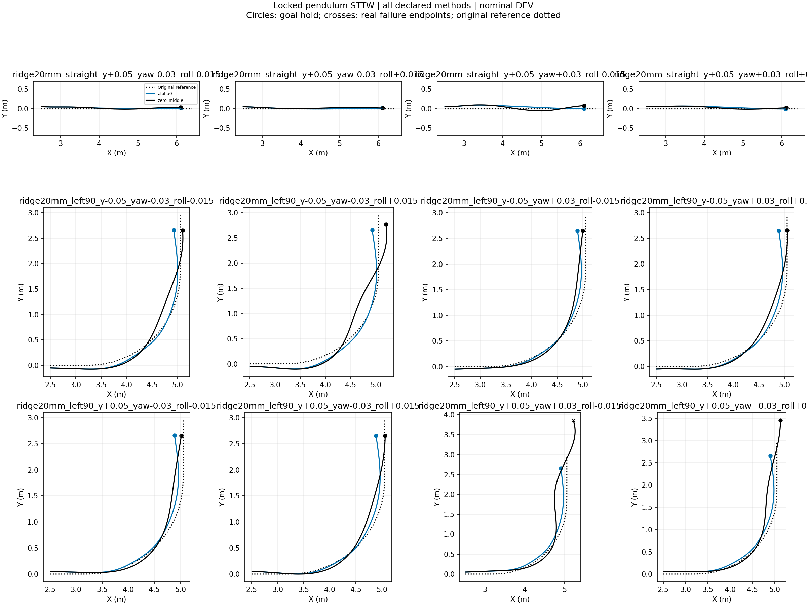
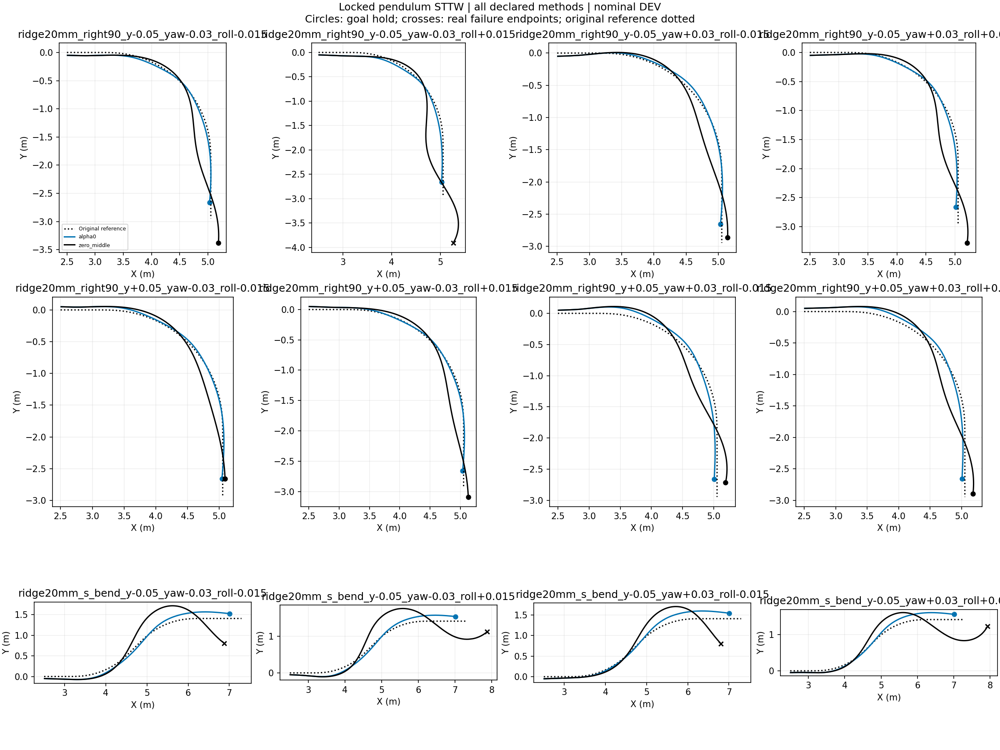
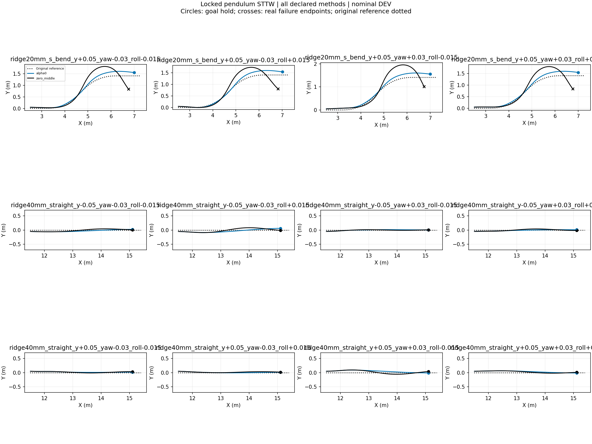
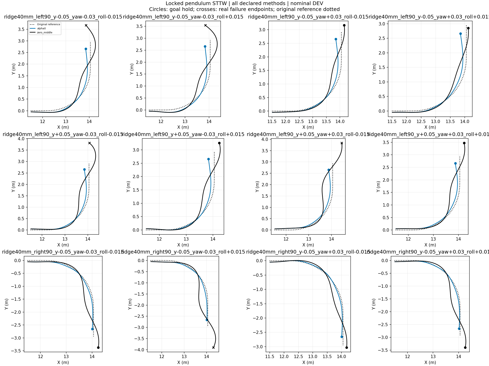
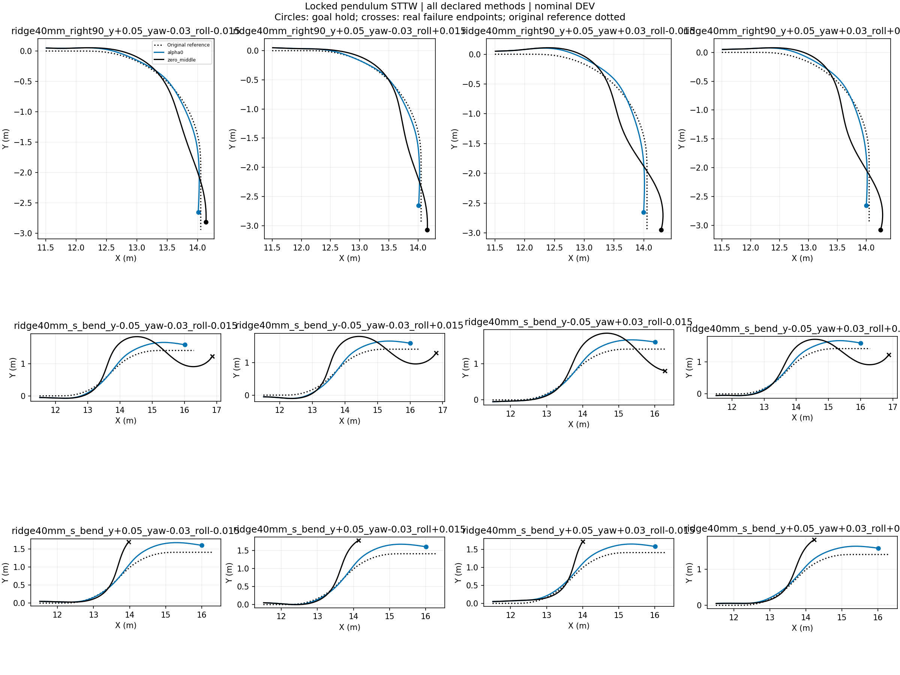

# Locked-pendulum STTW turning diagnostic

Nominal DEV, frozen H75, no training, one initialization per case. All failures retained. Each episode ends at its actual termination. These are inference-only behavior tests; task reward is not implemented and no reward improvement is claimed. RMSE below uses each episode's actual window and is not a paired-window ranking.

|Case|Method|End|Seconds|Path RMSE m|Speed RMSE m/s|
|---|---|---|---:|---:|---:|
|stones_straight_y-0.05_yaw-0.03_roll-0.015|alpha0|goal_hold|1.945|0.041|0.078|
|stones_straight_y-0.05_yaw-0.03_roll-0.015|zero_middle|goal_hold|1.975|0.040|0.074|
|stones_straight_y-0.05_yaw-0.03_roll+0.015|alpha0|goal_hold|1.950|0.056|0.075|
|stones_straight_y-0.05_yaw-0.03_roll+0.015|zero_middle|goal_hold|2.000|0.060|0.058|
|stones_straight_y-0.05_yaw+0.03_roll-0.015|alpha0|goal_hold|1.960|0.018|0.060|
|stones_straight_y-0.05_yaw+0.03_roll-0.015|zero_middle|goal_hold|1.980|0.017|0.068|
|stones_straight_y-0.05_yaw+0.03_roll+0.015|alpha0|goal_hold|1.940|0.025|0.077|
|stones_straight_y-0.05_yaw+0.03_roll+0.015|zero_middle|goal_hold|1.995|0.028|0.048|
|stones_straight_y+0.05_yaw-0.03_roll-0.015|alpha0|goal_hold|1.955|0.031|0.060|
|stones_straight_y+0.05_yaw-0.03_roll-0.015|zero_middle|goal_hold|1.990|0.028|0.055|
|stones_straight_y+0.05_yaw-0.03_roll+0.015|alpha0|goal_hold|1.945|0.018|0.069|
|stones_straight_y+0.05_yaw-0.03_roll+0.015|zero_middle|goal_hold|2.000|0.024|0.043|
|stones_straight_y+0.05_yaw+0.03_roll-0.015|alpha0|goal_hold|1.950|0.062|0.073|
|stones_straight_y+0.05_yaw+0.03_roll-0.015|zero_middle|goal_hold|2.005|0.057|0.044|
|stones_straight_y+0.05_yaw+0.03_roll+0.015|alpha0|goal_hold|1.945|0.046|0.074|
|stones_straight_y+0.05_yaw+0.03_roll+0.015|zero_middle|goal_hold|1.995|0.042|0.050|
|stones_left90_y-0.05_yaw-0.03_roll-0.015|alpha0|goal_hold|2.540|0.065|0.111|
|stones_left90_y-0.05_yaw-0.03_roll-0.015|zero_middle|goal_hold|2.475|0.104|0.065|
|stones_left90_y-0.05_yaw-0.03_roll+0.015|alpha0|goal_hold|2.540|0.077|0.116|
|stones_left90_y-0.05_yaw-0.03_roll+0.015|zero_middle|goal_hold|2.505|0.128|0.059|
|stones_left90_y-0.05_yaw+0.03_roll-0.015|alpha0|goal_hold|2.510|0.051|0.113|
|stones_left90_y-0.05_yaw+0.03_roll-0.015|zero_middle|goal_hold|2.625|0.096|0.066|
|stones_left90_y-0.05_yaw+0.03_roll+0.015|alpha0|goal_hold|2.550|0.061|0.083|
|stones_left90_y-0.05_yaw+0.03_roll+0.015|zero_middle|goal_hold|2.460|0.087|0.048|
|stones_left90_y+0.05_yaw-0.03_roll-0.015|alpha0|goal_hold|2.515|0.052|0.126|
|stones_left90_y+0.05_yaw-0.03_roll-0.015|zero_middle|goal_hold|2.725|0.113|0.052|
|stones_left90_y+0.05_yaw-0.03_roll+0.015|alpha0|goal_hold|2.515|0.050|0.117|
|stones_left90_y+0.05_yaw-0.03_roll+0.015|zero_middle|goal_hold|2.595|0.108|0.047|
|stones_left90_y+0.05_yaw+0.03_roll-0.015|alpha0|goal_hold|2.510|0.057|0.132|
|stones_left90_y+0.05_yaw+0.03_roll-0.015|zero_middle|corridor_or_domain_exit|3.200|0.157|0.058|
|stones_left90_y+0.05_yaw+0.03_roll+0.015|alpha0|goal_hold|2.520|0.055|0.134|
|stones_left90_y+0.05_yaw+0.03_roll+0.015|zero_middle|goal_hold|2.755|0.109|0.056|
|stones_right90_y-0.05_yaw-0.03_roll-0.015|alpha0|goal_hold|2.660|0.048|0.188|
|stones_right90_y-0.05_yaw-0.03_roll-0.015|zero_middle|goal_hold|2.770|0.095|0.073|
|stones_right90_y-0.05_yaw-0.03_roll+0.015|alpha0|goal_hold|2.605|0.044|0.190|
|stones_right90_y-0.05_yaw-0.03_roll+0.015|zero_middle|goal_hold|2.910|0.103|0.067|
|stones_right90_y-0.05_yaw+0.03_roll-0.015|alpha0|goal_hold|2.645|0.016|0.192|
|stones_right90_y-0.05_yaw+0.03_roll-0.015|zero_middle|goal_hold|2.590|0.101|0.059|
|stones_right90_y-0.05_yaw+0.03_roll+0.015|alpha0|goal_hold|2.645|0.043|0.184|
|stones_right90_y-0.05_yaw+0.03_roll+0.015|zero_middle|goal_hold|2.660|0.087|0.050|
|stones_right90_y+0.05_yaw-0.03_roll-0.015|alpha0|goal_hold|2.680|0.028|0.196|
|stones_right90_y+0.05_yaw-0.03_roll-0.015|zero_middle|goal_hold|2.475|0.087|0.058|
|stones_right90_y+0.05_yaw-0.03_roll+0.015|alpha0|goal_hold|2.640|0.021|0.194|
|stones_right90_y+0.05_yaw-0.03_roll+0.015|zero_middle|goal_hold|2.555|0.080|0.043|
|stones_right90_y+0.05_yaw+0.03_roll-0.015|alpha0|goal_hold|2.670|0.060|0.183|
|stones_right90_y+0.05_yaw+0.03_roll-0.015|zero_middle|goal_hold|2.550|0.120|0.045|
|stones_right90_y+0.05_yaw+0.03_roll+0.015|alpha0|goal_hold|2.660|0.053|0.181|
|stones_right90_y+0.05_yaw+0.03_roll+0.015|zero_middle|goal_hold|2.570|0.106|0.054|
|stones_s_bend_y-0.05_yaw-0.03_roll-0.015|alpha0|goal_hold|2.910|0.082|0.159|
|stones_s_bend_y-0.05_yaw-0.03_roll-0.015|zero_middle|corridor_or_domain_exit|3.000|0.242|0.075|
|stones_s_bend_y-0.05_yaw-0.03_roll+0.015|alpha0|goal_hold|2.940|0.087|0.164|
|stones_s_bend_y-0.05_yaw-0.03_roll+0.015|zero_middle|corridor_or_domain_exit|3.100|0.272|0.066|
|stones_s_bend_y-0.05_yaw+0.03_roll-0.015|alpha0|goal_hold|2.905|0.085|0.161|
|stones_s_bend_y-0.05_yaw+0.03_roll-0.015|zero_middle|corridor_or_domain_exit|3.040|0.224|0.091|
|stones_s_bend_y-0.05_yaw+0.03_roll+0.015|alpha0|goal_hold|2.930|0.091|0.153|
|stones_s_bend_y-0.05_yaw+0.03_roll+0.015|zero_middle|corridor_or_domain_exit|2.960|0.204|0.062|
|stones_s_bend_y+0.05_yaw-0.03_roll-0.015|alpha0|goal_hold|2.910|0.075|0.164|
|stones_s_bend_y+0.05_yaw-0.03_roll-0.015|zero_middle|corridor_or_domain_exit|3.085|0.255|0.066|
|stones_s_bend_y+0.05_yaw-0.03_roll+0.015|alpha0|goal_hold|2.910|0.074|0.164|
|stones_s_bend_y+0.05_yaw-0.03_roll+0.015|zero_middle|corridor_or_domain_exit|3.060|0.259|0.063|
|stones_s_bend_y+0.05_yaw+0.03_roll-0.015|alpha0|goal_hold|2.895|0.081|0.161|
|stones_s_bend_y+0.05_yaw+0.03_roll-0.015|zero_middle|corridor_or_domain_exit|3.160|0.276|0.063|
|stones_s_bend_y+0.05_yaw+0.03_roll+0.015|alpha0|goal_hold|2.905|0.078|0.167|
|stones_s_bend_y+0.05_yaw+0.03_roll+0.015|zero_middle|corridor_or_domain_exit|3.045|0.237|0.068|
|ridge20mm_straight_y-0.05_yaw-0.03_roll-0.015|alpha0|goal_hold|1.945|0.042|0.083|
|ridge20mm_straight_y-0.05_yaw-0.03_roll-0.015|zero_middle|goal_hold|1.990|0.040|0.059|
|ridge20mm_straight_y-0.05_yaw-0.03_roll+0.015|alpha0|goal_hold|1.950|0.059|0.085|
|ridge20mm_straight_y-0.05_yaw-0.03_roll+0.015|zero_middle|goal_hold|1.985|0.061|0.093|
|ridge20mm_straight_y-0.05_yaw+0.03_roll-0.015|alpha0|goal_hold|1.940|0.017|0.093|
|ridge20mm_straight_y-0.05_yaw+0.03_roll-0.015|zero_middle|goal_hold|1.995|0.017|0.054|
|ridge20mm_straight_y-0.05_yaw+0.03_roll+0.015|alpha0|goal_hold|1.930|0.026|0.110|
|ridge20mm_straight_y-0.05_yaw+0.03_roll+0.015|zero_middle|goal_hold|1.980|0.031|0.076|
|ridge20mm_straight_y+0.05_yaw-0.03_roll-0.015|alpha0|goal_hold|1.945|0.025|0.084|
|ridge20mm_straight_y+0.05_yaw-0.03_roll-0.015|zero_middle|goal_hold|1.995|0.028|0.051|
|ridge20mm_straight_y+0.05_yaw-0.03_roll+0.015|alpha0|goal_hold|1.950|0.017|0.065|
|ridge20mm_straight_y+0.05_yaw-0.03_roll+0.015|zero_middle|goal_hold|2.000|0.024|0.047|
|ridge20mm_straight_y+0.05_yaw+0.03_roll-0.015|alpha0|goal_hold|1.950|0.059|0.076|
|ridge20mm_straight_y+0.05_yaw+0.03_roll-0.015|zero_middle|goal_hold|2.005|0.060|0.059|
|ridge20mm_straight_y+0.05_yaw+0.03_roll+0.015|alpha0|goal_hold|1.945|0.045|0.078|
|ridge20mm_straight_y+0.05_yaw+0.03_roll+0.015|zero_middle|goal_hold|2.000|0.041|0.050|
|ridge20mm_left90_y-0.05_yaw-0.03_roll-0.015|alpha0|goal_hold|2.530|0.062|0.109|
|ridge20mm_left90_y-0.05_yaw-0.03_roll-0.015|zero_middle|goal_hold|2.465|0.097|0.061|
|ridge20mm_left90_y-0.05_yaw-0.03_roll+0.015|alpha0|goal_hold|2.525|0.071|0.114|
|ridge20mm_left90_y-0.05_yaw-0.03_roll+0.015|zero_middle|goal_hold|2.535|0.141|0.093|
|ridge20mm_left90_y-0.05_yaw+0.03_roll-0.015|alpha0|goal_hold|2.515|0.062|0.119|
|ridge20mm_left90_y-0.05_yaw+0.03_roll-0.015|zero_middle|goal_hold|2.445|0.083|0.057|
|ridge20mm_left90_y-0.05_yaw+0.03_roll+0.015|alpha0|goal_hold|2.490|0.070|0.124|
|ridge20mm_left90_y-0.05_yaw+0.03_roll+0.015|zero_middle|goal_hold|2.435|0.085|0.065|
|ridge20mm_left90_y+0.05_yaw-0.03_roll-0.015|alpha0|goal_hold|2.505|0.068|0.130|
|ridge20mm_left90_y+0.05_yaw-0.03_roll-0.015|zero_middle|goal_hold|2.435|0.092|0.066|
|ridge20mm_left90_y+0.05_yaw-0.03_roll+0.015|alpha0|goal_hold|2.510|0.065|0.126|
|ridge20mm_left90_y+0.05_yaw-0.03_roll+0.015|zero_middle|goal_hold|2.440|0.081|0.055|
|ridge20mm_left90_y+0.05_yaw+0.03_roll-0.015|alpha0|goal_hold|2.495|0.075|0.136|
|ridge20mm_left90_y+0.05_yaw+0.03_roll-0.015|zero_middle|corridor_or_domain_exit|3.180|0.153|0.061|
|ridge20mm_left90_y+0.05_yaw+0.03_roll+0.015|alpha0|goal_hold|2.510|0.064|0.136|
|ridge20mm_left90_y+0.05_yaw+0.03_roll+0.015|zero_middle|goal_hold|2.890|0.105|0.053|
|ridge20mm_right90_y-0.05_yaw-0.03_roll-0.015|alpha0|goal_hold|2.575|0.031|0.198|
|ridge20mm_right90_y-0.05_yaw-0.03_roll-0.015|zero_middle|goal_hold|2.870|0.119|0.059|
|ridge20mm_right90_y-0.05_yaw-0.03_roll+0.015|alpha0|goal_hold|2.580|0.044|0.206|
|ridge20mm_right90_y-0.05_yaw-0.03_roll+0.015|zero_middle|corridor_or_domain_exit|3.250|0.187|0.069|
|ridge20mm_right90_y-0.05_yaw+0.03_roll-0.015|alpha0|goal_hold|2.600|0.026|0.177|
|ridge20mm_right90_y-0.05_yaw+0.03_roll-0.015|zero_middle|goal_hold|2.580|0.101|0.049|
|ridge20mm_right90_y-0.05_yaw+0.03_roll+0.015|alpha0|goal_hold|2.610|0.028|0.196|
|ridge20mm_right90_y-0.05_yaw+0.03_roll+0.015|zero_middle|goal_hold|2.840|0.133|0.063|
|ridge20mm_right90_y+0.05_yaw-0.03_roll-0.015|alpha0|goal_hold|2.620|0.028|0.186|
|ridge20mm_right90_y+0.05_yaw-0.03_roll-0.015|zero_middle|goal_hold|2.465|0.084|0.047|
|ridge20mm_right90_y+0.05_yaw-0.03_roll+0.015|alpha0|goal_hold|2.635|0.020|0.189|
|ridge20mm_right90_y+0.05_yaw-0.03_roll+0.015|zero_middle|goal_hold|2.720|0.094|0.040|
|ridge20mm_right90_y+0.05_yaw+0.03_roll-0.015|alpha0|goal_hold|2.640|0.065|0.190|
|ridge20mm_right90_y+0.05_yaw+0.03_roll-0.015|zero_middle|goal_hold|2.550|0.130|0.053|
|ridge20mm_right90_y+0.05_yaw+0.03_roll+0.015|alpha0|goal_hold|2.640|0.058|0.194|
|ridge20mm_right90_y+0.05_yaw+0.03_roll+0.015|zero_middle|goal_hold|2.630|0.124|0.064|
|ridge20mm_s_bend_y-0.05_yaw-0.03_roll-0.015|alpha0|goal_hold|2.935|0.092|0.158|
|ridge20mm_s_bend_y-0.05_yaw-0.03_roll-0.015|zero_middle|corridor_or_domain_exit|3.110|0.243|0.063|
|ridge20mm_s_bend_y-0.05_yaw-0.03_roll+0.015|alpha0|goal_hold|2.935|0.098|0.167|
|ridge20mm_s_bend_y-0.05_yaw-0.03_roll+0.015|zero_middle|corridor_or_domain_exit|3.660|0.292|0.081|
|ridge20mm_s_bend_y-0.05_yaw+0.03_roll-0.015|alpha0|goal_hold|2.935|0.101|0.155|
|ridge20mm_s_bend_y-0.05_yaw+0.03_roll-0.015|zero_middle|corridor_or_domain_exit|3.035|0.213|0.066|
|ridge20mm_s_bend_y-0.05_yaw+0.03_roll+0.015|alpha0|goal_hold|2.920|0.105|0.164|
|ridge20mm_s_bend_y-0.05_yaw+0.03_roll+0.015|zero_middle|corridor_or_domain_exit|3.640|0.274|0.074|
|ridge20mm_s_bend_y+0.05_yaw-0.03_roll-0.015|alpha0|goal_hold|2.935|0.105|0.162|
|ridge20mm_s_bend_y+0.05_yaw-0.03_roll-0.015|zero_middle|corridor_or_domain_exit|3.100|0.247|0.074|
|ridge20mm_s_bend_y+0.05_yaw-0.03_roll+0.015|alpha0|goal_hold|2.945|0.104|0.163|
|ridge20mm_s_bend_y+0.05_yaw-0.03_roll+0.015|zero_middle|corridor_or_domain_exit|3.080|0.237|0.063|
|ridge20mm_s_bend_y+0.05_yaw+0.03_roll-0.015|alpha0|goal_hold|2.915|0.109|0.158|
|ridge20mm_s_bend_y+0.05_yaw+0.03_roll-0.015|zero_middle|corridor_or_domain_exit|3.140|0.282|0.069|
|ridge20mm_s_bend_y+0.05_yaw+0.03_roll+0.015|alpha0|goal_hold|2.930|0.106|0.163|
|ridge20mm_s_bend_y+0.05_yaw+0.03_roll+0.015|zero_middle|corridor_or_domain_exit|3.080|0.238|0.067|
|ridge40mm_straight_y-0.05_yaw-0.03_roll-0.015|alpha0|goal_hold|1.950|0.041|0.073|
|ridge40mm_straight_y-0.05_yaw-0.03_roll-0.015|zero_middle|goal_hold|2.000|0.042|0.053|
|ridge40mm_straight_y-0.05_yaw-0.03_roll+0.015|alpha0|goal_hold|1.965|0.058|0.055|
|ridge40mm_straight_y-0.05_yaw-0.03_roll+0.015|zero_middle|goal_hold|2.005|0.062|0.058|
|ridge40mm_straight_y-0.05_yaw+0.03_roll-0.015|alpha0|goal_hold|1.950|0.018|0.073|
|ridge40mm_straight_y-0.05_yaw+0.03_roll-0.015|zero_middle|goal_hold|2.000|0.017|0.044|
|ridge40mm_straight_y-0.05_yaw+0.03_roll+0.015|alpha0|goal_hold|1.955|0.024|0.064|
|ridge40mm_straight_y-0.05_yaw+0.03_roll+0.015|zero_middle|goal_hold|1.995|0.030|0.064|
|ridge40mm_straight_y+0.05_yaw-0.03_roll-0.015|alpha0|goal_hold|1.945|0.027|0.079|
|ridge40mm_straight_y+0.05_yaw-0.03_roll-0.015|zero_middle|goal_hold|2.000|0.028|0.048|
|ridge40mm_straight_y+0.05_yaw-0.03_roll+0.015|alpha0|goal_hold|1.945|0.017|0.076|
|ridge40mm_straight_y+0.05_yaw-0.03_roll+0.015|zero_middle|goal_hold|2.000|0.025|0.045|
|ridge40mm_straight_y+0.05_yaw+0.03_roll-0.015|alpha0|goal_hold|1.955|0.058|0.071|
|ridge40mm_straight_y+0.05_yaw+0.03_roll-0.015|zero_middle|goal_hold|2.015|0.057|0.035|
|ridge40mm_straight_y+0.05_yaw+0.03_roll+0.015|alpha0|goal_hold|1.955|0.045|0.068|
|ridge40mm_straight_y+0.05_yaw+0.03_roll+0.015|zero_middle|goal_hold|1.995|0.042|0.063|
|ridge40mm_left90_y-0.05_yaw-0.03_roll-0.015|alpha0|goal_hold|2.515|0.096|0.102|
|ridge40mm_left90_y-0.05_yaw-0.03_roll-0.015|zero_middle|corridor_or_domain_exit|3.140|0.162|0.060|
|ridge40mm_left90_y-0.05_yaw-0.03_roll+0.015|alpha0|goal_hold|2.520|0.108|0.097|
|ridge40mm_left90_y-0.05_yaw-0.03_roll+0.015|zero_middle|corridor_or_domain_exit|3.140|0.187|0.069|
|ridge40mm_left90_y-0.05_yaw+0.03_roll-0.015|alpha0|goal_hold|2.500|0.085|0.101|
|ridge40mm_left90_y-0.05_yaw+0.03_roll-0.015|zero_middle|goal_hold|2.755|0.133|0.051|
|ridge40mm_left90_y-0.05_yaw+0.03_roll+0.015|alpha0|goal_hold|2.490|0.087|0.109|
|ridge40mm_left90_y-0.05_yaw+0.03_roll+0.015|zero_middle|goal_hold|2.555|0.118|0.054|
|ridge40mm_left90_y+0.05_yaw-0.03_roll-0.015|alpha0|goal_hold|2.480|0.082|0.110|
|ridge40mm_left90_y+0.05_yaw-0.03_roll-0.015|zero_middle|corridor_or_domain_exit|3.220|0.197|0.086|
|ridge40mm_left90_y+0.05_yaw-0.03_roll+0.015|alpha0|goal_hold|2.490|0.088|0.108|
|ridge40mm_left90_y+0.05_yaw-0.03_roll+0.015|zero_middle|goal_hold|2.835|0.171|0.054|
|ridge40mm_left90_y+0.05_yaw+0.03_roll-0.015|alpha0|goal_hold|2.480|0.086|0.125|
|ridge40mm_left90_y+0.05_yaw+0.03_roll-0.015|zero_middle|corridor_or_domain_exit|3.220|0.247|0.059|
|ridge40mm_left90_y+0.05_yaw+0.03_roll+0.015|alpha0|goal_hold|2.495|0.077|0.127|
|ridge40mm_left90_y+0.05_yaw+0.03_roll+0.015|zero_middle|goal_hold|2.925|0.169|0.058|
|ridge40mm_right90_y-0.05_yaw-0.03_roll-0.015|alpha0|goal_hold|2.600|0.044|0.203|
|ridge40mm_right90_y-0.05_yaw-0.03_roll-0.015|zero_middle|goal_hold|2.880|0.152|0.062|
|ridge40mm_right90_y-0.05_yaw-0.03_roll+0.015|alpha0|goal_hold|2.590|0.050|0.205|
|ridge40mm_right90_y-0.05_yaw-0.03_roll+0.015|zero_middle|corridor_or_domain_exit|3.255|0.212|0.062|
|ridge40mm_right90_y-0.05_yaw+0.03_roll-0.015|alpha0|goal_hold|2.595|0.030|0.177|
|ridge40mm_right90_y-0.05_yaw+0.03_roll-0.015|zero_middle|goal_hold|2.685|0.121|0.052|
|ridge40mm_right90_y-0.05_yaw+0.03_roll+0.015|alpha0|goal_hold|2.620|0.029|0.196|
|ridge40mm_right90_y-0.05_yaw+0.03_roll+0.015|zero_middle|goal_hold|2.915|0.158|0.062|
|ridge40mm_right90_y+0.05_yaw-0.03_roll-0.015|alpha0|goal_hold|2.615|0.036|0.191|
|ridge40mm_right90_y+0.05_yaw-0.03_roll-0.015|zero_middle|goal_hold|2.550|0.102|0.055|
|ridge40mm_right90_y+0.05_yaw-0.03_roll+0.015|alpha0|goal_hold|2.625|0.031|0.192|
|ridge40mm_right90_y+0.05_yaw-0.03_roll+0.015|zero_middle|goal_hold|2.700|0.108|0.057|
|ridge40mm_right90_y+0.05_yaw+0.03_roll-0.015|alpha0|goal_hold|2.630|0.071|0.187|
|ridge40mm_right90_y+0.05_yaw+0.03_roll-0.015|zero_middle|goal_hold|2.695|0.173|0.060|
|ridge40mm_right90_y+0.05_yaw+0.03_roll+0.015|alpha0|goal_hold|2.630|0.057|0.194|
|ridge40mm_right90_y+0.05_yaw+0.03_roll+0.015|zero_middle|goal_hold|2.760|0.164|0.070|
|ridge40mm_s_bend_y-0.05_yaw-0.03_roll-0.015|alpha0|goal_hold|2.995|0.137|0.153|
|ridge40mm_s_bend_y-0.05_yaw-0.03_roll-0.015|zero_middle|corridor_or_domain_exit|3.820|0.322|0.070|
|ridge40mm_s_bend_y-0.05_yaw-0.03_roll+0.015|alpha0|goal_hold|3.005|0.141|0.156|
|ridge40mm_s_bend_y-0.05_yaw-0.03_roll+0.015|zero_middle|corridor_or_domain_exit|3.760|0.313|0.073|
|ridge40mm_s_bend_y-0.05_yaw+0.03_roll-0.015|alpha0|goal_hold|2.975|0.138|0.155|
|ridge40mm_s_bend_y-0.05_yaw+0.03_roll-0.015|zero_middle|corridor_or_domain_exit|3.395|0.295|0.058|
|ridge40mm_s_bend_y-0.05_yaw+0.03_roll+0.015|alpha0|goal_hold|2.970|0.133|0.157|
|ridge40mm_s_bend_y-0.05_yaw+0.03_roll+0.015|zero_middle|corridor_or_domain_exit|3.660|0.270|0.069|
|ridge40mm_s_bend_y+0.05_yaw-0.03_roll-0.015|alpha0|goal_hold|2.975|0.147|0.166|
|ridge40mm_s_bend_y+0.05_yaw-0.03_roll-0.015|zero_middle|corridor_or_domain_exit|1.915|0.218|0.073|
|ridge40mm_s_bend_y+0.05_yaw-0.03_roll+0.015|alpha0|goal_hold|2.980|0.144|0.166|
|ridge40mm_s_bend_y+0.05_yaw-0.03_roll+0.015|zero_middle|corridor_or_domain_exit|2.020|0.246|0.056|
|ridge40mm_s_bend_y+0.05_yaw+0.03_roll-0.015|alpha0|goal_hold|2.950|0.133|0.159|
|ridge40mm_s_bend_y+0.05_yaw+0.03_roll-0.015|zero_middle|corridor_or_domain_exit|1.935|0.204|0.055|
|ridge40mm_s_bend_y+0.05_yaw+0.03_roll+0.015|alpha0|goal_hold|2.945|0.125|0.160|
|ridge40mm_s_bend_y+0.05_yaw+0.03_roll+0.015|zero_middle|corridor_or_domain_exit|2.045|0.238|0.059|

## Tracking plots
- [stones_straight_y-0.05_yaw-0.03_roll-0.015](stones_straight_y-0.05_yaw-0.03_roll-0.015_tracking.png)
- [stones_straight_y-0.05_yaw-0.03_roll+0.015](stones_straight_y-0.05_yaw-0.03_roll+0.015_tracking.png)
- [stones_straight_y-0.05_yaw+0.03_roll-0.015](stones_straight_y-0.05_yaw+0.03_roll-0.015_tracking.png)
- [stones_straight_y-0.05_yaw+0.03_roll+0.015](stones_straight_y-0.05_yaw+0.03_roll+0.015_tracking.png)
- [stones_straight_y+0.05_yaw-0.03_roll-0.015](stones_straight_y+0.05_yaw-0.03_roll-0.015_tracking.png)
- [stones_straight_y+0.05_yaw-0.03_roll+0.015](stones_straight_y+0.05_yaw-0.03_roll+0.015_tracking.png)
- [stones_straight_y+0.05_yaw+0.03_roll-0.015](stones_straight_y+0.05_yaw+0.03_roll-0.015_tracking.png)
- [stones_straight_y+0.05_yaw+0.03_roll+0.015](stones_straight_y+0.05_yaw+0.03_roll+0.015_tracking.png)
- [stones_left90_y-0.05_yaw-0.03_roll-0.015](stones_left90_y-0.05_yaw-0.03_roll-0.015_tracking.png)
- [stones_left90_y-0.05_yaw-0.03_roll+0.015](stones_left90_y-0.05_yaw-0.03_roll+0.015_tracking.png)
- [stones_left90_y-0.05_yaw+0.03_roll-0.015](stones_left90_y-0.05_yaw+0.03_roll-0.015_tracking.png)
- [stones_left90_y-0.05_yaw+0.03_roll+0.015](stones_left90_y-0.05_yaw+0.03_roll+0.015_tracking.png)
- [stones_left90_y+0.05_yaw-0.03_roll-0.015](stones_left90_y+0.05_yaw-0.03_roll-0.015_tracking.png)
- [stones_left90_y+0.05_yaw-0.03_roll+0.015](stones_left90_y+0.05_yaw-0.03_roll+0.015_tracking.png)
- [stones_left90_y+0.05_yaw+0.03_roll-0.015](stones_left90_y+0.05_yaw+0.03_roll-0.015_tracking.png)
- [stones_left90_y+0.05_yaw+0.03_roll+0.015](stones_left90_y+0.05_yaw+0.03_roll+0.015_tracking.png)
- [stones_right90_y-0.05_yaw-0.03_roll-0.015](stones_right90_y-0.05_yaw-0.03_roll-0.015_tracking.png)
- [stones_right90_y-0.05_yaw-0.03_roll+0.015](stones_right90_y-0.05_yaw-0.03_roll+0.015_tracking.png)
- [stones_right90_y-0.05_yaw+0.03_roll-0.015](stones_right90_y-0.05_yaw+0.03_roll-0.015_tracking.png)
- [stones_right90_y-0.05_yaw+0.03_roll+0.015](stones_right90_y-0.05_yaw+0.03_roll+0.015_tracking.png)
- [stones_right90_y+0.05_yaw-0.03_roll-0.015](stones_right90_y+0.05_yaw-0.03_roll-0.015_tracking.png)
- [stones_right90_y+0.05_yaw-0.03_roll+0.015](stones_right90_y+0.05_yaw-0.03_roll+0.015_tracking.png)
- [stones_right90_y+0.05_yaw+0.03_roll-0.015](stones_right90_y+0.05_yaw+0.03_roll-0.015_tracking.png)
- [stones_right90_y+0.05_yaw+0.03_roll+0.015](stones_right90_y+0.05_yaw+0.03_roll+0.015_tracking.png)
- [stones_s_bend_y-0.05_yaw-0.03_roll-0.015](stones_s_bend_y-0.05_yaw-0.03_roll-0.015_tracking.png)
- [stones_s_bend_y-0.05_yaw-0.03_roll+0.015](stones_s_bend_y-0.05_yaw-0.03_roll+0.015_tracking.png)
- [stones_s_bend_y-0.05_yaw+0.03_roll-0.015](stones_s_bend_y-0.05_yaw+0.03_roll-0.015_tracking.png)
- [stones_s_bend_y-0.05_yaw+0.03_roll+0.015](stones_s_bend_y-0.05_yaw+0.03_roll+0.015_tracking.png)
- [stones_s_bend_y+0.05_yaw-0.03_roll-0.015](stones_s_bend_y+0.05_yaw-0.03_roll-0.015_tracking.png)
- [stones_s_bend_y+0.05_yaw-0.03_roll+0.015](stones_s_bend_y+0.05_yaw-0.03_roll+0.015_tracking.png)
- [stones_s_bend_y+0.05_yaw+0.03_roll-0.015](stones_s_bend_y+0.05_yaw+0.03_roll-0.015_tracking.png)
- [stones_s_bend_y+0.05_yaw+0.03_roll+0.015](stones_s_bend_y+0.05_yaw+0.03_roll+0.015_tracking.png)
- [ridge20mm_straight_y-0.05_yaw-0.03_roll-0.015](ridge20mm_straight_y-0.05_yaw-0.03_roll-0.015_tracking.png)
- [ridge20mm_straight_y-0.05_yaw-0.03_roll+0.015](ridge20mm_straight_y-0.05_yaw-0.03_roll+0.015_tracking.png)
- [ridge20mm_straight_y-0.05_yaw+0.03_roll-0.015](ridge20mm_straight_y-0.05_yaw+0.03_roll-0.015_tracking.png)
- [ridge20mm_straight_y-0.05_yaw+0.03_roll+0.015](ridge20mm_straight_y-0.05_yaw+0.03_roll+0.015_tracking.png)
- [ridge20mm_straight_y+0.05_yaw-0.03_roll-0.015](ridge20mm_straight_y+0.05_yaw-0.03_roll-0.015_tracking.png)
- [ridge20mm_straight_y+0.05_yaw-0.03_roll+0.015](ridge20mm_straight_y+0.05_yaw-0.03_roll+0.015_tracking.png)
- [ridge20mm_straight_y+0.05_yaw+0.03_roll-0.015](ridge20mm_straight_y+0.05_yaw+0.03_roll-0.015_tracking.png)
- [ridge20mm_straight_y+0.05_yaw+0.03_roll+0.015](ridge20mm_straight_y+0.05_yaw+0.03_roll+0.015_tracking.png)
- [ridge20mm_left90_y-0.05_yaw-0.03_roll-0.015](ridge20mm_left90_y-0.05_yaw-0.03_roll-0.015_tracking.png)
- [ridge20mm_left90_y-0.05_yaw-0.03_roll+0.015](ridge20mm_left90_y-0.05_yaw-0.03_roll+0.015_tracking.png)
- [ridge20mm_left90_y-0.05_yaw+0.03_roll-0.015](ridge20mm_left90_y-0.05_yaw+0.03_roll-0.015_tracking.png)
- [ridge20mm_left90_y-0.05_yaw+0.03_roll+0.015](ridge20mm_left90_y-0.05_yaw+0.03_roll+0.015_tracking.png)
- [ridge20mm_left90_y+0.05_yaw-0.03_roll-0.015](ridge20mm_left90_y+0.05_yaw-0.03_roll-0.015_tracking.png)
- [ridge20mm_left90_y+0.05_yaw-0.03_roll+0.015](ridge20mm_left90_y+0.05_yaw-0.03_roll+0.015_tracking.png)
- [ridge20mm_left90_y+0.05_yaw+0.03_roll-0.015](ridge20mm_left90_y+0.05_yaw+0.03_roll-0.015_tracking.png)
- [ridge20mm_left90_y+0.05_yaw+0.03_roll+0.015](ridge20mm_left90_y+0.05_yaw+0.03_roll+0.015_tracking.png)
- [ridge20mm_right90_y-0.05_yaw-0.03_roll-0.015](ridge20mm_right90_y-0.05_yaw-0.03_roll-0.015_tracking.png)
- [ridge20mm_right90_y-0.05_yaw-0.03_roll+0.015](ridge20mm_right90_y-0.05_yaw-0.03_roll+0.015_tracking.png)
- [ridge20mm_right90_y-0.05_yaw+0.03_roll-0.015](ridge20mm_right90_y-0.05_yaw+0.03_roll-0.015_tracking.png)
- [ridge20mm_right90_y-0.05_yaw+0.03_roll+0.015](ridge20mm_right90_y-0.05_yaw+0.03_roll+0.015_tracking.png)
- [ridge20mm_right90_y+0.05_yaw-0.03_roll-0.015](ridge20mm_right90_y+0.05_yaw-0.03_roll-0.015_tracking.png)
- [ridge20mm_right90_y+0.05_yaw-0.03_roll+0.015](ridge20mm_right90_y+0.05_yaw-0.03_roll+0.015_tracking.png)
- [ridge20mm_right90_y+0.05_yaw+0.03_roll-0.015](ridge20mm_right90_y+0.05_yaw+0.03_roll-0.015_tracking.png)
- [ridge20mm_right90_y+0.05_yaw+0.03_roll+0.015](ridge20mm_right90_y+0.05_yaw+0.03_roll+0.015_tracking.png)
- [ridge20mm_s_bend_y-0.05_yaw-0.03_roll-0.015](ridge20mm_s_bend_y-0.05_yaw-0.03_roll-0.015_tracking.png)
- [ridge20mm_s_bend_y-0.05_yaw-0.03_roll+0.015](ridge20mm_s_bend_y-0.05_yaw-0.03_roll+0.015_tracking.png)
- [ridge20mm_s_bend_y-0.05_yaw+0.03_roll-0.015](ridge20mm_s_bend_y-0.05_yaw+0.03_roll-0.015_tracking.png)
- [ridge20mm_s_bend_y-0.05_yaw+0.03_roll+0.015](ridge20mm_s_bend_y-0.05_yaw+0.03_roll+0.015_tracking.png)
- [ridge20mm_s_bend_y+0.05_yaw-0.03_roll-0.015](ridge20mm_s_bend_y+0.05_yaw-0.03_roll-0.015_tracking.png)
- [ridge20mm_s_bend_y+0.05_yaw-0.03_roll+0.015](ridge20mm_s_bend_y+0.05_yaw-0.03_roll+0.015_tracking.png)
- [ridge20mm_s_bend_y+0.05_yaw+0.03_roll-0.015](ridge20mm_s_bend_y+0.05_yaw+0.03_roll-0.015_tracking.png)
- [ridge20mm_s_bend_y+0.05_yaw+0.03_roll+0.015](ridge20mm_s_bend_y+0.05_yaw+0.03_roll+0.015_tracking.png)
- [ridge40mm_straight_y-0.05_yaw-0.03_roll-0.015](ridge40mm_straight_y-0.05_yaw-0.03_roll-0.015_tracking.png)
- [ridge40mm_straight_y-0.05_yaw-0.03_roll+0.015](ridge40mm_straight_y-0.05_yaw-0.03_roll+0.015_tracking.png)
- [ridge40mm_straight_y-0.05_yaw+0.03_roll-0.015](ridge40mm_straight_y-0.05_yaw+0.03_roll-0.015_tracking.png)
- [ridge40mm_straight_y-0.05_yaw+0.03_roll+0.015](ridge40mm_straight_y-0.05_yaw+0.03_roll+0.015_tracking.png)
- [ridge40mm_straight_y+0.05_yaw-0.03_roll-0.015](ridge40mm_straight_y+0.05_yaw-0.03_roll-0.015_tracking.png)
- [ridge40mm_straight_y+0.05_yaw-0.03_roll+0.015](ridge40mm_straight_y+0.05_yaw-0.03_roll+0.015_tracking.png)
- [ridge40mm_straight_y+0.05_yaw+0.03_roll-0.015](ridge40mm_straight_y+0.05_yaw+0.03_roll-0.015_tracking.png)
- [ridge40mm_straight_y+0.05_yaw+0.03_roll+0.015](ridge40mm_straight_y+0.05_yaw+0.03_roll+0.015_tracking.png)
- [ridge40mm_left90_y-0.05_yaw-0.03_roll-0.015](ridge40mm_left90_y-0.05_yaw-0.03_roll-0.015_tracking.png)
- [ridge40mm_left90_y-0.05_yaw-0.03_roll+0.015](ridge40mm_left90_y-0.05_yaw-0.03_roll+0.015_tracking.png)
- [ridge40mm_left90_y-0.05_yaw+0.03_roll-0.015](ridge40mm_left90_y-0.05_yaw+0.03_roll-0.015_tracking.png)
- [ridge40mm_left90_y-0.05_yaw+0.03_roll+0.015](ridge40mm_left90_y-0.05_yaw+0.03_roll+0.015_tracking.png)
- [ridge40mm_left90_y+0.05_yaw-0.03_roll-0.015](ridge40mm_left90_y+0.05_yaw-0.03_roll-0.015_tracking.png)
- [ridge40mm_left90_y+0.05_yaw-0.03_roll+0.015](ridge40mm_left90_y+0.05_yaw-0.03_roll+0.015_tracking.png)
- [ridge40mm_left90_y+0.05_yaw+0.03_roll-0.015](ridge40mm_left90_y+0.05_yaw+0.03_roll-0.015_tracking.png)
- [ridge40mm_left90_y+0.05_yaw+0.03_roll+0.015](ridge40mm_left90_y+0.05_yaw+0.03_roll+0.015_tracking.png)
- [ridge40mm_right90_y-0.05_yaw-0.03_roll-0.015](ridge40mm_right90_y-0.05_yaw-0.03_roll-0.015_tracking.png)
- [ridge40mm_right90_y-0.05_yaw-0.03_roll+0.015](ridge40mm_right90_y-0.05_yaw-0.03_roll+0.015_tracking.png)
- [ridge40mm_right90_y-0.05_yaw+0.03_roll-0.015](ridge40mm_right90_y-0.05_yaw+0.03_roll-0.015_tracking.png)
- [ridge40mm_right90_y-0.05_yaw+0.03_roll+0.015](ridge40mm_right90_y-0.05_yaw+0.03_roll+0.015_tracking.png)
- [ridge40mm_right90_y+0.05_yaw-0.03_roll-0.015](ridge40mm_right90_y+0.05_yaw-0.03_roll-0.015_tracking.png)
- [ridge40mm_right90_y+0.05_yaw-0.03_roll+0.015](ridge40mm_right90_y+0.05_yaw-0.03_roll+0.015_tracking.png)
- [ridge40mm_right90_y+0.05_yaw+0.03_roll-0.015](ridge40mm_right90_y+0.05_yaw+0.03_roll-0.015_tracking.png)
- [ridge40mm_right90_y+0.05_yaw+0.03_roll+0.015](ridge40mm_right90_y+0.05_yaw+0.03_roll+0.015_tracking.png)
- [ridge40mm_s_bend_y-0.05_yaw-0.03_roll-0.015](ridge40mm_s_bend_y-0.05_yaw-0.03_roll-0.015_tracking.png)
- [ridge40mm_s_bend_y-0.05_yaw-0.03_roll+0.015](ridge40mm_s_bend_y-0.05_yaw-0.03_roll+0.015_tracking.png)
- [ridge40mm_s_bend_y-0.05_yaw+0.03_roll-0.015](ridge40mm_s_bend_y-0.05_yaw+0.03_roll-0.015_tracking.png)
- [ridge40mm_s_bend_y-0.05_yaw+0.03_roll+0.015](ridge40mm_s_bend_y-0.05_yaw+0.03_roll+0.015_tracking.png)
- [ridge40mm_s_bend_y+0.05_yaw-0.03_roll-0.015](ridge40mm_s_bend_y+0.05_yaw-0.03_roll-0.015_tracking.png)
- [ridge40mm_s_bend_y+0.05_yaw-0.03_roll+0.015](ridge40mm_s_bend_y+0.05_yaw-0.03_roll+0.015_tracking.png)
- [ridge40mm_s_bend_y+0.05_yaw+0.03_roll-0.015](ridge40mm_s_bend_y+0.05_yaw+0.03_roll-0.015_tracking.png)
- [ridge40mm_s_bend_y+0.05_yaw+0.03_roll+0.015](ridge40mm_s_bend_y+0.05_yaw+0.03_roll+0.015_tracking.png)
