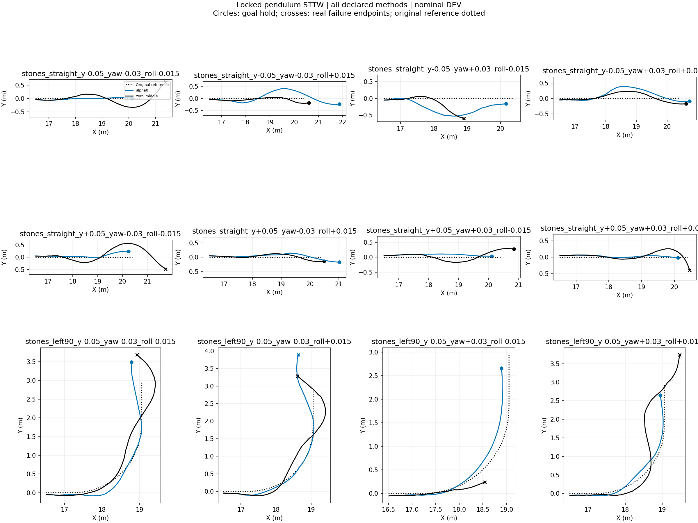
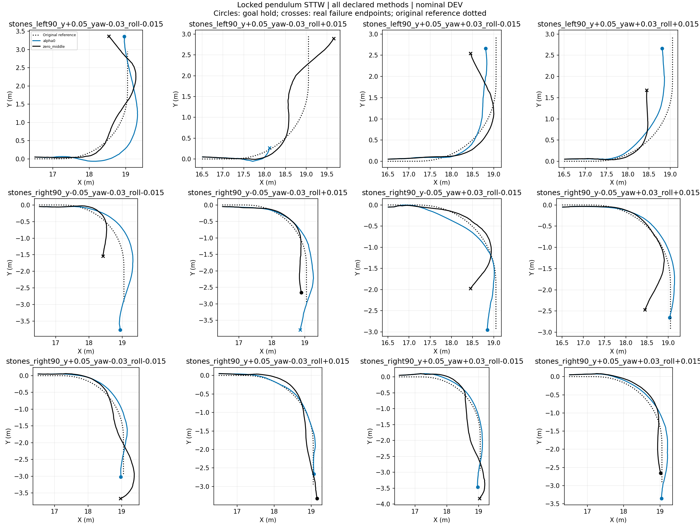
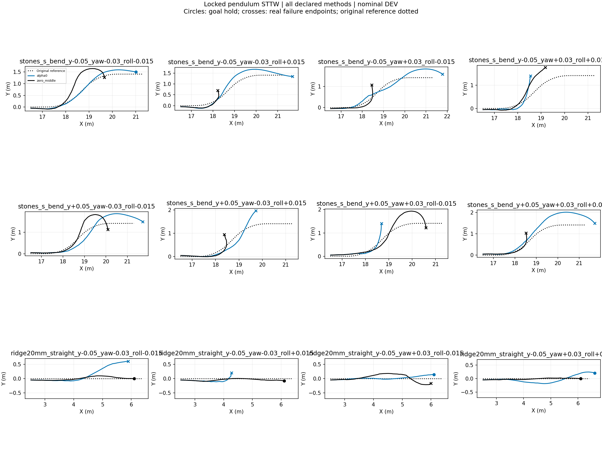
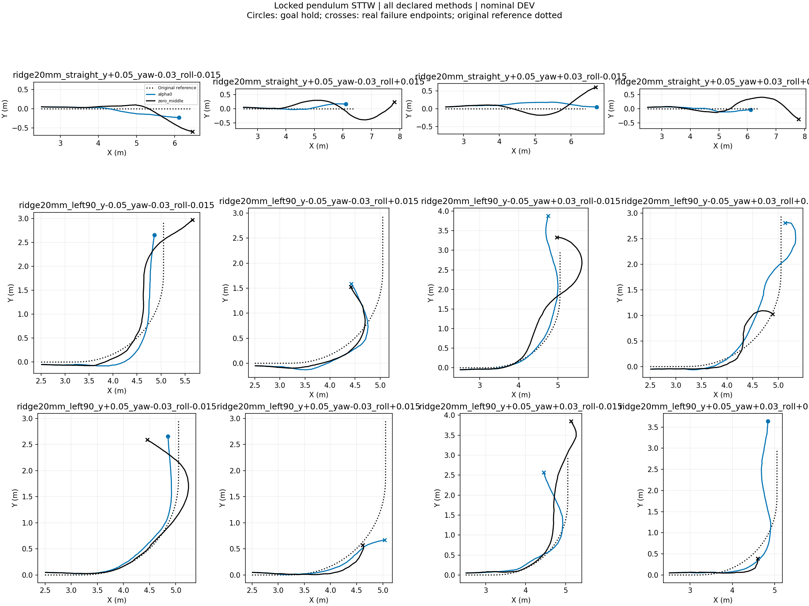
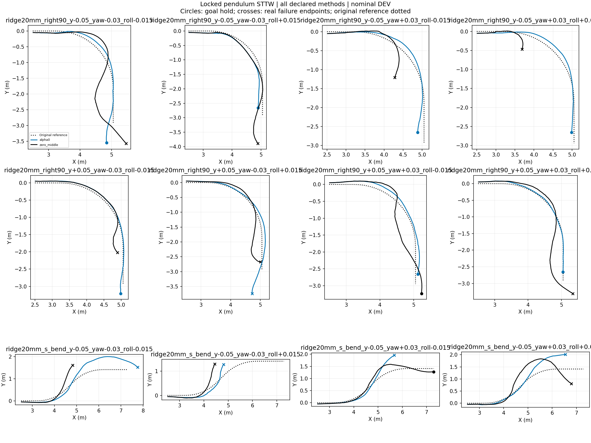
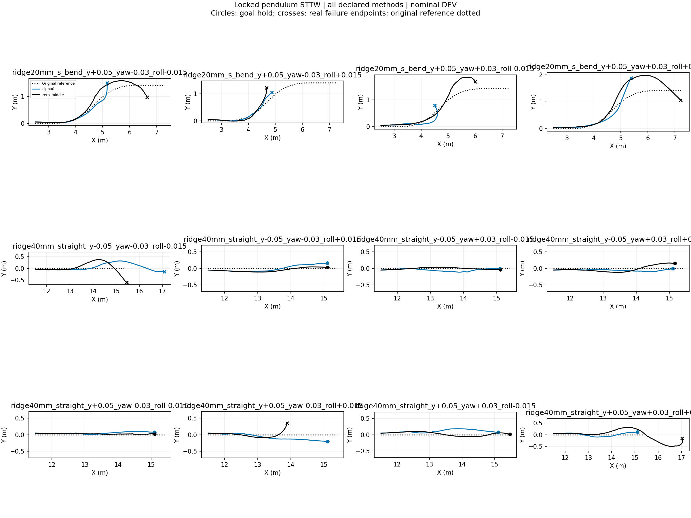
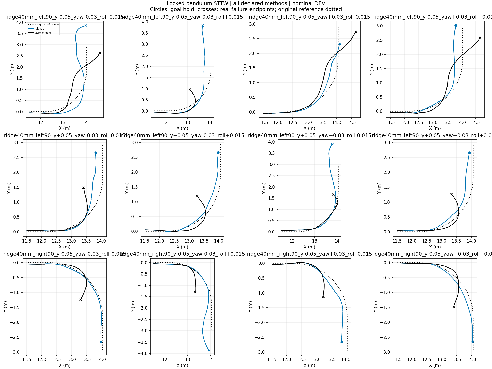
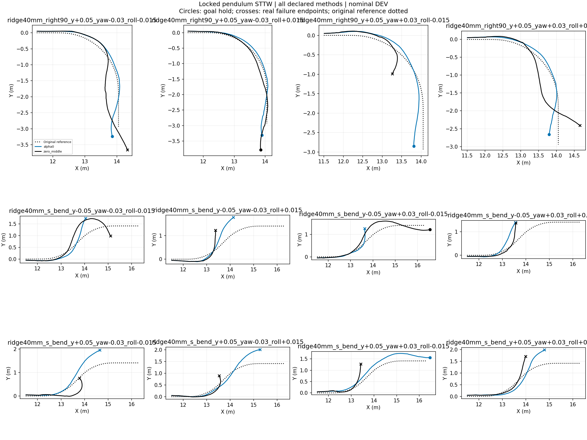

# Locked-pendulum STTW turning diagnostic

Nominal DEV, frozen H75, no training, one initialization per case. All failures retained. Each episode ends at its actual termination. These are inference-only behavior tests; task reward is not implemented and no reward improvement is claimed. RMSE below uses each episode's actual window and is not a paired-window ranking.

|Case|Method|End|Seconds|Path RMSE m|Speed RMSE m/s|
|---|---|---|---:|---:|---:|
|stones_straight_y-0.05_yaw-0.03_roll-0.015|alpha0|goal_hold|2.040|0.035|0.081|
|stones_straight_y-0.05_yaw-0.03_roll-0.015|zero_middle|corridor_or_domain_exit|3.050|0.203|0.084|
|stones_straight_y-0.05_yaw-0.03_roll+0.015|alpha0|goal_hold|3.300|0.215|0.158|
|stones_straight_y-0.05_yaw-0.03_roll+0.015|zero_middle|goal_hold|2.355|0.091|0.074|
|stones_straight_y-0.05_yaw+0.03_roll-0.015|alpha0|goal_hold|2.235|0.325|0.124|
|stones_straight_y-0.05_yaw+0.03_roll-0.015|zero_middle|corridor_or_domain_exit|1.490|0.246|0.111|
|stones_straight_y-0.05_yaw+0.03_roll+0.015|alpha0|goal_hold|2.630|0.202|0.165|
|stones_straight_y-0.05_yaw+0.03_roll+0.015|zero_middle|goal_hold|2.400|0.132|0.096|
|stones_straight_y+0.05_yaw-0.03_roll-0.015|alpha0|goal_hold|2.200|0.103|0.113|
|stones_straight_y+0.05_yaw-0.03_roll-0.015|zero_middle|corridor_or_domain_exit|3.320|0.279|0.084|
|stones_straight_y+0.05_yaw-0.03_roll+0.015|alpha0|goal_hold|2.600|0.083|0.091|
|stones_straight_y+0.05_yaw-0.03_roll+0.015|zero_middle|goal_hold|2.285|0.079|0.074|
|stones_straight_y+0.05_yaw+0.03_roll-0.015|alpha0|goal_hold|2.010|0.084|0.078|
|stones_straight_y+0.05_yaw+0.03_roll-0.015|zero_middle|goal_hold|2.550|0.144|0.087|
|stones_straight_y+0.05_yaw+0.03_roll+0.015|alpha0|goal_hold|2.055|0.040|0.083|
|stones_straight_y+0.05_yaw+0.03_roll+0.015|zero_middle|corridor_or_domain_exit|2.500|0.128|0.095|
|stones_left90_y-0.05_yaw-0.03_roll-0.015|alpha0|goal_hold|3.220|0.130|0.165|
|stones_left90_y-0.05_yaw-0.03_roll-0.015|zero_middle|corridor_or_domain_exit|3.260|0.183|0.096|
|stones_left90_y-0.05_yaw-0.03_roll+0.015|alpha0|corridor_or_domain_exit|3.520|0.206|0.184|
|stones_left90_y-0.05_yaw-0.03_roll+0.015|zero_middle|corridor_or_domain_exit|3.200|0.193|0.117|
|stones_left90_y-0.05_yaw+0.03_roll-0.015|alpha0|goal_hold|2.550|0.109|0.150|
|stones_left90_y-0.05_yaw+0.03_roll-0.015|zero_middle|physical_failure|1.175|0.085|0.133|
|stones_left90_y-0.05_yaw+0.03_roll+0.015|alpha0|goal_hold|2.630|0.071|0.176|
|stones_left90_y-0.05_yaw+0.03_roll+0.015|zero_middle|corridor_or_domain_exit|3.420|0.271|0.111|
|stones_left90_y+0.05_yaw-0.03_roll-0.015|alpha0|goal_hold|3.395|0.290|0.142|
|stones_left90_y+0.05_yaw-0.03_roll-0.015|zero_middle|corridor_or_domain_exit|3.160|0.153|0.121|
|stones_left90_y+0.05_yaw-0.03_roll+0.015|alpha0|physical_failure|1.095|0.062|0.449|
|stones_left90_y+0.05_yaw-0.03_roll+0.015|zero_middle|corridor_or_domain_exit|2.885|0.245|0.105|
|stones_left90_y+0.05_yaw+0.03_roll-0.015|alpha0|goal_hold|2.610|0.153|0.176|
|stones_left90_y+0.05_yaw+0.03_roll-0.015|zero_middle|corridor_or_domain_exit|2.610|0.213|0.101|
|stones_left90_y+0.05_yaw+0.03_roll+0.015|alpha0|goal_hold|2.570|0.150|0.180|
|stones_left90_y+0.05_yaw+0.03_roll+0.015|zero_middle|corridor_or_domain_exit|1.895|0.249|0.121|
|stones_right90_y-0.05_yaw-0.03_roll-0.015|alpha0|goal_hold|3.595|0.180|0.220|
|stones_right90_y-0.05_yaw-0.03_roll-0.015|zero_middle|corridor_or_domain_exit|1.885|0.214|0.121|
|stones_right90_y-0.05_yaw-0.03_roll+0.015|alpha0|corridor_or_domain_exit|3.540|0.117|0.216|
|stones_right90_y-0.05_yaw-0.03_roll+0.015|zero_middle|goal_hold|2.555|0.115|0.092|
|stones_right90_y-0.05_yaw+0.03_roll-0.015|alpha0|goal_hold|2.845|0.107|0.215|
|stones_right90_y-0.05_yaw+0.03_roll-0.015|zero_middle|corridor_or_domain_exit|2.275|0.180|0.106|
|stones_right90_y-0.05_yaw+0.03_roll+0.015|alpha0|goal_hold|2.845|0.078|0.233|
|stones_right90_y-0.05_yaw+0.03_roll+0.015|zero_middle|corridor_or_domain_exit|2.475|0.199|0.098|
|stones_right90_y+0.05_yaw-0.03_roll-0.015|alpha0|goal_hold|3.105|0.099|0.228|
|stones_right90_y+0.05_yaw-0.03_roll-0.015|zero_middle|corridor_or_domain_exit|3.260|0.153|0.096|
|stones_right90_y+0.05_yaw-0.03_roll+0.015|alpha0|goal_hold|2.725|0.030|0.199|
|stones_right90_y+0.05_yaw-0.03_roll+0.015|zero_middle|goal_hold|2.955|0.102|0.085|
|stones_right90_y+0.05_yaw+0.03_roll-0.015|alpha0|goal_hold|3.265|0.077|0.194|
|stones_right90_y+0.05_yaw+0.03_roll-0.015|zero_middle|corridor_or_domain_exit|3.320|0.180|0.108|
|stones_right90_y+0.05_yaw+0.03_roll+0.015|alpha0|goal_hold|3.305|0.102|0.231|
|stones_right90_y+0.05_yaw+0.03_roll+0.015|zero_middle|goal_hold|2.625|0.099|0.094|
|stones_s_bend_y-0.05_yaw-0.03_roll-0.015|alpha0|goal_hold|3.020|0.098|0.171|
|stones_s_bend_y-0.05_yaw-0.03_roll-0.015|zero_middle|corridor_or_domain_exit|2.440|0.324|0.134|
|stones_s_bend_y-0.05_yaw-0.03_roll+0.015|alpha0|corridor_or_domain_exit|3.560|0.189|0.181|
|stones_s_bend_y-0.05_yaw-0.03_roll+0.015|zero_middle|corridor_or_domain_exit|1.340|0.117|0.152|
|stones_s_bend_y-0.05_yaw+0.03_roll-0.015|alpha0|corridor_or_domain_exit|3.560|0.211|0.203|
|stones_s_bend_y-0.05_yaw+0.03_roll-0.015|zero_middle|corridor_or_domain_exit|1.600|0.131|0.135|
|stones_s_bend_y-0.05_yaw+0.03_roll+0.015|alpha0|corridor_or_domain_exit|1.840|0.214|0.204|
|stones_s_bend_y-0.05_yaw+0.03_roll+0.015|zero_middle|physical_failure|2.035|0.273|0.128|
|stones_s_bend_y+0.05_yaw-0.03_roll-0.015|alpha0|corridor_or_domain_exit|3.620|0.244|0.194|
|stones_s_bend_y+0.05_yaw-0.03_roll-0.015|zero_middle|corridor_or_domain_exit|2.840|0.247|0.119|
|stones_s_bend_y+0.05_yaw-0.03_roll+0.015|alpha0|corridor_or_domain_exit|2.430|0.201|0.129|
|stones_s_bend_y+0.05_yaw-0.03_roll+0.015|zero_middle|corridor_or_domain_exit|1.540|0.120|0.152|
|stones_s_bend_y+0.05_yaw+0.03_roll-0.015|alpha0|corridor_or_domain_exit|1.840|0.162|0.182|
|stones_s_bend_y+0.05_yaw+0.03_roll-0.015|zero_middle|corridor_or_domain_exit|3.080|0.250|0.102|
|stones_s_bend_y+0.05_yaw+0.03_roll+0.015|alpha0|corridor_or_domain_exit|3.780|0.333|0.229|
|stones_s_bend_y+0.05_yaw+0.03_roll+0.015|zero_middle|corridor_or_domain_exit|1.560|0.099|0.151|
|ridge20mm_straight_y-0.05_yaw-0.03_roll-0.015|alpha0|corridor_or_domain_exit|2.055|0.292|0.124|
|ridge20mm_straight_y-0.05_yaw-0.03_roll-0.015|zero_middle|goal_hold|2.060|0.055|0.094|
|ridge20mm_straight_y-0.05_yaw-0.03_roll+0.015|alpha0|corridor_or_domain_exit|1.140|0.090|0.218|
|ridge20mm_straight_y-0.05_yaw-0.03_roll+0.015|zero_middle|goal_hold|2.030|0.054|0.082|
|ridge20mm_straight_y-0.05_yaw+0.03_roll-0.015|alpha0|goal_hold|2.015|0.054|0.081|
|ridge20mm_straight_y-0.05_yaw+0.03_roll-0.015|zero_middle|physical_failure|2.040|0.121|0.188|
|ridge20mm_straight_y-0.05_yaw+0.03_roll+0.015|alpha0|goal_hold|2.435|0.134|0.144|
|ridge20mm_straight_y-0.05_yaw+0.03_roll+0.015|zero_middle|goal_hold|2.035|0.027|0.091|
|ridge20mm_straight_y+0.05_yaw-0.03_roll-0.015|alpha0|goal_hold|2.055|0.111|0.082|
|ridge20mm_straight_y+0.05_yaw-0.03_roll-0.015|zero_middle|corridor_or_domain_exit|2.355|0.213|0.090|
|ridge20mm_straight_y+0.05_yaw-0.03_roll+0.015|alpha0|goal_hold|2.050|0.081|0.095|
|ridge20mm_straight_y+0.05_yaw-0.03_roll+0.015|zero_middle|corridor_or_domain_exit|3.300|0.203|0.116|
|ridge20mm_straight_y+0.05_yaw+0.03_roll-0.015|alpha0|goal_hold|2.380|0.123|0.089|
|ridge20mm_straight_y+0.05_yaw+0.03_roll-0.015|zero_middle|corridor_or_domain_exit|2.515|0.201|0.097|
|ridge20mm_straight_y+0.05_yaw+0.03_roll+0.015|alpha0|goal_hold|2.065|0.064|0.091|
|ridge20mm_straight_y+0.05_yaw+0.03_roll+0.015|zero_middle|corridor_or_domain_exit|3.260|0.200|0.107|
|ridge20mm_left90_y-0.05_yaw-0.03_roll-0.015|alpha0|goal_hold|2.685|0.181|0.159|
|ridge20mm_left90_y-0.05_yaw-0.03_roll-0.015|zero_middle|corridor_or_domain_exit|2.945|0.234|0.118|
|ridge20mm_left90_y-0.05_yaw-0.03_roll+0.015|alpha0|corridor_or_domain_exit|2.165|0.204|0.219|
|ridge20mm_left90_y-0.05_yaw-0.03_roll+0.015|zero_middle|corridor_or_domain_exit|1.980|0.188|0.122|
|ridge20mm_left90_y-0.05_yaw+0.03_roll-0.015|alpha0|corridor_or_domain_exit|3.340|0.158|0.152|
|ridge20mm_left90_y-0.05_yaw+0.03_roll-0.015|zero_middle|corridor_or_domain_exit|3.200|0.284|0.119|
|ridge20mm_left90_y-0.05_yaw+0.03_roll+0.015|alpha0|corridor_or_domain_exit|2.840|0.173|0.214|
|ridge20mm_left90_y-0.05_yaw+0.03_roll+0.015|zero_middle|physical_failure|1.965|0.149|0.500|
|ridge20mm_left90_y+0.05_yaw-0.03_roll-0.015|alpha0|goal_hold|2.585|0.094|0.161|
|ridge20mm_left90_y+0.05_yaw-0.03_roll-0.015|zero_middle|corridor_or_domain_exit|2.765|0.155|0.108|
|ridge20mm_left90_y+0.05_yaw-0.03_roll+0.015|alpha0|corridor_or_domain_exit|1.620|0.091|0.158|
|ridge20mm_left90_y+0.05_yaw-0.03_roll+0.015|zero_middle|physical_failure|1.370|0.101|0.220|
|ridge20mm_left90_y+0.05_yaw+0.03_roll-0.015|alpha0|corridor_or_domain_exit|2.640|0.213|0.177|
|ridge20mm_left90_y+0.05_yaw+0.03_roll-0.015|zero_middle|corridor_or_domain_exit|3.360|0.177|0.292|
|ridge20mm_left90_y+0.05_yaw+0.03_roll+0.015|alpha0|goal_hold|3.360|0.209|0.175|
|ridge20mm_left90_y+0.05_yaw+0.03_roll+0.015|zero_middle|physical_failure|1.375|0.141|0.408|
|ridge20mm_right90_y-0.05_yaw-0.03_roll-0.015|alpha0|goal_hold|3.325|0.101|0.210|
|ridge20mm_right90_y-0.05_yaw-0.03_roll-0.015|zero_middle|corridor_or_domain_exit|3.420|0.284|0.100|
|ridge20mm_right90_y-0.05_yaw-0.03_roll+0.015|alpha0|goal_hold|2.615|0.105|0.208|
|ridge20mm_right90_y-0.05_yaw-0.03_roll+0.015|zero_middle|corridor_or_domain_exit|3.180|0.141|0.082|
|ridge20mm_right90_y-0.05_yaw+0.03_roll-0.015|alpha0|goal_hold|2.775|0.086|0.212|
|ridge20mm_right90_y-0.05_yaw+0.03_roll-0.015|zero_middle|corridor_or_domain_exit|1.610|0.194|0.115|
|ridge20mm_right90_y-0.05_yaw+0.03_roll+0.015|alpha0|goal_hold|2.765|0.071|0.210|
|ridge20mm_right90_y-0.05_yaw+0.03_roll+0.015|zero_middle|corridor_or_domain_exit|0.860|0.130|0.129|
|ridge20mm_right90_y+0.05_yaw-0.03_roll-0.015|alpha0|goal_hold|3.100|0.048|0.209|
|ridge20mm_right90_y+0.05_yaw-0.03_roll-0.015|zero_middle|physical_failure|2.275|0.115|0.256|
|ridge20mm_right90_y+0.05_yaw-0.03_roll+0.015|alpha0|corridor_or_domain_exit|3.460|0.105|0.218|
|ridge20mm_right90_y+0.05_yaw-0.03_roll+0.015|zero_middle|corridor_or_domain_exit|2.720|0.165|0.185|
|ridge20mm_right90_y+0.05_yaw+0.03_roll-0.015|alpha0|goal_hold|2.850|0.096|0.222|
|ridge20mm_right90_y+0.05_yaw+0.03_roll-0.015|zero_middle|goal_hold|3.005|0.218|0.119|
|ridge20mm_right90_y+0.05_yaw+0.03_roll+0.015|alpha0|goal_hold|2.730|0.036|0.205|
|ridge20mm_right90_y+0.05_yaw+0.03_roll+0.015|zero_middle|corridor_or_domain_exit|3.140|0.196|0.103|
|ridge20mm_s_bend_y-0.05_yaw-0.03_roll-0.015|alpha0|corridor_or_domain_exit|3.800|0.323|0.207|
|ridge20mm_s_bend_y-0.05_yaw-0.03_roll-0.015|zero_middle|corridor_or_domain_exit|1.875|0.246|0.100|
|ridge20mm_s_bend_y-0.05_yaw-0.03_roll+0.015|alpha0|physical_failure|1.900|0.140|0.248|
|ridge20mm_s_bend_y-0.05_yaw-0.03_roll+0.015|zero_middle|corridor_or_domain_exit|1.620|0.241|0.106|
|ridge20mm_s_bend_y-0.05_yaw+0.03_roll-0.015|alpha0|corridor_or_domain_exit|2.425|0.221|0.166|
|ridge20mm_s_bend_y-0.05_yaw+0.03_roll-0.015|zero_middle|goal_hold|3.185|0.143|0.118|
|ridge20mm_s_bend_y-0.05_yaw+0.03_roll+0.015|alpha0|corridor_or_domain_exit|2.915|0.282|0.202|
|ridge20mm_s_bend_y-0.05_yaw+0.03_roll+0.015|zero_middle|corridor_or_domain_exit|3.205|0.309|0.093|
|ridge20mm_s_bend_y+0.05_yaw-0.03_roll-0.015|alpha0|physical_failure|2.055|0.084|0.293|
|ridge20mm_s_bend_y+0.05_yaw-0.03_roll-0.015|zero_middle|corridor_or_domain_exit|2.900|0.163|0.112|
|ridge20mm_s_bend_y+0.05_yaw-0.03_roll+0.015|alpha0|physical_failure|1.655|0.059|0.156|
|ridge20mm_s_bend_y+0.05_yaw-0.03_roll+0.015|zero_middle|corridor_or_domain_exit|1.700|0.121|0.126|
|ridge20mm_s_bend_y+0.05_yaw+0.03_roll-0.015|alpha0|corridor_or_domain_exit|1.620|0.112|0.289|
|ridge20mm_s_bend_y+0.05_yaw+0.03_roll-0.015|zero_middle|physical_failure|2.580|0.228|0.269|
|ridge20mm_s_bend_y+0.05_yaw+0.03_roll+0.015|alpha0|corridor_or_domain_exit|2.265|0.182|0.139|
|ridge20mm_s_bend_y+0.05_yaw+0.03_roll+0.015|zero_middle|corridor_or_domain_exit|3.400|0.305|0.096|
|ridge40mm_straight_y-0.05_yaw-0.03_roll-0.015|alpha0|corridor_or_domain_exit|3.340|0.157|0.149|
|ridge40mm_straight_y-0.05_yaw-0.03_roll-0.015|zero_middle|corridor_or_domain_exit|2.535|0.224|0.105|
|ridge40mm_straight_y-0.05_yaw-0.03_roll+0.015|alpha0|goal_hold|2.065|0.091|0.094|
|ridge40mm_straight_y-0.05_yaw-0.03_roll+0.015|zero_middle|goal_hold|2.050|0.073|0.089|
|ridge40mm_straight_y-0.05_yaw+0.03_roll-0.015|alpha0|goal_hold|2.075|0.060|0.105|
|ridge40mm_straight_y-0.05_yaw+0.03_roll-0.015|zero_middle|goal_hold|2.040|0.027|0.089|
|ridge40mm_straight_y-0.05_yaw+0.03_roll+0.015|alpha0|goal_hold|2.050|0.059|0.086|
|ridge40mm_straight_y-0.05_yaw+0.03_roll+0.015|zero_middle|goal_hold|2.120|0.092|0.098|
|ridge40mm_straight_y+0.05_yaw-0.03_roll-0.015|alpha0|goal_hold|2.045|0.062|0.090|
|ridge40mm_straight_y+0.05_yaw-0.03_roll-0.015|zero_middle|goal_hold|2.060|0.032|0.095|
|ridge40mm_straight_y+0.05_yaw-0.03_roll+0.015|alpha0|goal_hold|2.050|0.107|0.086|
|ridge40mm_straight_y+0.05_yaw-0.03_roll+0.015|zero_middle|corridor_or_domain_exit|1.520|0.097|0.144|
|ridge40mm_straight_y+0.05_yaw+0.03_roll-0.015|alpha0|goal_hold|2.120|0.121|0.144|
|ridge40mm_straight_y+0.05_yaw+0.03_roll-0.015|zero_middle|goal_hold|2.270|0.062|0.089|
|ridge40mm_straight_y+0.05_yaw+0.03_roll+0.015|alpha0|goal_hold|2.110|0.069|0.113|
|ridge40mm_straight_y+0.05_yaw+0.03_roll+0.015|zero_middle|physical_failure|3.575|0.241|0.300|
|ridge40mm_left90_y-0.05_yaw-0.03_roll-0.015|alpha0|corridor_or_domain_exit|3.760|0.275|0.207|
|ridge40mm_left90_y-0.05_yaw-0.03_roll-0.015|zero_middle|corridor_or_domain_exit|2.705|0.286|0.110|
|ridge40mm_left90_y-0.05_yaw-0.03_roll+0.015|alpha0|corridor_or_domain_exit|3.320|0.231|0.145|
|ridge40mm_left90_y-0.05_yaw-0.03_roll+0.015|zero_middle|corridor_or_domain_exit|1.570|0.196|0.133|
|ridge40mm_left90_y-0.05_yaw+0.03_roll-0.015|alpha0|physical_failure|2.375|0.102|0.146|
|ridge40mm_left90_y-0.05_yaw+0.03_roll-0.015|zero_middle|corridor_or_domain_exit|2.685|0.241|0.108|
|ridge40mm_left90_y-0.05_yaw+0.03_roll+0.015|alpha0|goal_hold|2.820|0.183|0.173|
|ridge40mm_left90_y-0.05_yaw+0.03_roll+0.015|zero_middle|corridor_or_domain_exit|2.695|0.230|0.130|
|ridge40mm_left90_y+0.05_yaw-0.03_roll-0.015|alpha0|goal_hold|2.585|0.171|0.161|
|ridge40mm_left90_y+0.05_yaw-0.03_roll-0.015|zero_middle|corridor_or_domain_exit|1.820|0.203|0.121|
|ridge40mm_left90_y+0.05_yaw-0.03_roll+0.015|alpha0|goal_hold|2.590|0.092|0.176|
|ridge40mm_left90_y+0.05_yaw-0.03_roll+0.015|zero_middle|corridor_or_domain_exit|1.750|0.180|0.134|
|ridge40mm_left90_y+0.05_yaw+0.03_roll-0.015|alpha0|corridor_or_domain_exit|3.425|0.211|0.174|
|ridge40mm_left90_y+0.05_yaw+0.03_roll-0.015|zero_middle|physical_failure|2.095|0.060|0.383|
|ridge40mm_left90_y+0.05_yaw+0.03_roll+0.015|alpha0|goal_hold|2.560|0.145|0.182|
|ridge40mm_left90_y+0.05_yaw+0.03_roll+0.015|zero_middle|corridor_or_domain_exit|1.785|0.177|0.138|
|ridge40mm_right90_y-0.05_yaw-0.03_roll-0.015|alpha0|goal_hold|2.680|0.043|0.215|
|ridge40mm_right90_y-0.05_yaw-0.03_roll-0.015|zero_middle|corridor_or_domain_exit|1.695|0.179|0.127|
|ridge40mm_right90_y-0.05_yaw-0.03_roll+0.015|alpha0|corridor_or_domain_exit|3.480|0.185|0.210|
|ridge40mm_right90_y-0.05_yaw-0.03_roll+0.015|zero_middle|corridor_or_domain_exit|1.580|0.221|0.122|
|ridge40mm_right90_y-0.05_yaw+0.03_roll-0.015|alpha0|goal_hold|2.630|0.123|0.203|
|ridge40mm_right90_y-0.05_yaw+0.03_roll-0.015|zero_middle|corridor_or_domain_exit|1.520|0.209|0.132|
|ridge40mm_right90_y-0.05_yaw+0.03_roll+0.015|alpha0|goal_hold|2.600|0.081|0.180|
|ridge40mm_right90_y-0.05_yaw+0.03_roll+0.015|zero_middle|corridor_or_domain_exit|1.850|0.197|0.102|
|ridge40mm_right90_y+0.05_yaw-0.03_roll-0.015|alpha0|goal_hold|3.165|0.105|0.212|
|ridge40mm_right90_y+0.05_yaw-0.03_roll-0.015|zero_middle|corridor_or_domain_exit|3.240|0.207|0.106|
|ridge40mm_right90_y+0.05_yaw-0.03_roll+0.015|alpha0|goal_hold|3.145|0.078|0.203|
|ridge40mm_right90_y+0.05_yaw-0.03_roll+0.015|zero_middle|goal_hold|3.170|0.085|0.092|
|ridge40mm_right90_y+0.05_yaw+0.03_roll-0.015|alpha0|goal_hold|2.880|0.119|0.212|
|ridge40mm_right90_y+0.05_yaw+0.03_roll-0.015|zero_middle|corridor_or_domain_exit|1.520|0.158|0.124|
|ridge40mm_right90_y+0.05_yaw+0.03_roll+0.015|alpha0|goal_hold|2.830|0.099|0.230|
|ridge40mm_right90_y+0.05_yaw+0.03_roll+0.015|zero_middle|corridor_or_domain_exit|2.630|0.239|0.109|
|ridge40mm_s_bend_y-0.05_yaw-0.03_roll-0.015|alpha0|corridor_or_domain_exit|2.155|0.206|0.162|
|ridge40mm_s_bend_y-0.05_yaw-0.03_roll-0.015|zero_middle|corridor_or_domain_exit|2.860|0.280|0.134|
|ridge40mm_s_bend_y-0.05_yaw-0.03_roll+0.015|alpha0|corridor_or_domain_exit|2.200|0.272|0.197|
|ridge40mm_s_bend_y-0.05_yaw-0.03_roll+0.015|zero_middle|corridor_or_domain_exit|1.650|0.215|0.107|
|ridge40mm_s_bend_y-0.05_yaw+0.03_roll-0.015|alpha0|corridor_or_domain_exit|1.800|0.124|0.206|
|ridge40mm_s_bend_y-0.05_yaw+0.03_roll-0.015|zero_middle|goal_hold|3.350|0.194|0.104|
|ridge40mm_s_bend_y-0.05_yaw+0.03_roll+0.015|alpha0|corridor_or_domain_exit|1.735|0.269|0.203|
|ridge40mm_s_bend_y-0.05_yaw+0.03_roll+0.015|zero_middle|corridor_or_domain_exit|1.760|0.188|0.132|
|ridge40mm_s_bend_y+0.05_yaw-0.03_roll-0.015|alpha0|corridor_or_domain_exit|2.410|0.270|0.175|
|ridge40mm_s_bend_y+0.05_yaw-0.03_roll-0.015|zero_middle|corridor_or_domain_exit|1.700|0.229|0.123|
|ridge40mm_s_bend_y+0.05_yaw-0.03_roll+0.015|alpha0|corridor_or_domain_exit|2.735|0.231|0.183|
|ridge40mm_s_bend_y+0.05_yaw-0.03_roll+0.015|zero_middle|corridor_or_domain_exit|1.560|0.087|0.149|
|ridge40mm_s_bend_y+0.05_yaw+0.03_roll-0.015|alpha0|goal_hold|3.380|0.194|0.194|
|ridge40mm_s_bend_y+0.05_yaw+0.03_roll-0.015|zero_middle|corridor_or_domain_exit|1.605|0.214|0.126|
|ridge40mm_s_bend_y+0.05_yaw+0.03_roll+0.015|alpha0|corridor_or_domain_exit|2.510|0.232|0.157|
|ridge40mm_s_bend_y+0.05_yaw+0.03_roll+0.015|zero_middle|corridor_or_domain_exit|2.025|0.184|0.114|

## Tracking plots
- [stones_straight_y-0.05_yaw-0.03_roll-0.015](stones_straight_y-0.05_yaw-0.03_roll-0.015_tracking.png)
- [stones_straight_y-0.05_yaw-0.03_roll+0.015](stones_straight_y-0.05_yaw-0.03_roll+0.015_tracking.png)
- [stones_straight_y-0.05_yaw+0.03_roll-0.015](stones_straight_y-0.05_yaw+0.03_roll-0.015_tracking.png)
- [stones_straight_y-0.05_yaw+0.03_roll+0.015](stones_straight_y-0.05_yaw+0.03_roll+0.015_tracking.png)
- [stones_straight_y+0.05_yaw-0.03_roll-0.015](stones_straight_y+0.05_yaw-0.03_roll-0.015_tracking.png)
- [stones_straight_y+0.05_yaw-0.03_roll+0.015](stones_straight_y+0.05_yaw-0.03_roll+0.015_tracking.png)
- [stones_straight_y+0.05_yaw+0.03_roll-0.015](stones_straight_y+0.05_yaw+0.03_roll-0.015_tracking.png)
- [stones_straight_y+0.05_yaw+0.03_roll+0.015](stones_straight_y+0.05_yaw+0.03_roll+0.015_tracking.png)
- [stones_left90_y-0.05_yaw-0.03_roll-0.015](stones_left90_y-0.05_yaw-0.03_roll-0.015_tracking.png)
- [stones_left90_y-0.05_yaw-0.03_roll+0.015](stones_left90_y-0.05_yaw-0.03_roll+0.015_tracking.png)
- [stones_left90_y-0.05_yaw+0.03_roll-0.015](stones_left90_y-0.05_yaw+0.03_roll-0.015_tracking.png)
- [stones_left90_y-0.05_yaw+0.03_roll+0.015](stones_left90_y-0.05_yaw+0.03_roll+0.015_tracking.png)
- [stones_left90_y+0.05_yaw-0.03_roll-0.015](stones_left90_y+0.05_yaw-0.03_roll-0.015_tracking.png)
- [stones_left90_y+0.05_yaw-0.03_roll+0.015](stones_left90_y+0.05_yaw-0.03_roll+0.015_tracking.png)
- [stones_left90_y+0.05_yaw+0.03_roll-0.015](stones_left90_y+0.05_yaw+0.03_roll-0.015_tracking.png)
- [stones_left90_y+0.05_yaw+0.03_roll+0.015](stones_left90_y+0.05_yaw+0.03_roll+0.015_tracking.png)
- [stones_right90_y-0.05_yaw-0.03_roll-0.015](stones_right90_y-0.05_yaw-0.03_roll-0.015_tracking.png)
- [stones_right90_y-0.05_yaw-0.03_roll+0.015](stones_right90_y-0.05_yaw-0.03_roll+0.015_tracking.png)
- [stones_right90_y-0.05_yaw+0.03_roll-0.015](stones_right90_y-0.05_yaw+0.03_roll-0.015_tracking.png)
- [stones_right90_y-0.05_yaw+0.03_roll+0.015](stones_right90_y-0.05_yaw+0.03_roll+0.015_tracking.png)
- [stones_right90_y+0.05_yaw-0.03_roll-0.015](stones_right90_y+0.05_yaw-0.03_roll-0.015_tracking.png)
- [stones_right90_y+0.05_yaw-0.03_roll+0.015](stones_right90_y+0.05_yaw-0.03_roll+0.015_tracking.png)
- [stones_right90_y+0.05_yaw+0.03_roll-0.015](stones_right90_y+0.05_yaw+0.03_roll-0.015_tracking.png)
- [stones_right90_y+0.05_yaw+0.03_roll+0.015](stones_right90_y+0.05_yaw+0.03_roll+0.015_tracking.png)
- [stones_s_bend_y-0.05_yaw-0.03_roll-0.015](stones_s_bend_y-0.05_yaw-0.03_roll-0.015_tracking.png)
- [stones_s_bend_y-0.05_yaw-0.03_roll+0.015](stones_s_bend_y-0.05_yaw-0.03_roll+0.015_tracking.png)
- [stones_s_bend_y-0.05_yaw+0.03_roll-0.015](stones_s_bend_y-0.05_yaw+0.03_roll-0.015_tracking.png)
- [stones_s_bend_y-0.05_yaw+0.03_roll+0.015](stones_s_bend_y-0.05_yaw+0.03_roll+0.015_tracking.png)
- [stones_s_bend_y+0.05_yaw-0.03_roll-0.015](stones_s_bend_y+0.05_yaw-0.03_roll-0.015_tracking.png)
- [stones_s_bend_y+0.05_yaw-0.03_roll+0.015](stones_s_bend_y+0.05_yaw-0.03_roll+0.015_tracking.png)
- [stones_s_bend_y+0.05_yaw+0.03_roll-0.015](stones_s_bend_y+0.05_yaw+0.03_roll-0.015_tracking.png)
- [stones_s_bend_y+0.05_yaw+0.03_roll+0.015](stones_s_bend_y+0.05_yaw+0.03_roll+0.015_tracking.png)
- [ridge20mm_straight_y-0.05_yaw-0.03_roll-0.015](ridge20mm_straight_y-0.05_yaw-0.03_roll-0.015_tracking.png)
- [ridge20mm_straight_y-0.05_yaw-0.03_roll+0.015](ridge20mm_straight_y-0.05_yaw-0.03_roll+0.015_tracking.png)
- [ridge20mm_straight_y-0.05_yaw+0.03_roll-0.015](ridge20mm_straight_y-0.05_yaw+0.03_roll-0.015_tracking.png)
- [ridge20mm_straight_y-0.05_yaw+0.03_roll+0.015](ridge20mm_straight_y-0.05_yaw+0.03_roll+0.015_tracking.png)
- [ridge20mm_straight_y+0.05_yaw-0.03_roll-0.015](ridge20mm_straight_y+0.05_yaw-0.03_roll-0.015_tracking.png)
- [ridge20mm_straight_y+0.05_yaw-0.03_roll+0.015](ridge20mm_straight_y+0.05_yaw-0.03_roll+0.015_tracking.png)
- [ridge20mm_straight_y+0.05_yaw+0.03_roll-0.015](ridge20mm_straight_y+0.05_yaw+0.03_roll-0.015_tracking.png)
- [ridge20mm_straight_y+0.05_yaw+0.03_roll+0.015](ridge20mm_straight_y+0.05_yaw+0.03_roll+0.015_tracking.png)
- [ridge20mm_left90_y-0.05_yaw-0.03_roll-0.015](ridge20mm_left90_y-0.05_yaw-0.03_roll-0.015_tracking.png)
- [ridge20mm_left90_y-0.05_yaw-0.03_roll+0.015](ridge20mm_left90_y-0.05_yaw-0.03_roll+0.015_tracking.png)
- [ridge20mm_left90_y-0.05_yaw+0.03_roll-0.015](ridge20mm_left90_y-0.05_yaw+0.03_roll-0.015_tracking.png)
- [ridge20mm_left90_y-0.05_yaw+0.03_roll+0.015](ridge20mm_left90_y-0.05_yaw+0.03_roll+0.015_tracking.png)
- [ridge20mm_left90_y+0.05_yaw-0.03_roll-0.015](ridge20mm_left90_y+0.05_yaw-0.03_roll-0.015_tracking.png)
- [ridge20mm_left90_y+0.05_yaw-0.03_roll+0.015](ridge20mm_left90_y+0.05_yaw-0.03_roll+0.015_tracking.png)
- [ridge20mm_left90_y+0.05_yaw+0.03_roll-0.015](ridge20mm_left90_y+0.05_yaw+0.03_roll-0.015_tracking.png)
- [ridge20mm_left90_y+0.05_yaw+0.03_roll+0.015](ridge20mm_left90_y+0.05_yaw+0.03_roll+0.015_tracking.png)
- [ridge20mm_right90_y-0.05_yaw-0.03_roll-0.015](ridge20mm_right90_y-0.05_yaw-0.03_roll-0.015_tracking.png)
- [ridge20mm_right90_y-0.05_yaw-0.03_roll+0.015](ridge20mm_right90_y-0.05_yaw-0.03_roll+0.015_tracking.png)
- [ridge20mm_right90_y-0.05_yaw+0.03_roll-0.015](ridge20mm_right90_y-0.05_yaw+0.03_roll-0.015_tracking.png)
- [ridge20mm_right90_y-0.05_yaw+0.03_roll+0.015](ridge20mm_right90_y-0.05_yaw+0.03_roll+0.015_tracking.png)
- [ridge20mm_right90_y+0.05_yaw-0.03_roll-0.015](ridge20mm_right90_y+0.05_yaw-0.03_roll-0.015_tracking.png)
- [ridge20mm_right90_y+0.05_yaw-0.03_roll+0.015](ridge20mm_right90_y+0.05_yaw-0.03_roll+0.015_tracking.png)
- [ridge20mm_right90_y+0.05_yaw+0.03_roll-0.015](ridge20mm_right90_y+0.05_yaw+0.03_roll-0.015_tracking.png)
- [ridge20mm_right90_y+0.05_yaw+0.03_roll+0.015](ridge20mm_right90_y+0.05_yaw+0.03_roll+0.015_tracking.png)
- [ridge20mm_s_bend_y-0.05_yaw-0.03_roll-0.015](ridge20mm_s_bend_y-0.05_yaw-0.03_roll-0.015_tracking.png)
- [ridge20mm_s_bend_y-0.05_yaw-0.03_roll+0.015](ridge20mm_s_bend_y-0.05_yaw-0.03_roll+0.015_tracking.png)
- [ridge20mm_s_bend_y-0.05_yaw+0.03_roll-0.015](ridge20mm_s_bend_y-0.05_yaw+0.03_roll-0.015_tracking.png)
- [ridge20mm_s_bend_y-0.05_yaw+0.03_roll+0.015](ridge20mm_s_bend_y-0.05_yaw+0.03_roll+0.015_tracking.png)
- [ridge20mm_s_bend_y+0.05_yaw-0.03_roll-0.015](ridge20mm_s_bend_y+0.05_yaw-0.03_roll-0.015_tracking.png)
- [ridge20mm_s_bend_y+0.05_yaw-0.03_roll+0.015](ridge20mm_s_bend_y+0.05_yaw-0.03_roll+0.015_tracking.png)
- [ridge20mm_s_bend_y+0.05_yaw+0.03_roll-0.015](ridge20mm_s_bend_y+0.05_yaw+0.03_roll-0.015_tracking.png)
- [ridge20mm_s_bend_y+0.05_yaw+0.03_roll+0.015](ridge20mm_s_bend_y+0.05_yaw+0.03_roll+0.015_tracking.png)
- [ridge40mm_straight_y-0.05_yaw-0.03_roll-0.015](ridge40mm_straight_y-0.05_yaw-0.03_roll-0.015_tracking.png)
- [ridge40mm_straight_y-0.05_yaw-0.03_roll+0.015](ridge40mm_straight_y-0.05_yaw-0.03_roll+0.015_tracking.png)
- [ridge40mm_straight_y-0.05_yaw+0.03_roll-0.015](ridge40mm_straight_y-0.05_yaw+0.03_roll-0.015_tracking.png)
- [ridge40mm_straight_y-0.05_yaw+0.03_roll+0.015](ridge40mm_straight_y-0.05_yaw+0.03_roll+0.015_tracking.png)
- [ridge40mm_straight_y+0.05_yaw-0.03_roll-0.015](ridge40mm_straight_y+0.05_yaw-0.03_roll-0.015_tracking.png)
- [ridge40mm_straight_y+0.05_yaw-0.03_roll+0.015](ridge40mm_straight_y+0.05_yaw-0.03_roll+0.015_tracking.png)
- [ridge40mm_straight_y+0.05_yaw+0.03_roll-0.015](ridge40mm_straight_y+0.05_yaw+0.03_roll-0.015_tracking.png)
- [ridge40mm_straight_y+0.05_yaw+0.03_roll+0.015](ridge40mm_straight_y+0.05_yaw+0.03_roll+0.015_tracking.png)
- [ridge40mm_left90_y-0.05_yaw-0.03_roll-0.015](ridge40mm_left90_y-0.05_yaw-0.03_roll-0.015_tracking.png)
- [ridge40mm_left90_y-0.05_yaw-0.03_roll+0.015](ridge40mm_left90_y-0.05_yaw-0.03_roll+0.015_tracking.png)
- [ridge40mm_left90_y-0.05_yaw+0.03_roll-0.015](ridge40mm_left90_y-0.05_yaw+0.03_roll-0.015_tracking.png)
- [ridge40mm_left90_y-0.05_yaw+0.03_roll+0.015](ridge40mm_left90_y-0.05_yaw+0.03_roll+0.015_tracking.png)
- [ridge40mm_left90_y+0.05_yaw-0.03_roll-0.015](ridge40mm_left90_y+0.05_yaw-0.03_roll-0.015_tracking.png)
- [ridge40mm_left90_y+0.05_yaw-0.03_roll+0.015](ridge40mm_left90_y+0.05_yaw-0.03_roll+0.015_tracking.png)
- [ridge40mm_left90_y+0.05_yaw+0.03_roll-0.015](ridge40mm_left90_y+0.05_yaw+0.03_roll-0.015_tracking.png)
- [ridge40mm_left90_y+0.05_yaw+0.03_roll+0.015](ridge40mm_left90_y+0.05_yaw+0.03_roll+0.015_tracking.png)
- [ridge40mm_right90_y-0.05_yaw-0.03_roll-0.015](ridge40mm_right90_y-0.05_yaw-0.03_roll-0.015_tracking.png)
- [ridge40mm_right90_y-0.05_yaw-0.03_roll+0.015](ridge40mm_right90_y-0.05_yaw-0.03_roll+0.015_tracking.png)
- [ridge40mm_right90_y-0.05_yaw+0.03_roll-0.015](ridge40mm_right90_y-0.05_yaw+0.03_roll-0.015_tracking.png)
- [ridge40mm_right90_y-0.05_yaw+0.03_roll+0.015](ridge40mm_right90_y-0.05_yaw+0.03_roll+0.015_tracking.png)
- [ridge40mm_right90_y+0.05_yaw-0.03_roll-0.015](ridge40mm_right90_y+0.05_yaw-0.03_roll-0.015_tracking.png)
- [ridge40mm_right90_y+0.05_yaw-0.03_roll+0.015](ridge40mm_right90_y+0.05_yaw-0.03_roll+0.015_tracking.png)
- [ridge40mm_right90_y+0.05_yaw+0.03_roll-0.015](ridge40mm_right90_y+0.05_yaw+0.03_roll-0.015_tracking.png)
- [ridge40mm_right90_y+0.05_yaw+0.03_roll+0.015](ridge40mm_right90_y+0.05_yaw+0.03_roll+0.015_tracking.png)
- [ridge40mm_s_bend_y-0.05_yaw-0.03_roll-0.015](ridge40mm_s_bend_y-0.05_yaw-0.03_roll-0.015_tracking.png)
- [ridge40mm_s_bend_y-0.05_yaw-0.03_roll+0.015](ridge40mm_s_bend_y-0.05_yaw-0.03_roll+0.015_tracking.png)
- [ridge40mm_s_bend_y-0.05_yaw+0.03_roll-0.015](ridge40mm_s_bend_y-0.05_yaw+0.03_roll-0.015_tracking.png)
- [ridge40mm_s_bend_y-0.05_yaw+0.03_roll+0.015](ridge40mm_s_bend_y-0.05_yaw+0.03_roll+0.015_tracking.png)
- [ridge40mm_s_bend_y+0.05_yaw-0.03_roll-0.015](ridge40mm_s_bend_y+0.05_yaw-0.03_roll-0.015_tracking.png)
- [ridge40mm_s_bend_y+0.05_yaw-0.03_roll+0.015](ridge40mm_s_bend_y+0.05_yaw-0.03_roll+0.015_tracking.png)
- [ridge40mm_s_bend_y+0.05_yaw+0.03_roll-0.015](ridge40mm_s_bend_y+0.05_yaw+0.03_roll-0.015_tracking.png)
- [ridge40mm_s_bend_y+0.05_yaw+0.03_roll+0.015](ridge40mm_s_bend_y+0.05_yaw+0.03_roll+0.015_tracking.png)
