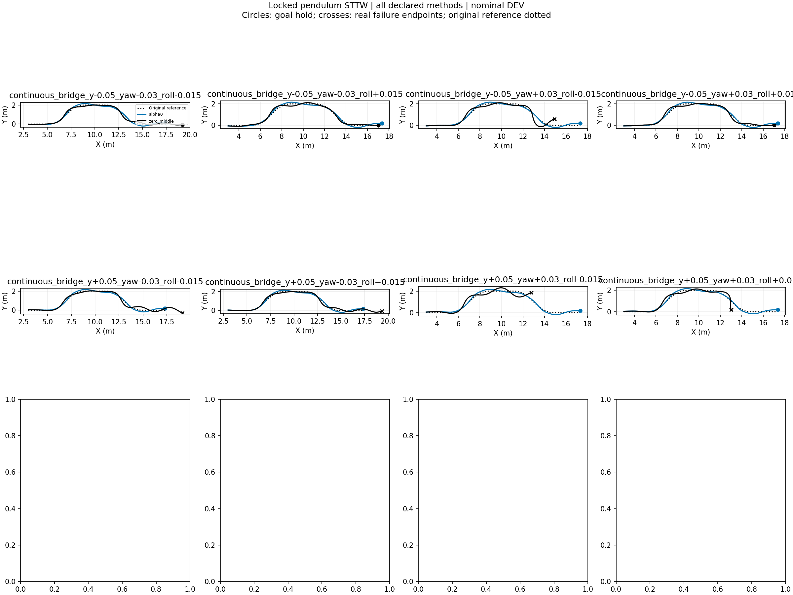

# Locked-pendulum STTW turning diagnostic

Nominal DEV, frozen H75, no training, one initialization per case. All failures retained. Each episode ends at its actual termination. These are inference-only behavior tests; task reward is not implemented and no reward improvement is claimed. RMSE below uses each episode's actual window and is not a paired-window ranking.

|Case|Method|End|Seconds|Path RMSE m|Speed RMSE m/s|
|---|---|---|---:|---:|---:|
|continuous_bridge_y-0.05_yaw-0.03_roll-0.015|alpha0|goal_hold|9.045|0.099|0.123|
|continuous_bridge_y-0.05_yaw-0.03_roll-0.015|zero_middle|goal_hold|9.855|0.090|0.044|
|continuous_bridge_y-0.05_yaw-0.03_roll+0.015|alpha0|goal_hold|9.025|0.098|0.127|
|continuous_bridge_y-0.05_yaw-0.03_roll+0.015|zero_middle|goal_hold|8.640|0.096|0.045|
|continuous_bridge_y-0.05_yaw+0.03_roll-0.015|alpha0|goal_hold|9.035|0.095|0.121|
|continuous_bridge_y-0.05_yaw+0.03_roll-0.015|zero_middle|corridor_or_domain_exit|7.920|0.204|0.053|
|continuous_bridge_y-0.05_yaw+0.03_roll+0.015|alpha0|goal_hold|9.035|0.094|0.125|
|continuous_bridge_y-0.05_yaw+0.03_roll+0.015|zero_middle|goal_hold|8.655|0.102|0.049|
|continuous_bridge_y+0.05_yaw-0.03_roll-0.015|alpha0|goal_hold|9.030|0.095|0.123|
|continuous_bridge_y+0.05_yaw-0.03_roll-0.015|zero_middle|timeout|10.000|0.139|0.050|
|continuous_bridge_y+0.05_yaw-0.03_roll+0.015|alpha0|goal_hold|9.055|0.095|0.123|
|continuous_bridge_y+0.05_yaw-0.03_roll+0.015|zero_middle|timeout|10.000|0.101|0.041|
|continuous_bridge_y+0.05_yaw+0.03_roll-0.015|alpha0|goal_hold|9.055|0.101|0.124|
|continuous_bridge_y+0.05_yaw+0.03_roll-0.015|zero_middle|corridor_or_domain_exit|6.200|0.215|0.050|
|continuous_bridge_y+0.05_yaw+0.03_roll+0.015|alpha0|goal_hold|9.075|0.097|0.124|
|continuous_bridge_y+0.05_yaw+0.03_roll+0.015|zero_middle|corridor_or_domain_exit|6.805|0.164|0.050|

## Tracking plots
- [continuous_bridge_y-0.05_yaw-0.03_roll-0.015](continuous_bridge_y-0.05_yaw-0.03_roll-0.015_tracking.png)
- [continuous_bridge_y-0.05_yaw-0.03_roll+0.015](continuous_bridge_y-0.05_yaw-0.03_roll+0.015_tracking.png)
- [continuous_bridge_y-0.05_yaw+0.03_roll-0.015](continuous_bridge_y-0.05_yaw+0.03_roll-0.015_tracking.png)
- [continuous_bridge_y-0.05_yaw+0.03_roll+0.015](continuous_bridge_y-0.05_yaw+0.03_roll+0.015_tracking.png)
- [continuous_bridge_y+0.05_yaw-0.03_roll-0.015](continuous_bridge_y+0.05_yaw-0.03_roll-0.015_tracking.png)
- [continuous_bridge_y+0.05_yaw-0.03_roll+0.015](continuous_bridge_y+0.05_yaw-0.03_roll+0.015_tracking.png)
- [continuous_bridge_y+0.05_yaw+0.03_roll-0.015](continuous_bridge_y+0.05_yaw+0.03_roll-0.015_tracking.png)
- [continuous_bridge_y+0.05_yaw+0.03_roll+0.015](continuous_bridge_y+0.05_yaw+0.03_roll+0.015_tracking.png)
