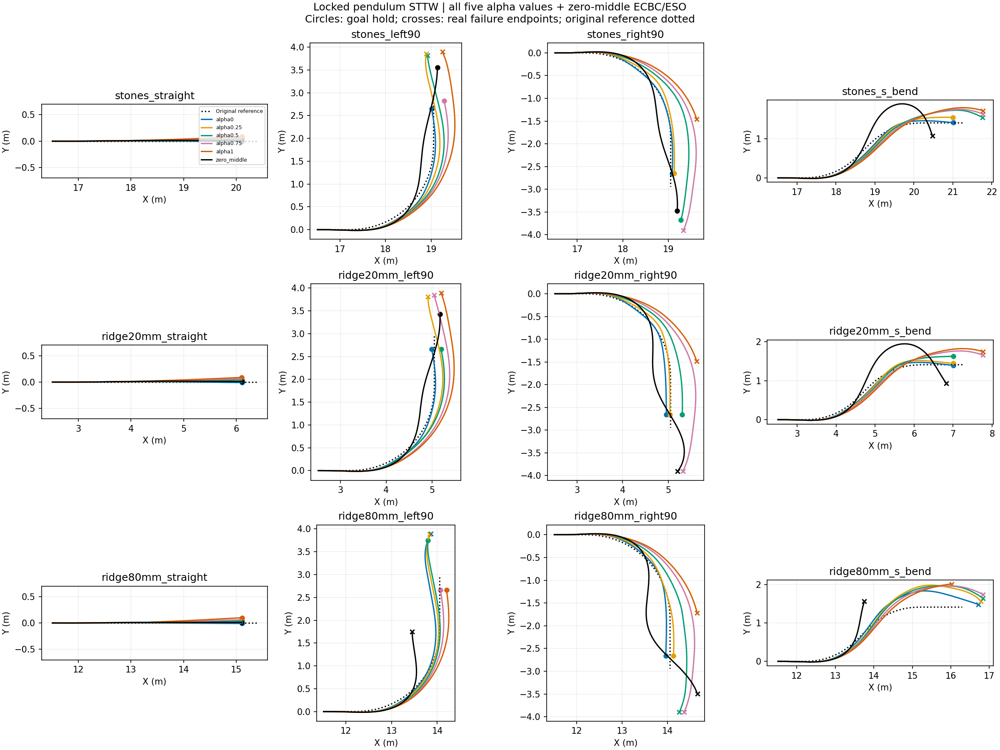

# Locked-pendulum STTW turning diagnostic

Nominal DEV, frozen H75, no training, one initialization per case. All failures retained. Each episode ends at its actual termination. These are inference-only behavior tests; task reward is not implemented and no reward improvement is claimed. RMSE below uses each episode's actual window and is not a paired-window ranking.

|Case|Method|End|Seconds|Path RMSE m|Speed RMSE m/s|
|---|---|---|---:|---:|---:|
|stones_straight|alpha0|goal_hold|1.770|0.004|0.060|
|stones_straight|alpha0.25|goal_hold|1.770|0.009|0.062|
|stones_straight|alpha0.5|goal_hold|1.770|0.018|0.063|
|stones_straight|alpha0.75|goal_hold|1.775|0.027|0.054|
|stones_straight|alpha1|goal_hold|1.780|0.037|0.047|
|stones_straight|zero_middle|goal_hold|1.805|0.010|0.047|
|stones_left90|alpha0|goal_hold|2.330|0.052|0.119|
|stones_left90|alpha0.25|corridor_or_domain_exit|3.000|0.102|0.143|
|stones_left90|alpha0.5|corridor_or_domain_exit|2.920|0.137|0.076|
|stones_left90|alpha0.75|goal_hold|2.415|0.199|0.056|
|stones_left90|alpha1|corridor_or_domain_exit|2.960|0.289|0.068|
|stones_left90|zero_middle|goal_hold|2.680|0.115|0.063|
|stones_right90|alpha0|goal_hold|2.505|0.020|0.280|
|stones_right90|alpha0.25|goal_hold|2.495|0.061|0.248|
|stones_right90|alpha0.5|goal_hold|3.005|0.257|0.122|
|stones_right90|alpha0.75|corridor_or_domain_exit|3.120|0.360|0.061|
|stones_right90|alpha1|corridor_or_domain_exit|1.885|0.303|0.037|
|stones_right90|zero_middle|goal_hold|2.655|0.123|0.064|
|stones_s_bend|alpha0|goal_hold|2.720|0.055|0.243|
|stones_s_bend|alpha0.25|goal_hold|2.640|0.088|0.182|
|stones_s_bend|alpha0.5|corridor_or_domain_exit|3.000|0.167|0.128|
|stones_s_bend|alpha0.75|corridor_or_domain_exit|2.920|0.180|0.073|
|stones_s_bend|alpha1|corridor_or_domain_exit|2.880|0.202|0.058|
|stones_s_bend|zero_middle|corridor_or_domain_exit|2.720|0.268|0.084|
|ridge20mm_straight|alpha0|goal_hold|1.760|0.005|0.093|
|ridge20mm_straight|alpha0.25|goal_hold|1.760|0.010|0.090|
|ridge20mm_straight|alpha0.5|goal_hold|1.760|0.020|0.091|
|ridge20mm_straight|alpha0.75|goal_hold|1.760|0.029|0.092|
|ridge20mm_straight|alpha1|goal_hold|1.755|0.038|0.098|
|ridge20mm_straight|zero_middle|goal_hold|1.800|0.011|0.067|
|ridge20mm_left90|alpha0|goal_hold|2.320|0.034|0.120|
|ridge20mm_left90|alpha0.25|corridor_or_domain_exit|2.960|0.103|0.114|
|ridge20mm_left90|alpha0.5|goal_hold|2.315|0.127|0.074|
|ridge20mm_left90|alpha0.75|corridor_or_domain_exit|2.940|0.192|0.048|
|ridge20mm_left90|alpha1|corridor_or_domain_exit|2.960|0.263|0.063|
|ridge20mm_left90|zero_middle|goal_hold|2.625|0.118|0.061|
|ridge20mm_right90|alpha0|goal_hold|2.520|0.058|0.309|
|ridge20mm_right90|alpha0.25|goal_hold|2.500|0.044|0.264|
|ridge20mm_right90|alpha0.5|goal_hold|2.480|0.163|0.175|
|ridge20mm_right90|alpha0.75|corridor_or_domain_exit|3.115|0.353|0.061|
|ridge20mm_right90|alpha1|corridor_or_domain_exit|1.895|0.298|0.038|
|ridge20mm_right90|zero_middle|corridor_or_domain_exit|2.975|0.195|0.067|
|ridge20mm_s_bend|alpha0|goal_hold|2.730|0.049|0.256|
|ridge20mm_s_bend|alpha0.25|goal_hold|2.715|0.072|0.230|
|ridge20mm_s_bend|alpha0.5|goal_hold|2.595|0.110|0.136|
|ridge20mm_s_bend|alpha0.75|corridor_or_domain_exit|2.940|0.177|0.068|
|ridge20mm_s_bend|alpha1|corridor_or_domain_exit|2.900|0.209|0.052|
|ridge20mm_s_bend|zero_middle|corridor_or_domain_exit|2.920|0.297|0.072|
|ridge80mm_straight|alpha0|goal_hold|1.755|0.004|0.094|
|ridge80mm_straight|alpha0.25|goal_hold|1.755|0.008|0.095|
|ridge80mm_straight|alpha0.5|goal_hold|1.755|0.018|0.095|
|ridge80mm_straight|alpha0.75|goal_hold|1.750|0.028|0.097|
|ridge80mm_straight|alpha1|goal_hold|1.765|0.042|0.109|
|ridge80mm_straight|zero_middle|goal_hold|1.790|0.009|0.073|
|ridge80mm_left90|alpha0|corridor_or_domain_exit|3.040|0.152|0.207|
|ridge80mm_left90|alpha0.25|corridor_or_domain_exit|2.980|0.125|0.144|
|ridge80mm_left90|alpha0.5|goal_hold|2.855|0.106|0.081|
|ridge80mm_left90|alpha0.75|goal_hold|2.285|0.076|0.057|
|ridge80mm_left90|alpha1|goal_hold|2.305|0.128|0.052|
|ridge80mm_left90|zero_middle|corridor_or_domain_exit|1.745|0.238|0.074|
|ridge80mm_right90|alpha0|goal_hold|2.460|0.049|0.247|
|ridge80mm_right90|alpha0.25|goal_hold|2.425|0.053|0.205|
|ridge80mm_right90|alpha0.5|corridor_or_domain_exit|3.080|0.229|0.140|
|ridge80mm_right90|alpha0.75|corridor_or_domain_exit|3.080|0.349|0.061|
|ridge80mm_right90|alpha1|corridor_or_domain_exit|1.985|0.301|0.056|
|ridge80mm_right90|zero_middle|corridor_or_domain_exit|2.815|0.282|0.080|
|ridge80mm_s_bend|alpha0|corridor_or_domain_exit|3.240|0.222|0.227|
|ridge80mm_s_bend|alpha0.25|corridor_or_domain_exit|3.300|0.305|0.205|
|ridge80mm_s_bend|alpha0.5|corridor_or_domain_exit|3.180|0.304|0.119|
|ridge80mm_s_bend|alpha0.75|corridor_or_domain_exit|3.060|0.296|0.059|
|ridge80mm_s_bend|alpha1|corridor_or_domain_exit|2.570|0.246|0.071|
|ridge80mm_s_bend|zero_middle|corridor_or_domain_exit|1.655|0.198|0.069|

## Tracking plots
- [stones_straight](stones_straight_tracking.png)
- [stones_left90](stones_left90_tracking.png)
- [stones_right90](stones_right90_tracking.png)
- [stones_s_bend](stones_s_bend_tracking.png)
- [ridge20mm_straight](ridge20mm_straight_tracking.png)
- [ridge20mm_left90](ridge20mm_left90_tracking.png)
- [ridge20mm_right90](ridge20mm_right90_tracking.png)
- [ridge20mm_s_bend](ridge20mm_s_bend_tracking.png)
- [ridge80mm_straight](ridge80mm_straight_tracking.png)
- [ridge80mm_left90](ridge80mm_left90_tracking.png)
- [ridge80mm_right90](ridge80mm_right90_tracking.png)
- [ridge80mm_s_bend](ridge80mm_s_bend_tracking.png)
