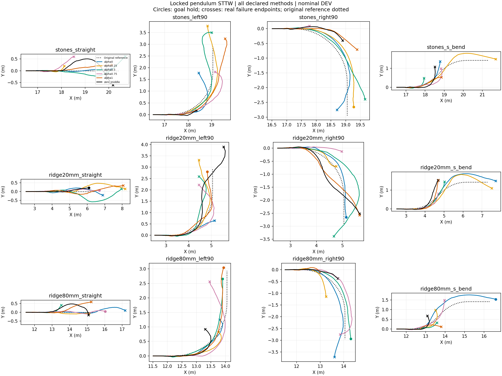

# Locked-pendulum STTW turning diagnostic

Nominal DEV, frozen H75, no training, one initialization per case. All failures retained. Each episode ends at its actual termination. These are inference-only behavior tests; task reward is not implemented and no reward improvement is claimed. RMSE below uses each episode's actual window and is not a paired-window ranking.

|Case|Method|End|Seconds|Path RMSE m|Speed RMSE m/s|
|---|---|---|---:|---:|---:|
|stones_straight|alpha0|goal_hold|1.850|0.032|0.096|
|stones_straight|alpha0.25|physical_failure|0.940|0.054|0.449|
|stones_straight|alpha0.5|corridor_or_domain_exit|2.310|0.178|0.130|
|stones_straight|alpha0.75|corridor_or_domain_exit|1.150|0.244|0.142|
|stones_straight|alpha1|goal_hold|1.845|0.123|0.086|
|stones_straight|zero_middle|corridor_or_domain_exit|2.270|0.283|0.140|
|stones_left90|alpha0|corridor_or_domain_exit|2.085|0.212|0.246|
|stones_left90|alpha0.25|corridor_or_domain_exit|3.040|0.123|0.136|
|stones_left90|alpha0.5|physical_failure|3.200|0.200|0.423|
|stones_left90|alpha0.75|corridor_or_domain_exit|2.160|0.263|0.193|
|stones_left90|alpha1|physical_failure|2.785|0.286|0.228|
|stones_left90|zero_middle|physical_failure|0.975|0.094|0.145|
|stones_right90|alpha0|physical_failure|2.870|0.119|0.365|
|stones_right90|alpha0.25|goal_hold|2.640|0.174|0.266|
|stones_right90|alpha0.5|corridor_or_domain_exit|2.365|0.217|0.176|
|stones_right90|alpha0.75|physical_failure|0.660|0.058|0.157|
|stones_right90|alpha1|corridor_or_domain_exit|1.620|0.302|0.121|
|stones_right90|zero_middle|physical_failure|1.320|0.219|0.124|
|stones_s_bend|alpha0|corridor_or_domain_exit|1.680|0.117|0.225|
|stones_s_bend|alpha0.25|corridor_or_domain_exit|3.180|0.196|0.193|
|stones_s_bend|alpha0.5|physical_failure|1.005|0.104|0.655|
|stones_s_bend|alpha0.75|corridor_or_domain_exit|1.580|0.129|0.200|
|stones_s_bend|alpha1|physical_failure|1.280|0.060|0.134|
|stones_s_bend|zero_middle|corridor_or_domain_exit|1.480|0.128|0.159|
|ridge20mm_straight|alpha0|physical_failure|2.365|0.106|0.157|
|ridge20mm_straight|alpha0.25|corridor_or_domain_exit|3.100|0.247|0.180|
|ridge20mm_straight|alpha0.5|corridor_or_domain_exit|3.060|0.283|0.149|
|ridge20mm_straight|alpha0.75|goal_hold|2.145|0.062|0.101|
|ridge20mm_straight|alpha1|corridor_or_domain_exit|2.940|0.147|0.122|
|ridge20mm_straight|zero_middle|goal_hold|1.890|0.083|0.121|
|ridge20mm_left90|alpha0|physical_failure|1.495|0.135|0.188|
|ridge20mm_left90|alpha0.25|corridor_or_domain_exit|2.795|0.238|0.186|
|ridge20mm_left90|alpha0.5|corridor_or_domain_exit|2.355|0.263|0.224|
|ridge20mm_left90|alpha0.75|corridor_or_domain_exit|2.345|0.202|0.160|
|ridge20mm_left90|alpha1|goal_hold|2.475|0.093|0.188|
|ridge20mm_left90|zero_middle|physical_failure|3.075|0.284|0.153|
|ridge20mm_right90|alpha0|goal_hold|2.660|0.106|0.319|
|ridge20mm_right90|alpha0.25|physical_failure|1.455|0.048|0.444|
|ridge20mm_right90|alpha0.5|corridor_or_domain_exit|3.240|0.337|0.204|
|ridge20mm_right90|alpha0.75|corridor_or_domain_exit|1.325|0.270|0.159|
|ridge20mm_right90|alpha1|corridor_or_domain_exit|2.310|0.274|0.158|
|ridge20mm_right90|zero_middle|corridor_or_domain_exit|2.275|0.284|0.119|
|ridge20mm_s_bend|alpha0|corridor_or_domain_exit|3.420|0.256|0.280|
|ridge20mm_s_bend|alpha0.25|corridor_or_domain_exit|3.300|0.208|0.252|
|ridge20mm_s_bend|alpha0.5|corridor_or_domain_exit|1.720|0.093|0.151|
|ridge20mm_s_bend|alpha0.75|physical_failure|1.385|0.073|0.212|
|ridge20mm_s_bend|alpha1|corridor_or_domain_exit|1.700|0.197|0.160|
|ridge20mm_s_bend|zero_middle|corridor_or_domain_exit|1.630|0.240|0.148|
|ridge80mm_straight|alpha0|corridor_or_domain_exit|3.060|0.127|0.234|
|ridge80mm_straight|alpha0.25|goal_hold|1.855|0.051|0.134|
|ridge80mm_straight|alpha0.5|physical_failure|1.175|0.124|0.218|
|ridge80mm_straight|alpha0.75|goal_hold|2.355|0.049|0.174|
|ridge80mm_straight|alpha1|corridor_or_domain_exit|1.940|0.261|0.167|
|ridge80mm_straight|zero_middle|corridor_or_domain_exit|2.060|0.249|0.154|
|ridge80mm_left90|alpha0|physical_failure|1.795|0.048|0.449|
|ridge80mm_left90|alpha0.25|corridor_or_domain_exit|1.580|0.134|0.407|
|ridge80mm_left90|alpha0.5|goal_hold|2.330|0.104|0.175|
|ridge80mm_left90|alpha0.75|corridor_or_domain_exit|2.475|0.237|0.192|
|ridge80mm_left90|alpha1|goal_hold|2.535|0.107|0.146|
|ridge80mm_left90|zero_middle|physical_failure|1.460|0.126|0.408|
|ridge80mm_right90|alpha0|corridor_or_domain_exit|2.980|0.164|0.241|
|ridge80mm_right90|alpha0.25|corridor_or_domain_exit|1.445|0.238|0.324|
|ridge80mm_right90|alpha0.5|goal_hold|2.620|0.125|0.180|
|ridge80mm_right90|alpha0.75|corridor_or_domain_exit|2.780|0.204|0.223|
|ridge80mm_right90|alpha1|physical_failure|0.970|0.079|0.635|
|ridge80mm_right90|zero_middle|physical_failure|1.200|0.136|0.170|
|ridge80mm_s_bend|alpha0|goal_hold|3.330|0.251|0.288|
|ridge80mm_s_bend|alpha0.25|corridor_or_domain_exit|1.500|0.101|0.276|
|ridge80mm_s_bend|alpha0.5|physical_failure|1.145|0.108|0.238|
|ridge80mm_s_bend|alpha0.75|corridor_or_domain_exit|1.780|0.107|0.203|
|ridge80mm_s_bend|alpha1|corridor_or_domain_exit|1.260|0.155|0.203|
|ridge80mm_s_bend|zero_middle|corridor_or_domain_exit|1.160|0.114|0.191|

## Tracking plots
- [stones_straight](stones_straight_tracking.png)
- [stones_left90](stones_left90_tracking.png)
- [stones_right90](stones_right90_tracking.png)
- [stones_s_bend](stones_s_bend_tracking.png)
- [ridge20mm_straight](ridge20mm_straight_tracking.png)
- [ridge20mm_left90](ridge20mm_left90_tracking.png)
- [ridge20mm_right90](ridge20mm_right90_tracking.png)
- [ridge20mm_s_bend](ridge20mm_s_bend_tracking.png)
- [ridge80mm_straight](ridge80mm_straight_tracking.png)
- [ridge80mm_left90](ridge80mm_left90_tracking.png)
- [ridge80mm_right90](ridge80mm_right90_tracking.png)
- [ridge80mm_s_bend](ridge80mm_s_bend_tracking.png)
