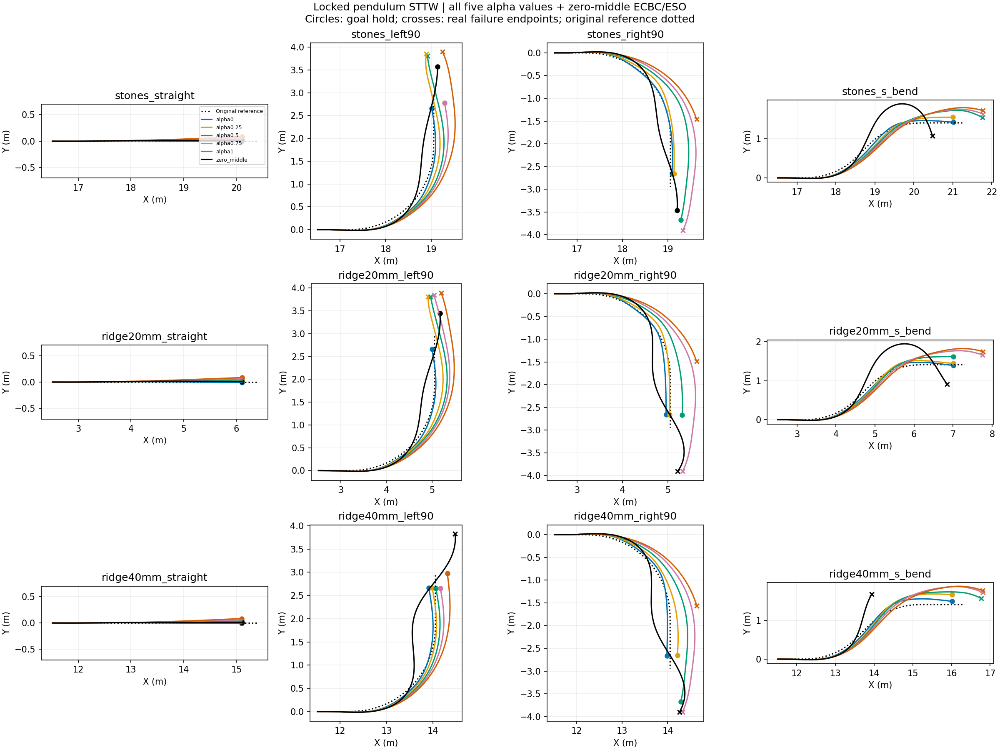

# Locked-pendulum STTW turning diagnostic

Nominal DEV, frozen H75, no training, one initialization per case. All failures retained. Each episode ends at its actual termination. These are inference-only behavior tests; task reward is not implemented and no reward improvement is claimed. RMSE below uses each episode's actual window and is not a paired-window ranking.

|Case|Method|End|Seconds|Path RMSE m|Speed RMSE m/s|
|---|---|---|---:|---:|---:|
|stones_straight|alpha0|goal_hold|1.770|0.004|0.059|
|stones_straight|alpha0.25|goal_hold|1.770|0.008|0.063|
|stones_straight|alpha0.5|goal_hold|1.770|0.018|0.063|
|stones_straight|alpha0.75|goal_hold|1.775|0.027|0.054|
|stones_straight|alpha1|goal_hold|1.780|0.037|0.047|
|stones_straight|zero_middle|goal_hold|1.805|0.010|0.047|
|stones_left90|alpha0|goal_hold|2.330|0.051|0.119|
|stones_left90|alpha0.25|corridor_or_domain_exit|3.000|0.102|0.143|
|stones_left90|alpha0.5|corridor_or_domain_exit|2.920|0.135|0.076|
|stones_left90|alpha0.75|goal_hold|2.395|0.196|0.055|
|stones_left90|alpha1|corridor_or_domain_exit|2.960|0.291|0.069|
|stones_left90|zero_middle|goal_hold|2.690|0.115|0.063|
|stones_right90|alpha0|goal_hold|2.505|0.021|0.279|
|stones_right90|alpha0.25|goal_hold|2.495|0.062|0.248|
|stones_right90|alpha0.5|goal_hold|3.005|0.257|0.122|
|stones_right90|alpha0.75|corridor_or_domain_exit|3.120|0.360|0.061|
|stones_right90|alpha1|corridor_or_domain_exit|1.885|0.303|0.037|
|stones_right90|zero_middle|goal_hold|2.650|0.123|0.064|
|stones_s_bend|alpha0|goal_hold|2.725|0.053|0.242|
|stones_s_bend|alpha0.25|goal_hold|2.640|0.088|0.182|
|stones_s_bend|alpha0.5|corridor_or_domain_exit|3.000|0.165|0.129|
|stones_s_bend|alpha0.75|corridor_or_domain_exit|2.920|0.181|0.072|
|stones_s_bend|alpha1|corridor_or_domain_exit|2.880|0.202|0.057|
|stones_s_bend|zero_middle|corridor_or_domain_exit|2.720|0.268|0.084|
|ridge20mm_straight|alpha0|goal_hold|1.760|0.005|0.091|
|ridge20mm_straight|alpha0.25|goal_hold|1.760|0.011|0.090|
|ridge20mm_straight|alpha0.5|goal_hold|1.760|0.020|0.092|
|ridge20mm_straight|alpha0.75|goal_hold|1.760|0.029|0.093|
|ridge20mm_straight|alpha1|goal_hold|1.775|0.038|0.118|
|ridge20mm_straight|zero_middle|goal_hold|1.795|0.011|0.067|
|ridge20mm_left90|alpha0|goal_hold|2.320|0.035|0.117|
|ridge20mm_left90|alpha0.25|corridor_or_domain_exit|2.960|0.103|0.117|
|ridge20mm_left90|alpha0.5|corridor_or_domain_exit|2.940|0.149|0.063|
|ridge20mm_left90|alpha0.75|corridor_or_domain_exit|2.940|0.190|0.048|
|ridge20mm_left90|alpha1|corridor_or_domain_exit|2.960|0.262|0.063|
|ridge20mm_left90|zero_middle|goal_hold|2.630|0.119|0.061|
|ridge20mm_right90|alpha0|goal_hold|2.520|0.058|0.309|
|ridge20mm_right90|alpha0.25|goal_hold|2.500|0.044|0.264|
|ridge20mm_right90|alpha0.5|goal_hold|2.485|0.165|0.174|
|ridge20mm_right90|alpha0.75|corridor_or_domain_exit|3.115|0.353|0.061|
|ridge20mm_right90|alpha1|corridor_or_domain_exit|1.895|0.298|0.039|
|ridge20mm_right90|zero_middle|corridor_or_domain_exit|2.975|0.196|0.067|
|ridge20mm_s_bend|alpha0|goal_hold|2.730|0.050|0.256|
|ridge20mm_s_bend|alpha0.25|goal_hold|2.720|0.072|0.231|
|ridge20mm_s_bend|alpha0.5|goal_hold|2.605|0.112|0.141|
|ridge20mm_s_bend|alpha0.75|corridor_or_domain_exit|2.940|0.184|0.071|
|ridge20mm_s_bend|alpha1|corridor_or_domain_exit|2.900|0.210|0.052|
|ridge20mm_s_bend|zero_middle|corridor_or_domain_exit|2.940|0.299|0.072|
|ridge40mm_straight|alpha0|goal_hold|1.765|0.004|0.069|
|ridge40mm_straight|alpha0.25|goal_hold|1.765|0.007|0.071|
|ridge40mm_straight|alpha0.5|goal_hold|1.765|0.017|0.071|
|ridge40mm_straight|alpha0.75|goal_hold|1.765|0.027|0.071|
|ridge40mm_straight|alpha1|goal_hold|1.765|0.036|0.072|
|ridge40mm_straight|zero_middle|goal_hold|1.805|0.010|0.053|
|ridge40mm_left90|alpha0|goal_hold|2.315|0.051|0.118|
|ridge40mm_left90|alpha0.25|goal_hold|2.305|0.047|0.083|
|ridge40mm_left90|alpha0.5|goal_hold|2.300|0.079|0.053|
|ridge40mm_left90|alpha0.75|goal_hold|2.310|0.121|0.045|
|ridge40mm_left90|alpha1|goal_hold|2.480|0.193|0.051|
|ridge40mm_left90|zero_middle|corridor_or_domain_exit|2.920|0.260|0.067|
|ridge40mm_right90|alpha0|goal_hold|2.520|0.044|0.279|
|ridge40mm_right90|alpha0.25|goal_hold|2.445|0.102|0.185|
|ridge40mm_right90|alpha0.5|goal_hold|2.975|0.243|0.108|
|ridge40mm_right90|alpha0.75|corridor_or_domain_exit|3.100|0.353|0.054|
|ridge40mm_right90|alpha1|corridor_or_domain_exit|1.920|0.303|0.047|
|ridge40mm_right90|zero_middle|corridor_or_domain_exit|2.955|0.207|0.069|
|ridge40mm_s_bend|alpha0|goal_hold|2.775|0.090|0.253|
|ridge40mm_s_bend|alpha0.25|goal_hold|2.700|0.148|0.181|
|ridge40mm_s_bend|alpha0.5|corridor_or_domain_exit|3.080|0.185|0.147|
|ridge40mm_s_bend|alpha0.75|corridor_or_domain_exit|3.000|0.241|0.059|
|ridge40mm_s_bend|alpha1|corridor_or_domain_exit|2.940|0.241|0.049|
|ridge40mm_s_bend|zero_middle|corridor_or_domain_exit|1.745|0.205|0.064|

## Tracking plots
- [stones_straight](stones_straight_tracking.png)
- [stones_left90](stones_left90_tracking.png)
- [stones_right90](stones_right90_tracking.png)
- [stones_s_bend](stones_s_bend_tracking.png)
- [ridge20mm_straight](ridge20mm_straight_tracking.png)
- [ridge20mm_left90](ridge20mm_left90_tracking.png)
- [ridge20mm_right90](ridge20mm_right90_tracking.png)
- [ridge20mm_s_bend](ridge20mm_s_bend_tracking.png)
- [ridge40mm_straight](ridge40mm_straight_tracking.png)
- [ridge40mm_left90](ridge40mm_left90_tracking.png)
- [ridge40mm_right90](ridge40mm_right90_tracking.png)
- [ridge40mm_s_bend](ridge40mm_s_bend_tracking.png)
