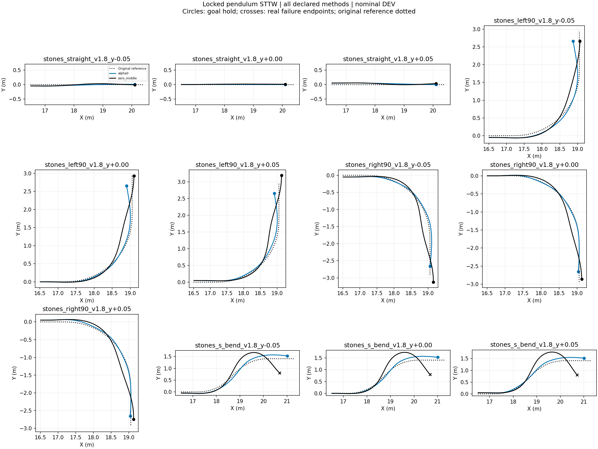
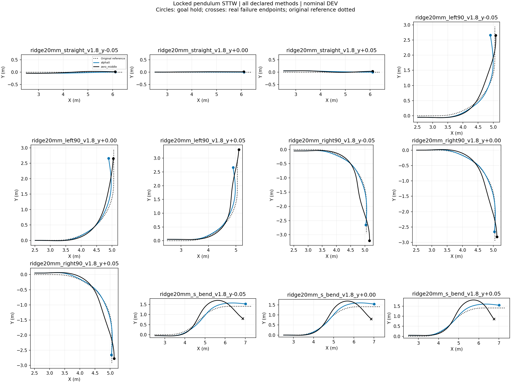
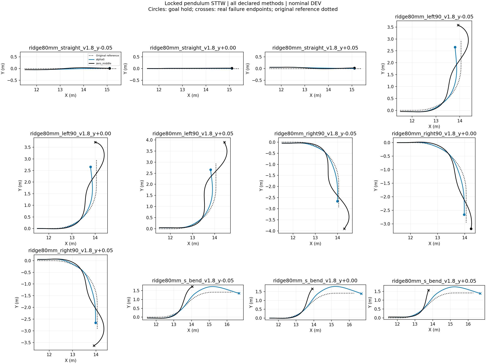

# Locked-pendulum STTW turning diagnostic

Nominal DEV, frozen H75, no training, one initialization per case. All failures retained. Each episode ends at its actual termination. These are inference-only behavior tests; task reward is not implemented and no reward improvement is claimed. RMSE below uses each episode's actual window and is not a paired-window ranking.

|Case|Method|End|Seconds|Path RMSE m|Speed RMSE m/s|
|---|---|---|---:|---:|---:|
|stones_straight_v1.8_y-0.05|alpha0|goal_hold|1.935|0.030|0.092|
|stones_straight_v1.8_y-0.05|zero_middle|goal_hold|1.980|0.032|0.072|
|stones_straight_v1.8_y+0.00|alpha0|goal_hold|1.945|0.002|0.070|
|stones_straight_v1.8_y+0.00|zero_middle|goal_hold|1.995|0.010|0.044|
|stones_straight_v1.8_y+0.05|alpha0|goal_hold|1.950|0.036|0.062|
|stones_straight_v1.8_y+0.05|zero_middle|goal_hold|1.990|0.034|0.054|
|stones_left90_v1.8_y-0.05|alpha0|goal_hold|2.525|0.071|0.089|
|stones_left90_v1.8_y-0.05|zero_middle|goal_hold|2.450|0.091|0.064|
|stones_left90_v1.8_y+0.00|alpha0|goal_hold|2.525|0.048|0.102|
|stones_left90_v1.8_y+0.00|zero_middle|goal_hold|2.605|0.100|0.047|
|stones_left90_v1.8_y+0.05|alpha0|goal_hold|2.510|0.053|0.131|
|stones_left90_v1.8_y+0.05|zero_middle|goal_hold|2.745|0.112|0.058|
|stones_right90_v1.8_y-0.05|alpha0|goal_hold|2.670|0.035|0.187|
|stones_right90_v1.8_y-0.05|zero_middle|goal_hold|2.715|0.096|0.070|
|stones_right90_v1.8_y+0.00|alpha0|goal_hold|2.660|0.009|0.198|
|stones_right90_v1.8_y+0.00|zero_middle|goal_hold|2.590|0.087|0.045|
|stones_right90_v1.8_y+0.05|alpha0|goal_hold|2.670|0.036|0.192|
|stones_right90_v1.8_y+0.05|zero_middle|goal_hold|2.530|0.097|0.054|
|stones_s_bend_v1.8_y-0.05|alpha0|goal_hold|2.925|0.096|0.160|
|stones_s_bend_v1.8_y-0.05|zero_middle|corridor_or_domain_exit|2.970|0.221|0.074|
|stones_s_bend_v1.8_y+0.00|alpha0|goal_hold|2.925|0.086|0.155|
|stones_s_bend_v1.8_y+0.00|zero_middle|corridor_or_domain_exit|3.035|0.240|0.064|
|stones_s_bend_v1.8_y+0.05|alpha0|goal_hold|2.905|0.075|0.167|
|stones_s_bend_v1.8_y+0.05|zero_middle|corridor_or_domain_exit|3.065|0.246|0.070|
|ridge20mm_straight_v1.8_y-0.05|alpha0|goal_hold|1.930|0.036|0.109|
|ridge20mm_straight_v1.8_y-0.05|zero_middle|goal_hold|1.980|0.033|0.077|
|ridge20mm_straight_v1.8_y+0.00|alpha0|goal_hold|1.945|0.003|0.076|
|ridge20mm_straight_v1.8_y+0.00|zero_middle|goal_hold|1.995|0.010|0.050|
|ridge20mm_straight_v1.8_y+0.05|alpha0|goal_hold|1.950|0.034|0.071|
|ridge20mm_straight_v1.8_y+0.05|zero_middle|goal_hold|2.000|0.033|0.046|
|ridge20mm_left90_v1.8_y-0.05|alpha0|goal_hold|2.520|0.062|0.104|
|ridge20mm_left90_v1.8_y-0.05|zero_middle|goal_hold|2.450|0.090|0.068|
|ridge20mm_left90_v1.8_y+0.00|alpha0|goal_hold|2.520|0.060|0.117|
|ridge20mm_left90_v1.8_y+0.00|zero_middle|goal_hold|2.440|0.080|0.056|
|ridge20mm_left90_v1.8_y+0.05|alpha0|goal_hold|2.515|0.064|0.128|
|ridge20mm_left90_v1.8_y+0.05|zero_middle|goal_hold|2.815|0.097|0.050|
|ridge20mm_right90_v1.8_y-0.05|alpha0|goal_hold|2.610|0.027|0.186|
|ridge20mm_right90_v1.8_y-0.05|zero_middle|goal_hold|2.765|0.109|0.060|
|ridge20mm_right90_v1.8_y+0.00|alpha0|goal_hold|2.620|0.012|0.188|
|ridge20mm_right90_v1.8_y+0.00|zero_middle|goal_hold|2.595|0.090|0.090|
|ridge20mm_right90_v1.8_y+0.05|alpha0|goal_hold|2.630|0.034|0.184|
|ridge20mm_right90_v1.8_y+0.05|zero_middle|goal_hold|2.545|0.098|0.046|
|ridge20mm_s_bend_v1.8_y-0.05|alpha0|goal_hold|2.925|0.096|0.163|
|ridge20mm_s_bend_v1.8_y-0.05|zero_middle|corridor_or_domain_exit|3.080|0.234|0.073|
|ridge20mm_s_bend_v1.8_y+0.00|alpha0|goal_hold|2.945|0.102|0.158|
|ridge20mm_s_bend_v1.8_y+0.00|zero_middle|corridor_or_domain_exit|3.045|0.215|0.064|
|ridge20mm_s_bend_v1.8_y+0.05|alpha0|goal_hold|2.935|0.105|0.159|
|ridge20mm_s_bend_v1.8_y+0.05|zero_middle|corridor_or_domain_exit|3.080|0.238|0.067|
|ridge80mm_straight_v1.8_y-0.05|alpha0|goal_hold|1.940|0.031|0.092|
|ridge80mm_straight_v1.8_y-0.05|zero_middle|goal_hold|1.990|0.033|0.072|
|ridge80mm_straight_v1.8_y+0.00|alpha0|goal_hold|1.950|0.004|0.088|
|ridge80mm_straight_v1.8_y+0.00|zero_middle|goal_hold|1.990|0.009|0.065|
|ridge80mm_straight_v1.8_y+0.05|alpha0|goal_hold|1.950|0.034|0.078|
|ridge80mm_straight_v1.8_y+0.05|zero_middle|goal_hold|2.005|0.033|0.057|
|ridge80mm_left90_v1.8_y-0.05|alpha0|goal_hold|2.490|0.120|0.103|
|ridge80mm_left90_v1.8_y-0.05|zero_middle|corridor_or_domain_exit|3.160|0.196|0.076|
|ridge80mm_left90_v1.8_y+0.00|alpha0|goal_hold|2.485|0.111|0.097|
|ridge80mm_left90_v1.8_y+0.00|zero_middle|corridor_or_domain_exit|3.240|0.209|0.082|
|ridge80mm_left90_v1.8_y+0.05|alpha0|goal_hold|2.475|0.106|0.109|
|ridge80mm_left90_v1.8_y+0.05|zero_middle|corridor_or_domain_exit|3.340|0.293|0.155|
|ridge80mm_right90_v1.8_y-0.05|alpha0|goal_hold|2.600|0.055|0.201|
|ridge80mm_right90_v1.8_y-0.05|zero_middle|corridor_or_domain_exit|3.400|0.261|0.240|
|ridge80mm_right90_v1.8_y+0.00|alpha0|goal_hold|2.590|0.065|0.195|
|ridge80mm_right90_v1.8_y+0.00|zero_middle|goal_hold|2.805|0.147|0.095|
|ridge80mm_right90_v1.8_y+0.05|alpha0|goal_hold|2.600|0.076|0.197|
|ridge80mm_right90_v1.8_y+0.05|zero_middle|corridor_or_domain_exit|3.180|0.176|0.067|
|ridge80mm_s_bend_v1.8_y-0.05|alpha0|corridor_or_domain_exit|3.480|0.165|0.176|
|ridge80mm_s_bend_v1.8_y-0.05|zero_middle|corridor_or_domain_exit|1.975|0.258|0.069|
|ridge80mm_s_bend_v1.8_y+0.00|alpha0|corridor_or_domain_exit|3.500|0.198|0.176|
|ridge80mm_s_bend_v1.8_y+0.00|zero_middle|corridor_or_domain_exit|1.890|0.223|0.064|
|ridge80mm_s_bend_v1.8_y+0.05|alpha0|corridor_or_domain_exit|3.460|0.179|0.172|
|ridge80mm_s_bend_v1.8_y+0.05|zero_middle|corridor_or_domain_exit|1.805|0.205|0.067|

## Tracking plots
- [stones_straight_v1.8_y-0.05](stones_straight_v1.8_y-0.05_tracking.png)
- [stones_straight_v1.8_y+0.00](stones_straight_v1.8_y+0.00_tracking.png)
- [stones_straight_v1.8_y+0.05](stones_straight_v1.8_y+0.05_tracking.png)
- [stones_left90_v1.8_y-0.05](stones_left90_v1.8_y-0.05_tracking.png)
- [stones_left90_v1.8_y+0.00](stones_left90_v1.8_y+0.00_tracking.png)
- [stones_left90_v1.8_y+0.05](stones_left90_v1.8_y+0.05_tracking.png)
- [stones_right90_v1.8_y-0.05](stones_right90_v1.8_y-0.05_tracking.png)
- [stones_right90_v1.8_y+0.00](stones_right90_v1.8_y+0.00_tracking.png)
- [stones_right90_v1.8_y+0.05](stones_right90_v1.8_y+0.05_tracking.png)
- [stones_s_bend_v1.8_y-0.05](stones_s_bend_v1.8_y-0.05_tracking.png)
- [stones_s_bend_v1.8_y+0.00](stones_s_bend_v1.8_y+0.00_tracking.png)
- [stones_s_bend_v1.8_y+0.05](stones_s_bend_v1.8_y+0.05_tracking.png)
- [ridge20mm_straight_v1.8_y-0.05](ridge20mm_straight_v1.8_y-0.05_tracking.png)
- [ridge20mm_straight_v1.8_y+0.00](ridge20mm_straight_v1.8_y+0.00_tracking.png)
- [ridge20mm_straight_v1.8_y+0.05](ridge20mm_straight_v1.8_y+0.05_tracking.png)
- [ridge20mm_left90_v1.8_y-0.05](ridge20mm_left90_v1.8_y-0.05_tracking.png)
- [ridge20mm_left90_v1.8_y+0.00](ridge20mm_left90_v1.8_y+0.00_tracking.png)
- [ridge20mm_left90_v1.8_y+0.05](ridge20mm_left90_v1.8_y+0.05_tracking.png)
- [ridge20mm_right90_v1.8_y-0.05](ridge20mm_right90_v1.8_y-0.05_tracking.png)
- [ridge20mm_right90_v1.8_y+0.00](ridge20mm_right90_v1.8_y+0.00_tracking.png)
- [ridge20mm_right90_v1.8_y+0.05](ridge20mm_right90_v1.8_y+0.05_tracking.png)
- [ridge20mm_s_bend_v1.8_y-0.05](ridge20mm_s_bend_v1.8_y-0.05_tracking.png)
- [ridge20mm_s_bend_v1.8_y+0.00](ridge20mm_s_bend_v1.8_y+0.00_tracking.png)
- [ridge20mm_s_bend_v1.8_y+0.05](ridge20mm_s_bend_v1.8_y+0.05_tracking.png)
- [ridge80mm_straight_v1.8_y-0.05](ridge80mm_straight_v1.8_y-0.05_tracking.png)
- [ridge80mm_straight_v1.8_y+0.00](ridge80mm_straight_v1.8_y+0.00_tracking.png)
- [ridge80mm_straight_v1.8_y+0.05](ridge80mm_straight_v1.8_y+0.05_tracking.png)
- [ridge80mm_left90_v1.8_y-0.05](ridge80mm_left90_v1.8_y-0.05_tracking.png)
- [ridge80mm_left90_v1.8_y+0.00](ridge80mm_left90_v1.8_y+0.00_tracking.png)
- [ridge80mm_left90_v1.8_y+0.05](ridge80mm_left90_v1.8_y+0.05_tracking.png)
- [ridge80mm_right90_v1.8_y-0.05](ridge80mm_right90_v1.8_y-0.05_tracking.png)
- [ridge80mm_right90_v1.8_y+0.00](ridge80mm_right90_v1.8_y+0.00_tracking.png)
- [ridge80mm_right90_v1.8_y+0.05](ridge80mm_right90_v1.8_y+0.05_tracking.png)
- [ridge80mm_s_bend_v1.8_y-0.05](ridge80mm_s_bend_v1.8_y-0.05_tracking.png)
- [ridge80mm_s_bend_v1.8_y+0.00](ridge80mm_s_bend_v1.8_y+0.00_tracking.png)
- [ridge80mm_s_bend_v1.8_y+0.05](ridge80mm_s_bend_v1.8_y+0.05_tracking.png)
