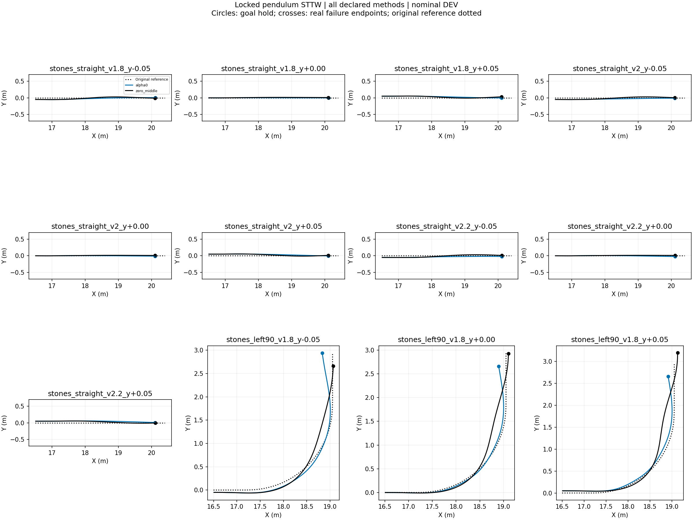
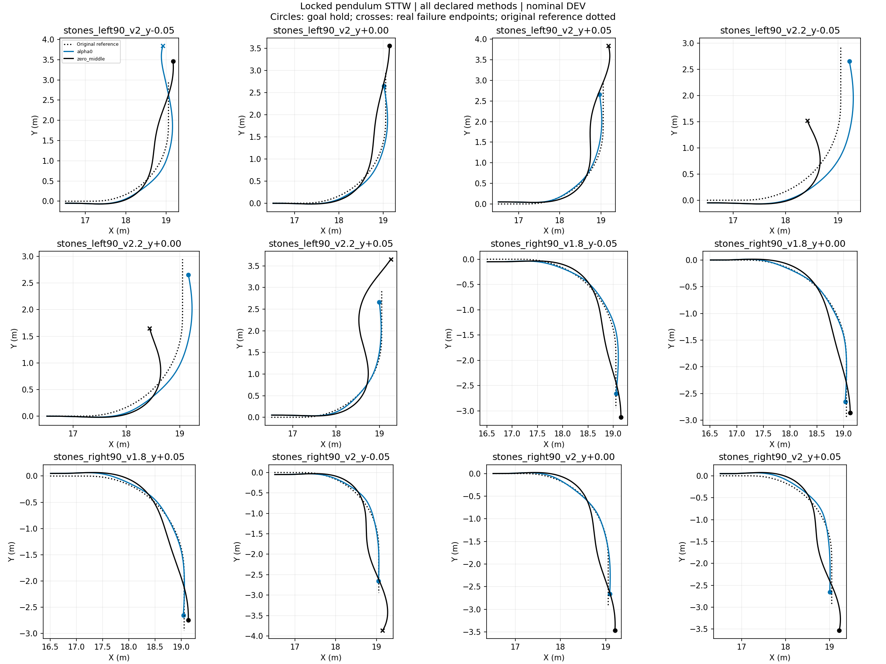
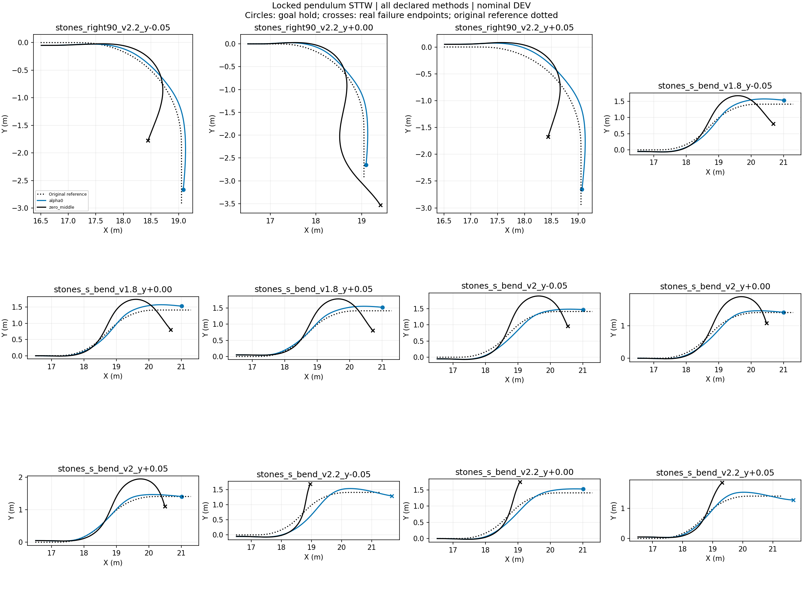
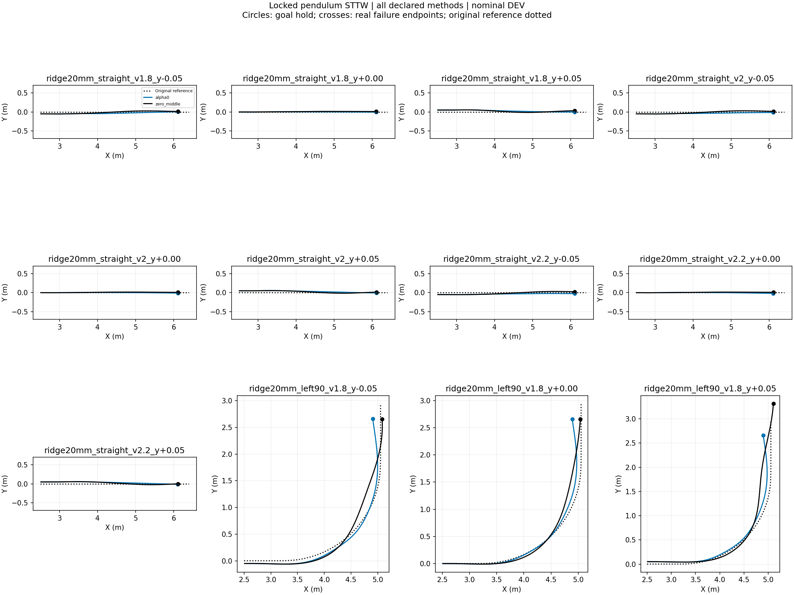
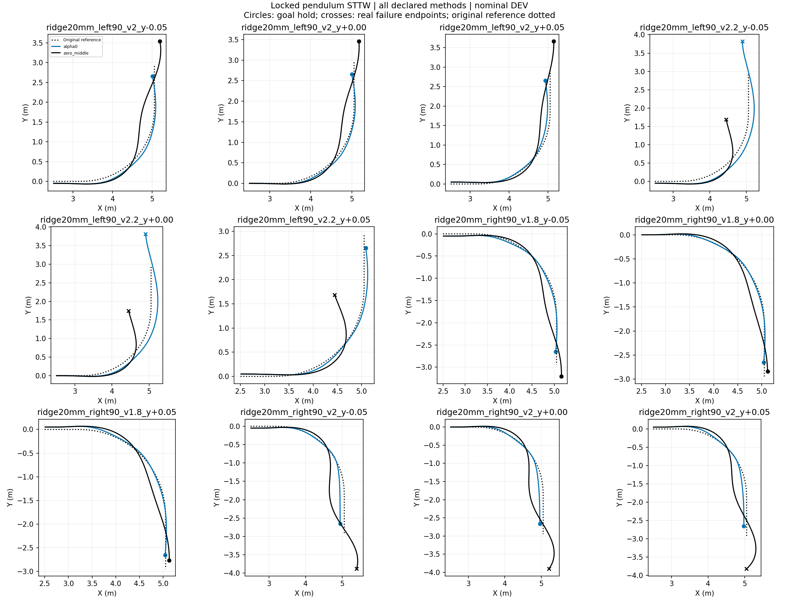
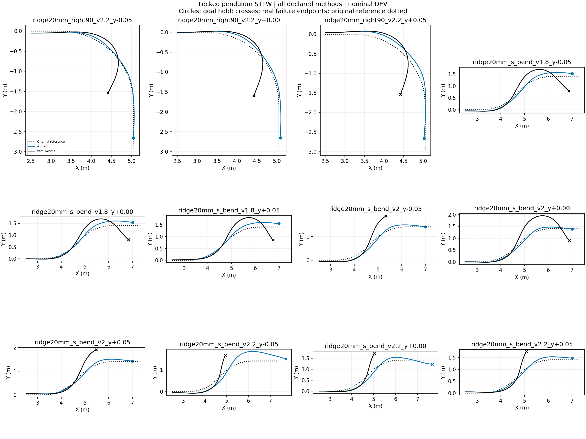
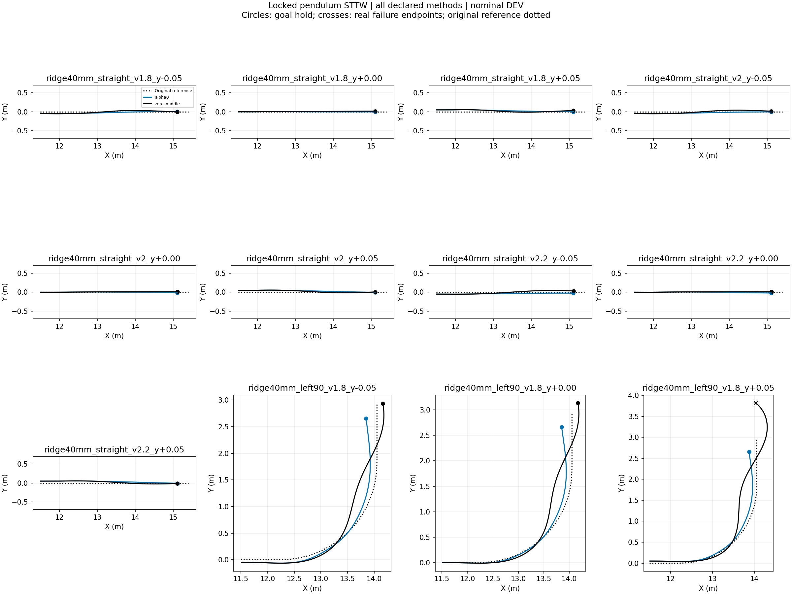
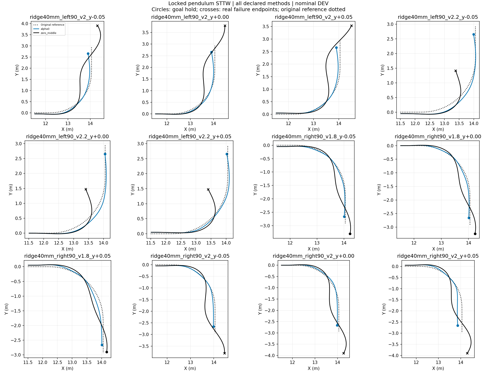
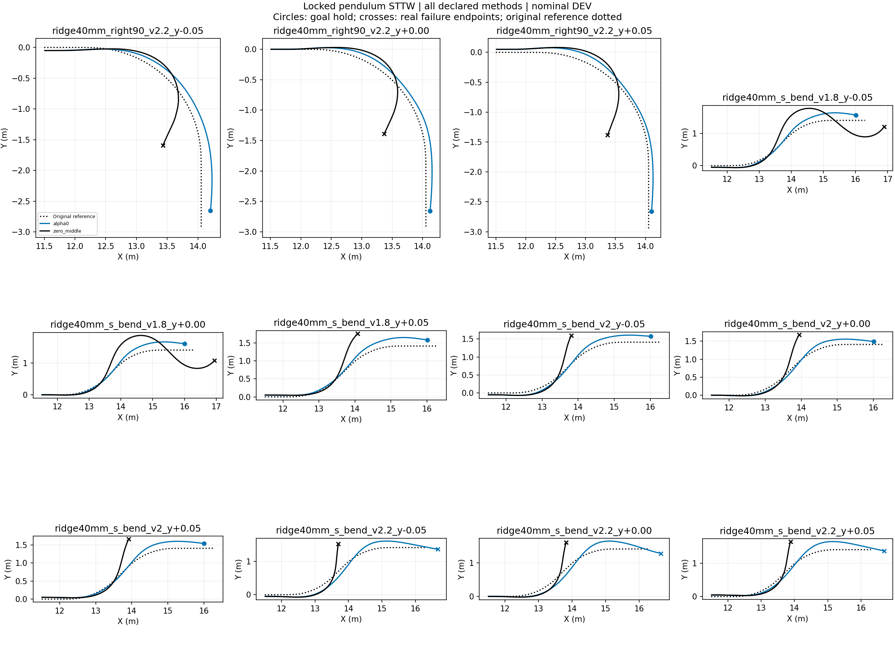

# Locked-pendulum STTW turning diagnostic

Nominal DEV, frozen H75, no training, one initialization per case. All failures retained. Each episode ends at its actual termination. These are inference-only behavior tests; task reward is not implemented and no reward improvement is claimed. RMSE below uses each episode's actual window and is not a paired-window ranking.

|Case|Method|End|Seconds|Path RMSE m|Speed RMSE m/s|
|---|---|---|---:|---:|---:|
|stones_straight_v1.8_y-0.05|alpha0|goal_hold|1.935|0.030|0.092|
|stones_straight_v1.8_y-0.05|zero_middle|goal_hold|1.980|0.032|0.072|
|stones_straight_v1.8_y+0.00|alpha0|goal_hold|1.945|0.002|0.073|
|stones_straight_v1.8_y+0.00|zero_middle|goal_hold|1.995|0.010|0.044|
|stones_straight_v1.8_y+0.05|alpha0|goal_hold|1.950|0.036|0.062|
|stones_straight_v1.8_y+0.05|zero_middle|goal_hold|1.990|0.034|0.054|
|stones_straight_v2_y-0.05|alpha0|goal_hold|1.765|0.035|0.076|
|stones_straight_v2_y-0.05|zero_middle|goal_hold|1.800|0.034|0.064|
|stones_straight_v2_y+0.00|alpha0|goal_hold|1.770|0.004|0.059|
|stones_straight_v2_y+0.00|zero_middle|goal_hold|1.805|0.010|0.047|
|stones_straight_v2_y+0.05|alpha0|goal_hold|1.770|0.040|0.057|
|stones_straight_v2_y+0.05|zero_middle|goal_hold|1.810|0.036|0.038|
|stones_straight_v2.2_y-0.05|alpha0|goal_hold|1.625|0.035|0.099|
|stones_straight_v2.2_y-0.05|zero_middle|goal_hold|1.655|0.036|0.100|
|stones_straight_v2.2_y+0.00|alpha0|goal_hold|1.625|0.008|0.117|
|stones_straight_v2.2_y+0.00|zero_middle|goal_hold|1.650|0.010|0.077|
|stones_straight_v2.2_y+0.05|alpha0|goal_hold|1.625|0.047|0.087|
|stones_straight_v2.2_y+0.05|zero_middle|goal_hold|1.660|0.039|0.086|
|stones_left90_v1.8_y-0.05|alpha0|goal_hold|2.685|0.084|0.085|
|stones_left90_v1.8_y-0.05|zero_middle|goal_hold|2.450|0.091|0.064|
|stones_left90_v1.8_y+0.00|alpha0|goal_hold|2.525|0.048|0.102|
|stones_left90_v1.8_y+0.00|zero_middle|goal_hold|2.605|0.100|0.048|
|stones_left90_v1.8_y+0.05|alpha0|goal_hold|2.510|0.053|0.131|
|stones_left90_v1.8_y+0.05|zero_middle|goal_hold|2.745|0.112|0.058|
|stones_left90_v2_y-0.05|alpha0|corridor_or_domain_exit|3.060|0.103|0.197|
|stones_left90_v2_y-0.05|zero_middle|goal_hold|2.665|0.144|0.061|
|stones_left90_v2_y+0.00|alpha0|goal_hold|2.330|0.050|0.119|
|stones_left90_v2_y+0.00|zero_middle|goal_hold|2.680|0.114|0.063|
|stones_left90_v2_y+0.05|alpha0|goal_hold|2.310|0.039|0.155|
|stones_left90_v2_y+0.05|zero_middle|corridor_or_domain_exit|2.860|0.150|0.054|
|stones_left90_v2.2_y-0.05|alpha0|goal_hold|2.215|0.187|0.127|
|stones_left90_v2.2_y-0.05|zero_middle|corridor_or_domain_exit|1.605|0.205|0.133|
|stones_left90_v2.2_y+0.00|alpha0|goal_hold|2.175|0.116|0.128|
|stones_left90_v2.2_y+0.00|zero_middle|corridor_or_domain_exit|1.615|0.205|0.111|
|stones_left90_v2.2_y+0.05|alpha0|goal_hold|2.145|0.029|0.191|
|stones_left90_v2.2_y+0.05|zero_middle|corridor_or_domain_exit|2.620|0.259|0.104|
|stones_right90_v1.8_y-0.05|alpha0|goal_hold|2.670|0.035|0.187|
|stones_right90_v1.8_y-0.05|zero_middle|goal_hold|2.715|0.096|0.069|
|stones_right90_v1.8_y+0.00|alpha0|goal_hold|2.660|0.010|0.198|
|stones_right90_v1.8_y+0.00|zero_middle|goal_hold|2.590|0.087|0.045|
|stones_right90_v1.8_y+0.05|alpha0|goal_hold|2.670|0.036|0.192|
|stones_right90_v1.8_y+0.05|zero_middle|goal_hold|2.530|0.097|0.054|
|stones_right90_v2_y-0.05|alpha0|goal_hold|2.510|0.035|0.289|
|stones_right90_v2_y-0.05|zero_middle|corridor_or_domain_exit|2.880|0.142|0.077|
|stones_right90_v2_y+0.00|alpha0|goal_hold|2.505|0.021|0.280|
|stones_right90_v2_y+0.00|zero_middle|goal_hold|2.655|0.123|0.064|
|stones_right90_v2_y+0.05|alpha0|goal_hold|2.545|0.059|0.289|
|stones_right90_v2_y+0.05|zero_middle|goal_hold|2.730|0.155|0.066|
|stones_right90_v2.2_y-0.05|alpha0|goal_hold|2.350|0.060|0.324|
|stones_right90_v2.2_y-0.05|zero_middle|corridor_or_domain_exit|1.700|0.209|0.129|
|stones_right90_v2.2_y+0.00|alpha0|goal_hold|2.380|0.071|0.337|
|stones_right90_v2.2_y+0.00|zero_middle|corridor_or_domain_exit|2.620|0.267|0.088|
|stones_right90_v2.2_y+0.05|alpha0|goal_hold|2.400|0.102|0.321|
|stones_right90_v2.2_y+0.05|zero_middle|corridor_or_domain_exit|1.670|0.223|0.121|
|stones_s_bend_v1.8_y-0.05|alpha0|goal_hold|2.925|0.095|0.160|
|stones_s_bend_v1.8_y-0.05|zero_middle|corridor_or_domain_exit|2.970|0.221|0.074|
|stones_s_bend_v1.8_y+0.00|alpha0|goal_hold|2.925|0.086|0.156|
|stones_s_bend_v1.8_y+0.00|zero_middle|corridor_or_domain_exit|3.035|0.240|0.064|
|stones_s_bend_v1.8_y+0.05|alpha0|goal_hold|2.905|0.075|0.167|
|stones_s_bend_v1.8_y+0.05|zero_middle|corridor_or_domain_exit|3.065|0.246|0.070|
|stones_s_bend_v2_y-0.05|alpha0|goal_hold|2.690|0.078|0.224|
|stones_s_bend_v2_y-0.05|zero_middle|corridor_or_domain_exit|2.800|0.282|0.079|
|stones_s_bend_v2_y+0.00|alpha0|goal_hold|2.720|0.056|0.245|
|stones_s_bend_v2_y+0.00|zero_middle|corridor_or_domain_exit|2.720|0.268|0.084|
|stones_s_bend_v2_y+0.05|alpha0|goal_hold|2.755|0.049|0.259|
|stones_s_bend_v2_y+0.05|zero_middle|corridor_or_domain_exit|2.760|0.289|0.077|
|stones_s_bend_v2.2_y-0.05|alpha0|corridor_or_domain_exit|2.860|0.135|0.284|
|stones_s_bend_v2.2_y-0.05|zero_middle|corridor_or_domain_exit|1.665|0.204|0.112|
|stones_s_bend_v2.2_y+0.00|alpha0|goal_hold|2.475|0.091|0.244|
|stones_s_bend_v2.2_y+0.00|zero_middle|corridor_or_domain_exit|1.670|0.196|0.092|
|stones_s_bend_v2.2_y+0.05|alpha0|corridor_or_domain_exit|2.900|0.077|0.298|
|stones_s_bend_v2.2_y+0.05|zero_middle|corridor_or_domain_exit|1.750|0.199|0.093|
|ridge20mm_straight_v1.8_y-0.05|alpha0|goal_hold|1.930|0.036|0.109|
|ridge20mm_straight_v1.8_y-0.05|zero_middle|goal_hold|1.980|0.033|0.078|
|ridge20mm_straight_v1.8_y+0.00|alpha0|goal_hold|1.945|0.003|0.076|
|ridge20mm_straight_v1.8_y+0.00|zero_middle|goal_hold|1.995|0.010|0.050|
|ridge20mm_straight_v1.8_y+0.05|alpha0|goal_hold|1.950|0.034|0.070|
|ridge20mm_straight_v1.8_y+0.05|zero_middle|goal_hold|2.000|0.033|0.046|
|ridge20mm_straight_v2_y-0.05|alpha0|goal_hold|1.755|0.037|0.096|
|ridge20mm_straight_v2_y-0.05|zero_middle|goal_hold|1.795|0.034|0.078|
|ridge20mm_straight_v2_y+0.00|alpha0|goal_hold|1.760|0.005|0.092|
|ridge20mm_straight_v2_y+0.00|zero_middle|goal_hold|1.800|0.011|0.067|
|ridge20mm_straight_v2_y+0.05|alpha0|goal_hold|1.765|0.037|0.088|
|ridge20mm_straight_v2_y+0.05|zero_middle|goal_hold|1.805|0.035|0.061|
|ridge20mm_straight_v2.2_y-0.05|alpha0|goal_hold|1.625|0.037|0.130|
|ridge20mm_straight_v2.2_y-0.05|zero_middle|goal_hold|1.635|0.036|0.120|
|ridge20mm_straight_v2.2_y+0.00|alpha0|goal_hold|1.605|0.007|0.132|
|ridge20mm_straight_v2.2_y+0.00|zero_middle|goal_hold|1.640|0.010|0.115|
|ridge20mm_straight_v2.2_y+0.05|alpha0|goal_hold|1.610|0.039|0.129|
|ridge20mm_straight_v2.2_y+0.05|zero_middle|goal_hold|1.640|0.038|0.124|
|ridge20mm_left90_v1.8_y-0.05|alpha0|goal_hold|2.520|0.062|0.104|
|ridge20mm_left90_v1.8_y-0.05|zero_middle|goal_hold|2.450|0.090|0.068|
|ridge20mm_left90_v1.8_y+0.00|alpha0|goal_hold|2.520|0.060|0.117|
|ridge20mm_left90_v1.8_y+0.00|zero_middle|goal_hold|2.440|0.080|0.056|
|ridge20mm_left90_v1.8_y+0.05|alpha0|goal_hold|2.515|0.064|0.128|
|ridge20mm_left90_v1.8_y+0.05|zero_middle|goal_hold|2.815|0.097|0.051|
|ridge20mm_left90_v2_y-0.05|alpha0|goal_hold|2.340|0.061|0.120|
|ridge20mm_left90_v2_y-0.05|zero_middle|goal_hold|2.715|0.157|0.056|
|ridge20mm_left90_v2_y+0.00|alpha0|goal_hold|2.320|0.035|0.117|
|ridge20mm_left90_v2_y+0.00|zero_middle|goal_hold|2.635|0.119|0.061|
|ridge20mm_left90_v2_y+0.05|alpha0|goal_hold|2.305|0.052|0.156|
|ridge20mm_left90_v2_y+0.05|zero_middle|goal_hold|2.735|0.110|0.054|
|ridge20mm_left90_v2.2_y-0.05|alpha0|corridor_or_domain_exit|2.780|0.116|0.165|
|ridge20mm_left90_v2.2_y-0.05|zero_middle|corridor_or_domain_exit|1.645|0.220|0.109|
|ridge20mm_left90_v2.2_y+0.00|alpha0|corridor_or_domain_exit|2.760|0.109|0.157|
|ridge20mm_left90_v2.2_y+0.00|zero_middle|corridor_or_domain_exit|1.660|0.215|0.108|
|ridge20mm_left90_v2.2_y+0.05|alpha0|goal_hold|2.145|0.042|0.169|
|ridge20mm_left90_v2.2_y+0.05|zero_middle|corridor_or_domain_exit|1.640|0.199|0.112|
|ridge20mm_right90_v1.8_y-0.05|alpha0|goal_hold|2.610|0.027|0.186|
|ridge20mm_right90_v1.8_y-0.05|zero_middle|goal_hold|2.765|0.109|0.060|
|ridge20mm_right90_v1.8_y+0.00|alpha0|goal_hold|2.620|0.012|0.188|
|ridge20mm_right90_v1.8_y+0.00|zero_middle|goal_hold|2.605|0.091|0.089|
|ridge20mm_right90_v1.8_y+0.05|alpha0|goal_hold|2.630|0.034|0.184|
|ridge20mm_right90_v1.8_y+0.05|zero_middle|goal_hold|2.540|0.098|0.046|
|ridge20mm_right90_v2_y-0.05|alpha0|goal_hold|2.500|0.064|0.306|
|ridge20mm_right90_v2_y-0.05|zero_middle|corridor_or_domain_exit|2.940|0.216|0.069|
|ridge20mm_right90_v2_y+0.00|alpha0|goal_hold|2.520|0.057|0.309|
|ridge20mm_right90_v2_y+0.00|zero_middle|corridor_or_domain_exit|2.975|0.195|0.067|
|ridge20mm_right90_v2_y+0.05|alpha0|goal_hold|2.525|0.062|0.298|
|ridge20mm_right90_v2_y+0.05|zero_middle|corridor_or_domain_exit|2.980|0.175|0.136|
|ridge20mm_right90_v2.2_y-0.05|alpha0|goal_hold|2.340|0.028|0.338|
|ridge20mm_right90_v2.2_y-0.05|zero_middle|corridor_or_domain_exit|1.595|0.189|0.126|
|ridge20mm_right90_v2.2_y+0.00|alpha0|goal_hold|2.340|0.053|0.334|
|ridge20mm_right90_v2.2_y+0.00|zero_middle|corridor_or_domain_exit|1.615|0.202|0.117|
|ridge20mm_right90_v2.2_y+0.05|alpha0|goal_hold|2.410|0.082|0.342|
|ridge20mm_right90_v2.2_y+0.05|zero_middle|corridor_or_domain_exit|1.605|0.213|0.123|
|ridge20mm_s_bend_v1.8_y-0.05|alpha0|goal_hold|2.930|0.096|0.162|
|ridge20mm_s_bend_v1.8_y-0.05|zero_middle|corridor_or_domain_exit|3.080|0.234|0.073|
|ridge20mm_s_bend_v1.8_y+0.00|alpha0|goal_hold|2.945|0.102|0.158|
|ridge20mm_s_bend_v1.8_y+0.00|zero_middle|corridor_or_domain_exit|3.030|0.213|0.065|
|ridge20mm_s_bend_v1.8_y+0.05|alpha0|goal_hold|2.935|0.105|0.159|
|ridge20mm_s_bend_v1.8_y+0.05|zero_middle|corridor_or_domain_exit|3.080|0.238|0.067|
|ridge20mm_s_bend_v2_y-0.05|alpha0|goal_hold|2.770|0.076|0.254|
|ridge20mm_s_bend_v2_y-0.05|zero_middle|corridor_or_domain_exit|1.935|0.243|0.065|
|ridge20mm_s_bend_v2_y+0.00|alpha0|goal_hold|2.735|0.050|0.256|
|ridge20mm_s_bend_v2_y+0.00|zero_middle|corridor_or_domain_exit|2.960|0.303|0.071|
|ridge20mm_s_bend_v2_y+0.05|alpha0|goal_hold|2.760|0.061|0.261|
|ridge20mm_s_bend_v2_y+0.05|zero_middle|corridor_or_domain_exit|1.970|0.230|0.055|
|ridge20mm_s_bend_v2.2_y-0.05|alpha0|corridor_or_domain_exit|3.080|0.246|0.307|
|ridge20mm_s_bend_v2.2_y-0.05|zero_middle|corridor_or_domain_exit|1.640|0.206|0.100|
|ridge20mm_s_bend_v2.2_y+0.00|alpha0|corridor_or_domain_exit|2.920|0.097|0.310|
|ridge20mm_s_bend_v2.2_y+0.00|zero_middle|corridor_or_domain_exit|1.660|0.200|0.093|
|ridge20mm_s_bend_v2.2_y+0.05|alpha0|goal_hold|2.525|0.074|0.288|
|ridge20mm_s_bend_v2.2_y+0.05|zero_middle|corridor_or_domain_exit|1.675|0.194|0.095|
|ridge40mm_straight_v1.8_y-0.05|alpha0|goal_hold|1.945|0.031|0.077|
|ridge40mm_straight_v1.8_y-0.05|zero_middle|goal_hold|1.995|0.033|0.059|
|ridge40mm_straight_v1.8_y+0.00|alpha0|goal_hold|1.945|0.002|0.074|
|ridge40mm_straight_v1.8_y+0.00|zero_middle|goal_hold|1.995|0.009|0.049|
|ridge40mm_straight_v1.8_y+0.05|alpha0|goal_hold|1.955|0.034|0.061|
|ridge40mm_straight_v1.8_y+0.05|zero_middle|goal_hold|2.005|0.033|0.039|
|ridge40mm_straight_v2_y-0.05|alpha0|goal_hold|1.775|0.033|0.050|
|ridge40mm_straight_v2_y-0.05|zero_middle|goal_hold|1.815|0.037|0.038|
|ridge40mm_straight_v2_y+0.00|alpha0|goal_hold|1.765|0.004|0.069|
|ridge40mm_straight_v2_y+0.00|zero_middle|goal_hold|1.805|0.009|0.053|
|ridge40mm_straight_v2_y+0.05|alpha0|goal_hold|1.780|0.037|0.046|
|ridge40mm_straight_v2_y+0.05|zero_middle|goal_hold|1.815|0.035|0.037|
|ridge40mm_straight_v2.2_y-0.05|alpha0|goal_hold|1.625|0.038|0.076|
|ridge40mm_straight_v2.2_y-0.05|zero_middle|goal_hold|1.660|0.039|0.076|
|ridge40mm_straight_v2.2_y+0.00|alpha0|goal_hold|1.615|0.009|0.091|
|ridge40mm_straight_v2.2_y+0.00|zero_middle|goal_hold|1.650|0.008|0.087|
|ridge40mm_straight_v2.2_y+0.05|alpha0|goal_hold|1.635|0.039|0.073|
|ridge40mm_straight_v2.2_y+0.05|zero_middle|goal_hold|1.660|0.038|0.081|
|ridge40mm_left90_v1.8_y-0.05|alpha0|goal_hold|2.505|0.091|0.109|
|ridge40mm_left90_v1.8_y-0.05|zero_middle|goal_hold|2.630|0.141|0.060|
|ridge40mm_left90_v1.8_y+0.00|alpha0|goal_hold|2.505|0.079|0.105|
|ridge40mm_left90_v1.8_y+0.00|zero_middle|goal_hold|2.740|0.143|0.054|
|ridge40mm_left90_v1.8_y+0.05|alpha0|goal_hold|2.495|0.076|0.118|
|ridge40mm_left90_v1.8_y+0.05|zero_middle|corridor_or_domain_exit|3.200|0.182|0.060|
|ridge40mm_left90_v2_y-0.05|alpha0|goal_hold|2.315|0.073|0.125|
|ridge40mm_left90_v2_y-0.05|zero_middle|corridor_or_domain_exit|3.055|0.264|0.187|
|ridge40mm_left90_v2_y+0.00|alpha0|goal_hold|2.315|0.051|0.118|
|ridge40mm_left90_v2_y+0.00|zero_middle|corridor_or_domain_exit|2.900|0.260|0.068|
|ridge40mm_left90_v2_y+0.05|alpha0|goal_hold|2.295|0.056|0.132|
|ridge40mm_left90_v2_y+0.05|zero_middle|corridor_or_domain_exit|2.820|0.285|0.069|
|ridge40mm_left90_v2.2_y-0.05|alpha0|goal_hold|2.160|0.084|0.141|
|ridge40mm_left90_v2.2_y-0.05|zero_middle|corridor_or_domain_exit|1.505|0.203|0.113|
|ridge40mm_left90_v2.2_y+0.00|alpha0|goal_hold|2.150|0.077|0.141|
|ridge40mm_left90_v2.2_y+0.00|zero_middle|corridor_or_domain_exit|1.535|0.192|0.117|
|ridge40mm_left90_v2.2_y+0.05|alpha0|goal_hold|2.145|0.043|0.156|
|ridge40mm_left90_v2.2_y+0.05|zero_middle|corridor_or_domain_exit|1.540|0.184|0.123|
|ridge40mm_right90_v1.8_y-0.05|alpha0|goal_hold|2.635|0.031|0.198|
|ridge40mm_right90_v1.8_y-0.05|zero_middle|goal_hold|2.840|0.148|0.060|
|ridge40mm_right90_v1.8_y+0.00|alpha0|goal_hold|2.620|0.031|0.190|
|ridge40mm_right90_v1.8_y+0.00|zero_middle|goal_hold|2.825|0.153|0.072|
|ridge40mm_right90_v1.8_y+0.05|alpha0|goal_hold|2.620|0.067|0.205|
|ridge40mm_right90_v1.8_y+0.05|zero_middle|goal_hold|2.630|0.125|0.051|
|ridge40mm_right90_v2_y-0.05|alpha0|goal_hold|2.505|0.043|0.301|
|ridge40mm_right90_v2_y-0.05|zero_middle|corridor_or_domain_exit|2.920|0.232|0.062|
|ridge40mm_right90_v2_y+0.00|alpha0|goal_hold|2.510|0.045|0.275|
|ridge40mm_right90_v2_y+0.00|zero_middle|corridor_or_domain_exit|2.955|0.208|0.069|
|ridge40mm_right90_v2_y+0.05|alpha0|goal_hold|2.540|0.114|0.321|
|ridge40mm_right90_v2_y+0.05|zero_middle|corridor_or_domain_exit|3.105|0.248|0.253|
|ridge40mm_right90_v2.2_y-0.05|alpha0|goal_hold|2.305|0.108|0.281|
|ridge40mm_right90_v2.2_y-0.05|zero_middle|corridor_or_domain_exit|1.605|0.193|0.119|
|ridge40mm_right90_v2.2_y+0.00|alpha0|goal_hold|2.345|0.078|0.302|
|ridge40mm_right90_v2.2_y+0.00|zero_middle|corridor_or_domain_exit|1.510|0.192|0.130|
|ridge40mm_right90_v2.2_y+0.05|alpha0|goal_hold|2.335|0.077|0.301|
|ridge40mm_right90_v2.2_y+0.05|zero_middle|corridor_or_domain_exit|1.510|0.203|0.125|
|ridge40mm_s_bend_v1.8_y-0.05|alpha0|goal_hold|2.980|0.127|0.158|
|ridge40mm_s_bend_v1.8_y-0.05|zero_middle|corridor_or_domain_exit|3.760|0.302|0.071|
|ridge40mm_s_bend_v1.8_y+0.00|alpha0|goal_hold|2.975|0.137|0.158|
|ridge40mm_s_bend_v1.8_y+0.00|zero_middle|corridor_or_domain_exit|3.840|0.336|0.069|
|ridge40mm_s_bend_v1.8_y+0.05|alpha0|goal_hold|2.960|0.127|0.159|
|ridge40mm_s_bend_v1.8_y+0.05|zero_middle|corridor_or_domain_exit|1.970|0.223|0.059|
|ridge40mm_s_bend_v2_y-0.05|alpha0|goal_hold|2.775|0.115|0.226|
|ridge40mm_s_bend_v2_y-0.05|zero_middle|corridor_or_domain_exit|1.695|0.211|0.061|
|ridge40mm_s_bend_v2_y+0.00|alpha0|goal_hold|2.775|0.089|0.254|
|ridge40mm_s_bend_v2_y+0.00|zero_middle|corridor_or_domain_exit|1.745|0.205|0.063|
|ridge40mm_s_bend_v2_y+0.05|alpha0|goal_hold|2.760|0.112|0.240|
|ridge40mm_s_bend_v2_y+0.05|zero_middle|corridor_or_domain_exit|1.725|0.199|0.064|
|ridge40mm_s_bend_v2.2_y-0.05|alpha0|corridor_or_domain_exit|2.940|0.121|0.300|
|ridge40mm_s_bend_v2.2_y-0.05|zero_middle|corridor_or_domain_exit|1.540|0.202|0.101|
|ridge40mm_s_bend_v2.2_y+0.00|alpha0|corridor_or_domain_exit|2.940|0.130|0.313|
|ridge40mm_s_bend_v2.2_y+0.00|zero_middle|corridor_or_domain_exit|1.575|0.191|0.102|
|ridge40mm_s_bend_v2.2_y+0.05|alpha0|corridor_or_domain_exit|2.920|0.128|0.289|
|ridge40mm_s_bend_v2.2_y+0.05|zero_middle|corridor_or_domain_exit|1.600|0.188|0.104|

## Tracking plots
- [stones_straight_v1.8_y-0.05](stones_straight_v1.8_y-0.05_tracking.png)
- [stones_straight_v1.8_y+0.00](stones_straight_v1.8_y+0.00_tracking.png)
- [stones_straight_v1.8_y+0.05](stones_straight_v1.8_y+0.05_tracking.png)
- [stones_straight_v2_y-0.05](stones_straight_v2_y-0.05_tracking.png)
- [stones_straight_v2_y+0.00](stones_straight_v2_y+0.00_tracking.png)
- [stones_straight_v2_y+0.05](stones_straight_v2_y+0.05_tracking.png)
- [stones_straight_v2.2_y-0.05](stones_straight_v2.2_y-0.05_tracking.png)
- [stones_straight_v2.2_y+0.00](stones_straight_v2.2_y+0.00_tracking.png)
- [stones_straight_v2.2_y+0.05](stones_straight_v2.2_y+0.05_tracking.png)
- [stones_left90_v1.8_y-0.05](stones_left90_v1.8_y-0.05_tracking.png)
- [stones_left90_v1.8_y+0.00](stones_left90_v1.8_y+0.00_tracking.png)
- [stones_left90_v1.8_y+0.05](stones_left90_v1.8_y+0.05_tracking.png)
- [stones_left90_v2_y-0.05](stones_left90_v2_y-0.05_tracking.png)
- [stones_left90_v2_y+0.00](stones_left90_v2_y+0.00_tracking.png)
- [stones_left90_v2_y+0.05](stones_left90_v2_y+0.05_tracking.png)
- [stones_left90_v2.2_y-0.05](stones_left90_v2.2_y-0.05_tracking.png)
- [stones_left90_v2.2_y+0.00](stones_left90_v2.2_y+0.00_tracking.png)
- [stones_left90_v2.2_y+0.05](stones_left90_v2.2_y+0.05_tracking.png)
- [stones_right90_v1.8_y-0.05](stones_right90_v1.8_y-0.05_tracking.png)
- [stones_right90_v1.8_y+0.00](stones_right90_v1.8_y+0.00_tracking.png)
- [stones_right90_v1.8_y+0.05](stones_right90_v1.8_y+0.05_tracking.png)
- [stones_right90_v2_y-0.05](stones_right90_v2_y-0.05_tracking.png)
- [stones_right90_v2_y+0.00](stones_right90_v2_y+0.00_tracking.png)
- [stones_right90_v2_y+0.05](stones_right90_v2_y+0.05_tracking.png)
- [stones_right90_v2.2_y-0.05](stones_right90_v2.2_y-0.05_tracking.png)
- [stones_right90_v2.2_y+0.00](stones_right90_v2.2_y+0.00_tracking.png)
- [stones_right90_v2.2_y+0.05](stones_right90_v2.2_y+0.05_tracking.png)
- [stones_s_bend_v1.8_y-0.05](stones_s_bend_v1.8_y-0.05_tracking.png)
- [stones_s_bend_v1.8_y+0.00](stones_s_bend_v1.8_y+0.00_tracking.png)
- [stones_s_bend_v1.8_y+0.05](stones_s_bend_v1.8_y+0.05_tracking.png)
- [stones_s_bend_v2_y-0.05](stones_s_bend_v2_y-0.05_tracking.png)
- [stones_s_bend_v2_y+0.00](stones_s_bend_v2_y+0.00_tracking.png)
- [stones_s_bend_v2_y+0.05](stones_s_bend_v2_y+0.05_tracking.png)
- [stones_s_bend_v2.2_y-0.05](stones_s_bend_v2.2_y-0.05_tracking.png)
- [stones_s_bend_v2.2_y+0.00](stones_s_bend_v2.2_y+0.00_tracking.png)
- [stones_s_bend_v2.2_y+0.05](stones_s_bend_v2.2_y+0.05_tracking.png)
- [ridge20mm_straight_v1.8_y-0.05](ridge20mm_straight_v1.8_y-0.05_tracking.png)
- [ridge20mm_straight_v1.8_y+0.00](ridge20mm_straight_v1.8_y+0.00_tracking.png)
- [ridge20mm_straight_v1.8_y+0.05](ridge20mm_straight_v1.8_y+0.05_tracking.png)
- [ridge20mm_straight_v2_y-0.05](ridge20mm_straight_v2_y-0.05_tracking.png)
- [ridge20mm_straight_v2_y+0.00](ridge20mm_straight_v2_y+0.00_tracking.png)
- [ridge20mm_straight_v2_y+0.05](ridge20mm_straight_v2_y+0.05_tracking.png)
- [ridge20mm_straight_v2.2_y-0.05](ridge20mm_straight_v2.2_y-0.05_tracking.png)
- [ridge20mm_straight_v2.2_y+0.00](ridge20mm_straight_v2.2_y+0.00_tracking.png)
- [ridge20mm_straight_v2.2_y+0.05](ridge20mm_straight_v2.2_y+0.05_tracking.png)
- [ridge20mm_left90_v1.8_y-0.05](ridge20mm_left90_v1.8_y-0.05_tracking.png)
- [ridge20mm_left90_v1.8_y+0.00](ridge20mm_left90_v1.8_y+0.00_tracking.png)
- [ridge20mm_left90_v1.8_y+0.05](ridge20mm_left90_v1.8_y+0.05_tracking.png)
- [ridge20mm_left90_v2_y-0.05](ridge20mm_left90_v2_y-0.05_tracking.png)
- [ridge20mm_left90_v2_y+0.00](ridge20mm_left90_v2_y+0.00_tracking.png)
- [ridge20mm_left90_v2_y+0.05](ridge20mm_left90_v2_y+0.05_tracking.png)
- [ridge20mm_left90_v2.2_y-0.05](ridge20mm_left90_v2.2_y-0.05_tracking.png)
- [ridge20mm_left90_v2.2_y+0.00](ridge20mm_left90_v2.2_y+0.00_tracking.png)
- [ridge20mm_left90_v2.2_y+0.05](ridge20mm_left90_v2.2_y+0.05_tracking.png)
- [ridge20mm_right90_v1.8_y-0.05](ridge20mm_right90_v1.8_y-0.05_tracking.png)
- [ridge20mm_right90_v1.8_y+0.00](ridge20mm_right90_v1.8_y+0.00_tracking.png)
- [ridge20mm_right90_v1.8_y+0.05](ridge20mm_right90_v1.8_y+0.05_tracking.png)
- [ridge20mm_right90_v2_y-0.05](ridge20mm_right90_v2_y-0.05_tracking.png)
- [ridge20mm_right90_v2_y+0.00](ridge20mm_right90_v2_y+0.00_tracking.png)
- [ridge20mm_right90_v2_y+0.05](ridge20mm_right90_v2_y+0.05_tracking.png)
- [ridge20mm_right90_v2.2_y-0.05](ridge20mm_right90_v2.2_y-0.05_tracking.png)
- [ridge20mm_right90_v2.2_y+0.00](ridge20mm_right90_v2.2_y+0.00_tracking.png)
- [ridge20mm_right90_v2.2_y+0.05](ridge20mm_right90_v2.2_y+0.05_tracking.png)
- [ridge20mm_s_bend_v1.8_y-0.05](ridge20mm_s_bend_v1.8_y-0.05_tracking.png)
- [ridge20mm_s_bend_v1.8_y+0.00](ridge20mm_s_bend_v1.8_y+0.00_tracking.png)
- [ridge20mm_s_bend_v1.8_y+0.05](ridge20mm_s_bend_v1.8_y+0.05_tracking.png)
- [ridge20mm_s_bend_v2_y-0.05](ridge20mm_s_bend_v2_y-0.05_tracking.png)
- [ridge20mm_s_bend_v2_y+0.00](ridge20mm_s_bend_v2_y+0.00_tracking.png)
- [ridge20mm_s_bend_v2_y+0.05](ridge20mm_s_bend_v2_y+0.05_tracking.png)
- [ridge20mm_s_bend_v2.2_y-0.05](ridge20mm_s_bend_v2.2_y-0.05_tracking.png)
- [ridge20mm_s_bend_v2.2_y+0.00](ridge20mm_s_bend_v2.2_y+0.00_tracking.png)
- [ridge20mm_s_bend_v2.2_y+0.05](ridge20mm_s_bend_v2.2_y+0.05_tracking.png)
- [ridge40mm_straight_v1.8_y-0.05](ridge40mm_straight_v1.8_y-0.05_tracking.png)
- [ridge40mm_straight_v1.8_y+0.00](ridge40mm_straight_v1.8_y+0.00_tracking.png)
- [ridge40mm_straight_v1.8_y+0.05](ridge40mm_straight_v1.8_y+0.05_tracking.png)
- [ridge40mm_straight_v2_y-0.05](ridge40mm_straight_v2_y-0.05_tracking.png)
- [ridge40mm_straight_v2_y+0.00](ridge40mm_straight_v2_y+0.00_tracking.png)
- [ridge40mm_straight_v2_y+0.05](ridge40mm_straight_v2_y+0.05_tracking.png)
- [ridge40mm_straight_v2.2_y-0.05](ridge40mm_straight_v2.2_y-0.05_tracking.png)
- [ridge40mm_straight_v2.2_y+0.00](ridge40mm_straight_v2.2_y+0.00_tracking.png)
- [ridge40mm_straight_v2.2_y+0.05](ridge40mm_straight_v2.2_y+0.05_tracking.png)
- [ridge40mm_left90_v1.8_y-0.05](ridge40mm_left90_v1.8_y-0.05_tracking.png)
- [ridge40mm_left90_v1.8_y+0.00](ridge40mm_left90_v1.8_y+0.00_tracking.png)
- [ridge40mm_left90_v1.8_y+0.05](ridge40mm_left90_v1.8_y+0.05_tracking.png)
- [ridge40mm_left90_v2_y-0.05](ridge40mm_left90_v2_y-0.05_tracking.png)
- [ridge40mm_left90_v2_y+0.00](ridge40mm_left90_v2_y+0.00_tracking.png)
- [ridge40mm_left90_v2_y+0.05](ridge40mm_left90_v2_y+0.05_tracking.png)
- [ridge40mm_left90_v2.2_y-0.05](ridge40mm_left90_v2.2_y-0.05_tracking.png)
- [ridge40mm_left90_v2.2_y+0.00](ridge40mm_left90_v2.2_y+0.00_tracking.png)
- [ridge40mm_left90_v2.2_y+0.05](ridge40mm_left90_v2.2_y+0.05_tracking.png)
- [ridge40mm_right90_v1.8_y-0.05](ridge40mm_right90_v1.8_y-0.05_tracking.png)
- [ridge40mm_right90_v1.8_y+0.00](ridge40mm_right90_v1.8_y+0.00_tracking.png)
- [ridge40mm_right90_v1.8_y+0.05](ridge40mm_right90_v1.8_y+0.05_tracking.png)
- [ridge40mm_right90_v2_y-0.05](ridge40mm_right90_v2_y-0.05_tracking.png)
- [ridge40mm_right90_v2_y+0.00](ridge40mm_right90_v2_y+0.00_tracking.png)
- [ridge40mm_right90_v2_y+0.05](ridge40mm_right90_v2_y+0.05_tracking.png)
- [ridge40mm_right90_v2.2_y-0.05](ridge40mm_right90_v2.2_y-0.05_tracking.png)
- [ridge40mm_right90_v2.2_y+0.00](ridge40mm_right90_v2.2_y+0.00_tracking.png)
- [ridge40mm_right90_v2.2_y+0.05](ridge40mm_right90_v2.2_y+0.05_tracking.png)
- [ridge40mm_s_bend_v1.8_y-0.05](ridge40mm_s_bend_v1.8_y-0.05_tracking.png)
- [ridge40mm_s_bend_v1.8_y+0.00](ridge40mm_s_bend_v1.8_y+0.00_tracking.png)
- [ridge40mm_s_bend_v1.8_y+0.05](ridge40mm_s_bend_v1.8_y+0.05_tracking.png)
- [ridge40mm_s_bend_v2_y-0.05](ridge40mm_s_bend_v2_y-0.05_tracking.png)
- [ridge40mm_s_bend_v2_y+0.00](ridge40mm_s_bend_v2_y+0.00_tracking.png)
- [ridge40mm_s_bend_v2_y+0.05](ridge40mm_s_bend_v2_y+0.05_tracking.png)
- [ridge40mm_s_bend_v2.2_y-0.05](ridge40mm_s_bend_v2.2_y-0.05_tracking.png)
- [ridge40mm_s_bend_v2.2_y+0.00](ridge40mm_s_bend_v2.2_y+0.00_tracking.png)
- [ridge40mm_s_bend_v2.2_y+0.05](ridge40mm_s_bend_v2.2_y+0.05_tracking.png)
