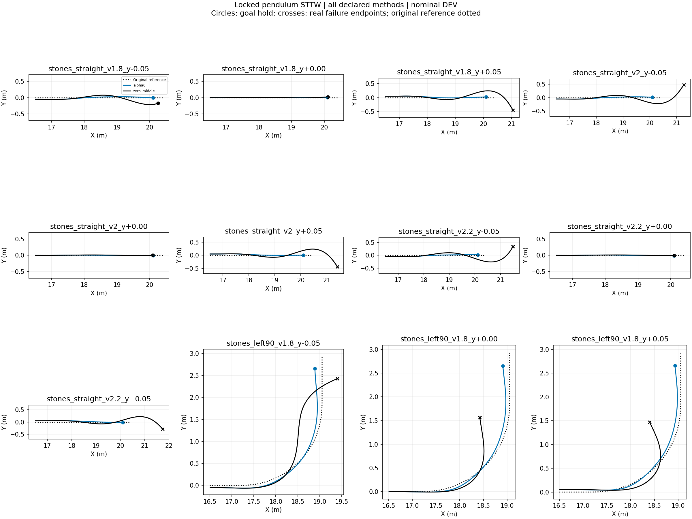
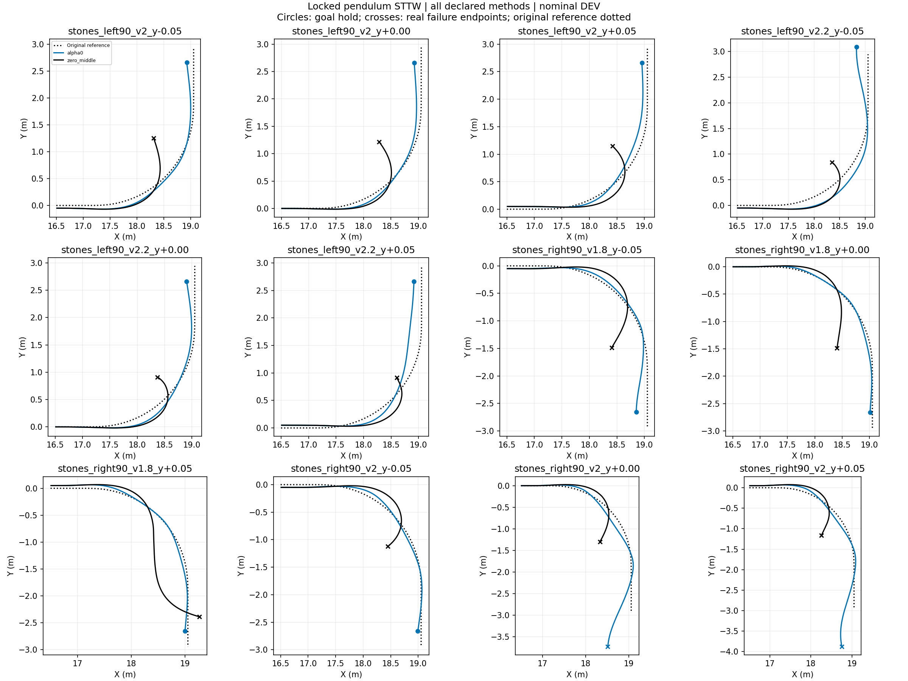
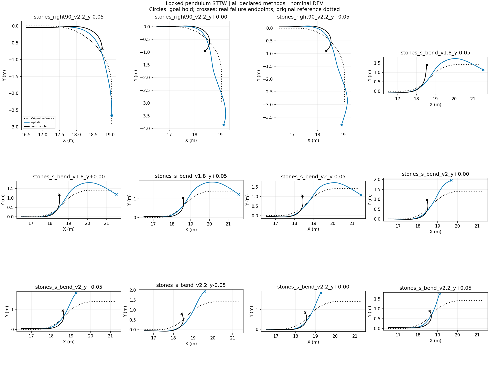
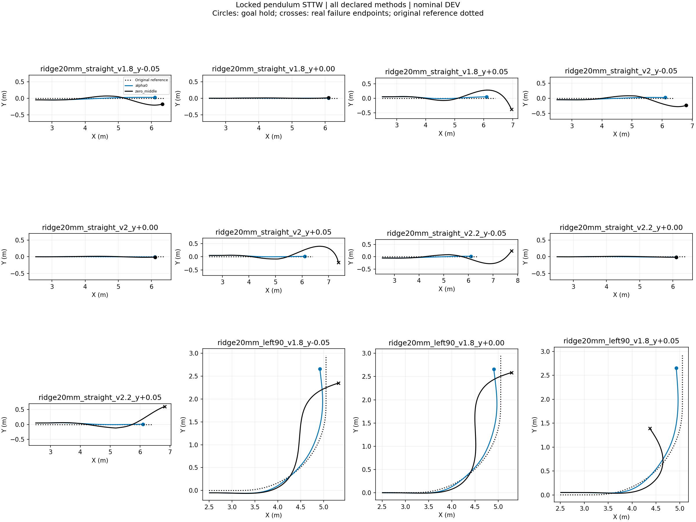
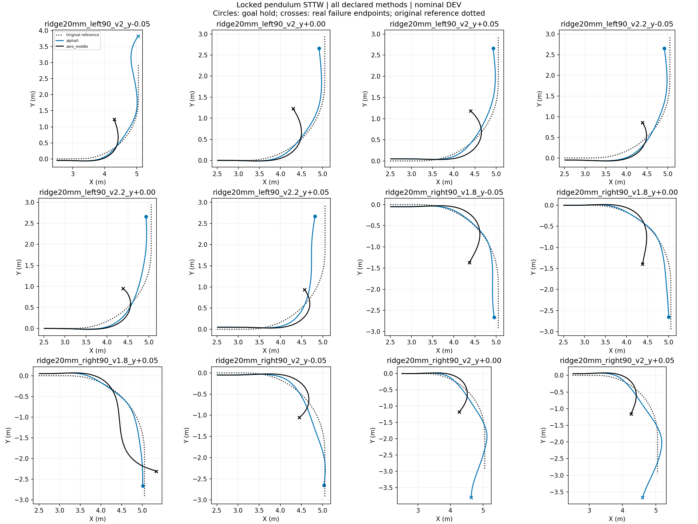
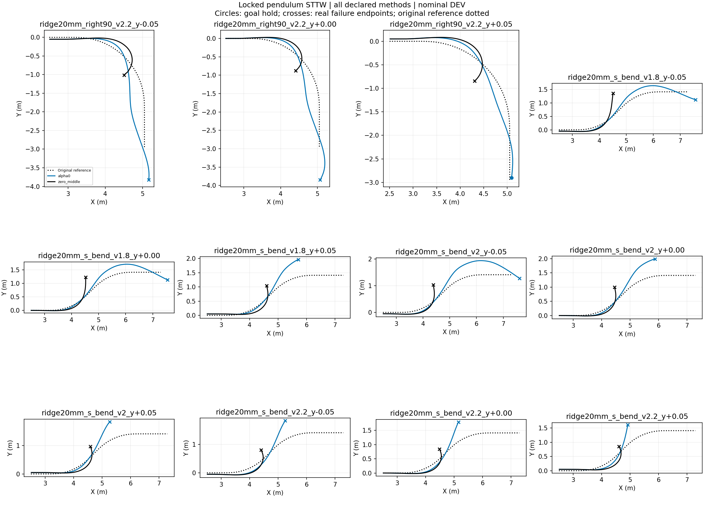
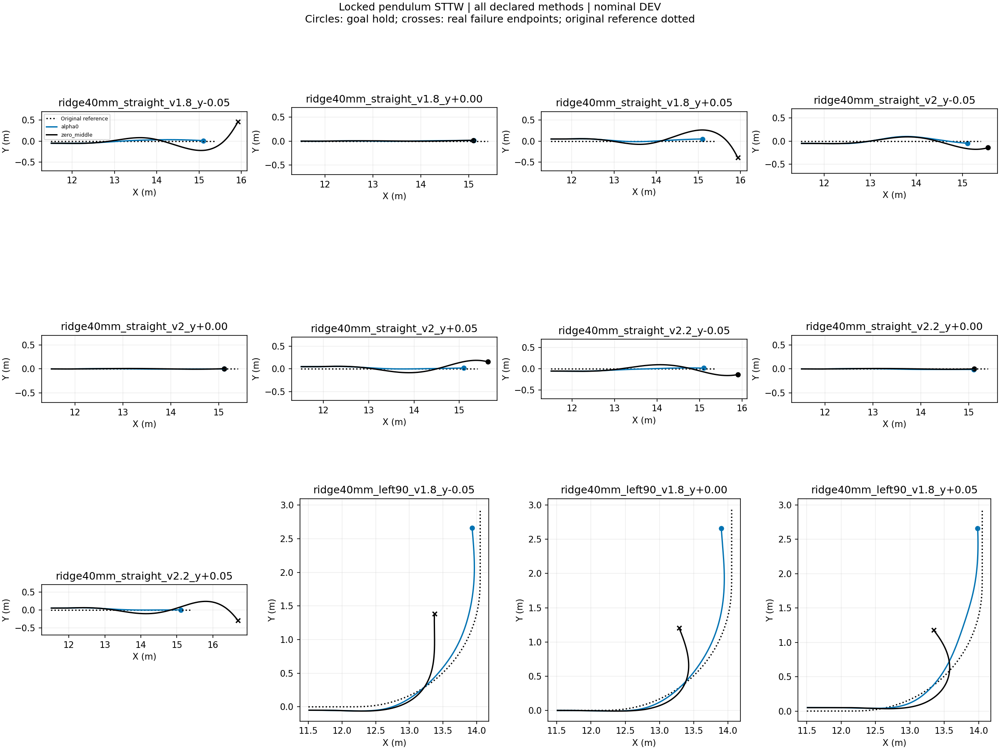
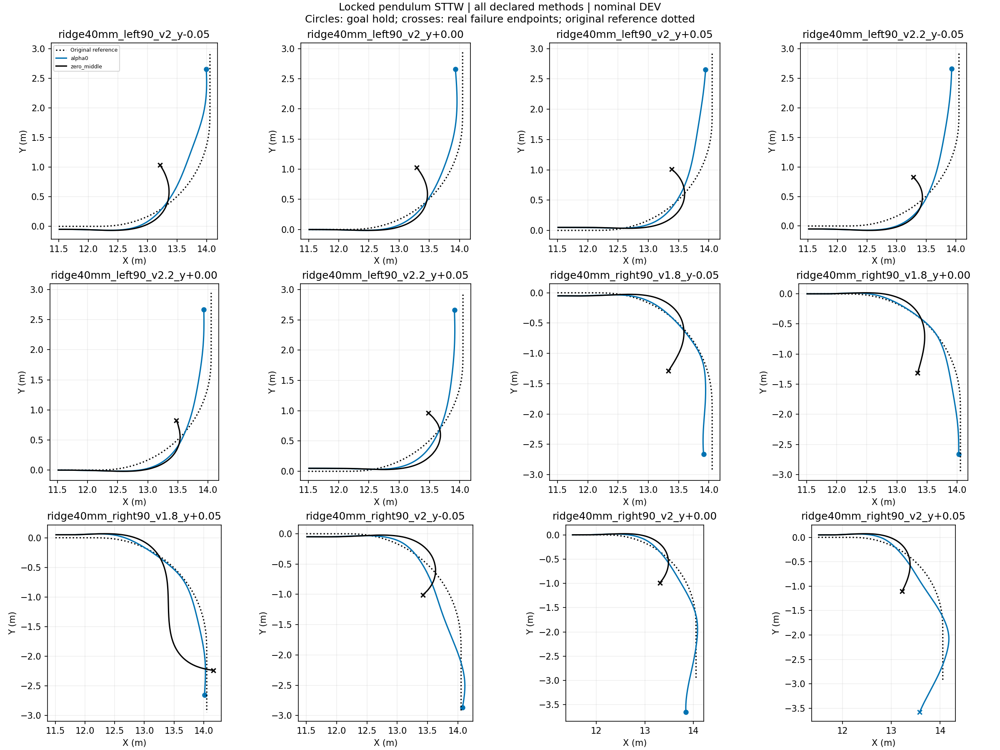
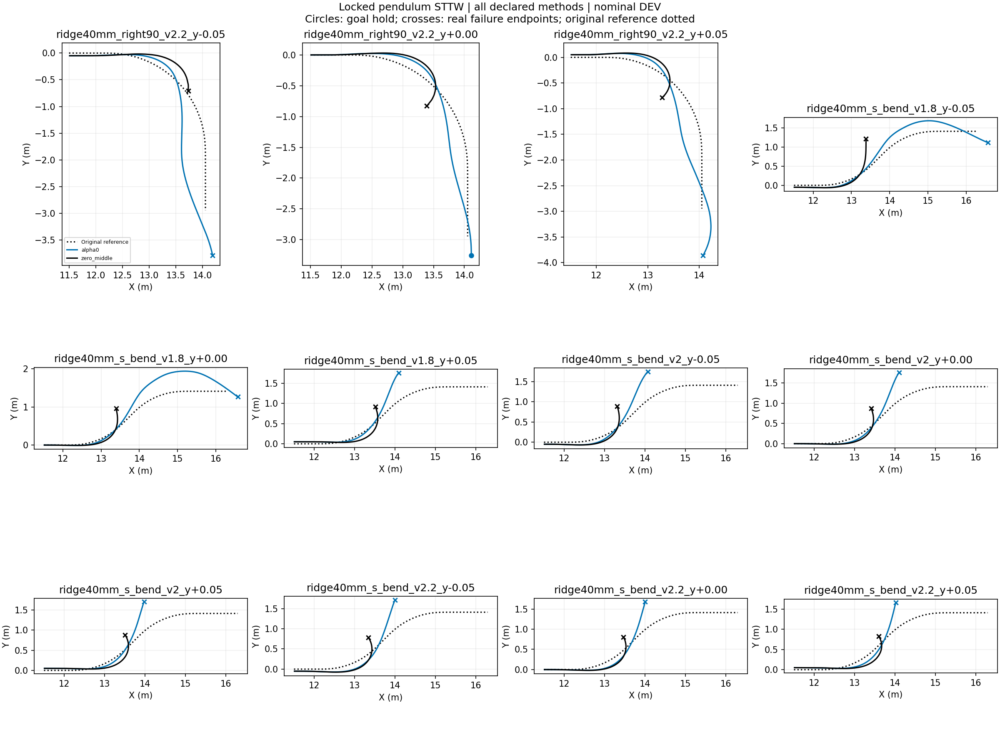

# Locked-pendulum STTW turning diagnostic

Nominal DEV, frozen H75, no training, one initialization per case. All failures retained. Each episode ends at its actual termination. These are inference-only behavior tests; task reward is not implemented and no reward improvement is claimed. RMSE below uses each episode's actual window and is not a paired-window ranking.

|Case|Method|End|Seconds|Path RMSE m|Speed RMSE m/s|
|---|---|---|---:|---:|---:|
|stones_straight_v1.8_y-0.05|alpha0|goal_hold|1.945|0.032|0.085|
|stones_straight_v1.8_y-0.05|zero_middle|goal_hold|2.100|0.097|0.068|
|stones_straight_v1.8_y+0.00|alpha0|goal_hold|1.945|0.002|0.069|
|stones_straight_v1.8_y+0.00|zero_middle|goal_hold|2.000|0.007|0.042|
|stones_straight_v1.8_y+0.05|alpha0|goal_hold|1.945|0.032|0.084|
|stones_straight_v1.8_y+0.05|zero_middle|corridor_or_domain_exit|2.740|0.134|0.053|
|stones_straight_v2_y-0.05|alpha0|goal_hold|1.775|0.034|0.074|
|stones_straight_v2_y-0.05|zero_middle|corridor_or_domain_exit|2.580|0.135|0.059|
|stones_straight_v2_y+0.00|alpha0|goal_hold|1.770|0.003|0.061|
|stones_straight_v2_y+0.00|zero_middle|goal_hold|1.805|0.006|0.045|
|stones_straight_v2_y+0.05|alpha0|goal_hold|1.775|0.033|0.055|
|stones_straight_v2_y+0.05|zero_middle|corridor_or_domain_exit|2.640|0.130|0.054|
|stones_straight_v2.2_y-0.05|alpha0|goal_hold|1.625|0.034|0.111|
|stones_straight_v2.2_y-0.05|zero_middle|corridor_or_domain_exit|2.440|0.125|0.101|
|stones_straight_v2.2_y+0.00|alpha0|goal_hold|1.625|0.007|0.116|
|stones_straight_v2.2_y+0.00|zero_middle|goal_hold|1.650|0.006|0.074|
|stones_straight_v2.2_y+0.05|alpha0|goal_hold|1.630|0.038|0.081|
|stones_straight_v2.2_y+0.05|zero_middle|corridor_or_domain_exit|2.520|0.105|0.079|
|stones_left90_v1.8_y-0.05|alpha0|goal_hold|2.485|0.082|0.089|
|stones_left90_v1.8_y-0.05|zero_middle|corridor_or_domain_exit|2.480|0.233|0.071|
|stones_left90_v1.8_y+0.00|alpha0|goal_hold|2.495|0.061|0.090|
|stones_left90_v1.8_y+0.00|zero_middle|corridor_or_domain_exit|1.805|0.218|0.064|
|stones_left90_v1.8_y+0.05|alpha0|goal_hold|2.495|0.057|0.126|
|stones_left90_v1.8_y+0.05|zero_middle|corridor_or_domain_exit|1.840|0.190|0.080|
|stones_left90_v2_y-0.05|alpha0|goal_hold|2.330|0.067|0.127|
|stones_left90_v2_y-0.05|zero_middle|corridor_or_domain_exit|1.500|0.199|0.091|
|stones_left90_v2_y+0.00|alpha0|goal_hold|2.310|0.062|0.127|
|stones_left90_v2_y+0.00|zero_middle|corridor_or_domain_exit|1.530|0.182|0.098|
|stones_left90_v2_y+0.05|alpha0|goal_hold|2.290|0.071|0.152|
|stones_left90_v2_y+0.05|zero_middle|corridor_or_domain_exit|1.560|0.136|0.105|
|stones_left90_v2.2_y-0.05|alpha0|goal_hold|2.425|0.129|0.172|
|stones_left90_v2.2_y-0.05|zero_middle|corridor_or_domain_exit|1.280|0.134|0.193|
|stones_left90_v2.2_y+0.00|alpha0|goal_hold|2.140|0.074|0.144|
|stones_left90_v2.2_y+0.00|zero_middle|corridor_or_domain_exit|1.320|0.121|0.179|
|stones_left90_v2.2_y+0.05|alpha0|goal_hold|2.125|0.120|0.203|
|stones_left90_v2.2_y+0.05|zero_middle|physical_failure|1.350|0.112|0.224|
|stones_right90_v1.8_y-0.05|alpha0|goal_hold|2.675|0.076|0.202|
|stones_right90_v1.8_y-0.05|zero_middle|corridor_or_domain_exit|1.900|0.193|0.094|
|stones_right90_v1.8_y+0.00|alpha0|goal_hold|2.655|0.024|0.201|
|stones_right90_v1.8_y+0.00|zero_middle|corridor_or_domain_exit|1.775|0.212|0.063|
|stones_right90_v1.8_y+0.05|alpha0|goal_hold|2.675|0.040|0.197|
|stones_right90_v1.8_y+0.05|zero_middle|corridor_or_domain_exit|2.480|0.284|0.075|
|stones_right90_v2_y-0.05|alpha0|goal_hold|2.520|0.040|0.292|
|stones_right90_v2_y-0.05|zero_middle|corridor_or_domain_exit|1.580|0.141|0.123|
|stones_right90_v2_y+0.00|alpha0|corridor_or_domain_exit|3.200|0.182|0.320|
|stones_right90_v2_y+0.00|zero_middle|corridor_or_domain_exit|1.570|0.189|0.085|
|stones_right90_v2_y+0.05|alpha0|corridor_or_domain_exit|3.220|0.133|0.287|
|stones_right90_v2_y+0.05|zero_middle|corridor_or_domain_exit|1.490|0.194|0.094|
|stones_right90_v2.2_y-0.05|alpha0|goal_hold|2.340|0.076|0.359|
|stones_right90_v2.2_y-0.05|zero_middle|physical_failure|1.245|0.147|0.178|
|stones_right90_v2.2_y+0.00|alpha0|corridor_or_domain_exit|3.000|0.154|0.390|
|stones_right90_v2.2_y+0.00|zero_middle|corridor_or_domain_exit|1.360|0.129|0.189|
|stones_right90_v2.2_y+0.05|alpha0|corridor_or_domain_exit|2.980|0.120|0.362|
|stones_right90_v2.2_y+0.05|zero_middle|corridor_or_domain_exit|1.320|0.149|0.175|
|stones_s_bend_v1.8_y-0.05|alpha0|corridor_or_domain_exit|3.480|0.180|0.199|
|stones_s_bend_v1.8_y-0.05|zero_middle|corridor_or_domain_exit|1.670|0.207|0.078|
|stones_s_bend_v1.8_y+0.00|alpha0|corridor_or_domain_exit|3.540|0.219|0.201|
|stones_s_bend_v1.8_y+0.00|zero_middle|corridor_or_domain_exit|1.580|0.139|0.067|
|stones_s_bend_v1.8_y+0.05|alpha0|corridor_or_domain_exit|3.600|0.262|0.212|
|stones_s_bend_v1.8_y+0.05|zero_middle|corridor_or_domain_exit|1.580|0.100|0.083|
|stones_s_bend_v2_y-0.05|alpha0|corridor_or_domain_exit|3.260|0.181|0.300|
|stones_s_bend_v2_y-0.05|zero_middle|corridor_or_domain_exit|1.380|0.141|0.089|
|stones_s_bend_v2_y+0.00|alpha0|corridor_or_domain_exit|2.205|0.248|0.230|
|stones_s_bend_v2_y+0.00|zero_middle|corridor_or_domain_exit|1.380|0.109|0.096|
|stones_s_bend_v2_y+0.05|alpha0|corridor_or_domain_exit|1.960|0.210|0.174|
|stones_s_bend_v2_y+0.05|zero_middle|corridor_or_domain_exit|1.420|0.096|0.095|
|stones_s_bend_v2.2_y-0.05|alpha0|corridor_or_domain_exit|1.965|0.222|0.209|
|stones_s_bend_v2.2_y-0.05|zero_middle|corridor_or_domain_exit|1.240|0.126|0.177|
|stones_s_bend_v2.2_y+0.00|alpha0|corridor_or_domain_exit|1.800|0.196|0.149|
|stones_s_bend_v2.2_y+0.00|zero_middle|corridor_or_domain_exit|1.260|0.105|0.158|
|stones_s_bend_v2.2_y+0.05|alpha0|corridor_or_domain_exit|1.720|0.179|0.174|
|stones_s_bend_v2.2_y+0.05|zero_middle|corridor_or_domain_exit|1.320|0.112|0.164|
|ridge20mm_straight_v1.8_y-0.05|alpha0|goal_hold|1.935|0.032|0.101|
|ridge20mm_straight_v1.8_y-0.05|zero_middle|goal_hold|2.140|0.094|0.068|
|ridge20mm_straight_v1.8_y+0.00|alpha0|goal_hold|1.945|0.002|0.075|
|ridge20mm_straight_v1.8_y+0.00|zero_middle|goal_hold|1.995|0.005|0.050|
|ridge20mm_straight_v1.8_y+0.05|alpha0|goal_hold|1.970|0.035|0.060|
|ridge20mm_straight_v1.8_y+0.05|zero_middle|corridor_or_domain_exit|2.700|0.140|0.056|
|ridge20mm_straight_v2_y-0.05|alpha0|goal_hold|1.760|0.033|0.091|
|ridge20mm_straight_v2_y-0.05|zero_middle|goal_hold|2.165|0.125|0.100|
|ridge20mm_straight_v2_y+0.00|alpha0|goal_hold|1.760|0.004|0.090|
|ridge20mm_straight_v2_y+0.00|zero_middle|goal_hold|1.800|0.010|0.066|
|ridge20mm_straight_v2_y+0.05|alpha0|goal_hold|1.770|0.033|0.080|
|ridge20mm_straight_v2_y+0.05|zero_middle|corridor_or_domain_exit|2.660|0.178|0.086|
|ridge20mm_straight_v2.2_y-0.05|alpha0|goal_hold|1.610|0.033|0.130|
|ridge20mm_straight_v2.2_y-0.05|zero_middle|corridor_or_domain_exit|2.500|0.125|0.126|
|ridge20mm_straight_v2.2_y+0.00|alpha0|goal_hold|1.610|0.006|0.128|
|ridge20mm_straight_v2.2_y+0.00|zero_middle|goal_hold|1.635|0.008|0.118|
|ridge20mm_straight_v2.2_y+0.05|alpha0|goal_hold|1.615|0.035|0.126|
|ridge20mm_straight_v2.2_y+0.05|zero_middle|corridor_or_domain_exit|2.055|0.195|0.126|
|ridge20mm_left90_v1.8_y-0.05|alpha0|goal_hold|2.500|0.070|0.100|
|ridge20mm_left90_v1.8_y-0.05|zero_middle|corridor_or_domain_exit|2.440|0.254|0.077|
|ridge20mm_left90_v1.8_y+0.00|alpha0|goal_hold|2.510|0.064|0.106|
|ridge20mm_left90_v1.8_y+0.00|zero_middle|corridor_or_domain_exit|2.600|0.273|0.068|
|ridge20mm_left90_v1.8_y+0.05|alpha0|goal_hold|2.515|0.067|0.118|
|ridge20mm_left90_v1.8_y+0.05|zero_middle|corridor_or_domain_exit|1.835|0.184|0.071|
|ridge20mm_left90_v2_y-0.05|alpha0|corridor_or_domain_exit|3.120|0.111|0.259|
|ridge20mm_left90_v2_y-0.05|zero_middle|corridor_or_domain_exit|1.490|0.198|0.084|
|ridge20mm_left90_v2_y+0.00|alpha0|goal_hold|2.325|0.061|0.146|
|ridge20mm_left90_v2_y+0.00|zero_middle|corridor_or_domain_exit|1.525|0.182|0.090|
|ridge20mm_left90_v2_y+0.05|alpha0|goal_hold|2.310|0.065|0.148|
|ridge20mm_left90_v2_y+0.05|zero_middle|corridor_or_domain_exit|1.580|0.146|0.098|
|ridge20mm_left90_v2.2_y-0.05|alpha0|goal_hold|2.145|0.086|0.150|
|ridge20mm_left90_v2.2_y-0.05|zero_middle|physical_failure|1.280|0.127|0.262|
|ridge20mm_left90_v2.2_y+0.00|alpha0|goal_hold|2.110|0.094|0.160|
|ridge20mm_left90_v2.2_y+0.00|zero_middle|corridor_or_domain_exit|1.320|0.122|0.150|
|ridge20mm_left90_v2.2_y+0.05|alpha0|goal_hold|2.145|0.176|0.216|
|ridge20mm_left90_v2.2_y+0.05|zero_middle|physical_failure|1.360|0.117|0.189|
|ridge20mm_right90_v1.8_y-0.05|alpha0|goal_hold|2.650|0.070|0.211|
|ridge20mm_right90_v1.8_y-0.05|zero_middle|corridor_or_domain_exit|1.795|0.185|0.099|
|ridge20mm_right90_v1.8_y+0.00|alpha0|goal_hold|2.630|0.054|0.205|
|ridge20mm_right90_v1.8_y+0.00|zero_middle|corridor_or_domain_exit|1.730|0.202|0.068|
|ridge20mm_right90_v1.8_y+0.05|alpha0|goal_hold|2.630|0.056|0.200|
|ridge20mm_right90_v1.8_y+0.05|zero_middle|corridor_or_domain_exit|2.420|0.251|0.075|
|ridge20mm_right90_v2_y-0.05|alpha0|goal_hold|2.495|0.076|0.307|
|ridge20mm_right90_v2_y-0.05|zero_middle|corridor_or_domain_exit|1.540|0.132|0.123|
|ridge20mm_right90_v2_y+0.00|alpha0|corridor_or_domain_exit|3.220|0.145|0.315|
|ridge20mm_right90_v2_y+0.00|zero_middle|corridor_or_domain_exit|1.540|0.180|0.104|
|ridge20mm_right90_v2_y+0.05|alpha0|corridor_or_domain_exit|3.200|0.141|0.320|
|ridge20mm_right90_v2_y+0.05|zero_middle|corridor_or_domain_exit|1.475|0.194|0.093|
|ridge20mm_right90_v2.2_y-0.05|alpha0|corridor_or_domain_exit|2.940|0.178|0.380|
|ridge20mm_right90_v2.2_y-0.05|zero_middle|corridor_or_domain_exit|1.440|0.139|0.206|
|ridge20mm_right90_v2.2_y+0.00|alpha0|corridor_or_domain_exit|3.040|0.156|0.420|
|ridge20mm_right90_v2.2_y+0.00|zero_middle|corridor_or_domain_exit|1.320|0.122|0.183|
|ridge20mm_right90_v2.2_y+0.05|alpha0|goal_hold|2.490|0.104|0.365|
|ridge20mm_right90_v2.2_y+0.05|zero_middle|corridor_or_domain_exit|1.280|0.140|0.177|
|ridge20mm_s_bend_v1.8_y-0.05|alpha0|corridor_or_domain_exit|3.440|0.145|0.194|
|ridge20mm_s_bend_v1.8_y-0.05|zero_middle|corridor_or_domain_exit|1.645|0.209|0.079|
|ridge20mm_s_bend_v1.8_y+0.00|alpha0|corridor_or_domain_exit|3.480|0.168|0.198|
|ridge20mm_s_bend_v1.8_y+0.00|zero_middle|corridor_or_domain_exit|1.600|0.152|0.067|
|ridge20mm_s_bend_v1.8_y+0.05|alpha0|corridor_or_domain_exit|2.410|0.241|0.177|
|ridge20mm_s_bend_v1.8_y+0.05|zero_middle|corridor_or_domain_exit|1.600|0.104|0.070|
|ridge20mm_s_bend_v2_y-0.05|alpha0|corridor_or_domain_exit|3.420|0.296|0.276|
|ridge20mm_s_bend_v2_y-0.05|zero_middle|corridor_or_domain_exit|1.380|0.144|0.085|
|ridge20mm_s_bend_v2_y+0.00|alpha0|corridor_or_domain_exit|2.310|0.264|0.235|
|ridge20mm_s_bend_v2_y+0.00|zero_middle|corridor_or_domain_exit|1.380|0.110|0.086|
|ridge20mm_s_bend_v2_y+0.05|alpha0|corridor_or_domain_exit|1.960|0.206|0.170|
|ridge20mm_s_bend_v2_y+0.05|zero_middle|corridor_or_domain_exit|1.420|0.097|0.086|
|ridge20mm_s_bend_v2.2_y-0.05|alpha0|corridor_or_domain_exit|1.805|0.207|0.162|
|ridge20mm_s_bend_v2.2_y-0.05|zero_middle|corridor_or_domain_exit|1.220|0.117|0.154|
|ridge20mm_s_bend_v2.2_y+0.00|alpha0|corridor_or_domain_exit|1.750|0.193|0.151|
|ridge20mm_s_bend_v2.2_y+0.00|zero_middle|corridor_or_domain_exit|1.240|0.100|0.136|
|ridge20mm_s_bend_v2.2_y+0.05|alpha0|corridor_or_domain_exit|1.640|0.166|0.184|
|ridge20mm_s_bend_v2.2_y+0.05|zero_middle|corridor_or_domain_exit|1.300|0.113|0.150|
|ridge40mm_straight_v1.8_y-0.05|alpha0|goal_hold|1.960|0.034|0.068|
|ridge40mm_straight_v1.8_y-0.05|zero_middle|corridor_or_domain_exit|2.660|0.131|0.059|
|ridge40mm_straight_v1.8_y+0.00|alpha0|goal_hold|1.950|0.006|0.071|
|ridge40mm_straight_v1.8_y+0.00|zero_middle|goal_hold|1.995|0.006|0.049|
|ridge40mm_straight_v1.8_y+0.05|alpha0|goal_hold|1.970|0.036|0.052|
|ridge40mm_straight_v1.8_y+0.05|zero_middle|corridor_or_domain_exit|2.680|0.134|0.050|
|ridge40mm_straight_v2_y-0.05|alpha0|goal_hold|1.880|0.058|0.156|
|ridge40mm_straight_v2_y-0.05|zero_middle|goal_hold|2.065|0.084|0.044|
|ridge40mm_straight_v2_y+0.00|alpha0|goal_hold|1.770|0.003|0.067|
|ridge40mm_straight_v2_y+0.00|zero_middle|goal_hold|1.805|0.005|0.053|
|ridge40mm_straight_v2_y+0.05|alpha0|goal_hold|1.785|0.033|0.040|
|ridge40mm_straight_v2_y+0.05|zero_middle|goal_hold|2.105|0.087|0.041|
|ridge40mm_straight_v2.2_y-0.05|alpha0|goal_hold|1.630|0.033|0.079|
|ridge40mm_straight_v2.2_y-0.05|zero_middle|goal_hold|2.035|0.078|0.074|
|ridge40mm_straight_v2.2_y+0.00|alpha0|goal_hold|1.615|0.007|0.091|
|ridge40mm_straight_v2.2_y+0.00|zero_middle|goal_hold|1.650|0.005|0.087|
|ridge40mm_straight_v2.2_y+0.05|alpha0|goal_hold|1.640|0.034|0.071|
|ridge40mm_straight_v2.2_y+0.05|zero_middle|corridor_or_domain_exit|2.520|0.113|0.081|
|ridge40mm_left90_v1.8_y-0.05|alpha0|goal_hold|2.485|0.077|0.091|
|ridge40mm_left90_v1.8_y-0.05|zero_middle|corridor_or_domain_exit|1.655|0.228|0.073|
|ridge40mm_left90_v1.8_y+0.00|alpha0|goal_hold|2.485|0.076|0.086|
|ridge40mm_left90_v1.8_y+0.00|zero_middle|corridor_or_domain_exit|1.610|0.187|0.082|
|ridge40mm_left90_v1.8_y+0.05|alpha0|goal_hold|2.490|0.088|0.124|
|ridge40mm_left90_v1.8_y+0.05|zero_middle|corridor_or_domain_exit|1.700|0.158|0.085|
|ridge40mm_left90_v2_y-0.05|alpha0|goal_hold|2.270|0.117|0.129|
|ridge40mm_left90_v2_y-0.05|zero_middle|corridor_or_domain_exit|1.400|0.178|0.111|
|ridge40mm_left90_v2_y+0.00|alpha0|goal_hold|2.265|0.081|0.111|
|ridge40mm_left90_v2_y+0.00|zero_middle|corridor_or_domain_exit|1.420|0.144|0.108|
|ridge40mm_left90_v2_y+0.05|alpha0|goal_hold|2.250|0.122|0.141|
|ridge40mm_left90_v2_y+0.05|zero_middle|corridor_or_domain_exit|1.480|0.125|0.118|
|ridge40mm_left90_v2.2_y-0.05|alpha0|goal_hold|2.090|0.133|0.156|
|ridge40mm_left90_v2.2_y-0.05|zero_middle|corridor_or_domain_exit|1.240|0.133|0.166|
|ridge40mm_left90_v2.2_y+0.00|alpha0|goal_hold|2.100|0.108|0.154|
|ridge40mm_left90_v2.2_y+0.00|zero_middle|physical_failure|1.245|0.100|0.186|
|ridge40mm_left90_v2.2_y+0.05|alpha0|goal_hold|2.105|0.100|0.159|
|ridge40mm_left90_v2.2_y+0.05|zero_middle|corridor_or_domain_exit|1.380|0.123|0.187|
|ridge40mm_right90_v1.8_y-0.05|alpha0|goal_hold|2.655|0.070|0.207|
|ridge40mm_right90_v1.8_y-0.05|zero_middle|corridor_or_domain_exit|1.750|0.182|0.093|
|ridge40mm_right90_v1.8_y+0.00|alpha0|goal_hold|2.635|0.051|0.200|
|ridge40mm_right90_v1.8_y+0.00|zero_middle|corridor_or_domain_exit|1.675|0.194|0.072|
|ridge40mm_right90_v1.8_y+0.05|alpha0|goal_hold|2.645|0.052|0.203|
|ridge40mm_right90_v1.8_y+0.05|zero_middle|corridor_or_domain_exit|2.400|0.297|0.068|
|ridge40mm_right90_v2_y-0.05|alpha0|goal_hold|2.595|0.103|0.310|
|ridge40mm_right90_v2_y-0.05|zero_middle|corridor_or_domain_exit|1.500|0.128|0.118|
|ridge40mm_right90_v2_y+0.00|alpha0|goal_hold|3.030|0.081|0.272|
|ridge40mm_right90_v2_y+0.00|zero_middle|corridor_or_domain_exit|1.420|0.137|0.115|
|ridge40mm_right90_v2_y+0.05|alpha0|corridor_or_domain_exit|3.160|0.146|0.327|
|ridge40mm_right90_v2_y+0.05|zero_middle|corridor_or_domain_exit|1.440|0.191|0.092|
|ridge40mm_right90_v2.2_y-0.05|alpha0|corridor_or_domain_exit|2.900|0.222|0.363|
|ridge40mm_right90_v2.2_y-0.05|zero_middle|physical_failure|1.235|0.133|0.160|
|ridge40mm_right90_v2.2_y+0.00|alpha0|goal_hold|2.650|0.124|0.361|
|ridge40mm_right90_v2.2_y+0.00|zero_middle|corridor_or_domain_exit|1.280|0.119|0.199|
|ridge40mm_right90_v2.2_y+0.05|alpha0|corridor_or_domain_exit|3.020|0.171|0.393|
|ridge40mm_right90_v2.2_y+0.05|zero_middle|corridor_or_domain_exit|1.240|0.135|0.180|
|ridge40mm_s_bend_v1.8_y-0.05|alpha0|corridor_or_domain_exit|3.480|0.170|0.192|
|ridge40mm_s_bend_v1.8_y-0.05|zero_middle|corridor_or_domain_exit|1.560|0.197|0.075|
|ridge40mm_s_bend_v1.8_y+0.00|alpha0|corridor_or_domain_exit|3.660|0.294|0.204|
|ridge40mm_s_bend_v1.8_y+0.00|zero_middle|corridor_or_domain_exit|1.460|0.113|0.084|
|ridge40mm_s_bend_v1.8_y+0.05|alpha0|corridor_or_domain_exit|2.060|0.214|0.160|
|ridge40mm_s_bend_v1.8_y+0.05|zero_middle|corridor_or_domain_exit|1.520|0.096|0.087|
|ridge40mm_s_bend_v2_y-0.05|alpha0|corridor_or_domain_exit|1.880|0.232|0.187|
|ridge40mm_s_bend_v2_y-0.05|zero_middle|corridor_or_domain_exit|1.300|0.126|0.097|
|ridge40mm_s_bend_v2_y+0.00|alpha0|corridor_or_domain_exit|1.870|0.207|0.148|
|ridge40mm_s_bend_v2_y+0.00|zero_middle|corridor_or_domain_exit|1.320|0.098|0.104|
|ridge40mm_s_bend_v2_y+0.05|alpha0|corridor_or_domain_exit|1.795|0.191|0.129|
|ridge40mm_s_bend_v2_y+0.05|zero_middle|corridor_or_domain_exit|1.380|0.097|0.112|
|ridge40mm_s_bend_v2.2_y-0.05|alpha0|corridor_or_domain_exit|1.685|0.205|0.155|
|ridge40mm_s_bend_v2.2_y-0.05|zero_middle|corridor_or_domain_exit|1.200|0.120|0.154|
|ridge40mm_s_bend_v2.2_y+0.00|alpha0|corridor_or_domain_exit|1.660|0.179|0.143|
|ridge40mm_s_bend_v2.2_y+0.00|zero_middle|corridor_or_domain_exit|1.220|0.098|0.154|
|ridge40mm_s_bend_v2.2_y+0.05|alpha0|corridor_or_domain_exit|1.660|0.164|0.140|
|ridge40mm_s_bend_v2.2_y+0.05|zero_middle|corridor_or_domain_exit|1.280|0.110|0.165|

## Tracking plots
- [stones_straight_v1.8_y-0.05](stones_straight_v1.8_y-0.05_tracking.png)
- [stones_straight_v1.8_y+0.00](stones_straight_v1.8_y+0.00_tracking.png)
- [stones_straight_v1.8_y+0.05](stones_straight_v1.8_y+0.05_tracking.png)
- [stones_straight_v2_y-0.05](stones_straight_v2_y-0.05_tracking.png)
- [stones_straight_v2_y+0.00](stones_straight_v2_y+0.00_tracking.png)
- [stones_straight_v2_y+0.05](stones_straight_v2_y+0.05_tracking.png)
- [stones_straight_v2.2_y-0.05](stones_straight_v2.2_y-0.05_tracking.png)
- [stones_straight_v2.2_y+0.00](stones_straight_v2.2_y+0.00_tracking.png)
- [stones_straight_v2.2_y+0.05](stones_straight_v2.2_y+0.05_tracking.png)
- [stones_left90_v1.8_y-0.05](stones_left90_v1.8_y-0.05_tracking.png)
- [stones_left90_v1.8_y+0.00](stones_left90_v1.8_y+0.00_tracking.png)
- [stones_left90_v1.8_y+0.05](stones_left90_v1.8_y+0.05_tracking.png)
- [stones_left90_v2_y-0.05](stones_left90_v2_y-0.05_tracking.png)
- [stones_left90_v2_y+0.00](stones_left90_v2_y+0.00_tracking.png)
- [stones_left90_v2_y+0.05](stones_left90_v2_y+0.05_tracking.png)
- [stones_left90_v2.2_y-0.05](stones_left90_v2.2_y-0.05_tracking.png)
- [stones_left90_v2.2_y+0.00](stones_left90_v2.2_y+0.00_tracking.png)
- [stones_left90_v2.2_y+0.05](stones_left90_v2.2_y+0.05_tracking.png)
- [stones_right90_v1.8_y-0.05](stones_right90_v1.8_y-0.05_tracking.png)
- [stones_right90_v1.8_y+0.00](stones_right90_v1.8_y+0.00_tracking.png)
- [stones_right90_v1.8_y+0.05](stones_right90_v1.8_y+0.05_tracking.png)
- [stones_right90_v2_y-0.05](stones_right90_v2_y-0.05_tracking.png)
- [stones_right90_v2_y+0.00](stones_right90_v2_y+0.00_tracking.png)
- [stones_right90_v2_y+0.05](stones_right90_v2_y+0.05_tracking.png)
- [stones_right90_v2.2_y-0.05](stones_right90_v2.2_y-0.05_tracking.png)
- [stones_right90_v2.2_y+0.00](stones_right90_v2.2_y+0.00_tracking.png)
- [stones_right90_v2.2_y+0.05](stones_right90_v2.2_y+0.05_tracking.png)
- [stones_s_bend_v1.8_y-0.05](stones_s_bend_v1.8_y-0.05_tracking.png)
- [stones_s_bend_v1.8_y+0.00](stones_s_bend_v1.8_y+0.00_tracking.png)
- [stones_s_bend_v1.8_y+0.05](stones_s_bend_v1.8_y+0.05_tracking.png)
- [stones_s_bend_v2_y-0.05](stones_s_bend_v2_y-0.05_tracking.png)
- [stones_s_bend_v2_y+0.00](stones_s_bend_v2_y+0.00_tracking.png)
- [stones_s_bend_v2_y+0.05](stones_s_bend_v2_y+0.05_tracking.png)
- [stones_s_bend_v2.2_y-0.05](stones_s_bend_v2.2_y-0.05_tracking.png)
- [stones_s_bend_v2.2_y+0.00](stones_s_bend_v2.2_y+0.00_tracking.png)
- [stones_s_bend_v2.2_y+0.05](stones_s_bend_v2.2_y+0.05_tracking.png)
- [ridge20mm_straight_v1.8_y-0.05](ridge20mm_straight_v1.8_y-0.05_tracking.png)
- [ridge20mm_straight_v1.8_y+0.00](ridge20mm_straight_v1.8_y+0.00_tracking.png)
- [ridge20mm_straight_v1.8_y+0.05](ridge20mm_straight_v1.8_y+0.05_tracking.png)
- [ridge20mm_straight_v2_y-0.05](ridge20mm_straight_v2_y-0.05_tracking.png)
- [ridge20mm_straight_v2_y+0.00](ridge20mm_straight_v2_y+0.00_tracking.png)
- [ridge20mm_straight_v2_y+0.05](ridge20mm_straight_v2_y+0.05_tracking.png)
- [ridge20mm_straight_v2.2_y-0.05](ridge20mm_straight_v2.2_y-0.05_tracking.png)
- [ridge20mm_straight_v2.2_y+0.00](ridge20mm_straight_v2.2_y+0.00_tracking.png)
- [ridge20mm_straight_v2.2_y+0.05](ridge20mm_straight_v2.2_y+0.05_tracking.png)
- [ridge20mm_left90_v1.8_y-0.05](ridge20mm_left90_v1.8_y-0.05_tracking.png)
- [ridge20mm_left90_v1.8_y+0.00](ridge20mm_left90_v1.8_y+0.00_tracking.png)
- [ridge20mm_left90_v1.8_y+0.05](ridge20mm_left90_v1.8_y+0.05_tracking.png)
- [ridge20mm_left90_v2_y-0.05](ridge20mm_left90_v2_y-0.05_tracking.png)
- [ridge20mm_left90_v2_y+0.00](ridge20mm_left90_v2_y+0.00_tracking.png)
- [ridge20mm_left90_v2_y+0.05](ridge20mm_left90_v2_y+0.05_tracking.png)
- [ridge20mm_left90_v2.2_y-0.05](ridge20mm_left90_v2.2_y-0.05_tracking.png)
- [ridge20mm_left90_v2.2_y+0.00](ridge20mm_left90_v2.2_y+0.00_tracking.png)
- [ridge20mm_left90_v2.2_y+0.05](ridge20mm_left90_v2.2_y+0.05_tracking.png)
- [ridge20mm_right90_v1.8_y-0.05](ridge20mm_right90_v1.8_y-0.05_tracking.png)
- [ridge20mm_right90_v1.8_y+0.00](ridge20mm_right90_v1.8_y+0.00_tracking.png)
- [ridge20mm_right90_v1.8_y+0.05](ridge20mm_right90_v1.8_y+0.05_tracking.png)
- [ridge20mm_right90_v2_y-0.05](ridge20mm_right90_v2_y-0.05_tracking.png)
- [ridge20mm_right90_v2_y+0.00](ridge20mm_right90_v2_y+0.00_tracking.png)
- [ridge20mm_right90_v2_y+0.05](ridge20mm_right90_v2_y+0.05_tracking.png)
- [ridge20mm_right90_v2.2_y-0.05](ridge20mm_right90_v2.2_y-0.05_tracking.png)
- [ridge20mm_right90_v2.2_y+0.00](ridge20mm_right90_v2.2_y+0.00_tracking.png)
- [ridge20mm_right90_v2.2_y+0.05](ridge20mm_right90_v2.2_y+0.05_tracking.png)
- [ridge20mm_s_bend_v1.8_y-0.05](ridge20mm_s_bend_v1.8_y-0.05_tracking.png)
- [ridge20mm_s_bend_v1.8_y+0.00](ridge20mm_s_bend_v1.8_y+0.00_tracking.png)
- [ridge20mm_s_bend_v1.8_y+0.05](ridge20mm_s_bend_v1.8_y+0.05_tracking.png)
- [ridge20mm_s_bend_v2_y-0.05](ridge20mm_s_bend_v2_y-0.05_tracking.png)
- [ridge20mm_s_bend_v2_y+0.00](ridge20mm_s_bend_v2_y+0.00_tracking.png)
- [ridge20mm_s_bend_v2_y+0.05](ridge20mm_s_bend_v2_y+0.05_tracking.png)
- [ridge20mm_s_bend_v2.2_y-0.05](ridge20mm_s_bend_v2.2_y-0.05_tracking.png)
- [ridge20mm_s_bend_v2.2_y+0.00](ridge20mm_s_bend_v2.2_y+0.00_tracking.png)
- [ridge20mm_s_bend_v2.2_y+0.05](ridge20mm_s_bend_v2.2_y+0.05_tracking.png)
- [ridge40mm_straight_v1.8_y-0.05](ridge40mm_straight_v1.8_y-0.05_tracking.png)
- [ridge40mm_straight_v1.8_y+0.00](ridge40mm_straight_v1.8_y+0.00_tracking.png)
- [ridge40mm_straight_v1.8_y+0.05](ridge40mm_straight_v1.8_y+0.05_tracking.png)
- [ridge40mm_straight_v2_y-0.05](ridge40mm_straight_v2_y-0.05_tracking.png)
- [ridge40mm_straight_v2_y+0.00](ridge40mm_straight_v2_y+0.00_tracking.png)
- [ridge40mm_straight_v2_y+0.05](ridge40mm_straight_v2_y+0.05_tracking.png)
- [ridge40mm_straight_v2.2_y-0.05](ridge40mm_straight_v2.2_y-0.05_tracking.png)
- [ridge40mm_straight_v2.2_y+0.00](ridge40mm_straight_v2.2_y+0.00_tracking.png)
- [ridge40mm_straight_v2.2_y+0.05](ridge40mm_straight_v2.2_y+0.05_tracking.png)
- [ridge40mm_left90_v1.8_y-0.05](ridge40mm_left90_v1.8_y-0.05_tracking.png)
- [ridge40mm_left90_v1.8_y+0.00](ridge40mm_left90_v1.8_y+0.00_tracking.png)
- [ridge40mm_left90_v1.8_y+0.05](ridge40mm_left90_v1.8_y+0.05_tracking.png)
- [ridge40mm_left90_v2_y-0.05](ridge40mm_left90_v2_y-0.05_tracking.png)
- [ridge40mm_left90_v2_y+0.00](ridge40mm_left90_v2_y+0.00_tracking.png)
- [ridge40mm_left90_v2_y+0.05](ridge40mm_left90_v2_y+0.05_tracking.png)
- [ridge40mm_left90_v2.2_y-0.05](ridge40mm_left90_v2.2_y-0.05_tracking.png)
- [ridge40mm_left90_v2.2_y+0.00](ridge40mm_left90_v2.2_y+0.00_tracking.png)
- [ridge40mm_left90_v2.2_y+0.05](ridge40mm_left90_v2.2_y+0.05_tracking.png)
- [ridge40mm_right90_v1.8_y-0.05](ridge40mm_right90_v1.8_y-0.05_tracking.png)
- [ridge40mm_right90_v1.8_y+0.00](ridge40mm_right90_v1.8_y+0.00_tracking.png)
- [ridge40mm_right90_v1.8_y+0.05](ridge40mm_right90_v1.8_y+0.05_tracking.png)
- [ridge40mm_right90_v2_y-0.05](ridge40mm_right90_v2_y-0.05_tracking.png)
- [ridge40mm_right90_v2_y+0.00](ridge40mm_right90_v2_y+0.00_tracking.png)
- [ridge40mm_right90_v2_y+0.05](ridge40mm_right90_v2_y+0.05_tracking.png)
- [ridge40mm_right90_v2.2_y-0.05](ridge40mm_right90_v2.2_y-0.05_tracking.png)
- [ridge40mm_right90_v2.2_y+0.00](ridge40mm_right90_v2.2_y+0.00_tracking.png)
- [ridge40mm_right90_v2.2_y+0.05](ridge40mm_right90_v2.2_y+0.05_tracking.png)
- [ridge40mm_s_bend_v1.8_y-0.05](ridge40mm_s_bend_v1.8_y-0.05_tracking.png)
- [ridge40mm_s_bend_v1.8_y+0.00](ridge40mm_s_bend_v1.8_y+0.00_tracking.png)
- [ridge40mm_s_bend_v1.8_y+0.05](ridge40mm_s_bend_v1.8_y+0.05_tracking.png)
- [ridge40mm_s_bend_v2_y-0.05](ridge40mm_s_bend_v2_y-0.05_tracking.png)
- [ridge40mm_s_bend_v2_y+0.00](ridge40mm_s_bend_v2_y+0.00_tracking.png)
- [ridge40mm_s_bend_v2_y+0.05](ridge40mm_s_bend_v2_y+0.05_tracking.png)
- [ridge40mm_s_bend_v2.2_y-0.05](ridge40mm_s_bend_v2.2_y-0.05_tracking.png)
- [ridge40mm_s_bend_v2.2_y+0.00](ridge40mm_s_bend_v2.2_y+0.00_tracking.png)
- [ridge40mm_s_bend_v2.2_y+0.05](ridge40mm_s_bend_v2.2_y+0.05_tracking.png)
