# STTW → RB → STTW：当前交接诊断

## P0完整运行快照已完成序列化重放

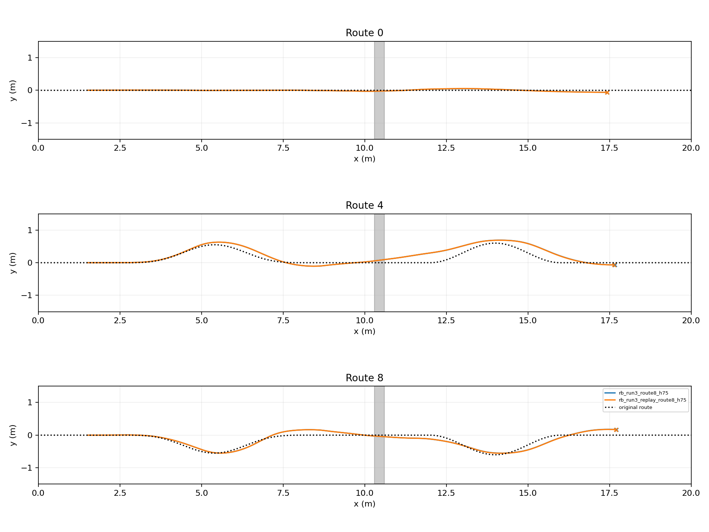

route0/4/8在4.5秒跳跃过程中保存完整快照，先完成原分支，再从磁盘读取并恢复后半程。三个原分支及三个恢复分支全部到达；它们共享前缀，不是六个独立初态。全部运行70.578秒，快照2,485,757字节，读取/恢复0.334秒；在线内存分支可直接复用GPU快照，此磁盘验证耗时不能冒称200ms在线规划达标。

|路线|恢复瞬间qpos/qvel差|后半程XY最大差|回交时刻差|
|---|---|---:|---:|
|直→直|0 / 0|0.005281m|+0.010s|
|左→左|0 / 0|0.004884m|−0.010s|
|右→右|0 / 0|0.011114m|0s|

原/恢复阶段顺序均为1→3→4→2，终态均goal；本组三条后半程XY差低于此前同形状固定路径重复的1.66–2.78cm。保留实际差异，不称GPU逐位确定，也不从三条外推全域重放精度。

快照包括完整MJX Data的106个叶节点（接触/约束与warm-start随数据保存）、RB FIFO/当前观测/上一动作、GroundAdapter控制器/H75状态、执行时钟、phase/alive、接触标志、制动目标、动作目标及阶段计时。冻结物理模型和权重由同目录declaration.json及terrain.mjb关联；该实现适用于当前名义评测runner，不冒充训练随机化环境的快照。原始轨迹、pickle、恢复回执与分析在`chapter3_playground_sttw_rb_sttw/p0_snapshot/evaluation/`。

P0仍缺唯一动作所有权的适配器回归及固定WorldMap/Route分离；尚未开始以完整P0通过为前提的规划数据采集。

## P0普通改路已接入GPU连续执行

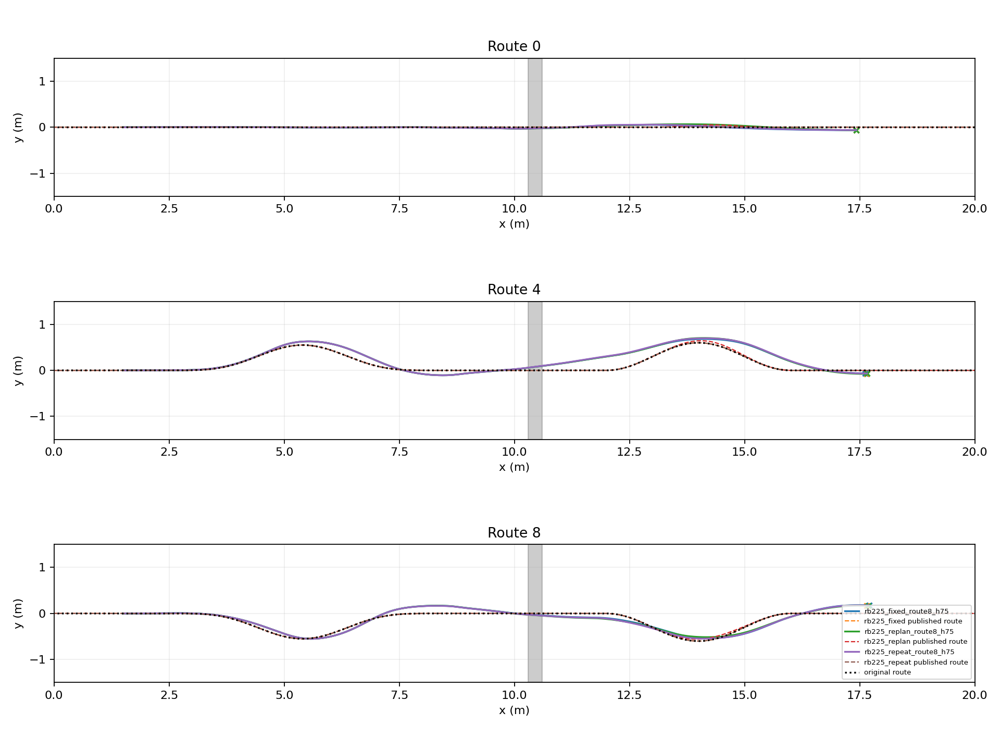

同RB225、共同物理与前视1.3，route0/4/8（直→直、左→左、右→右），固定/改路/固定重复三组均3/3到达，共9条134.259秒。改路在t=2s、tick400发布version0→1，保持s≤15m前缀（原s=0位于世界x=−5m，故约到世界x=10m）；后段增加5cm平滑偏移，速度1.8、alpha0不变。入口实际检查H75 frames/mask/lane_ticks、滤波/offset、ESO与filtered_roll_rate全部逐值不变。四项CPU合同测试覆盖版本、时钟、前缀和控制器状态恢复。

同固定路径重复的共同窗口XY最大差为2.12/1.66/2.78cm，改路对固定为5.27/5.37/6.25cm；发布前XY差均小于0.16mm。不能把不同运行整条轨迹当作逐位配对或把9/9当规划收益。该测试仍沿用旧路径跟踪走廊；固定WorldMap尚未分离，ControllerState快照尚不包含物理/RB缓存，完整P0未通过。

已处理并保留两次入口失败：缩短后段时重采样尾点重复；把世界x误当累计弧长s导致承诺前缀不足。修复为末端切线延伸及明确s原点，不改变控制器/任务门槛。原始输入、失败日志、完整轨迹、版本回执与数值分析：`chapter3_playground_sttw_rb_sttw/p0_plan_update/`。复用入口`prepare_playground_plan_update.py`，版本发布与控制器状态捕获在`playground_adapters.py`。

## 当前冻结交接：名义9/9，真实初差71/72；进入纲要P0

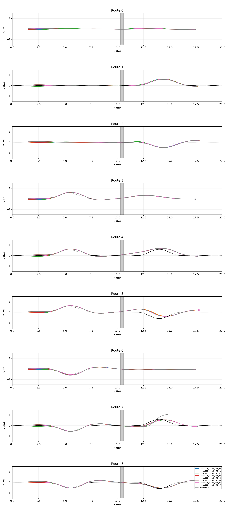

|前段 → 后段|完整目标 / 8|
|---|---:|
|直 → 直|8/8|
|直 → 左|8/8|
|直 → 右|8/8|
|左 → 直|8/8|
|左 → 左|8/8|
|左 → 右|8/8|
|右 → 直|8/8|
|右 → 左|7/8|
|右 → 右|8/8|

72/72均完成远岸接触、实际关节锁定及回交；71/72满足原完整目标与保持条件。共同implicitfast 1ms×5，RB225、H75/ECBC/ESO、地形、前后2m平地与原成功条件均保持。只将回交后pursuit前视倍率由1.0增至1.3：同九名义路线6/9→9/9，同72初差40/72→71/72，31条新增成功、0条丢失。单一候选修改，未遍历参数；是DEV工程比较，不是独立TEST或正式E1。

原前视72条224.281秒，新前视72条211.234秒；新名义9条65.876秒。两批真实初态最大核对误差7.45e-10，初差为y±0.05m、roll±0.015rad、yaw±0.03rad的八组合，各路线全部覆盖；不是72个独立种子。

保留反例：右弯接近→左弯续行，y=+0.05m、roll=+0.015rad、yaw=+0.03rad；5.570秒锁后回交，7.945秒路径走廊/控制域退出，位置(14.768,1.057)m，路径距离0.603m。这不是超时，也未达到目标。关闭全程H75中层修正的纯ECBC+ESO基线1/9，其中六条未进入RB，不能把它解释为仅落地后控制的配对因果结论。

采用为下一阶段**工程候选**：`learning/configs/playground_sttw_rb_sttw.json`（RB来源rb_run3 ppo_only→适配225；冻结导出`shared_plant_checkpoint_comparison/shared225`）。不再无限追加RB训练；训练奖励仍有变化并不等于任务收敛，但当前证据将主要剩余问题定位到地面续行。原始负例、旧设置及训练存档全部保留。

纲要P0现已开始实现：`TorchMiddleControl.update_plan`在20ms边界发布同网格路线，保留承诺前缀、H75历史/滤波与时钟，3项CPU合同测试通过。完整GroundAdapter、计划版本/有效期、全运行快照、WorldMap/Route分离及动作归属回归尚未完成，不能称P0或整章任务完成。

冻结候选复跑入口（输出目录须为新目录；重型GPU任务持项目共享锁）：

```bash
PYTHONPATH=learning/src:/home/qy/DVGC/JIT/src XLA_PYTHON_CLIENT_PREALLOCATE=false \
flock /home/qy/STTW_CONTROL/research-hub/.gpu-job.lock \
/home/qy/mujoco_playground/.venv/bin/python learning/cli/evaluate_playground_handoff.py \
  --config learning/configs/playground_sttw_rb_sttw.json --skills rb_run3 \
  --modes h75 --routes 0 1 2 3 4 5 6 7 8 --seconds 10 --physics-substeps 5 \
  --output <new-output-directory>
```

该入口使用注册表原rb_run3身份及配置内225适配权重，不依赖实验比较用的临时别名。

[六存档训练收敛比较](SHARED_PLANT_CONVERGENCE.md)；原始结果：`rb_adaptation/shared_plant_checkpoint_comparison/{evaluation,perturbation_evaluation,ground_baseline_evaluation,lookahead_evaluation,lookahead_offsets_evaluation}`。

## 统一物理续训200完成：225档名义完整链6/9，九条均已回交

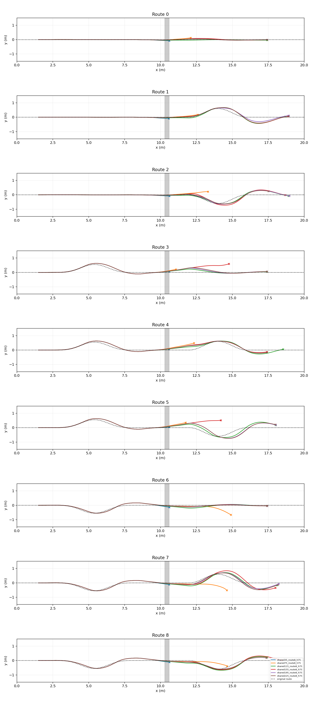

|累计存档|完整目标 / 9|
|---|---:|
|35|0/9|
|75|0/9|
|115|4/9|
|155|3/9|
|195|5/9|
|225|6/9|

54回合407.085秒，全部使用共同implicitfast 1ms×5物理步、同九路线和原终点门槛。父25在此物理域0/9，当前225为六个已评估存档中的最佳，不是全存档最佳。225九条均在5.245–5.595秒实际锁定并交回；直→左、左→右、右→左未满足原终点保持条件而超时，不能把回交9/9当作任务9/9。失败发生在地面续行：直→左最终超出目标x上界，另两条末端航向仍约−0.251/+0.356rad；完整终点条件不改。

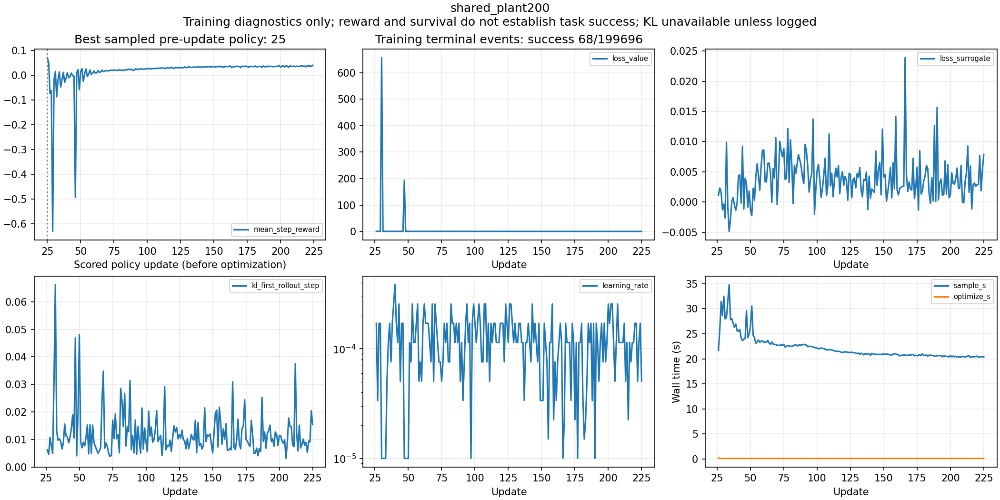

训练4469.033秒，20个周期存档；严格训练终止标志success68、failure199626、timeout2，done并集199696，事件允许重叠。后两25轮平均奖励0.034700→0.035738，value loss0.22203→0.21962，KL均值0.01010→0.01146。奖励及晚期完整链仍有上升，尚无任务收敛证明；不根据奖励直接采用或无界续训。[全部训练分窗及存档结果](SHARED_PLANT_CONVERGENCE.md)。训练完成Bark HTTP200。

冻结225的真实初差72条与同RB225的纯ECBC+ESO地面基线另行评估；基线关闭全部地面H75中层修正，包含接近段变化，不能冒充只改落地后的单因素比较。完整快照、普通路径更新、WorldMap/Route分离及RB归位动作所有权仍是纲要P0缺口；共同物理可用性已有进展，P0整体尚未通过。

原始全部结果：`rb_adaptation/shared_plant_checkpoint_comparison/`；训练：`rb_adaptation/shared_plant200/`。下文双积分器结果属于历史工程诊断，不与共同物理成绩混合排名。

## 六存档比较、真实初差与纲要P0共同物理测试

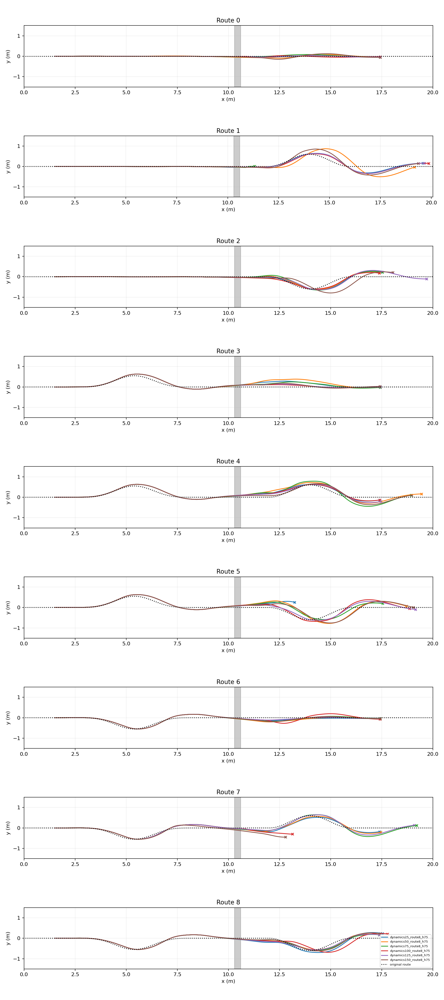

|存档|完整目标|直→直|直→左|直→右|左→直|左→左|左→右|右→直|右→左|右→右|
|---|---:|---|---|---|---|---|---|---|---|---|
|25|7/9|通过|超时|通过|通过|通过|越廊|通过|通过|通过|
|50|6/9|通过|超时|通过|通过|超时|超时|通过|通过|通过|
|75|6/9|通过|物理失败|通过|通过|超时|通过|通过|超时|通过|
|100|6/9|通过|超时|通过|通过|通过|超时|通过|越廊|通过|
|125|5/9|通过|超时|超时|通过|通过|超时|通过|超时|通过|
|150|5/9|通过|超时|通过|通过|超时|超时|通过|越廊|通过|

54回合用时444.505秒，0优化；每个checkpoint独立跑同样九路线，不拼接逐路线最优。25是这六个已评估存档中的名义DEV最佳，不是全程最佳或独立TEST结论。

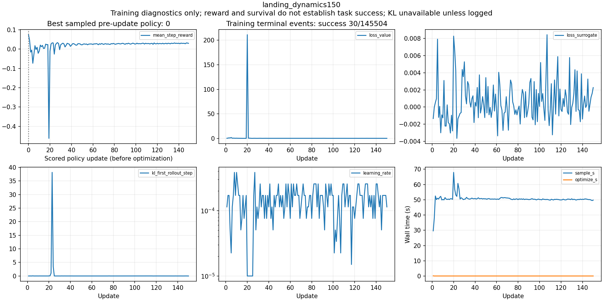

150轮训练已完成7602.236秒。后两个25轮窗口平均每步奖励0.028336→0.029471（约+4.0%），转向惩罚0.002792→0.002581，KL均值约0.0101→0.0096；完整链反而从25轮7/9降到150轮5/9。早期KL有明显尖峰。**未证明任务收敛，也不能把回报仍上涨理解为继续末档训练必然有益。** 分窗奖励、value loss、KL峰值/均值、失败事件与全部存档结果见[收敛分析](CONVERGENCE.md)。

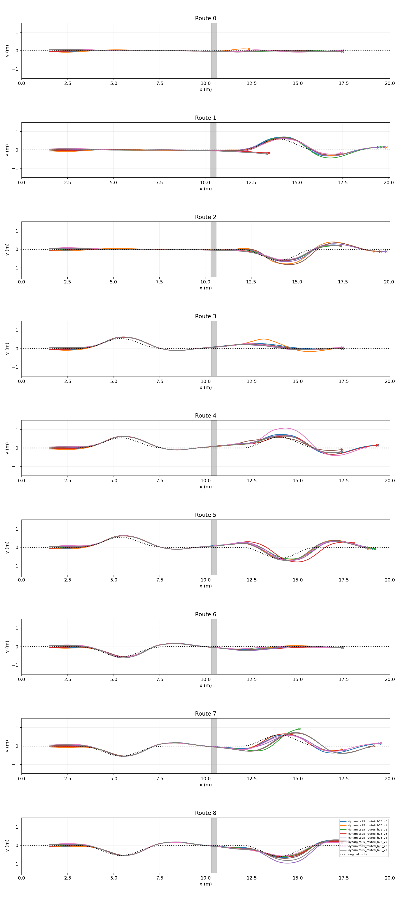

真实初差测试46/72，用时221.444秒；九路线各8条依次为7、2、5、8、5、1、8、3、7。首帧y/roll/yaw逐条核对通过，最大误差7.45e-10，确实施加了±0.05m、±0.015rad、±0.03rad，不沿用旧24名义重复标签。这是DEV条件覆盖，不是72个独立随机种子；未达到全工况稳健验收。

绕过跳跃、在x11以1.8m/s锁摆起步，原地面尾段直/左/右3/3通过。六模型均失败的直→左并非已证明地面控制器本身不可执行，当前主要差距在入口/落地交接状态，仍需保留反例。该独立起步诊断不计入完整链成功。

已开始执行纲要P0：同一个25候选、同九路线，全程统一implicitfast1ms为0/9（均进入RB后物理失败）；全程统一RK4 1ms也0/9（两条在RB前越廊，其余进入后物理失败）。旧7/9和46/72依赖双积分器，不能称共同物理P0通过。接口审计还保留动作所有权、WorldMap/Route分离、完整快照与非reset路径更新的缺口。

下一步不再从最后存档盲目追加旧双积分器训练：从选定25存档恢复Actor/critic/normalizer/Adam，在地面已可用的共同implicitfast1ms/5子步物理下追加200轮，每10个阶段更新保存一次（35、45、…225）。网络、Go2随机化、原奖励、原执行器权限和六入口不变；显式改变共同物理域，环境/历史重置，不称exact replay。共享物理分支只执行一次物理推进，取消双积分器分支的重复计算。新的共同物理模型需重新按九路线/真实初差验证；旧双积分器结果保留为工程基线。

原始结果与冻结配置：`rb_adaptation/landing_dynamics_checkpoint_comparison/`；新训练：`rb_adaptation/shared_plant200/`。等待>30分钟或本次推进累计3小时暂停助手，后台保留明确预算，不自动延长。


## 锁定条件续训完成：仍5/9，未改善完整交接

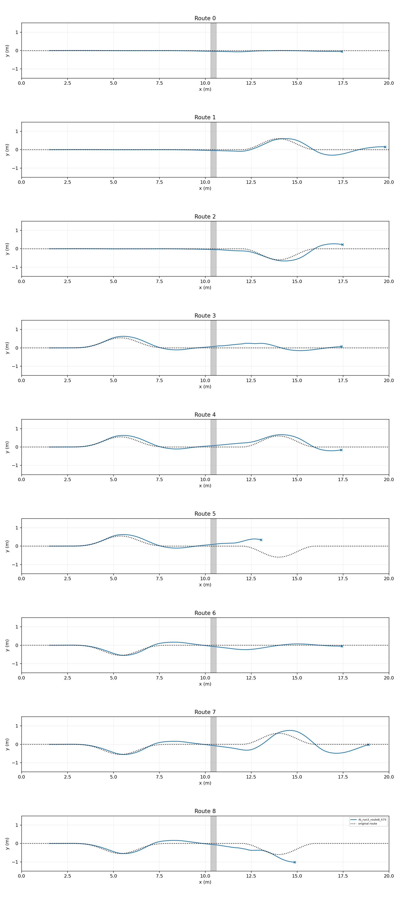

|前段|后段|锁定条件续训300|
|---|---|---|
|直线|直线|通过|
|直线|左弯|超时|
|直线|右弯|通过|
|左弯回正|直线|通过|
|左弯回正|左弯|通过|
|左弯回正|右弯|越廊|
|右弯回正|直线|通过|
|右弯回正|左弯|超时|
|右弯回正|右弯|越廊|

训练追加150更新到累计300，7760.615秒；严格完成事件7/159117，失败159109、超时1。这是随机训练终止事件，不是独立成功率。共同300checkpoint九路线仍5/9；相对归位150新增路线2/3、丢失1/8，净改善为零，未采用为更优模型。Bark训练完成回执已sent/HTTP200。

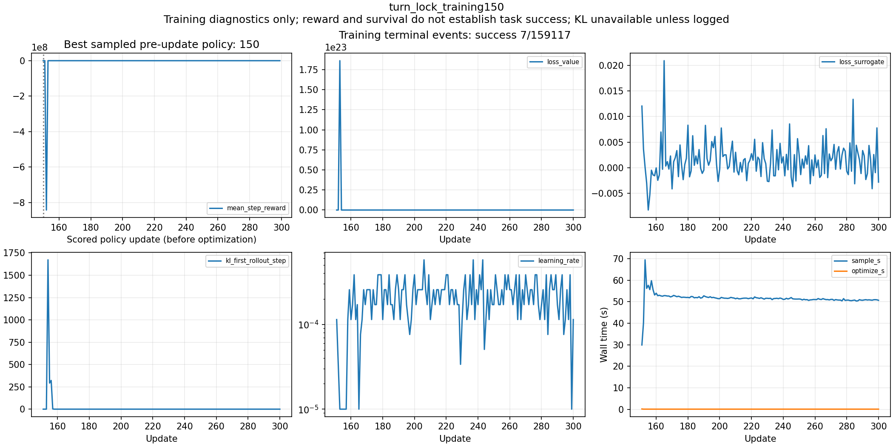

交回记录显示路线3/8转向角速度约19.911/16.156rad/s；路线3最终通过、路线8失败，所以它是待处理动态风险，不能声称唯一失败原因。路线5约8.830rad/s且交回0.5秒后航向增0.375rad，最终越廊。原奖励惩罚姿态/横向位置，但未直接惩罚落地后的横向速度、偏航角速度和转向角速度。

下一有限阶段从300的Actor/critic/normalizer初始化、fresh Adam，新增双轮远岸接地期间每20ms惩罚 `0.02*(2*vy²+0.5*yaw_rate²+0.05*steering_rate²)`，分别日志记录三项批均值。原权重为零时保留旧奖励；不加硬门控、不改执行器权限、不改九路线和最终成功门槛。六入口、Go2随机化、4096×24、严格锁定条件不变；150轮后停止，无自动延长。原奖励300保留对照；新奖励与fresh optimizer共同变化，不能称纯单因素实验。训练历史重置的部署差异仍未解决，必须完整链复测，不能从奖励推断交接成功。

原始结果与合同：`rb_adaptation/approach_departure_turns/turn_lock300_evaluation`、`landing_dynamics_protocol.json`；新run `rb_adaptation/landing_dynamics150`。

## 前弯—跳跃—后弯实测：两模型均5/9，交接尚未完成

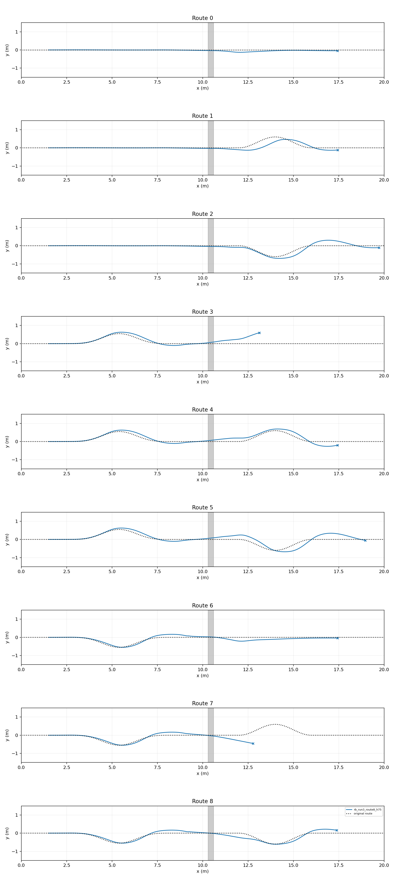

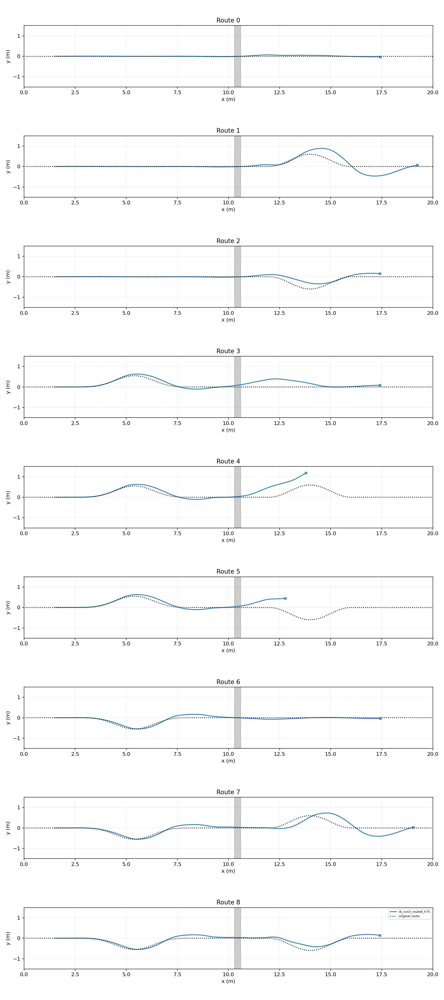

|前段|后段|归位150|父75|
|---|---|---|---|
|直线|直线|通过|通过|
|直线|左弯|通过|超时|
|直线|右弯|超时|通过|
|左弯回正|直线|越廊|通过|
|左弯回正|左弯|通过|越廊|
|左弯回正|右弯|超时|越廊|
|右弯回正|直线|通过|通过|
|右弯回正|左弯|越廊|超时|
|右弯回正|右弯|通过|通过|

同一候选覆盖九条完整链，新150耗时72.500秒，父75耗时70.278秒。新150九条均起跳、触远岸并锁后交回，完整目标仅5/9；两条超时、两条越廊，不能把回交等同任务成功。新150相对父75新增2条、丢失2条，未采用为更优模型。所有轨迹与失败在 `rb_adaptation/approach_departure_turns/{evaluation,parent_evaluation}`，DEV，不是独立成功率。

前弯实测RB入口有约−0.074/+0.067rad侧倾，旧直线约0.006rad；部分交回横向速度约−0.414m/s。归位150训练7684.585秒完成150更新，success事件1684、failure事件148410、done150091，事件标志有3次重叠，不能相加作为互斥类别或独立成功率。训练阶段Bark旧回执为URLError，未成功送达。

训练成功用关节姿态L2误差<0.15rad、速度L2<0.5rad/s，而实际锁定用每关节<0.01rad、<0.1rad/s。新有限续训用六个真实入口（两来源×三前段，去掉重复后段前缀），收紧L2到0.01rad/0.1rad/s，保证训练关节条件覆盖实际锁定条件；原Go2随机化、其他奖励、网络及4096×24不变，从150恢复权重/Adam，追加150到300。此为修改任务分布和完成条件的DEV阶段，不是单因素对照；不改变全链原最终验收。仅qpos/qvel初始化、训练历史清零，与部署继承历史仍有差异，必须复测全链。

## 当前顺序与新增覆盖（用户要求）

等待预计超过30分钟或每次恢复后累计推进达到3小时即暂停，等待用户继续；不再启动后续阶段，已授权后台任务保留原预算。

先完成 STTW→RB→STTW 交接，再按 `/home/qy/下载/Chapter3_Execution_Outline_CN.docx` 推进第三章规划；研究任务不替换，方法可调整。现有三路线跳跃前均为直线，不能作为前弯交接证据。

已准备九种组合：前段直线／左弯回正／右弯回正 × 后段直线／左弯／右弯。前弯位于x=2.5–8.3m，横向偏移峰值0.55m；沟前8.3–10.3m、沟后10.6–12.6m仍为原平地（平地不限制落地后的转弯）。地图、沟、最终目标及保持标准不变，连续运行、不重置状态。首轮每个共同checkpoint九个名义DEV回合、各最多10秒；真正初差验收另报，不与名义重复混算。

配置及路线编号：`/media/qy/6A7E3DB07E3D75C3/STTW_runs/chapter3_playground_sttw_rb_sttw/rb_adaptation/approach_departure_turns/{config,protocol}.json`。已核对路线前进性、曲率有限、前弯回正与地形配置不变；**九路线物理测试已完成，结果见上表；整体交接仍未通过**。复用现有GPU批量评测入口，交付全部实际/参考XY、失败终点以及进入RB和交回STTW的状态。

**初态标签更正：本轮24车道测试的初差未生效。** 新增initial_*参数被已有start_*初始化覆盖；直接读取保存首帧确认全部y/roll/yaw为零。下列14/24、16/24等只能解释为名义批量重复，不能称扰动验收或独立成功率；原轨迹与失败保留，各run有INITIAL_STATE_CORRECTION.json。已删除重复初始化，准备复用原start_*参数，真正的24初差组合尚未执行。

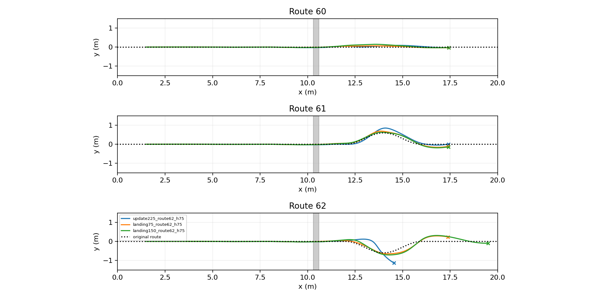

三条单名义路线：固定奖励修正阶段75模型3/3通过；父225和修正150各2/3。流程为双轮实际接触远岸且车身就绪后，RB保持车轮控制，原有限伺服主动归位，严格位置/速度条件满足后锁摆再交STTW。无物理状态重置、力矩扩权或最终判据放宽。

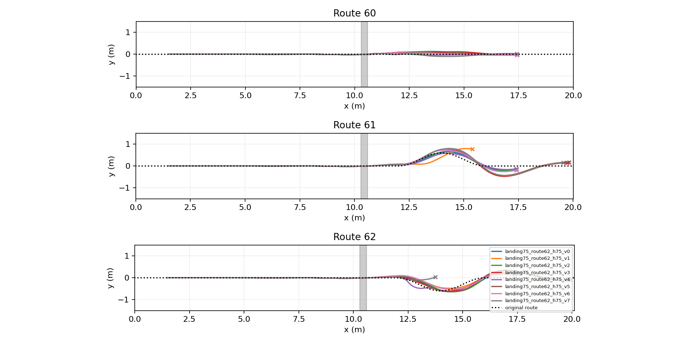

24名义重复：原轮速反馈14/24；车体真速反馈16/24（直/左/右8/4/4）；严格动态门控1/24；1.5m/s续行12/24；状态就绪再启H75为7/24。批量接触数值变化明显，不能据这些小差异宣称严格因果改善，当前没有稳健采用。23条已锁定轨迹有真实双轮远岸接触、髋膝最大漂移0.0001668rad。

已定位原流程存在任一轮触岸就可交回、未锁摆就交STTW、归位前要求已归位等问题。旧左弯交回后轮中心x10.309m仍在远岸10.6m前；落地真实车速与轮速估计也明显不同。车体速度反馈依赖仿真真值，实车需可靠估计。

**当前限定训练**：从修正75权重/fresh Adam出发，150更新训练真实部署的主动归位阶段。RB持有车轮、原权限内髋膝重力补偿归位、请求关节目标回写观测历史；RK4跳跃/implicitfast归位匹配评测，原网络、Go2随机化、奖励、严格训练成功门槛保持。8环境256步集成实际归位7次、数值有限、0优化；该150轮已完成，九路线结果见上表；旧启动记录保留在run，后续仍须真正初差验收。

训练/合同/全部原始结果：`/media/qy/6A7E3DB07E3D75C3/STTW_runs/chapter3_playground_sttw_rb_sttw/rb_adaptation`。真实初差配置true_perturbation_config.json目前只准备、未执行。用户要求续接稳定后按文件继续，文件已明确为上述执行纲要；先完成交接，再推进纲要任务。

## 累计300轮复测与奖励冲突

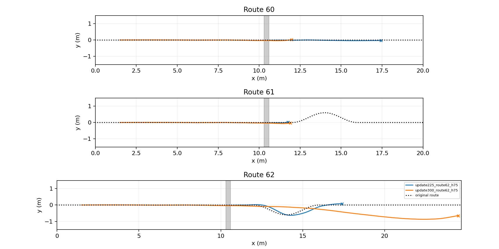

第二阶段150轮耗时4762.217秒，训练终止成功0/176881。固定225与300各三路线完整链复测共6回合102.408秒：225直线/右弯通过、左弯失败（2/3），300三条均物理失败（0/3）。225两条保持均0.505秒。300右弯驶至x24.483m后失败，图完整保留，不能裁到20m隐藏终点。无统一候选三路线通过，尚未采用。

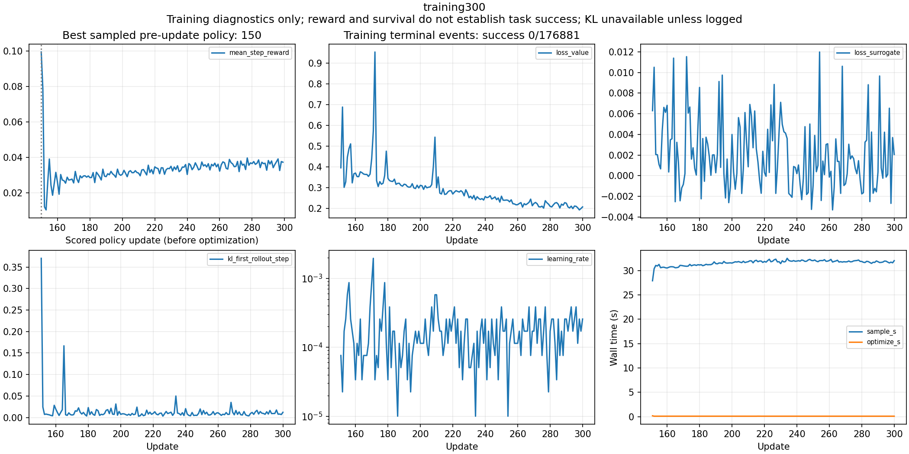

奖励代数诊断：固定其他项、匀速前进时，旧进度与速度分项每秒为2v+exp[-4(v-1.8)^2]（v≤5m/s）；1.8m/s为4.6，3.4m/s约6.8。该项明确鼓励超速；旧150模型落地前确有约3.4m/s。它是奖励方向冲突的证据，不证明所有失败由此造成。

下一有限阶段从完整链表现较好的225权重初始化，fresh Adam，进度奖励封顶1.8m/s，另加每秒-2(v-1.8)^2；网络、物理、Go2随机化、地形、原最终门槛及其他奖励不变。配置冻结到新run，150阶段轮数，4096×24，不与旧奖励数值直接排名。预计75–90分钟，超过30分钟暂停目标，后台固定预算与Bark保留。

初次导出缺少PYTHONPATH导致0物理启动失败；补正后实际结果位于[全部逐步结果](/media/qy/6A7E3DB07E3D75C3/STTW_runs/chapter3_playground_sttw_rb_sttw/rb_adaptation/full_chain300/evaluation_retry/RESULTS.md)。导出器另纠正周期模型的奖励归属：model225附带的是模型224采样分数，不能称225得分；模型权重身份与完整链实际调用未改变。

## 150轮续训与完整链复测

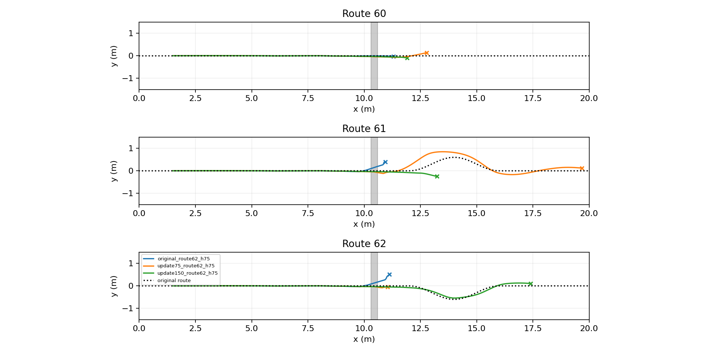

同两米平地地图、名义摩擦0.8、无高度观测偏置，原模型/75/150各三路线，共9回合145.147秒，零额外优化。原Run3完整目标0/3，75轮0/3，150轮1/3（右弯）。75轮左弯持续10秒，但8.48秒才锁摆，目标区航向误差短暂超过0.2rad，未连续保持0.5秒，仍为失败。150轮右弯5.19秒锁摆、最终保持0.505秒；直线物理失败、左弯越廊，尚未采用。不同路线不能分别挑不同checkpoint拼成统一策略通过。

150轮训练耗时4804.021秒；训练终止事件255245，成功0、物理失败255238、超时7。这是重复训练回合，不是独立测试成功率。采样best仍update0，其初始短批与后续稳态回合不同；最终能力以完整链测试为准。

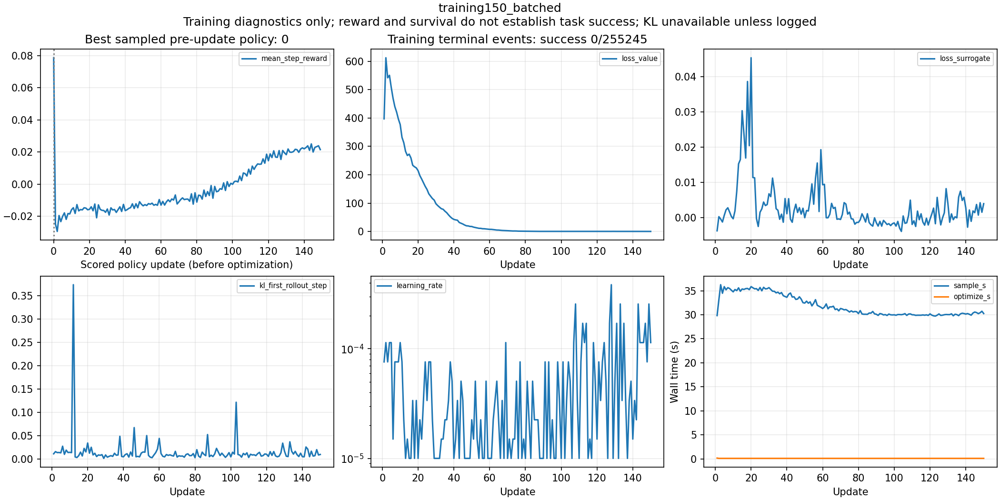

原始结果和逐步数据：[完整链报告](/media/qy/6A7E3DB07E3D75C3/STTW_runs/chapter3_playground_sttw_rb_sttw/rb_adaptation/full_chain_recheck/evaluation/RESULTS.md)；[训练日志报告](/media/qy/6A7E3DB07E3D75C3/STTW_runs/chapter3_playground_sttw_rb_sttw/rb_adaptation/training150_batched/RESULTS.md)。本次仅DEV名义筛选，未通过扰动验收。

后续限定从model150恢复Actor/Critic/normalizer及Adam，追加150轮到300；环境重新初始化，不称逐位精确恢复。地图、奖励、随机化、网络、4096环境/24步保持不变。预计75–90分钟，按用户要求暂停助手目标，后台预算与阶段Bark保留。TensorBoard：http://localhost:41961 。

## 历史标量候选比较

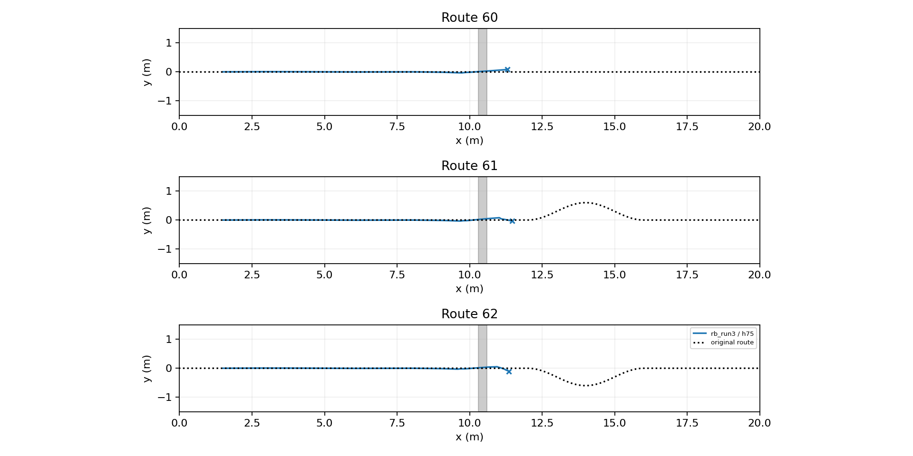

沟前x=8.3–10.3m、沟后x=10.6–12.6m为全宽平地，真实碰撞三角形高度检查通过。旧地图碎石分别侵入0.2m和0.6m，旧结果不能作为本协议验收。沟宽0.3m、两岸同高，远处最高脊坡4cm保留。

固定原高成功率RB Run3 transition_128000（actor ffe98cc0c497）；原平台任务246/250不代表当前串联任务成功率。GPU MJX-Warp物理、Torch H75/ECBC/ESO及JAX RB，DLPack共享，循环内不搬运物理状态或动作到CPU。

本批次18回合、每条最多10秒、零训练，实际耗时108.098秒。**完整目标4/18，均为直线；左右弯均未通过，任务未完成。** 六候选为RB高度观测坐标偏置0.08/0.16m × 接地后转向引导幅度0/0.08/0.15rad；高度偏置只作用于网络观测，不改变物理地形或成功判据。所有失败保留，属于名义DEV筛选，不是独立成功率估计。

|候选|直线60|左弯61|右弯62|
|---|---|---|---|
|0|goal|physical_failure|corridor_or_domain_exit|
|1|goal|physical_failure|physical_failure|
|2|corridor_or_domain_exit|physical_failure|corridor_or_domain_exit|
|3|goal|corridor_or_domain_exit|physical_failure|
|4|goal|corridor_or_domain_exit|physical_failure|
|5|physical_failure|physical_failure|physical_failure|

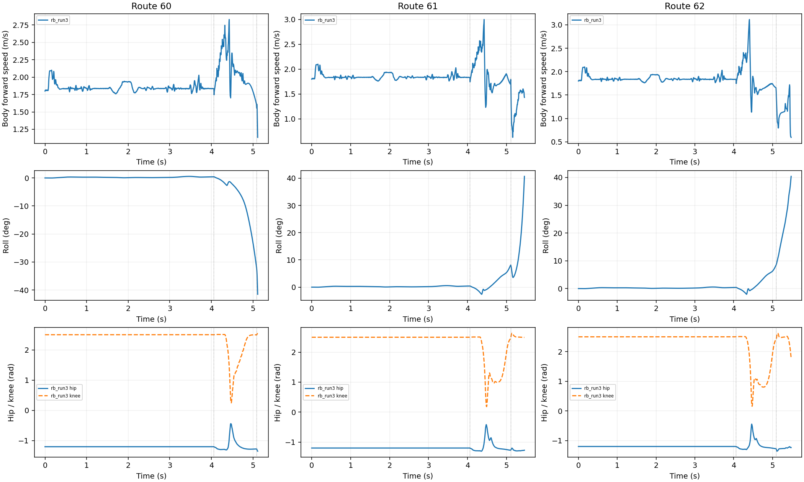

RB落地恢复期间解锁，满足车身状态后STTW接管车轮并用原有限伺服收摆，回到原构型且速度收敛才锁髋膝；不重置物理状态。轮地显式接触沿用源RB XML的condim6、friction5/.5/.0001，属于声明的新接触域，不复用原0.8地面验收。末端仍要求原位置/路径/航向/速度容差和0.5秒保持。

下一批`stable_gate`要求车身状态连续达标50/100/150ms后才交车轮，超限清零；实际回交时刻可变，不是触地后固定等待。已完成2/18，均为右弯，仍未采用。随后同地图同接触域x11独立锁摆起步的地面诊断：H75直/左/右3/3，零中层1/3（6回合34.876秒）；该诊断不算完整链成功。observer_settle为2/18，joint_settle为2/18，均未达到统一候选三路线通过。home_posture严格归位与缩摆仍为2/18（右弯），没有统一候选通过三路线；停止继续门槛/标量扫描，转向原Run3在当前同高沟任务的适配。随后已接通Playground续训，现有真实优化更新；不代表完整链通过。

完整配置、源快照、逐条轨迹和报告：`/media/qy/6A7E3DB07E3D75C3/STTW_runs/chapter3_playground_sttw_rb_sttw/flat_buffers`。历史尝试索引：`/media/qy/6A7E3DB07E3D75C3/STTW_runs/chapter3_playground_sttw_rb_sttw/iteration_summary.json`。

## 接触记录更正

安装的MJX-Warp `_get_data_into_warp` 明确跳过contact复制。此前evaluation及run3_native_rb_retry调用mjx.get_data读取CPU接触，故其“无远岸接触、无回交”字段无效，也不能作为正确回交闭环的能力结论。原始状态保留。现在直接使用GPU contact__geom/dist/pos/worldid与nacon有效掩码判断，排除轮自接触；已完成的compact_corrected阶段35处独立NumPy归约一致，后续入口已删除这个重复校验选项。

回放视频（真实终点保留）：[直线通过](/media/qy/6A7E3DB07E3D75C3/STTW_runs/chapter3_playground_sttw_rb_sttw/flat_buffers/rb_run3_route60_h75_v0.mp4)、[左弯失败](/media/qy/6A7E3DB07E3D75C3/STTW_runs/chapter3_playground_sttw_rb_sttw/flat_buffers/rb_run3_route61_h75_v0.mp4)。视频为保存状态回放，不是额外物理评测。
