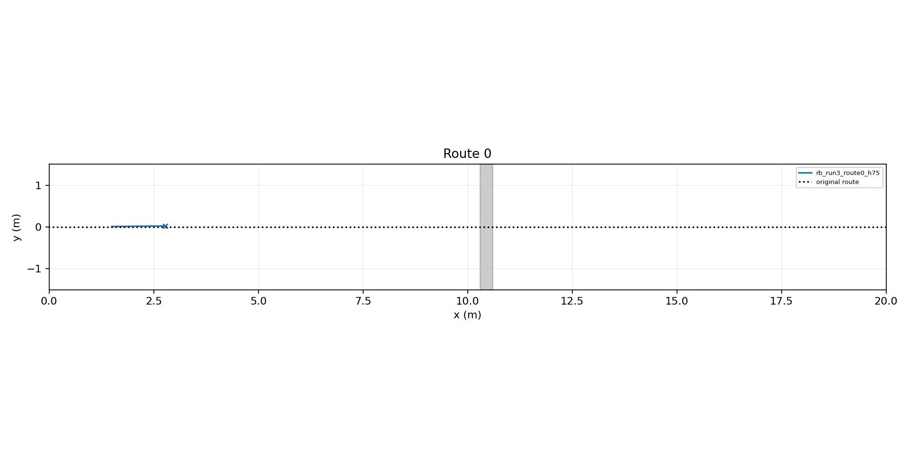

# GPU地面CEM接入与性能探针

共同六个自由三次B样条系数，固定首尾C2直线；每方向64候选×4轮、8精英，固定1.8m/s、alpha0。几何与名义动态方法共享曲线、固定地图、整车几何边界、净空及目标，违规样本仅帮助搜索，不允许发布。正式先导使用无量纲违规排序并保留均值/原直线两个候选，均计入64预算。下表是此前原始性能探针，未经正式先导改动，不混作同一任务结果。

|实现|动态左中位/P95 ms|动态右中位/P95 ms|首次动态预热 s|
|---|---:|---:|---:|
|p1_cem_probe|171.35/178.37|171.44/179.23|0.605|
|p1_cem_compiled|24.39/25.79|24.48/26.39|4.307|

相同输入、候选预算及原始排序下，融合前后四个选中参数逐值相同，两个动态预测最大状态差8.01e-5/3.81e-6。原始窄障碍探针四项均无可行计划，保留全部违反量；速度提升不代表规划有效。GPU图捕获和首次编译单列；该计时含候选生成、搜索、整车边界和同步，不含实际在线读状态/发布。

## 已发现并修复的工程问题

- GPU弧长重采样导致约4微米已承诺前缀差，第一批发布失败，未完成任何回合；直接保持解析前缀，不放宽1e-6原门槛。
- CUDA图必须保留捕获张量的所有者。几何solver被释放后约束尺度失效，根1/2出现NaN；该批几何/动态规划比较已判无效。其72条真实执行轨迹仍按实际发布路线保留。修复后严格匹配配置/地图/初始与计划数组/发布时序/执行源码，48条复用，24条重跑；不得把旧3/36对13/36写成方法收益。

实际E1先导数据与结论完成后在本目录补入。研究任务与原完整链地形不变；此处仅地面DEV，不替代P2/E2或P3/E3。

## 禁止障碍触碰的实际负例

一个独立2秒预算工程回合在0.675秒真实触碰固定障碍，正确终止为forbidden_obstacle_contact，禁止接触计数1。它不计入E1的72条分母，证明新增障碍没有被仿真碰撞或失败分类忽略；不是越野能力结果。
