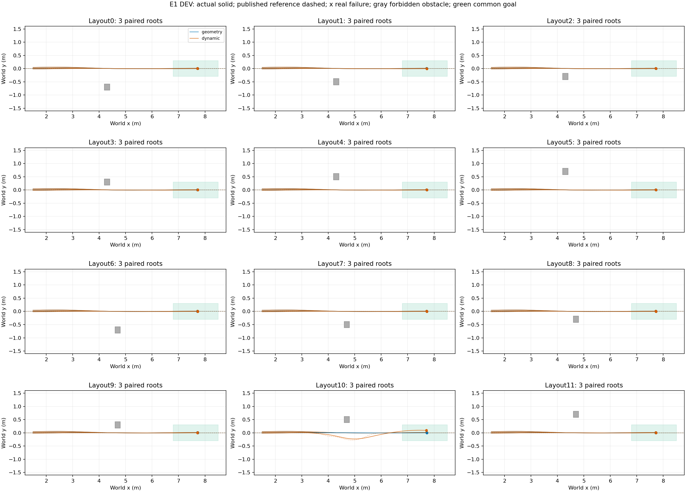

# E1地面规划先导：尚未证明动态规划收益

几何规划12/36获得可发布计划，动态规划13/36；两组物理执行均36/36到达。无计划时继续原直线，仍按预声明计为规划失败，不能把这24/23条实际到达改写成物理不可达。两方法规划完成率差2.78个百分点，按12布局重采样的描述性95%区间为0–8.33个百分点；不支持明确正向收益，也未达到原5个百分点投入门槛。

这批偏置障碍允许直线通过，未强制绕行，无法充分回答地面动态的研究问题。共享0.36m保守全车误差裕量拒绝了大量实际可行直线，不能据此判地形不可行；该裕量基于此前粗糙DEV的全局运动学界，不是安全概率保证。后续校准实际规划长度上的逐几何误差，并增加阻断直行的布局及足够的绕行/续行窗口；不通过随意减小裕量或放宽物理门槛制造优势。

动态规划双方向搜索中位49.96ms、P95 51.72ms、最大54.27ms；几何为8.77/9.52/9.77ms。包含GPU搜索、整车边界和结束同步，但不含真实在线读状态与发布；本批是从匹配保存初态离线规划、统一80ms发布，不能称实时重规划验收。查询位姿最大差3.5e-10、速度状态最大差1.57e-7；发布保留历史。当前9项约束包括净空、姿态、速度、曲率、共同出口及续行，尚未包含完整原控制器运行域的显式预测检查，因此不称P1完整通过。

原NaN几何排序对照已判无效。当前72条中48条按严格相同配置/地图/数组/时序/执行源码复用，24条因路线浮点数组变化重跑，详见reuse.json；不是重新采样72个独立初态。原始记录与真实失败保留。

# E1 ground planning DEV pilot

Static saved-state planning with shared delayed publication; no live rolling query or independent TEST. No-plan cases execute their existing straight reference but remain planner failures. See manifest for exact frozen physics, skills, maps, roots, budget and common target.

|Method|Plans /36|Physical goal /36|Task success /36|Penalized mean s|Planner median/P95/max ms|
|---|---:|---:|---:|---:|---:|
|geometry|12|36|12|4.122|8.77/9.52/9.77|
|dynamic|13|36|13|4.091|49.96/51.72/54.27|

|Layout|Root|Method|Plan|Outcome|Physical outcome|Time s|Query pose/velocity gap|Executed XY error m|
|---|---|---|---|---|---|---|---|---|
|0|0|geometry|True|goal|goal|3.365|3.49e-10/1.56e-07|0.15211445093154907|
|0|0|dynamic|True|goal|goal|3.365|3.49e-10/1.56e-07|0.06163458898663521|
|0|1|geometry|True|goal|goal|3.365|3.49e-10/9.69e-08|0.14711827039718628|
|0|1|dynamic|True|goal|goal|3.365|3.49e-10/9.69e-08|0.04963916540145874|
|0|2|geometry|True|goal|goal|3.370|2.33e-10/4.47e-08|0.13672302663326263|
|0|2|dynamic|True|goal|goal|3.370|2.33e-10/4.47e-08|0.05095560848712921|
|1|0|geometry|False|no_plan|goal|3.365|3.49e-10/1.56e-07|None|
|1|0|dynamic|False|no_plan|goal|3.365|3.49e-10/1.56e-07|None|
|1|1|geometry|False|no_plan|goal|3.365|3.49e-10/9.69e-08|None|
|1|1|dynamic|False|no_plan|goal|3.365|3.49e-10/9.69e-08|None|
|1|2|geometry|False|no_plan|goal|3.365|2.33e-10/4.47e-08|None|
|1|2|dynamic|False|no_plan|goal|3.345|2.33e-10/4.47e-08|None|
|2|0|geometry|False|no_plan|goal|3.365|3.49e-10/1.56e-07|None|
|2|0|dynamic|False|no_plan|goal|3.365|3.49e-10/1.56e-07|None|
|2|1|geometry|False|no_plan|goal|3.365|3.49e-10/9.69e-08|None|
|2|1|dynamic|False|no_plan|goal|3.365|3.49e-10/9.69e-08|None|
|2|2|geometry|False|no_plan|goal|3.365|2.33e-10/4.47e-08|None|
|2|2|dynamic|False|no_plan|goal|3.365|2.33e-10/4.47e-08|None|
|3|0|geometry|False|no_plan|goal|3.365|3.49e-10/1.56e-07|None|
|3|0|dynamic|False|no_plan|goal|3.365|3.49e-10/1.56e-07|None|
|3|1|geometry|False|no_plan|goal|3.365|3.49e-10/9.69e-08|None|
|3|1|dynamic|False|no_plan|goal|3.365|3.49e-10/9.69e-08|None|
|3|2|geometry|False|no_plan|goal|3.370|2.33e-10/4.47e-08|None|
|3|2|dynamic|False|no_plan|goal|3.365|2.33e-10/4.47e-08|None|
|4|0|geometry|False|no_plan|goal|3.365|3.49e-10/1.56e-07|None|
|4|0|dynamic|False|no_plan|goal|3.365|3.49e-10/1.56e-07|None|
|4|1|geometry|False|no_plan|goal|3.365|3.49e-10/9.69e-08|None|
|4|1|dynamic|False|no_plan|goal|3.365|3.49e-10/9.69e-08|None|
|4|2|geometry|False|no_plan|goal|3.365|2.33e-10/4.47e-08|None|
|4|2|dynamic|False|no_plan|goal|3.365|2.33e-10/4.47e-08|None|
|5|0|geometry|True|goal|goal|3.365|3.49e-10/1.56e-07|0.1520484983921051|
|5|0|dynamic|True|goal|goal|3.365|3.49e-10/1.56e-07|0.06168254092335701|
|5|1|geometry|True|goal|goal|3.365|3.49e-10/9.69e-08|0.1471380889415741|
|5|1|dynamic|True|goal|goal|3.365|3.49e-10/9.69e-08|0.04968476668000221|
|5|2|geometry|True|goal|goal|3.370|2.33e-10/4.47e-08|0.14346390962600708|
|5|2|dynamic|True|goal|goal|3.365|2.33e-10/4.47e-08|0.05850476771593094|
|6|0|geometry|True|goal|goal|3.365|3.49e-10/1.56e-07|0.15213365852832794|
|6|0|dynamic|True|goal|goal|3.365|3.49e-10/1.56e-07|0.061664726585149765|
|6|1|geometry|True|goal|goal|3.365|3.49e-10/9.69e-08|0.1470632255077362|
|6|1|dynamic|True|goal|goal|3.365|3.49e-10/9.69e-08|0.049639880657196045|
|6|2|geometry|True|goal|goal|3.370|2.33e-10/4.47e-08|0.13678494095802307|
|6|2|dynamic|True|goal|goal|3.365|2.33e-10/4.47e-08|0.05865351855754852|
|7|0|geometry|False|no_plan|goal|3.365|3.49e-10/1.56e-07|None|
|7|0|dynamic|False|no_plan|goal|3.365|3.49e-10/1.56e-07|None|
|7|1|geometry|False|no_plan|goal|3.365|3.49e-10/9.69e-08|None|
|7|1|dynamic|False|no_plan|goal|3.365|3.49e-10/9.69e-08|None|
|7|2|geometry|False|no_plan|goal|3.365|2.33e-10/4.47e-08|None|
|7|2|dynamic|False|no_plan|goal|3.365|2.33e-10/4.47e-08|None|
|8|0|geometry|False|no_plan|goal|3.365|3.49e-10/1.56e-07|None|
|8|0|dynamic|False|no_plan|goal|3.365|3.49e-10/1.56e-07|None|
|8|1|geometry|False|no_plan|goal|3.365|3.49e-10/9.69e-08|None|
|8|1|dynamic|False|no_plan|goal|3.365|3.49e-10/9.69e-08|None|
|8|2|geometry|False|no_plan|goal|3.365|2.33e-10/4.47e-08|None|
|8|2|dynamic|False|no_plan|goal|3.365|2.33e-10/4.47e-08|None|
|9|0|geometry|False|no_plan|goal|3.365|3.49e-10/1.56e-07|None|
|9|0|dynamic|False|no_plan|goal|3.365|3.49e-10/1.56e-07|None|
|9|1|geometry|False|no_plan|goal|3.365|3.49e-10/9.69e-08|None|
|9|1|dynamic|False|no_plan|goal|3.365|3.49e-10/9.69e-08|None|
|9|2|geometry|False|no_plan|goal|3.370|2.33e-10/4.47e-08|None|
|9|2|dynamic|False|no_plan|goal|3.370|2.33e-10/4.47e-08|None|
|10|0|geometry|False|no_plan|goal|3.365|3.49e-10/1.56e-07|None|
|10|0|dynamic|False|no_plan|goal|3.365|3.49e-10/1.56e-07|None|
|10|1|geometry|False|no_plan|goal|3.365|3.49e-10/9.69e-08|None|
|10|1|dynamic|False|no_plan|goal|3.365|3.49e-10/9.69e-08|None|
|10|2|geometry|False|no_plan|goal|3.365|2.33e-10/4.47e-08|None|
|10|2|dynamic|True|goal|goal|3.405|2.33e-10/4.47e-08|0.19875018298625946|
|11|0|geometry|True|goal|goal|3.365|3.49e-10/1.56e-07|0.15209978818893433|
|11|0|dynamic|True|goal|goal|3.365|3.49e-10/1.56e-07|0.06165400519967079|
|11|1|geometry|True|goal|goal|3.365|3.49e-10/9.69e-08|0.15224862098693848|
|11|1|dynamic|True|goal|goal|3.365|3.49e-10/9.69e-08|0.049638621509075165|
|11|2|geometry|True|goal|goal|3.370|2.33e-10/4.47e-08|0.13681134581565857|
|11|2|dynamic|True|goal|goal|3.365|2.33e-10/4.47e-08|0.05855023115873337|

Prediction comparisons use only the committed, actually executed route and stop at the real terminal state. Rejected hypothetical curves are not scored as executed predictions. The shared .36m engineering margin is not a probability or safety guarantee. Planner timing includes both topologies and GPU synchronization but not live state acquisition, initial graph compilation or the physical publication call. No claim of complete online 200ms acceptance.
